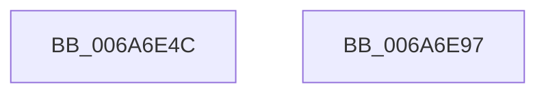

# IpmiLibpGetTimeout

- RVA: `0x006A6E4C`–`0x006A6E98` (길이 `76` bytes)
- VA: `0x00000001406A6E4C`
- 실행 섹션: `.text`
- PDB 이름 있음: `예`; PDB Function 태그: `아니요`
- unwind 정보 RVA: `0x000805BC`
- 디코드: `21`개 명령, `76/76` bytes 표시
- 미해석 바이트: `0` (있으면 어셈블리에 `.byte`로 보존)

> 이 문서는 커널 이미지의 기계어와 PDB 기호를 분석해 생성했습니다. 4번과 5번은 함수 원형과 자료형을 바이너리 사용 방식에서 추정한 C 해석이며 원본 소스 복구 결과는 아닙니다.

## 1. Dependencies

- 직접 호출 지점: **1**; 고유 호출 대상: **1**
- 직접 호출자로 확인된 함수: **2**
- RIP 상대 이미지 참조: **0**

### Outgoing calls
- `0x006A6E63` → [KeQueryPerformanceCounter](../37/KeQueryPerformanceCounter_function_0037E7E0.md) (function, `0x0037E7E0`)

### Direct callers
- [IpmiLibpKcsRequestAndReceive](IpmiLibpKcsRequestAndReceive_function_006A7210.md) at `0x006A7252`
- [IpmiLibpKcsSpinRegister](IpmiLibpKcsSpinRegister_function_006A74A8.md) at `0x006A74D7`

### Static image references
- 디코드된 RIP-relative 메모리 참조가 없습니다.

## 2. Other-region calls and transfers

- 다른 실행 섹션으로 향하는 call: **0**
- 별도 외부 분기/꼬리 이동을 확인하지 못했습니다.

## 3. Assembly (complete function range)

```asm
006A6E4C  48 89 4C 24 08                  mov qword ptr [rsp + 8], rcx
006A6E51  53                              push rbx
006A6E52  48 83 EC 20                     sub rsp, 0x20
006A6E56  48 83 64 24 30 00               and qword ptr [rsp + 0x30], 0
006A6E5C  48 8D 4C 24 30                  lea rcx, [rsp + 0x30]
006A6E61  8B DA                           mov ebx, edx
006A6E63  E8 78 79 CD FF                  call 0x14037e7e0
006A6E68  48 8B C8                        mov rcx, rax
006A6E6B  48 B8 DB 34 B6 D7 82 DE 1B 43   movabs rax, 0x431bde82d7b634db
006A6E75  48 F7 6C 24 30                  imul qword ptr [rsp + 0x30]
006A6E7A  48 C1 FA 12                     sar rdx, 0x12
006A6E7E  48 8B C2                        mov rax, rdx
006A6E81  48 C1 E8 3F                     shr rax, 0x3f
006A6E85  48 03 D0                        add rdx, rax
006A6E88  8B C3                           mov eax, ebx
006A6E8A  48 0F AF C2                     imul rax, rdx
006A6E8E  48 03 C1                        add rax, rcx
006A6E91  48 83 C4 20                     add rsp, 0x20
006A6E95  5B                              pop rbx
006A6E96  C3                              ret
006A6E97  CC                              int3
```

## 4. C-style interpretation (structured pseudocode)

```c
__int64 __fastcall IpmiLibpGetTimeout(__int64 a1, __int64 a2)
{
    __int64 result;
    __int64 v_rsp;
    unsigned __int64 v_stack_p8;

    v_stack_p8 = a1;
    v_rsp = (v_rsp) - (32);
    result = KeQueryPerformanceCounter(v_stack_p8, a2, a3, a4);
    a2 = (a2) >> (18);
    result = (a2) >> (63);
    a2 = (a2) + (result);
    result = ((unsigned int)((unsigned int)((unsigned int)((unsigned int)(a2))))) * (a2);
    result = (result) + (result);
    v_rsp = (v_rsp) + (32);
    return result;
}
```

## 5. (Beta) C Style

```c
int64_t IpmiLibpGetTimeout(int64_t Arg1, int64_t Arg2)
{
    int64_t result;
    int64_t local_rsp;
    uint64_t v_stack_p8;

    v_stack_p8 = Arg1;
    local_rsp = (local_rsp) - (32);
    result = KeQueryPerformanceCounter(v_stack_p8, Arg2, a3, a4);
    Arg2 = (Arg2) >> (18);
    result = (Arg2) >> (63);
    Arg2 = (Arg2) + (result);
    result = ((uint32_t)((uint32_t)((uint32_t)((uint32_t)(Arg2))))) * (Arg2);
    result = (result) + (result);
    local_rsp = (local_rsp) + (32);
    return result;
}
```

## 6. Execution-region graph

[열기: 2D/3D 그래프와 함수 탐색 컨트롤 패널](../../../control-panel.html?section=text&rva=0x006A6E4C&view=graph)

- 2D 그래프는 위에서 아래로 흐르고, 3D 그래프는 빈 공간을 드래그해 회전합니다. Shift+드래그는 이동, 휠은 확대·축소, 함수 노드 선택은 대상 보고서 이동입니다.

### Static fallback


