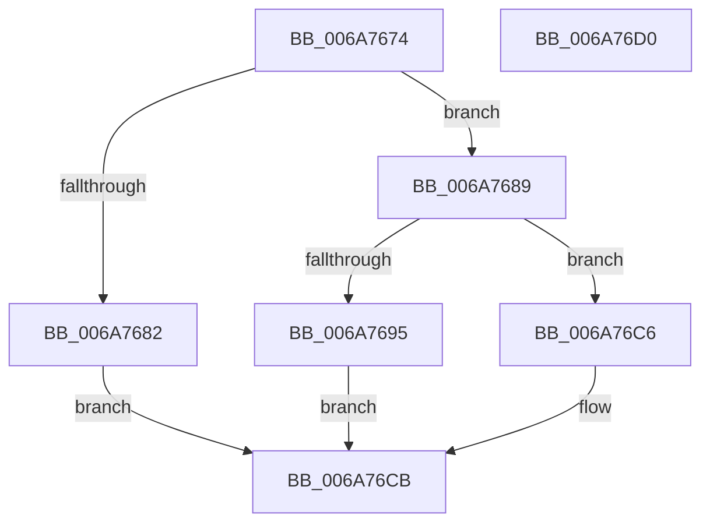

# IpmiLibpHandleErrorInterrupt

- RVA: `0x006A7674`–`0x006A76D1` (길이 `93` bytes)
- VA: `0x00000001406A7674`
- 실행 섹션: `.text`
- PDB 이름 있음: `예`; PDB Function 태그: `아니요`
- unwind 정보 RVA: `0x00063458`
- 디코드: `25`개 명령, `93/93` bytes 표시
- 미해석 바이트: `0` (있으면 어셈블리에 `.byte`로 보존)

> 이 문서는 커널 이미지의 기계어와 PDB 기호를 분석해 생성했습니다. 4번과 5번은 함수 원형과 자료형을 바이너리 사용 방식에서 추정한 C 해석이며 원본 소스 복구 결과는 아닙니다.

## 1. Dependencies

- 직접 호출 지점: **1**; 고유 호출 대상: **1**
- 직접 호출자로 확인된 함수: **1**
- RIP 상대 이미지 참조: **4**

### Outgoing calls
- `0x006A76B3` → [guard_dispatch_icall](../6B/guard_dispatch_icall_function_006BAAD0.md) (function, `0x006BAAD0`)

### Direct callers
- [IpmiLibpKcsHandleError](IpmiLibpKcsHandleError_function_006A6F48.md) at `0x006A6FA7`
- [IpmiLibpKcsHandleError](IpmiLibpKcsHandleError_function_006A6F48.md) at `0x006A6FE2`
- [IpmiLibpKcsHandleError](IpmiLibpKcsHandleError_function_006A6F48.md) at `0x006A703C`

### Static image references
- `0x006A7678` → RVA `0x00EFA0A0` (`.data`; read)
- `0x006A7689` → RVA `0x00EFA0B0` (`.data`; read)
- `0x006A7695` → RVA `0x00EFA0B8` (`.data`; read)
- `0x006A76AC` → RVA `0x00EFA080` (`.data`; read)

## 2. Other-region calls and transfers

- 다른 실행 섹션으로 향하는 call: **0**
- 별도 외부 분기/꼬리 이동을 확인하지 못했습니다.

## 3. Assembly (complete function range)

```asm
006A7674  48 83 EC 48                     sub rsp, 0x48
006A7678  8B 05 22 2A 85 00               mov eax, dword ptr [rip + 0x852a22]
006A767E  A8 01                           test al, 1
006A7680  75 07                           jne 0x1406a7689
006A7682  B8 02 00 00 C0                  mov eax, 0xc0000002
006A7687  EB 42                           jmp 0x1406a76cb
006A7689  48 8B 05 20 2A 85 00            mov rax, qword ptr [rip + 0x852a20]
006A7690  48 85 C0                        test rax, rax
006A7693  74 31                           je 0x1406a76c6
006A7695  48 8B 0D 1C 2A 85 00            mov rcx, qword ptr [rip + 0x852a1c]
006A769C  C6 44 24 28 00                  mov byte ptr [rsp + 0x28], 0
006A76A1  4C 89 4C 24 20                  mov qword ptr [rsp + 0x20], r9
006A76A6  4D 8B C8                        mov r9, r8
006A76A9  4C 8B C2                        mov r8, rdx
006A76AC  48 8D 15 CD 29 85 00            lea rdx, [rip + 0x8529cd]
006A76B3  E8 18 34 01 00                  call 0x1406baad0
006A76B8  85 C0                           test eax, eax
006A76BA  B9 0D 00 00 C0                  mov ecx, 0xc000000d
006A76BF  0F 48 C8                        cmovs ecx, eax
006A76C2  8B C1                           mov eax, ecx
006A76C4  EB 05                           jmp 0x1406a76cb
006A76C6  B8 0D 00 00 C0                  mov eax, 0xc000000d
006A76CB  48 83 C4 48                     add rsp, 0x48
006A76CF  C3                              ret
006A76D0  CC                              int3
```

## 4. C-style interpretation (structured pseudocode)

```c
__int64 __fastcall IpmiLibpHandleErrorInterrupt(__int64 a1, __int64 a2, __int64 a3, __int64 a4)
{
    __int64 result;
    __int64 v_rsp;
    unsigned __int8 v_stack_m20;
    unsigned __int64 v_stack_m28;

    v_rsp = (v_rsp) - (72);
    if ((((unsigned __int8)((unsigned int)(*(unsigned int *)(v_rip + 8727074)))) & (1)) != 0) goto loc_006A7689;
    goto loc_006A76CB;
loc_006A7689:
    if (*(unsigned __int64 *)(v_rip + 8727072) == 0) goto loc_006A76C6;
    v_stack_m20 = 0;
    v_stack_m28 = a4;
    result = guard_dispatch_icall(*(unsigned __int64 *)(v_rip + 8727068), v_rip + 8726989, a2, a3);
    a1 = (unsigned int)(0xC000000DULL);
    if (sign_flag) { a1 = (unsigned int)(result); }
    goto loc_006A76CB;
loc_006A76C6:
loc_006A76CB:
    v_rsp = (v_rsp) + (72);
    return (unsigned int)(0xC000000DULL);
}
```

## 5. (Beta) C Style

```c
int64_t IpmiLibpHandleErrorInterrupt(int64_t Arg1, int64_t Arg2, int64_t Arg3, int64_t Arg4)
{
    int64_t result;
    int64_t local_rsp;
    uint8_t v_stack_m20;
    uint64_t v_stack_m28;

    local_rsp = (local_rsp) - (72);
    if ((((uint8_t)((uint32_t)(*(uint32_t *)(v_rip + 0x852A22)))) & (1)) != 0) goto loc_006A7689;
    goto loc_006A76CB;
loc_006A7689:
    if (*(uint64_t *)(v_rip + 0x852A20) == 0) goto loc_006A76C6;
    v_stack_m20 = 0;
    v_stack_m28 = Arg4;
    result = guard_dispatch_icall(*(uint64_t *)(v_rip + 0x852A1C), v_rip + 8726989, Arg2, Arg3);
    Arg1 = (uint32_t)(0xC000000DULL);
    if (sign_flag) { Arg1 = (uint32_t)(result); }
    goto loc_006A76CB;
loc_006A76C6:
loc_006A76CB:
    local_rsp = (local_rsp) + (72);
    return (uint32_t)(0xC000000DULL);
}
```

## 6. Execution-region graph

[열기: 2D/3D 그래프와 함수 탐색 컨트롤 패널](../../../control-panel.html?section=text&rva=0x006A7674&view=graph)

- 2D 그래프는 위에서 아래로 흐르고, 3D 그래프는 빈 공간을 드래그해 회전합니다. Shift+드래그는 이동, 휠은 확대·축소, 함수 노드 선택은 대상 보고서 이동입니다.

### Static fallback


