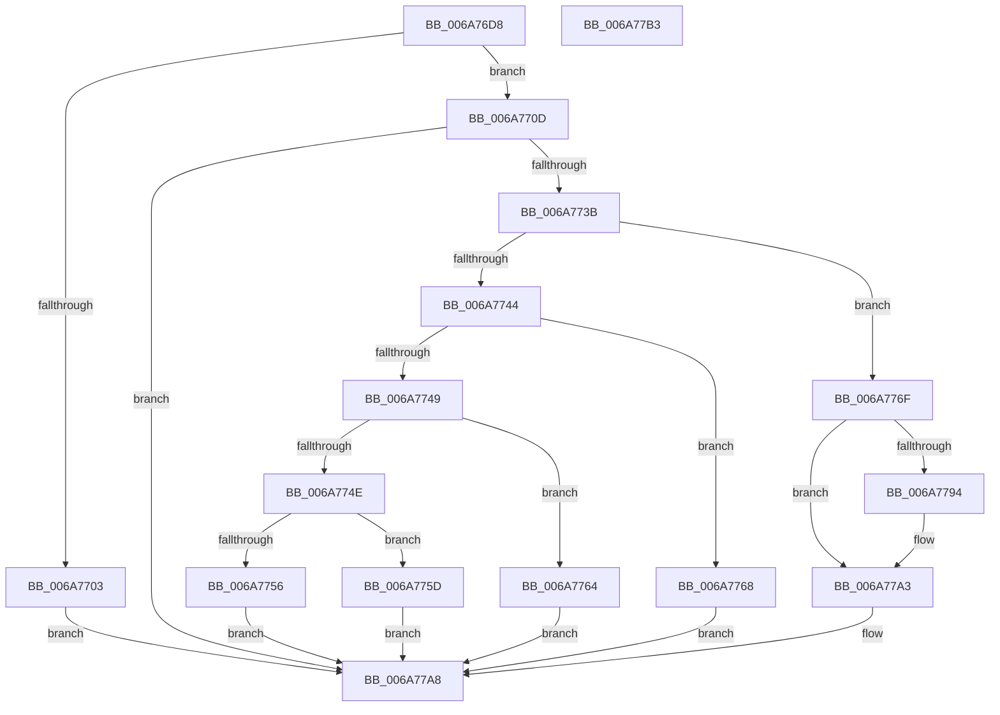

# IpmiLibpHandleReadInterrupt

- RVA: `0x006A76D8`–`0x006A77B4` (길이 `220` bytes)
- VA: `0x00000001406A76D8`
- 실행 섹션: `.text`
- PDB 이름 있음: `예`; PDB Function 태그: `아니요`
- unwind 정보 RVA: `0x000DB0BC`
- 디코드: `61`개 명령, `220/220` bytes 표시
- 미해석 바이트: `0` (있으면 어셈블리에 `.byte`로 보존)

> 이 문서는 커널 이미지의 기계어와 PDB 기호를 분석해 생성했습니다. 4번과 5번은 함수 원형과 자료형을 바이너리 사용 방식에서 추정한 C 해석이며 원본 소스 복구 결과는 아닙니다.

## 1. Dependencies

- 직접 호출 지점: **2**; 고유 호출 대상: **2**
- 직접 호출자로 확인된 함수: **1**
- RIP 상대 이미지 참조: **3**

### Outgoing calls
- `0x006A7732` → [guard_dispatch_icall](../6B/guard_dispatch_icall_function_006BAAD0.md) (function, `0x006BAAD0`)
- `0x006A7774` → [IpmiLibWriteOneByte](IpmiLibWriteOneByte_function_006A69F8.md) (function, `0x006A69F8`)

### Direct callers
- [IpmiLibpKcsReceiveResponseFromBmc](IpmiLibpKcsReceiveResponseFromBmc_function_006A7098.md) at `0x006A70EF`

### Static image references
- `0x006A76F3` → RVA `0x00EFA0B0` (`.data`; read)
- `0x006A7721` → RVA `0x00EFA0B8` (`.data`; read)
- `0x006A772B` → RVA `0x00EFA080` (`.data`; read)

## 2. Other-region calls and transfers

- 다른 실행 섹션으로 향하는 call: **0**
- 별도 외부 분기/꼬리 이동을 확인하지 못했습니다.

## 3. Assembly (complete function range)

```asm
006A76D8  48 8B C4                        mov rax, rsp
006A76DB  48 89 58 10                     mov qword ptr [rax + 0x10], rbx
006A76DF  48 89 48 08                     mov qword ptr [rax + 8], rcx
006A76E3  57                              push rdi
006A76E4  48 83 EC 50                     sub rsp, 0x50
006A76E8  C6 40 E8 00                     mov byte ptr [rax - 0x18], 0
006A76EC  49 8B D8                        mov rbx, r8
006A76EF  C6 40 08 00                     mov byte ptr [rax + 8], 0
006A76F3  48 8B 05 B6 29 85 00            mov rax, qword ptr [rip + 0x8529b6]
006A76FA  41 0F B7 F9                     movzx edi, r9w
006A76FE  48 85 C0                        test rax, rax
006A7701  75 0A                           jne 0x1406a770d
006A7703  B8 0D 00 00 C0                  mov eax, 0xc000000d
006A7708  E9 9B 00 00 00                  jmp 0x1406a77a8
006A770D  48 8D 4C 24 40                  lea rcx, [rsp + 0x40]
006A7712  C6 44 24 28 00                  mov byte ptr [rsp + 0x28], 0
006A7717  48 89 4C 24 20                  mov qword ptr [rsp + 0x20], rcx
006A771C  4C 8D 4C 24 60                  lea r9, [rsp + 0x60]
006A7721  48 8B 0D 90 29 85 00            mov rcx, qword ptr [rip + 0x852990]
006A7728  4C 8B C2                        mov r8, rdx
006A772B  48 8D 15 4E 29 85 00            lea rdx, [rip + 0x85294e]
006A7732  E8 99 33 01 00                  call 0x1406baad0
006A7737  85 C0                           test eax, eax
006A7739  78 6D                           js 0x1406a77a8
006A773B  0F B6 4C 24 60                  movzx ecx, byte ptr [rsp + 0x60]
006A7740  85 C9                           test ecx, ecx
006A7742  74 2B                           je 0x1406a776f
006A7744  83 E9 01                        sub ecx, 1
006A7747  74 1F                           je 0x1406a7768
006A7749  83 E9 01                        sub ecx, 1
006A774C  74 16                           je 0x1406a7764
006A774E  81 F9 FD 00 00 00               cmp ecx, 0xfd
006A7754  74 07                           je 0x1406a775d
006A7756  B8 01 00 00 C0                  mov eax, 0xc0000001
006A775B  EB 4B                           jmp 0x1406a77a8
006A775D  B8 3E 00 00 C0                  mov eax, 0xc000003e
006A7762  EB 44                           jmp 0x1406a77a8
006A7764  33 C0                           xor eax, eax
006A7766  EB 40                           jmp 0x1406a77a8
006A7768  B8 02 01 00 00                  mov eax, 0x102
006A776D  EB 39                           jmp 0x1406a77a8
006A776F  41 B0 68                        mov r8b, 0x68
006A7772  33 D2                           xor edx, edx
006A7774  E8 7F F2 FF FF                  call 0x1406a69f8
006A7779  4C 8B 84 24 80 00 00 00         mov r8, qword ptr [rsp + 0x80]
006A7781  8B C7                           mov eax, edi
006A7783  41 B9 01 00 00 00               mov r9d, 1
006A7789  41 2B C1                        sub eax, r9d
006A778C  41 0F B7 10                     movzx edx, word ptr [r8]
006A7790  3B D0                           cmp edx, eax
006A7792  7F 0F                           jg 0x1406a77a3
006A7794  8A 44 24 40                     mov al, byte ptr [rsp + 0x40]
006A7798  88 04 1A                        mov byte ptr [rdx + rbx], al
006A779B  66 41 03 D1                     add dx, r9w
006A779F  66 41 89 10                     mov word ptr [r8], dx
006A77A3  B8 05 01 00 00                  mov eax, 0x105
006A77A8  48 8B 5C 24 68                  mov rbx, qword ptr [rsp + 0x68]
006A77AD  48 83 C4 50                     add rsp, 0x50
006A77B1  5F                              pop rdi
006A77B2  C3                              ret
006A77B3  CC                              int3
```

## 4. C-style interpretation (structured pseudocode)

```c
__int64 __fastcall IpmiLibpHandleReadInterrupt(__int64 a1, __int64 a2, __int64 a3, unsigned __int16 a4, __int64 a5)
{
    __int64 result;
    __int64 v_rsp;
    unsigned __int64 v_stack_m18;
    unsigned __int8 v_stack_m30;
    unsigned __int64 v_stack_m38;
    unsigned __int64 v_stack_p10;
    unsigned __int64 v_stack_p8;

    *(unsigned __int64 *)(v_rsp + 16) = v_rbx;
    *(unsigned __int64 *)(v_rsp + 8) = a1;
    v_rsp = (v_rsp) - (80);
    *(unsigned __int8 *)(v_rsp - 24) = 0;
    *(unsigned __int8 *)(v_rsp + 8) = 0;
    if (*(unsigned __int64 *)(v_rip + 8726966) != 0) goto loc_006A770D;
    goto loc_006A77A8;
loc_006A770D:
    v_stack_m30 = 0;
    v_stack_m38 = v_stack_m18;
    result = guard_dispatch_icall(*(unsigned __int64 *)(v_rip + 8726928), v_rip + 8726862, a2, v_stack_p8);
    if (sign_flag) goto loc_006A77A8;
    if ((unsigned int)(v_stack_p8) == 0) goto loc_006A776F;
    a1 = (unsigned int)((v_stack_p8) - (1));
    if (condition_is_equal) goto loc_006A7768;
    a1 = (unsigned int)((a1) - (1));
    if (condition_is_equal) goto loc_006A7764;
    if (((unsigned int)(a1)) == 253) goto loc_006A775D;
    goto loc_006A77A8;
loc_006A775D:
    goto loc_006A77A8;
loc_006A7764:
    result = 0;
    goto loc_006A77A8;
loc_006A7768:
    goto loc_006A77A8;
loc_006A776F:
    a2 = 0;
    result = IpmiLibWriteOneByte(a1, a2, 104, v_stack_p8);
    result = (unsigned int)(((unsigned int)(a4)) - (1));
    if (((unsigned int)(*(unsigned __int16 *)(a5))) <= ((unsigned int)(result))) {
        result = v_stack_m18;
        *(unsigned __int8 *)(*(unsigned __int16 *)(a5) + a3 * 1) = (unsigned __int8)(result);
        a2 = (unsigned __int16)((*(unsigned __int16 *)(a5)) + (1));
        *(unsigned __int16 *)(a5) = (unsigned __int16)(a2);
    }
loc_006A77A8:
    v_rsp = (v_rsp) + (80);
    return 261;
}
```

## 5. (Beta) C Style

```c
int64_t IpmiLibpHandleReadInterrupt(int64_t Arg1, int64_t Arg2, int64_t Arg3, uint16_t Arg4, void *Arg5)
{
    uint8_t *arg5 = (uint8_t *)Arg5;

    int64_t result;
    int64_t local_rsp;
    uint64_t v_stack_m18;
    uint8_t v_stack_m30;
    uint64_t v_stack_m38;
    uint64_t v_stack_p10;
    uint64_t v_stack_p8;

    *(uint64_t *)(local_rsp + 0x10) = local_rbx;
    *(uint64_t *)(local_rsp + 0x8) = Arg1;
    local_rsp = (local_rsp) - (80);
    *(uint8_t *)(local_rsp - 0x18) = 0;
    *(uint8_t *)(local_rsp + 0x8) = 0;
    if (*(uint64_t *)(v_rip + 0x8529B6) != 0) goto loc_006A770D;
    goto loc_006A77A8;
loc_006A770D:
    v_stack_m30 = 0;
    v_stack_m38 = v_stack_m18;
    result = guard_dispatch_icall(*(uint64_t *)(v_rip + 0x852990), v_rip + 8726862, Arg2, v_stack_p8);
    if (sign_flag) goto loc_006A77A8;
    if ((uint32_t)(v_stack_p8) == 0) goto loc_006A776F;
    Arg1 = (uint32_t)((v_stack_p8) - (1));
    if (condition_is_equal) goto loc_006A7768;
    Arg1 = (uint32_t)((Arg1) - (1));
    if (condition_is_equal) goto loc_006A7764;
    if (((uint32_t)(Arg1)) == 253) goto loc_006A775D;
    goto loc_006A77A8;
loc_006A775D:
    goto loc_006A77A8;
loc_006A7764:
    result = 0;
    goto loc_006A77A8;
loc_006A7768:
    goto loc_006A77A8;
loc_006A776F:
    Arg2 = 0;
    result = IpmiLibWriteOneByte(Arg1, Arg2, 104, v_stack_p8);
    result = (uint32_t)(((uint32_t)(Arg4)) - (1));
    if (((uint32_t)(*(uint16_t *)(arg5))) <= ((uint32_t)(result))) {
        result = v_stack_m18;
        *(uint8_t *)(*(uint16_t *)(arg5) + Arg3 * 1) = (uint8_t)(result);
        Arg2 = (uint16_t)((*(uint16_t *)(arg5)) + (1));
        *(uint16_t *)(arg5) = (uint16_t)(Arg2);
    }
loc_006A77A8:
    local_rsp = (local_rsp) + (80);
    return 261;
}
```

### 관측된 메모리 오프셋

구조체 형식이 확인되지 않은 접근은 인자 기준의 오프셋으로만 기록했습니다.

| 기준 인자 | 오프셋 표현 | 폭 (bit) | 접근 |
|---|---:|---:|---|
| `Arg5` | `+ 0x0` | `16` | `R` |
| `Arg5` | `+ 0x0` | `16` | `W` |

## 6. Execution-region graph

[열기: 2D/3D 그래프와 함수 탐색 컨트롤 패널](../../../control-panel.html?section=text&rva=0x006A76D8&view=graph)

- 2D 그래프는 위에서 아래로 흐르고, 3D 그래프는 빈 공간을 드래그해 회전합니다. Shift+드래그는 이동, 휠은 확대·축소, 함수 노드 선택은 대상 보고서 이동입니다.

### Static fallback


