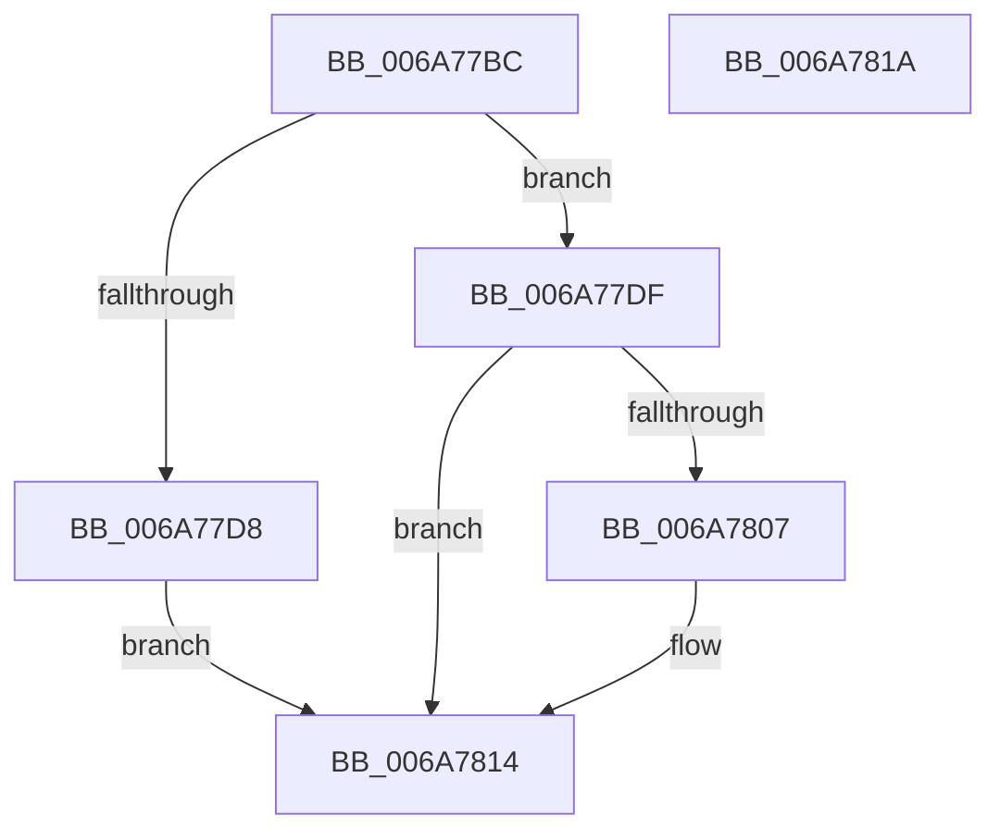

# IpmiLibpHandleSendInterrupt

- RVA: `0x006A77BC`–`0x006A781B` (길이 `95` bytes)
- VA: `0x00000001406A77BC`
- 실행 섹션: `.text`
- PDB 이름 있음: `예`; PDB Function 태그: `아니요`
- unwind 정보 RVA: `0x000DB0B0`
- 디코드: `26`개 명령, `95/95` bytes 표시
- 미해석 바이트: `0` (있으면 어셈블리에 `.byte`로 보존)

> 이 문서는 커널 이미지의 기계어와 PDB 기호를 분석해 생성했습니다. 4번과 5번은 함수 원형과 자료형을 바이너리 사용 방식에서 추정한 C 해석이며 원본 소스 복구 결과는 아닙니다.

## 1. Dependencies

- 직접 호출 지점: **1**; 고유 호출 대상: **1**
- 직접 호출자로 확인된 함수: **1**
- RIP 상대 이미지 참조: **3**

### Outgoing calls
- `0x006A77FE` → [guard_dispatch_icall](../6B/guard_dispatch_icall_function_006BAAD0.md) (function, `0x006BAAD0`)

### Direct callers
- [IpmiLibpKcsSendRequestToBMC](IpmiLibpKcsSendRequestToBMC_function_006A72BC.md) at `0x006A733E`
- [IpmiLibpKcsSendRequestToBMC](IpmiLibpKcsSendRequestToBMC_function_006A72BC.md) at `0x006A73A7`
- [IpmiLibpKcsSendRequestToBMC](IpmiLibpKcsSendRequestToBMC_function_006A72BC.md) at `0x006A7417`

### Static image references
- `0x006A77C6` → RVA `0x00EFA0B0` (`.data`; read)
- `0x006A77DF` → RVA `0x00EFA0B8` (`.data`; read)
- `0x006A77F2` → RVA `0x00EFA080` (`.data`; read)

## 2. Other-region calls and transfers

- 다른 실행 섹션으로 향하는 call: **0**
- 별도 외부 분기/꼬리 이동을 확인하지 못했습니다.

## 3. Assembly (complete function range)

```asm
006A77BC  48 89 4C 24 08                  mov qword ptr [rsp + 8], rcx
006A77C1  53                              push rbx
006A77C2  48 83 EC 40                     sub rsp, 0x40
006A77C6  48 8B 05 E3 28 85 00            mov rax, qword ptr [rip + 0x8528e3]
006A77CD  33 DB                           xor ebx, ebx
006A77CF  88 5C 24 50                     mov byte ptr [rsp + 0x50], bl
006A77D3  48 85 C0                        test rax, rax
006A77D6  75 07                           jne 0x1406a77df
006A77D8  B8 0D 00 00 C0                  mov eax, 0xc000000d
006A77DD  EB 35                           jmp 0x1406a7814
006A77DF  48 8B 0D D2 28 85 00            mov rcx, qword ptr [rip + 0x8528d2]
006A77E6  4C 8D 4C 24 50                  lea r9, [rsp + 0x50]
006A77EB  4C 8B C2                        mov r8, rdx
006A77EE  88 5C 24 28                     mov byte ptr [rsp + 0x28], bl
006A77F2  48 8D 15 87 28 85 00            lea rdx, [rip + 0x852887]
006A77F9  48 89 5C 24 20                  mov qword ptr [rsp + 0x20], rbx
006A77FE  E8 CD 32 01 00                  call 0x1406baad0
006A7803  85 C0                           test eax, eax
006A7805  78 0D                           js 0x1406a7814
006A7807  80 7C 24 50 FF                  cmp byte ptr [rsp + 0x50], 0xff
006A780C  B8 3E 00 00 C0                  mov eax, 0xc000003e
006A7811  0F 45 C3                        cmovne eax, ebx
006A7814  48 83 C4 40                     add rsp, 0x40
006A7818  5B                              pop rbx
006A7819  C3                              ret
006A781A  CC                              int3
```

## 4. C-style interpretation (structured pseudocode)

```c
__int64 __fastcall IpmiLibpHandleSendInterrupt(__int64 a1, __int64 a2)
{
    __int64 result;
    __int64 v_rbx;
    __int64 v_rsp;
    unsigned __int8 v_stack_m20;
    unsigned __int64 v_stack_m28;
    unsigned __int64 v_stack_p8;

    v_stack_p8 = a1;
    v_rsp = (v_rsp) - (64);
    v_rbx = 0;
    v_stack_p8 = 0;
    if (*(unsigned __int64 *)(v_rip + 8726755) != 0) goto loc_006A77DF;
    goto loc_006A7814;
loc_006A77DF:
    v_stack_m20 = 0;
    v_stack_m28 = 0;
    result = guard_dispatch_icall(*(unsigned __int64 *)(v_rip + 8726738), v_rip + 8726663, a2, v_stack_p8);
    if (!(sign_flag)) {
        result = 0xC000003EULL;
        if (v_stack_p8 != 255) { result = 0; }
    }
    v_rsp = (v_rsp) + (64);
    return result;
}
```

## 5. (Beta) C Style

```c
int64_t IpmiLibpHandleSendInterrupt(int64_t Arg1, int64_t Arg2)
{
    int64_t result;
    int64_t local_rbx;
    int64_t local_rsp;
    uint8_t v_stack_m20;
    uint64_t v_stack_m28;
    uint64_t v_stack_p8;

    v_stack_p8 = Arg1;
    local_rsp = (local_rsp) - (64);
    local_rbx = 0;
    v_stack_p8 = 0;
    if (*(uint64_t *)(v_rip + 0x8528E3) != 0) goto loc_006A77DF;
    goto loc_006A7814;
loc_006A77DF:
    v_stack_m20 = 0;
    v_stack_m28 = 0;
    result = guard_dispatch_icall(*(uint64_t *)(v_rip + 0x8528D2), v_rip + 8726663, Arg2, v_stack_p8);
    if (!(sign_flag)) {
        result = 0xC000003EULL;
        if (v_stack_p8 != 255) { result = 0; }
    }
    local_rsp = (local_rsp) + (64);
    return result;
}
```

## 6. Execution-region graph

[열기: 2D/3D 그래프와 함수 탐색 컨트롤 패널](../../../control-panel.html?section=text&rva=0x006A77BC&view=graph)

- 2D 그래프는 위에서 아래로 흐르고, 3D 그래프는 빈 공간을 드래그해 회전합니다. Shift+드래그는 이동, 휠은 확대·축소, 함수 노드 선택은 대상 보고서 이동입니다.

### Static fallback


