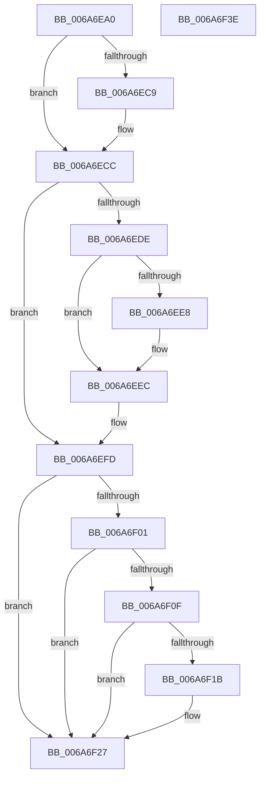

# IpmiLibpKcsBmcTransact

- RVA: `0x006A6EA0`–`0x006A6F3F` (길이 `159` bytes)
- VA: `0x00000001406A6EA0`
- 실행 섹션: `.text`
- PDB 이름 있음: `예`; PDB Function 태그: `아니요`
- unwind 정보 RVA: `0x0005C954`
- 디코드: `46`개 명령, `159/159` bytes 표시
- 미해석 바이트: `0` (있으면 어셈블리에 `.byte`로 보존)

> 이 문서는 커널 이미지의 기계어와 PDB 기호를 분석해 생성했습니다. 4번과 5번은 함수 원형과 자료형을 바이너리 사용 방식에서 추정한 C 해석이며 원본 소스 복구 결과는 아닙니다.

## 1. Dependencies

- 직접 호출 지점: **4**; 고유 호출 대상: **4**
- 직접 호출자로 확인된 함수: **1**
- RIP 상대 이미지 참조: **2**

### Outgoing calls
- `0x006A6ED3` → [IpmiLibpKcsSendRequestToBMC](IpmiLibpKcsSendRequestToBMC_function_006A72BC.md) (function, `0x006A72BC`)
- `0x006A6EF6` → [IpmiLibpKcsReceiveResponseFromBmc](IpmiLibpKcsReceiveResponseFromBmc_function_006A7098.md) (function, `0x006A7098`)
- `0x006A6F04` → [IpmiLibpKcsHandleError](IpmiLibpKcsHandleError_function_006A6F48.md) (function, `0x006A6F48`)
- `0x006A6F22` → [guard_dispatch_icall](../6B/guard_dispatch_icall_function_006BAAD0.md) (function, `0x006BAAD0`)

### Direct callers
- [IpmiLibpKcsRequestAndReceive](IpmiLibpKcsRequestAndReceive_function_006A7210.md) at `0x006A7273`

### Static image references
- `0x006A6F0F` → RVA `0x00EFA0A8` (`.data`; read)
- `0x006A6F1B` → RVA `0x00EFA0B8` (`.data`; read)

## 2. Other-region calls and transfers

- 다른 실행 섹션으로 향하는 call: **0**
- 별도 외부 분기/꼬리 이동을 확인하지 못했습니다.

## 3. Assembly (complete function range)

```asm
006A6EA0  48 89 5C 24 08                  mov qword ptr [rsp + 8], rbx
006A6EA5  48 89 6C 24 10                  mov qword ptr [rsp + 0x10], rbp
006A6EAA  48 89 74 24 18                  mov qword ptr [rsp + 0x18], rsi
006A6EAF  57                              push rdi
006A6EB0  48 83 EC 20                     sub rsp, 0x20
006A6EB4  49 8B D8                        mov rbx, r8
006A6EB7  BD 22 01 00 00                  mov ebp, 0x122
006A6EBC  44 0F B7 02                     movzx r8d, word ptr [rdx]
006A6EC0  48 8B F2                        mov rsi, rdx
006A6EC3  66 44 3B C5                     cmp r8w, bp
006A6EC7  72 03                           jb 0x1406a6ecc
006A6EC9  44 8B C5                        mov r8d, ebp
006A6ECC  48 83 C2 05                     add rdx, 5
006A6ED0  4C 8B CB                        mov r9, rbx
006A6ED3  E8 E4 03 00 00                  call 0x1406a72bc
006A6ED8  8B F8                           mov edi, eax
006A6EDA  85 C0                           test eax, eax
006A6EDC  75 1F                           jne 0x1406a6efd
006A6EDE  4C 8D 46 02                     lea r8, [rsi + 2]
006A6EE2  66 41 3B 28                     cmp bp, word ptr [r8]
006A6EE6  73 04                           jae 0x1406a6eec
006A6EE8  66 41 89 28                     mov word ptr [r8], bp
006A6EEC  48 8D 96 27 01 00 00            lea rdx, [rsi + 0x127]
006A6EF3  4C 8B CB                        mov r9, rbx
006A6EF6  E8 9D 01 00 00                  call 0x1406a7098
006A6EFB  8B F8                           mov edi, eax
006A6EFD  85 FF                           test edi, edi
006A6EFF  79 26                           jns 0x1406a6f27
006A6F01  48 8B D3                        mov rdx, rbx
006A6F04  E8 3F 00 00 00                  call 0x1406a6f48
006A6F09  8B F8                           mov edi, eax
006A6F0B  85 C0                           test eax, eax
006A6F0D  79 18                           jns 0x1406a6f27
006A6F0F  48 8B 05 92 31 85 00            mov rax, qword ptr [rip + 0x853192]
006A6F16  48 85 C0                        test rax, rax
006A6F19  74 0C                           je 0x1406a6f27
006A6F1B  48 8B 0D 96 31 85 00            mov rcx, qword ptr [rip + 0x853196]
006A6F22  E8 A9 3B 01 00                  call 0x1406baad0
006A6F27  48 8B 5C 24 30                  mov rbx, qword ptr [rsp + 0x30]
006A6F2C  8B C7                           mov eax, edi
006A6F2E  48 8B 6C 24 38                  mov rbp, qword ptr [rsp + 0x38]
006A6F33  48 8B 74 24 40                  mov rsi, qword ptr [rsp + 0x40]
006A6F38  48 83 C4 20                     add rsp, 0x20
006A6F3C  5F                              pop rdi
006A6F3D  C3                              ret
006A6F3E  CC                              int3
```

## 4. C-style interpretation (structured pseudocode)

```c
__int64 __fastcall IpmiLibpKcsBmcTransact(__int64 a1, __int64 a2, __int64 a3)
{
    __int64 result;
    __int64 v_rsp;
    unsigned __int64 v_stack_p10;
    unsigned __int64 v_stack_p18;
    unsigned __int64 v_stack_p8;

    v_stack_p8 = v_rbx;
    v_stack_p10 = v_rbp;
    v_stack_p18 = v_rsi;
    v_rsp = (v_rsp) - (32);
    if (((unsigned __int16)(*(unsigned __int16 *)(a2))) >= 290) {
        a3 = 290;
    }
    a2 = (a2) + (5);
    result = IpmiLibpKcsSendRequestToBMC(a1, a2, a3, a3);
    if ((unsigned int)(result) != 0) goto loc_006A6EFD;
    if (290 < (*(unsigned __int16 *)(a2 + 2))) {
        *(unsigned __int16 *)(a2 + 2) = 290;
    }
    result = IpmiLibpKcsReceiveResponseFromBmc(a1, a2 + 295, a2 + 2, a3);
loc_006A6EFD:
    if (!sign_flag) goto loc_006A6F27;
    result = IpmiLibpKcsHandleError(a1, a3, a2 + 2, a3);
    if (!sign_flag) goto loc_006A6F27;
    result = *(unsigned __int64 *)(v_rip + 8728978);
    if (*(unsigned __int64 *)(v_rip + 8728978) != 0) {
        a1 = *(unsigned __int64 *)(v_rip + 8728982);
        result = guard_dispatch_icall(a1, a3, a2 + 2, a3);
    }
    v_rsp = (v_rsp) + (32);
    return (unsigned int)((unsigned int)((unsigned int)((unsigned int)(result))));
}
```

## 5. (Beta) C Style

```c
int64_t IpmiLibpKcsBmcTransact(int64_t Arg1, void *Arg2, int64_t Arg3)
{
    uint8_t *arg2 = (uint8_t *)Arg2;

    int64_t result;
    int64_t local_rsp;
    uint64_t v_stack_p10;
    uint64_t v_stack_p18;
    uint64_t v_stack_p8;

    v_stack_p8 = local_rbx;
    v_stack_p10 = local_rbp;
    v_stack_p18 = local_rsi;
    local_rsp = (local_rsp) - (32);
    if (((uint16_t)(*(uint16_t *)(arg2))) >= 290) {
        Arg3 = 290;
    }
    Arg2 = (Arg2) + (5);
    result = IpmiLibpKcsSendRequestToBMC(Arg1, Arg2, Arg3, Arg3);
    if ((uint32_t)(result) != 0) goto loc_006A6EFD;
    if (290 < (*(uint16_t *)(arg2 + 0x2))) {
        *(uint16_t *)(arg2 + 0x2) = 290;
    }
    result = IpmiLibpKcsReceiveResponseFromBmc(Arg1, Arg2 + 295, Arg2 + 2, Arg3);
loc_006A6EFD:
    if (!sign_flag) goto loc_006A6F27;
    result = IpmiLibpKcsHandleError(Arg1, Arg3, Arg2 + 2, Arg3);
    if (!sign_flag) goto loc_006A6F27;
    result = *(uint64_t *)(v_rip + 0x853192);
    if (*(uint64_t *)(v_rip + 0x853192) != 0) {
        Arg1 = *(uint64_t *)(v_rip + 0x853196);
        result = guard_dispatch_icall(Arg1, Arg3, Arg2 + 2, Arg3);
    }
    local_rsp = (local_rsp) + (32);
    return (uint32_t)((uint32_t)((uint32_t)((uint32_t)(result))));
}
```

### 관측된 메모리 오프셋

구조체 형식이 확인되지 않은 접근은 인자 기준의 오프셋으로만 기록했습니다.

| 기준 인자 | 오프셋 표현 | 폭 (bit) | 접근 |
|---|---:|---:|---|
| `Arg2` | `+ 0x0` | `16` | `R` |
| `Arg2` | `+ 0x0` | `16` | `W` |
| `Arg2` | `+ 0x2` | `64` | `R` |
| `Arg2` | `+ 0x127` | `64` | `R` |

## 6. Execution-region graph

[열기: 2D/3D 그래프와 함수 탐색 컨트롤 패널](../../../control-panel.html?section=text&rva=0x006A6EA0&view=graph)

- 2D 그래프는 위에서 아래로 흐르고, 3D 그래프는 빈 공간을 드래그해 회전합니다. Shift+드래그는 이동, 휠은 확대·축소, 함수 노드 선택은 대상 보고서 이동입니다.

### Static fallback


