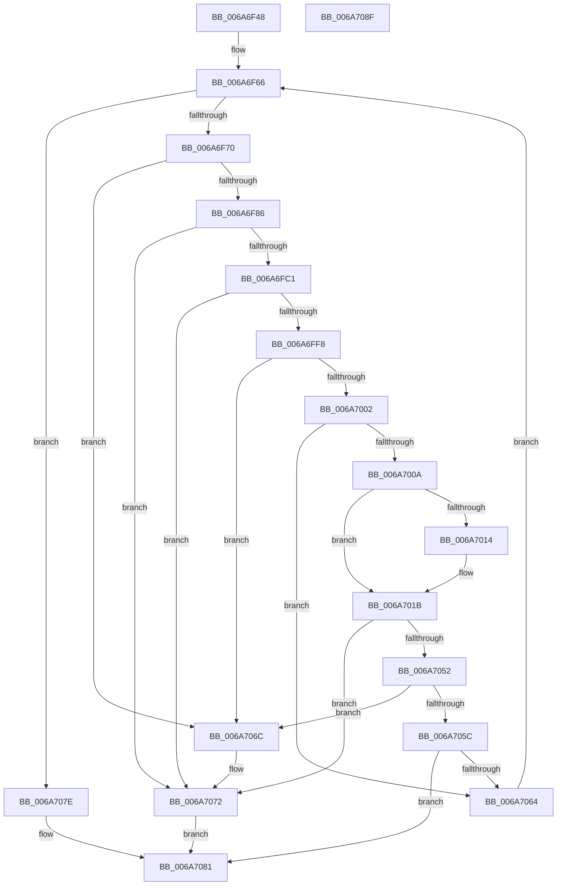

# IpmiLibpKcsHandleError

- RVA: `0x006A6F48`–`0x006A7090` (길이 `328` bytes)
- VA: `0x00000001406A6F48`
- 실행 섹션: `.text`
- PDB 이름 있음: `예`; PDB Function 태그: `아니요`
- unwind 정보 RVA: `0x00095AC0`
- 디코드: `84`개 명령, `328/328` bytes 표시
- 미해석 바이트: `0` (있으면 어셈블리에 `.byte`로 보존)

> 이 문서는 커널 이미지의 기계어와 PDB 기호를 분석해 생성했습니다. 4번과 5번은 함수 원형과 자료형을 바이너리 사용 방식에서 추정한 C 해석이며 원본 소스 복구 결과는 아닙니다.

## 1. Dependencies

- 직접 호출 지점: **9**; 고유 호출 대상: **4**
- 직접 호출자로 확인된 함수: **1**
- RIP 상대 이미지 참조: **2**

### Outgoing calls
- `0x006A6F79` → [IpmiLibpKcsSpinRegister](IpmiLibpKcsSpinRegister_function_006A74A8.md) (function, `0x006A74A8`)
- `0x006A6F95` → [IpmiLibWriteOneByte](IpmiLibWriteOneByte_function_006A69F8.md) (function, `0x006A69F8`)
- `0x006A6FA7` → [IpmiLibpHandleErrorInterrupt](IpmiLibpHandleErrorInterrupt_function_006A7674.md) (function, `0x006A7674`)
- `0x006A6FD0` → [IpmiLibWriteOneByte](IpmiLibWriteOneByte_function_006A69F8.md) (function, `0x006A69F8`)
- `0x006A6FE2` → [IpmiLibpHandleErrorInterrupt](IpmiLibpHandleErrorInterrupt_function_006A7674.md) (function, `0x006A7674`)
- `0x006A7016` → [IpmiLibReadOneByte](IpmiLibReadOneByte_function_006A69B8.md) (function, `0x006A69B8`)
- `0x006A7020` → [IpmiLibWriteOneByte](IpmiLibWriteOneByte_function_006A69F8.md) (function, `0x006A69F8`)
- `0x006A703C` → [IpmiLibpHandleErrorInterrupt](IpmiLibpHandleErrorInterrupt_function_006A7674.md) (function, `0x006A7674`)
- `0x006A7077` → [IpmiLibWriteOneByte](IpmiLibWriteOneByte_function_006A69F8.md) (function, `0x006A69F8`)

### Direct callers
- [IpmiLibpKcsBmcTransact](IpmiLibpKcsBmcTransact_function_006A6EA0.md) at `0x006A6F04`

### Static image references
- `0x006A6F89` → RVA `0x00EFA0D4` (`.data`; write)
- `0x006A700A` → RVA `0x00EFA0A0` (`.data`; read)

## 2. Other-region calls and transfers

- 다른 실행 섹션으로 향하는 call: **0**
- 별도 외부 분기/꼬리 이동을 확인하지 못했습니다.

## 3. Assembly (complete function range)

```asm
006A6F48  48 8B C4                        mov rax, rsp
006A6F4B  48 89 58 10                     mov qword ptr [rax + 0x10], rbx
006A6F4F  48 89 48 08                     mov qword ptr [rax + 8], rcx
006A6F53  57                              push rdi
006A6F54  48 83 EC 20                     sub rsp, 0x20
006A6F58  48 8B DA                        mov rbx, rdx
006A6F5B  C6 40 18 00                     mov byte ptr [rax + 0x18], 0
006A6F5F  C6 40 08 00                     mov byte ptr [rax + 8], 0
006A6F63  40 32 FF                        xor dil, dil
006A6F66  40 80 FF 0A                     cmp dil, 0xa
006A6F6A  0F 87 0E 01 00 00               ja 0x1406a707e
006A6F70  41 B8 02 00 00 00               mov r8d, 2
006A6F76  48 8B D3                        mov rdx, rbx
006A6F79  E8 2A 05 00 00                  call 0x1406a74a8
006A6F7E  85 C0                           test eax, eax
006A6F80  0F 85 E6 00 00 00               jne 0x1406a706c
006A6F86  41 B0 60                        mov r8b, 0x60
006A6F89  C7 05 41 31 85 00 04 00 00 00   mov dword ptr [rip + 0x853141], 4
006A6F93  B2 01                           mov dl, 1
006A6F95  E8 5E FA FF FF                  call 0x1406a69f8
006A6F9A  48 8B D3                        mov rdx, rbx
006A6F9D  4C 8D 4C 24 40                  lea r9, [rsp + 0x40]
006A6FA2  4C 8D 44 24 30                  lea r8, [rsp + 0x30]
006A6FA7  E8 C8 06 00 00                  call 0x1406a7674
006A6FAC  45 33 C9                        xor r9d, r9d
006A6FAF  3D 02 00 00 C0                  cmp eax, 0xc0000002
006A6FB4  44 0F 45 C8                     cmovne r9d, eax
006A6FB8  45 85 C9                        test r9d, r9d
006A6FBB  0F 85 B1 00 00 00               jne 0x1406a7072
006A6FC1  45 33 C0                        xor r8d, r8d
006A6FC4  C7 05 06 31 85 00 05 00 00 00   mov dword ptr [rip + 0x853106], 5
006A6FCE  33 D2                           xor edx, edx
006A6FD0  E8 23 FA FF FF                  call 0x1406a69f8
006A6FD5  48 8B D3                        mov rdx, rbx
006A6FD8  4C 8D 4C 24 40                  lea r9, [rsp + 0x40]
006A6FDD  4C 8D 44 24 30                  lea r8, [rsp + 0x30]
006A6FE2  E8 8D 06 00 00                  call 0x1406a7674
006A6FE7  45 33 C9                        xor r9d, r9d
006A6FEA  3D 02 00 00 C0                  cmp eax, 0xc0000002
006A6FEF  44 0F 45 C8                     cmovne r9d, eax
006A6FF3  45 85 C9                        test r9d, r9d
006A6FF6  75 7A                           jne 0x1406a7072
006A6FF8  0F B6 4C 24 30                  movzx ecx, byte ptr [rsp + 0x30]
006A6FFD  83 E9 01                        sub ecx, 1
006A7000  74 6A                           je 0x1406a706c
006A7002  81 F9 FE 00 00 00               cmp ecx, 0xfe
006A7008  74 5A                           je 0x1406a7064
006A700A  8B 05 90 30 85 00               mov eax, dword ptr [rip + 0x853090]
006A7010  A8 01                           test al, 1
006A7012  75 07                           jne 0x1406a701b
006A7014  33 D2                           xor edx, edx
006A7016  E8 9D F9 FF FF                  call 0x1406a69b8
006A701B  41 B0 68                        mov r8b, 0x68
006A701E  33 D2                           xor edx, edx
006A7020  E8 D3 F9 FF FF                  call 0x1406a69f8
006A7025  48 8B D3                        mov rdx, rbx
006A7028  C7 05 A2 30 85 00 06 00 00 00   mov dword ptr [rip + 0x8530a2], 6
006A7032  4C 8D 4C 24 40                  lea r9, [rsp + 0x40]
006A7037  4C 8D 44 24 30                  lea r8, [rsp + 0x30]
006A703C  E8 33 06 00 00                  call 0x1406a7674
006A7041  45 33 C9                        xor r9d, r9d
006A7044  3D 02 00 00 C0                  cmp eax, 0xc0000002
006A7049  44 0F 45 C8                     cmovne r9d, eax
006A704D  45 85 C9                        test r9d, r9d
006A7050  75 20                           jne 0x1406a7072
006A7052  0F B6 4C 24 30                  movzx ecx, byte ptr [rsp + 0x30]
006A7057  83 E9 01                        sub ecx, 1
006A705A  74 10                           je 0x1406a706c
006A705C  81 F9 FE 00 00 00               cmp ecx, 0xfe
006A7062  75 1D                           jne 0x1406a7081
006A7064  40 FE C7                        inc dil
006A7067  E9 FA FE FF FF                  jmp 0x1406a6f66
006A706C  41 B9 02 01 00 00               mov r9d, 0x102
006A7072  41 B0 60                        mov r8b, 0x60
006A7075  B2 01                           mov dl, 1
006A7077  E8 7C F9 FF FF                  call 0x1406a69f8
006A707C  EB 03                           jmp 0x1406a7081
006A707E  45 33 C9                        xor r9d, r9d
006A7081  48 8B 5C 24 38                  mov rbx, qword ptr [rsp + 0x38]
006A7086  41 8B C1                        mov eax, r9d
006A7089  48 83 C4 20                     add rsp, 0x20
006A708D  5F                              pop rdi
006A708E  C3                              ret
006A708F  CC                              int3
```

## 4. C-style interpretation (structured pseudocode)

```c
__int64 __fastcall IpmiLibpKcsHandleError(__int64 a1, __int64 a2)
{
    __int64 result;
    __int64 v_rdi;
    __int64 v_rsp;
    unsigned __int64 v_stack_p10;
    unsigned __int64 v_stack_p18;
    unsigned __int64 v_stack_p8;

    *(unsigned __int64 *)(v_rsp + 16) = v_rbx;
    *(unsigned __int64 *)(v_rsp + 8) = a1;
    v_rsp = (v_rsp) - (32);
    *(unsigned __int8 *)(v_rsp + 24) = 0;
    *(unsigned __int8 *)(v_rsp + 8) = 0;
    v_rdi = 0;
loc_006A6F66:
    if (0 > 10) goto loc_006A707E;
    result = IpmiLibpKcsSpinRegister(a1, a2, 2, a4);
    if ((unsigned int)(result) != 0) goto loc_006A706C;
    *(unsigned int *)(v_rip + 8728897) = 4;
    result = IpmiLibWriteOneByte(a1, 1, 96, a4);
    result = IpmiLibpHandleErrorInterrupt(a1, a2, v_stack_p8, v_stack_p18);
    a4 = 0;
    if (((unsigned int)(result)) != 0xC0000002ULL) { a4 = (unsigned int)(result); }
    if ((unsigned int)(a4) != 0) goto loc_006A7072;
    a3 = 0;
    *(unsigned int *)(v_rip + 8728838) = 5;
    a2 = 0;
    result = IpmiLibWriteOneByte(a1, a2, a3, a4);
    result = IpmiLibpHandleErrorInterrupt(a1, 0, v_stack_p8, v_stack_p18);
    a4 = 0;
    if (((unsigned int)(result)) != 0xC0000002ULL) { a4 = (unsigned int)(result); }
    if ((unsigned int)(a4) != 0) goto loc_006A7072;
    a1 = (unsigned int)((v_stack_p8) - (1));
    if (condition_is_equal) goto loc_006A706C;
    if (((unsigned int)(a1)) == 254) goto loc_006A7064;
    result = (unsigned int)(*(unsigned int *)(v_rip + 8728720));
    if ((((unsigned __int8)((unsigned int)(*(unsigned int *)(v_rip + 8728720)))) & (1)) == 0) {
        a2 = 0;
        result = IpmiLibReadOneByte(a1, a2, v_stack_p8, a4);
    }
    a2 = 0;
    result = IpmiLibWriteOneByte(a1, a2, 104, a4);
    *(unsigned int *)(v_rip + 8728738) = 6;
    result = IpmiLibpHandleErrorInterrupt(a1, 0, v_stack_p8, v_stack_p18);
    a4 = 0;
    if (((unsigned int)(result)) != 0xC0000002ULL) { a4 = (unsigned int)(result); }
    if ((unsigned int)(a4) != 0) goto loc_006A7072;
    a1 = (unsigned int)((v_stack_p8) - (1));
    if (condition_is_equal) goto loc_006A706C;
    if (((unsigned int)(a1)) != 254) goto loc_006A7081;
loc_006A7064:
    v_rdi = (unsigned __int8)((v_rdi) + 1);
    goto loc_006A6F66;
loc_006A706C:
loc_006A7072:
    result = IpmiLibWriteOneByte(a1, 1, 96, 258);
    goto loc_006A7081;
loc_006A707E:
    a4 = 0;
loc_006A7081:
    v_rsp = (v_rsp) + (32);
    return 0;
}
```

## 5. (Beta) C Style

```c
int64_t IpmiLibpKcsHandleError(int64_t Arg1, int64_t Arg2)
{
    int64_t result;
    int64_t local_rdi;
    int64_t local_rsp;
    uint64_t v_stack_p10;
    uint64_t v_stack_p18;
    uint64_t v_stack_p8;

    *(uint64_t *)(local_rsp + 0x10) = local_rbx;
    *(uint64_t *)(local_rsp + 0x8) = Arg1;
    local_rsp = (local_rsp) - (32);
    *(uint8_t *)(local_rsp + 0x18) = 0;
    *(uint8_t *)(local_rsp + 0x8) = 0;
    local_rdi = 0;
loc_006A6F66:
    if (0 > 10) goto loc_006A707E;
    result = IpmiLibpKcsSpinRegister(Arg1, Arg2, 2, a4);
    if ((uint32_t)(result) != 0) goto loc_006A706C;
    *(uint32_t *)(v_rip + 0x853141) = 4;
    result = IpmiLibWriteOneByte(Arg1, 1, 96, a4);
    result = IpmiLibpHandleErrorInterrupt(Arg1, Arg2, v_stack_p8, v_stack_p18);
    a4 = 0;
    if (((uint32_t)(result)) != 0xC0000002ULL) { a4 = (uint32_t)(result); }
    if ((uint32_t)(a4) != 0) goto loc_006A7072;
    a3 = 0;
    *(uint32_t *)(v_rip + 0x853106) = 5;
    Arg2 = 0;
    result = IpmiLibWriteOneByte(Arg1, Arg2, a3, a4);
    result = IpmiLibpHandleErrorInterrupt(Arg1, 0, v_stack_p8, v_stack_p18);
    a4 = 0;
    if (((uint32_t)(result)) != 0xC0000002ULL) { a4 = (uint32_t)(result); }
    if ((uint32_t)(a4) != 0) goto loc_006A7072;
    Arg1 = (uint32_t)((v_stack_p8) - (1));
    if (condition_is_equal) goto loc_006A706C;
    if (((uint32_t)(Arg1)) == 254) goto loc_006A7064;
    result = (uint32_t)(*(uint32_t *)(v_rip + 0x853090));
    if ((((uint8_t)((uint32_t)(*(uint32_t *)(v_rip + 0x853090)))) & (1)) == 0) {
        Arg2 = 0;
        result = IpmiLibReadOneByte(Arg1, Arg2, v_stack_p8, a4);
    }
    Arg2 = 0;
    result = IpmiLibWriteOneByte(Arg1, Arg2, 104, a4);
    *(uint32_t *)(v_rip + 0x8530A2) = 6;
    result = IpmiLibpHandleErrorInterrupt(Arg1, 0, v_stack_p8, v_stack_p18);
    a4 = 0;
    if (((uint32_t)(result)) != 0xC0000002ULL) { a4 = (uint32_t)(result); }
    if ((uint32_t)(a4) != 0) goto loc_006A7072;
    Arg1 = (uint32_t)((v_stack_p8) - (1));
    if (condition_is_equal) goto loc_006A706C;
    if (((uint32_t)(Arg1)) != 254) goto loc_006A7081;
loc_006A7064:
    local_rdi = (uint8_t)((local_rdi) + 1);
    goto loc_006A6F66;
loc_006A706C:
loc_006A7072:
    result = IpmiLibWriteOneByte(Arg1, 1, 96, 258);
    goto loc_006A7081;
loc_006A707E:
    a4 = 0;
loc_006A7081:
    local_rsp = (local_rsp) + (32);
    return 0;
}
```

## 6. Execution-region graph

[열기: 2D/3D 그래프와 함수 탐색 컨트롤 패널](../../../control-panel.html?section=text&rva=0x006A6F48&view=graph)

- 2D 그래프는 위에서 아래로 흐르고, 3D 그래프는 빈 공간을 드래그해 회전합니다. Shift+드래그는 이동, 휠은 확대·축소, 함수 노드 선택은 대상 보고서 이동입니다.

### Static fallback


