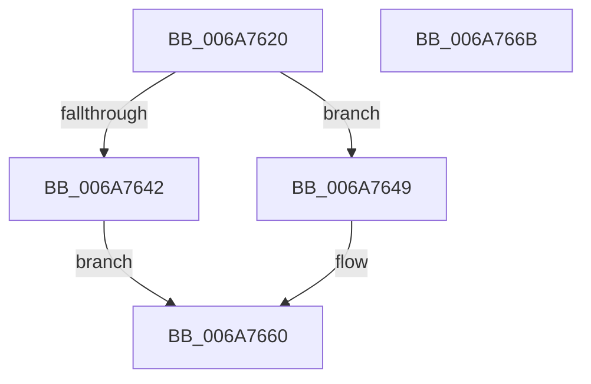

# IpmiLibpKcsIpmiMessagePack

- RVA: `0x006A7620`–`0x006A766C` (길이 `76` bytes)
- VA: `0x00000001406A7620`
- 실행 섹션: `.text`
- PDB 이름 있음: `예`; PDB Function 태그: `아니요`
- unwind 정보 RVA: `0x0005CAAC`
- 디코드: `23`개 명령, `76/76` bytes 표시
- 미해석 바이트: `0` (있으면 어셈블리에 `.byte`로 보존)

> 이 문서는 커널 이미지의 기계어와 PDB 기호를 분석해 생성했습니다. 4번과 5번은 함수 원형과 자료형을 바이너리 사용 방식에서 추정한 C 해석이며 원본 소스 복구 결과는 아닙니다.

## 1. Dependencies

- 직접 호출 지점: **1**; 고유 호출 대상: **1**
- 직접 호출자로 확인된 함수: **1**
- RIP 상대 이미지 참조: **0**

### Outgoing calls
- `0x006A7655` → [memcpy](../6C/memcpy_function_006C6840.md) (function, `0x006C6840`)

### Direct callers
- [IpmiLibpKcsRequestAndReceive](IpmiLibpKcsRequestAndReceive_function_006A7210.md) at `0x006A7262`

### Static image references
- 디코드된 RIP-relative 메모리 참조가 없습니다.

## 2. Other-region calls and transfers

- 다른 실행 섹션으로 향하는 call: **0**
- 별도 외부 분기/꼬리 이동을 확인하지 못했습니다.

## 3. Assembly (complete function range)

```asm
006A7620  48 89 5C 24 08                  mov qword ptr [rsp + 8], rbx
006A7625  57                              push rdi
006A7626  48 83 EC 20                     sub rsp, 0x20
006A762A  0F B7 42 01                     movzx eax, word ptr [rdx + 1]
006A762E  BF 22 01 00 00                  mov edi, 0x122
006A7633  66 83 C0 02                     add ax, 2
006A7637  48 8B D9                        mov rbx, rcx
006A763A  66 89 01                        mov word ptr [rcx], ax
006A763D  66 3B C7                        cmp ax, di
006A7640  76 07                           jbe 0x1406a7649
006A7642  B8 17 00 00 C0                  mov eax, 0xc0000017
006A7647  EB 17                           jmp 0x1406a7660
006A7649  44 0F B7 C0                     movzx r8d, ax
006A764D  48 83 C2 03                     add rdx, 3
006A7651  48 83 C1 05                     add rcx, 5
006A7655  E8 E6 F1 01 00                  call 0x1406c6840
006A765A  33 C0                           xor eax, eax
006A765C  66 89 7B 02                     mov word ptr [rbx + 2], di
006A7660  48 8B 5C 24 30                  mov rbx, qword ptr [rsp + 0x30]
006A7665  48 83 C4 20                     add rsp, 0x20
006A7669  5F                              pop rdi
006A766A  C3                              ret
006A766B  CC                              int3
```

## 4. C-style interpretation (structured pseudocode)

```c
__int64 __fastcall IpmiLibpKcsIpmiMessagePack(__int64 a1, __int64 a2)
{
    __int64 result;
    __int64 v_rsp;
    unsigned __int64 v_stack_p8;

    v_stack_p8 = v_rbx;
    v_rsp = (v_rsp) - (32);
    result = (unsigned __int16)((*(unsigned __int16 *)(a2 + 1)) + (2));
    *(unsigned __int16 *)(a1) = (unsigned __int16)(result);
    if (((unsigned __int16)(result)) <= 290) goto loc_006A7649;
    goto loc_006A7660;
loc_006A7649:
    a2 = (a2) + (3);
    a1 = (a1) + (5);
    result = memcpy(a1, a2, (unsigned __int16)((unsigned int)(0xC0000017ULL)), a4);
    result = 0;
    *(unsigned __int16 *)(a1 + 2) = 290;
loc_006A7660:
    v_rsp = (v_rsp) + (32);
    return result;
}
```

## 5. (Beta) C Style

```c
int64_t IpmiLibpKcsIpmiMessagePack(void *Arg1, void *Arg2)
{
    uint8_t *arg1 = (uint8_t *)Arg1;
    uint8_t *arg2 = (uint8_t *)Arg2;

    int64_t result;
    int64_t local_rsp;
    uint64_t v_stack_p8;

    v_stack_p8 = local_rbx;
    local_rsp = (local_rsp) - (32);
    result = (uint16_t)((*(uint16_t *)(arg2 + 0x1)) + (2));
    *(uint16_t *)(arg1) = (uint16_t)(result);
    if (((uint16_t)(result)) <= 290) goto loc_006A7649;
    goto loc_006A7660;
loc_006A7649:
    Arg2 = (Arg2) + (3);
    Arg1 = (Arg1) + (5);
    result = memcpy(Arg1, Arg2, (uint16_t)((uint32_t)(0xC0000017ULL)), a4);
    result = 0;
    *(uint16_t *)(arg1 + 0x2) = 290;
loc_006A7660:
    local_rsp = (local_rsp) + (32);
    return result;
}
```

### 관측된 메모리 오프셋

구조체 형식이 확인되지 않은 접근은 인자 기준의 오프셋으로만 기록했습니다.

| 기준 인자 | 오프셋 표현 | 폭 (bit) | 접근 |
|---|---:|---:|---|
| `Arg1` | `+ 0x0` | `16` | `W` |
| `Arg1` | `+ 0x2` | `16` | `W` |
| `Arg2` | `+ 0x1` | `16` | `R` |

## 6. Execution-region graph

[열기: 2D/3D 그래프와 함수 탐색 컨트롤 패널](../../../control-panel.html?section=text&rva=0x006A7620&view=graph)

- 2D 그래프는 위에서 아래로 흐르고, 3D 그래프는 빈 공간을 드래그해 회전합니다. Shift+드래그는 이동, 휠은 확대·축소, 함수 노드 선택은 대상 보고서 이동입니다.

### Static fallback


