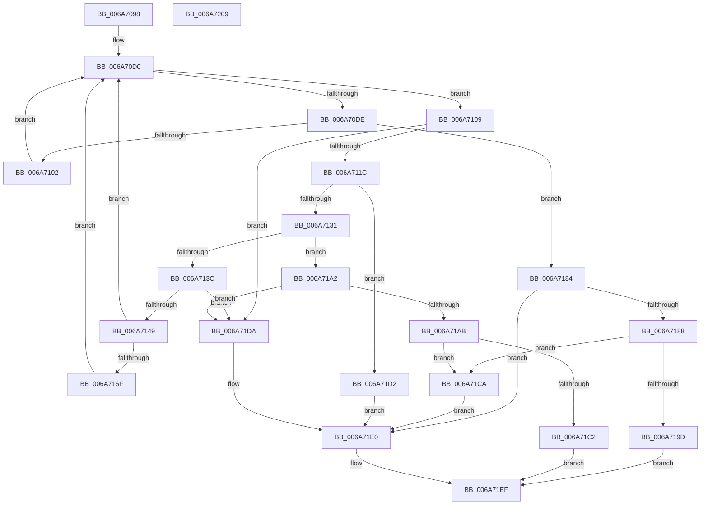

# IpmiLibpKcsReceiveResponseFromBmc

- RVA: `0x006A7098`–`0x006A720A` (길이 `370` bytes)
- VA: `0x00000001406A7098`
- 실행 섹션: `.text`
- PDB 이름 있음: `예`; PDB Function 태그: `아니요`
- unwind 정보 RVA: `0x0009F100`
- 디코드: `104`개 명령, `370/370` bytes 표시
- 미해석 바이트: `0` (있으면 어셈블리에 `.byte`로 보존)

> 이 문서는 커널 이미지의 기계어와 PDB 기호를 분석해 생성했습니다. 4번과 5번은 함수 원형과 자료형을 바이너리 사용 방식에서 추정한 C 해석이며 원본 소스 복구 결과는 아닙니다.

## 1. Dependencies

- 직접 호출 지점: **9**; 고유 호출 대상: **4**
- 직접 호출자로 확인된 함수: **1**
- RIP 상대 이미지 참조: **2**

### Outgoing calls
- `0x006A70EF` → [IpmiLibpHandleReadInterrupt](IpmiLibpHandleReadInterrupt_function_006A76D8.md) (function, `0x006A76D8`)
- `0x006A710F` → [IpmiLibpKcsSpinRegister](IpmiLibpKcsSpinRegister_function_006A74A8.md) (function, `0x006A74A8`)
- `0x006A711F` → [IpmiLibReadOneByte](IpmiLibReadOneByte_function_006A69B8.md) (function, `0x006A69B8`)
- `0x006A713C` → [IpmiLibpKcsSpinRegister](IpmiLibpKcsSpinRegister_function_006A74A8.md) (function, `0x006A74A8`)
- `0x006A714B` → [IpmiLibReadOneByte](IpmiLibReadOneByte_function_006A69B8.md) (function, `0x006A69B8`)
- `0x006A7158` → [IpmiLibWriteOneByte](IpmiLibWriteOneByte_function_006A69F8.md) (function, `0x006A69F8`)
- `0x006A71A2` → [IpmiLibpKcsSpinRegister](IpmiLibpKcsSpinRegister_function_006A74A8.md) (function, `0x006A74A8`)
- `0x006A71AD` → [IpmiLibReadOneByte](IpmiLibReadOneByte_function_006A69B8.md) (function, `0x006A69B8`)
- `0x006A71EA` → [IpmiLibWriteOneByte](IpmiLibWriteOneByte_function_006A69F8.md) (function, `0x006A69F8`)

### Direct callers
- [IpmiLibpKcsBmcTransact](IpmiLibpKcsBmcTransact_function_006A6EA0.md) at `0x006A6EF6`

### Static image references
- `0x006A70D0` → RVA `0x00EFA0A0` (`.data`; read)
- `0x006A718D` → RVA `0x00EFA0D4` (`.data`; write)

## 2. Other-region calls and transfers

- 다른 실행 섹션으로 향하는 call: **0**
- 별도 외부 분기/꼬리 이동을 확인하지 못했습니다.

## 3. Assembly (complete function range)

```asm
006A7098  48 8B C4                        mov rax, rsp
006A709B  48 89 58 10                     mov qword ptr [rax + 0x10], rbx
006A709F  48 89 68 18                     mov qword ptr [rax + 0x18], rbp
006A70A3  48 89 48 08                     mov qword ptr [rax + 8], rcx
006A70A7  56                              push rsi
006A70A8  57                              push rdi
006A70A9  41 54                           push r12
006A70AB  41 56                           push r14
006A70AD  41 57                           push r15
006A70AF  48 83 EC 30                     sub rsp, 0x30
006A70B3  45 0F B7 30                     movzx r14d, word ptr [r8]
006A70B7  45 33 FF                        xor r15d, r15d
006A70BA  49 8B D9                        mov rbx, r9
006A70BD  66 44 89 78 08                  mov word ptr [rax + 8], r15w
006A70C2  49 8B F0                        mov rsi, r8
006A70C5  48 8B EA                        mov rbp, rdx
006A70C8  41 0F B7 FF                     movzx edi, r15w
006A70CC  45 8D 67 01                     lea r12d, [r15 + 1]
006A70D0  8B 05 CA 2F 85 00               mov eax, dword ptr [rip + 0x852fca]
006A70D6  48 8B D3                        mov rdx, rbx
006A70D9  41 84 C4                        test r12b, al
006A70DC  74 2B                           je 0x1406a7109
006A70DE  48 8D 44 24 60                  lea rax, [rsp + 0x60]
006A70E3  45 0F B7 CE                     movzx r9d, r14w
006A70E7  4C 8B C5                        mov r8, rbp
006A70EA  48 89 44 24 20                  mov qword ptr [rsp + 0x20], rax
006A70EF  E8 E4 05 00 00                  call 0x1406a76d8
006A70F4  44 8B C8                        mov r9d, eax
006A70F7  3D 05 01 00 00                  cmp eax, 0x105
006A70FC  0F 85 82 00 00 00               jne 0x1406a7184
006A7102  0F B7 7C 24 60                  movzx edi, word ptr [rsp + 0x60]
006A7107  EB C7                           jmp 0x1406a70d0
006A7109  41 B8 02 00 00 00               mov r8d, 2
006A710F  E8 94 03 00 00                  call 0x1406a74a8
006A7114  85 C0                           test eax, eax
006A7116  0F 85 BE 00 00 00               jne 0x1406a71da
006A711C  41 8A D4                        mov dl, r12b
006A711F  E8 94 F8 FF FF                  call 0x1406a69b8
006A7124  8A C8                           mov cl, al
006A7126  C0 E9 06                        shr cl, 6
006A7129  84 C0                           test al, al
006A712B  0F 88 A1 00 00 00               js 0x1406a71d2
006A7131  45 8B C4                        mov r8d, r12d
006A7134  48 8B D3                        mov rdx, rbx
006A7137  41 84 CC                        test r12b, cl
006A713A  74 66                           je 0x1406a71a2
006A713C  E8 67 03 00 00                  call 0x1406a74a8
006A7141  85 C0                           test eax, eax
006A7143  0F 85 91 00 00 00               jne 0x1406a71da
006A7149  33 D2                           xor edx, edx
006A714B  E8 68 F8 FF FF                  call 0x1406a69b8
006A7150  33 D2                           xor edx, edx
006A7152  41 B0 68                        mov r8b, 0x68
006A7155  44 8A C8                        mov r9b, al
006A7158  E8 9B F8 FF FF                  call 0x1406a69f8
006A715D  45 8B C6                        mov r8d, r14d
006A7160  0F B7 CF                        movzx ecx, di
006A7163  45 2B C4                        sub r8d, r12d
006A7166  41 3B C8                        cmp ecx, r8d
006A7169  0F 8F 61 FF FF FF               jg 0x1406a70d0
006A716F  0F B7 CF                        movzx ecx, di
006A7172  66 41 03 FC                     add di, r12w
006A7176  66 89 7C 24 60                  mov word ptr [rsp + 0x60], di
006A717B  44 88 0C 29                     mov byte ptr [rcx + rbp], r9b
006A717F  E9 4C FF FF FF                  jmp 0x1406a70d0
006A7184  85 C0                           test eax, eax
006A7186  75 58                           jne 0x1406a71e0
006A7188  0F B7 44 24 60                  movzx eax, word ptr [rsp + 0x60]
006A718D  C7 05 3D 2F 85 00 07 00 00 00   mov dword ptr [rip + 0x852f3d], 7
006A7197  66 83 F8 03                     cmp ax, 3
006A719B  72 2D                           jb 0x1406a71ca
006A719D  66 89 06                        mov word ptr [rsi], ax
006A71A0  EB 4D                           jmp 0x1406a71ef
006A71A2  E8 01 03 00 00                  call 0x1406a74a8
006A71A7  85 C0                           test eax, eax
006A71A9  75 2F                           jne 0x1406a71da
006A71AB  33 D2                           xor edx, edx
006A71AD  E8 06 F8 FF FF                  call 0x1406a69b8
006A71B2  C7 05 18 2F 85 00 07 00 00 00   mov dword ptr [rip + 0x852f18], 7
006A71BC  66 83 FF 03                     cmp di, 3
006A71C0  72 08                           jb 0x1406a71ca
006A71C2  66 89 3E                        mov word ptr [rsi], di
006A71C5  45 8B CF                        mov r9d, r15d
006A71C8  EB 25                           jmp 0x1406a71ef
006A71CA  41 B9 E5 00 00 C0               mov r9d, 0xc00000e5
006A71D0  EB 0E                           jmp 0x1406a71e0
006A71D2  41 B9 3E 00 00 C0               mov r9d, 0xc000003e
006A71D8  EB 06                           jmp 0x1406a71e0
006A71DA  41 B9 02 01 00 00               mov r9d, 0x102
006A71E0  41 B0 60                        mov r8b, 0x60
006A71E3  66 44 89 3E                     mov word ptr [rsi], r15w
006A71E7  41 8A D4                        mov dl, r12b
006A71EA  E8 09 F8 FF FF                  call 0x1406a69f8
006A71EF  48 8B 5C 24 68                  mov rbx, qword ptr [rsp + 0x68]
006A71F4  41 8B C1                        mov eax, r9d
006A71F7  48 8B 6C 24 70                  mov rbp, qword ptr [rsp + 0x70]
006A71FC  48 83 C4 30                     add rsp, 0x30
006A7200  41 5F                           pop r15
006A7202  41 5E                           pop r14
006A7204  41 5C                           pop r12
006A7206  5F                              pop rdi
006A7207  5E                              pop rsi
006A7208  C3                              ret
006A7209  CC                              int3
```

## 4. C-style interpretation (structured pseudocode)

```c
__int64 __fastcall IpmiLibpKcsReceiveResponseFromBmc(__int64 a1, __int64 a2, __int64 a3, __int64 a4)
{
    __int64 result;
    __int64 v_r15;
    __int64 v_rdi;
    __int64 v_rsp;
    unsigned __int64 v_stack_m38;
    unsigned __int64 v_stack_p10;
    unsigned __int64 v_stack_p18;
    unsigned __int64 v_stack_p8;

    *(unsigned __int64 *)(v_rsp + 16) = v_rbx;
    *(unsigned __int64 *)(v_rsp + 24) = v_rbp;
    *(unsigned __int64 *)(v_rsp + 8) = a1;
    v_rsp = (v_rsp) - (48);
    v_r15 = 0;
    *(unsigned __int16 *)(v_rsp + 8) = 0;
loc_006A70D0:
    if ((((unsigned __int8)(v_r15 + 1)) & ((unsigned __int8)((unsigned int)(*(unsigned int *)(v_rip + 8728522))))) == 0) goto loc_006A7109;
    v_stack_m38 = v_stack_p8;
    result = IpmiLibpHandleReadInterrupt(a1, a4, a2, (unsigned __int16)(*(unsigned __int16 *)(a3)));
    if (((unsigned int)(result)) != 261) goto loc_006A7184;
    goto loc_006A70D0;
loc_006A7109:
    result = IpmiLibpKcsSpinRegister(a1, a4, 2, (unsigned int)((unsigned int)(result)));
    if ((unsigned int)(result) != 0) goto loc_006A71DA;
    result = IpmiLibReadOneByte(a1, (unsigned __int8)(v_r15 + 1), 2, (unsigned int)((unsigned int)(result)));
    a1 = (unsigned __int8)(((unsigned __int8)(result)) >> (6));
    if (sign_flag) goto loc_006A71D2;
    if ((((unsigned __int8)(v_r15 + 1)) & ((unsigned __int8)(a1))) == 0) goto loc_006A71A2;
    result = IpmiLibpKcsSpinRegister(a1, a4, (unsigned int)((unsigned int)(v_r15 + 1)), (unsigned int)((unsigned int)(result)));
    if ((unsigned int)(result) != 0) goto loc_006A71DA;
    a2 = 0;
    result = IpmiLibReadOneByte(a1, a2, (unsigned int)((unsigned int)(v_r15 + 1)), (unsigned int)((unsigned int)(result)));
    a2 = 0;
    result = IpmiLibWriteOneByte(a1, a2, 104, (unsigned __int8)(result));
    a3 = (unsigned int)(((unsigned int)((unsigned int)(*(unsigned __int16 *)(a3)))) - ((unsigned int)(v_r15 + 1)));
    if (((unsigned int)((unsigned __int16)(v_stack_p8))) > ((unsigned int)(a3))) goto loc_006A70D0;
    v_rdi = (unsigned __int16)((v_stack_p8) + ((unsigned __int16)(v_r15 + 1)));
    v_stack_p8 = (unsigned __int16)(v_rdi);
    *(unsigned __int8 *)((unsigned __int16)(v_stack_p8) + a2 * 1) = (unsigned __int8)((unsigned __int8)(result));
    goto loc_006A70D0;
loc_006A7184:
    if ((unsigned int)(result) != 0) goto loc_006A71E0;
    *(unsigned int *)(v_rip + 8728381) = 7;
    if (((unsigned __int16)(v_stack_p8)) < 3) goto loc_006A71CA;
    *(unsigned __int16 *)(a3) = (unsigned __int16)(v_stack_p8);
    goto loc_006A71EF;
loc_006A71A2:
    result = IpmiLibpKcsSpinRegister((unsigned __int16)(v_stack_p8), a2, a3, (unsigned __int8)(result));
    if ((unsigned int)(result) != 0) goto loc_006A71DA;
    a2 = 0;
    result = IpmiLibReadOneByte((unsigned __int16)(v_stack_p8), a2, a3, (unsigned __int8)(result));
    *(unsigned int *)(v_rip + 8728344) = 7;
    if (((unsigned __int16)(v_rdi)) < 3) goto loc_006A71CA;
    *(unsigned __int16 *)(a3) = (unsigned __int16)(v_rdi);
    goto loc_006A71EF;
loc_006A71CA:
    goto loc_006A71E0;
loc_006A71D2:
    goto loc_006A71E0;
loc_006A71DA:
loc_006A71E0:
    *(unsigned __int16 *)(a3) = 0;
    result = IpmiLibWriteOneByte((unsigned __int16)(v_stack_p8), (unsigned __int8)(v_r15 + 1), 96, 258);
loc_006A71EF:
    v_rsp = (v_rsp) + (48);
    return 258;
}
```

## 5. (Beta) C Style

```c
int64_t IpmiLibpKcsReceiveResponseFromBmc(int64_t Arg1, int64_t Arg2, void *Arg3, int64_t Arg4)
{
    uint8_t *arg3 = (uint8_t *)Arg3;

    int64_t result;
    int64_t local_r15;
    int64_t local_rdi;
    int64_t local_rsp;
    uint64_t v_stack_m38;
    uint64_t v_stack_p10;
    uint64_t v_stack_p18;
    uint64_t v_stack_p8;

    *(uint64_t *)(local_rsp + 0x10) = local_rbx;
    *(uint64_t *)(local_rsp + 0x18) = local_rbp;
    *(uint64_t *)(local_rsp + 0x8) = Arg1;
    local_rsp = (local_rsp) - (48);
    local_r15 = 0;
    *(uint16_t *)(local_rsp + 0x8) = 0;
loc_006A70D0:
    if ((((uint8_t)(local_r15 + 1)) & ((uint8_t)((uint32_t)(*(uint32_t *)(v_rip + 0x852FCA))))) == 0) goto loc_006A7109;
    v_stack_m38 = v_stack_p8;
    result = IpmiLibpHandleReadInterrupt(Arg1, Arg4, Arg2, (uint16_t)(*(uint16_t *)(arg3)));
    if (((uint32_t)(result)) != 261) goto loc_006A7184;
    goto loc_006A70D0;
loc_006A7109:
    result = IpmiLibpKcsSpinRegister(Arg1, Arg4, 2, (uint32_t)((uint32_t)(result)));
    if ((uint32_t)(result) != 0) goto loc_006A71DA;
    result = IpmiLibReadOneByte(Arg1, (uint8_t)(local_r15 + 1), 2, (uint32_t)((uint32_t)(result)));
    Arg1 = (uint8_t)(((uint8_t)(result)) >> (6));
    if (sign_flag) goto loc_006A71D2;
    if ((((uint8_t)(local_r15 + 1)) & ((uint8_t)(Arg1))) == 0) goto loc_006A71A2;
    result = IpmiLibpKcsSpinRegister(Arg1, Arg4, (uint32_t)((uint32_t)(local_r15 + 1)), (uint32_t)((uint32_t)(result)));
    if ((uint32_t)(result) != 0) goto loc_006A71DA;
    Arg2 = 0;
    result = IpmiLibReadOneByte(Arg1, Arg2, (uint32_t)((uint32_t)(local_r15 + 1)), (uint32_t)((uint32_t)(result)));
    Arg2 = 0;
    result = IpmiLibWriteOneByte(Arg1, Arg2, 104, (uint8_t)(result));
    Arg3 = (uint32_t)(((uint32_t)((uint32_t)(*(uint16_t *)(arg3)))) - ((uint32_t)(local_r15 + 1)));
    if (((uint32_t)((uint16_t)(v_stack_p8))) > ((uint32_t)(Arg3))) goto loc_006A70D0;
    local_rdi = (uint16_t)((v_stack_p8) + ((uint16_t)(local_r15 + 1)));
    v_stack_p8 = (uint16_t)(local_rdi);
    *(uint8_t *)((uint16_t)(v_stack_p8) + Arg2 * 1) = (uint8_t)((uint8_t)(result));
    goto loc_006A70D0;
loc_006A7184:
    if ((uint32_t)(result) != 0) goto loc_006A71E0;
    *(uint32_t *)(v_rip + 0x852F3D) = 7;
    if (((uint16_t)(v_stack_p8)) < 3) goto loc_006A71CA;
    *(uint16_t *)(arg3) = (uint16_t)(v_stack_p8);
    goto loc_006A71EF;
loc_006A71A2:
    result = IpmiLibpKcsSpinRegister((uint16_t)(v_stack_p8), Arg2, Arg3, (uint8_t)(result));
    if ((uint32_t)(result) != 0) goto loc_006A71DA;
    Arg2 = 0;
    result = IpmiLibReadOneByte((uint16_t)(v_stack_p8), Arg2, Arg3, (uint8_t)(result));
    *(uint32_t *)(v_rip + 0x852F18) = 7;
    if (((uint16_t)(local_rdi)) < 3) goto loc_006A71CA;
    *(uint16_t *)(arg3) = (uint16_t)(local_rdi);
    goto loc_006A71EF;
loc_006A71CA:
    goto loc_006A71E0;
loc_006A71D2:
    goto loc_006A71E0;
loc_006A71DA:
loc_006A71E0:
    *(uint16_t *)(arg3) = 0;
    result = IpmiLibWriteOneByte((uint16_t)(v_stack_p8), (uint8_t)(local_r15 + 1), 96, 258);
loc_006A71EF:
    local_rsp = (local_rsp) + (48);
    return 258;
}
```

### 관측된 메모리 오프셋

구조체 형식이 확인되지 않은 접근은 인자 기준의 오프셋으로만 기록했습니다.

| 기준 인자 | 오프셋 표현 | 폭 (bit) | 접근 |
|---|---:|---:|---|
| `Arg3` | `+ 0x0` | `16` | `R` |
| `Arg3` | `+ 0x0` | `16` | `W` |

## 6. Execution-region graph

[열기: 2D/3D 그래프와 함수 탐색 컨트롤 패널](../../../control-panel.html?section=text&rva=0x006A7098&view=graph)

- 2D 그래프는 위에서 아래로 흐르고, 3D 그래프는 빈 공간을 드래그해 회전합니다. Shift+드래그는 이동, 휠은 확대·축소, 함수 노드 선택은 대상 보고서 이동입니다.

### Static fallback


