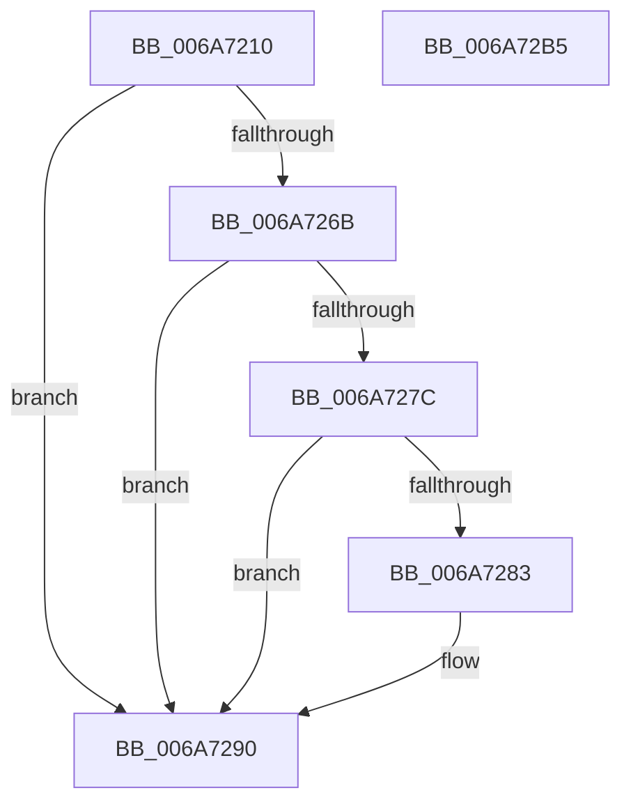

# IpmiLibpKcsRequestAndReceive

- RVA: `0x006A7210`–`0x006A72B6` (길이 `166` bytes)
- VA: `0x00000001406A7210`
- 실행 섹션: `.text`
- PDB 이름 있음: `예`; PDB Function 태그: `아니요`
- unwind 정보 RVA: `0x000DB090`
- 디코드: `41`개 명령, `166/166` bytes 표시
- 미해석 바이트: `0` (있으면 어셈블리에 `.byte`로 보존)

> 이 문서는 커널 이미지의 기계어와 PDB 기호를 분석해 생성했습니다. 4번과 5번은 함수 원형과 자료형을 바이너리 사용 방식에서 추정한 C 해석이며 원본 소스 복구 결과는 아닙니다.

## 1. Dependencies

- 직접 호출 지점: **6**; 고유 호출 대상: **6**
- 직접 호출자로 확인된 함수: **1**
- RIP 상대 이미지 참조: **2**

### Outgoing calls
- `0x006A7247` → [memset](../6C/memset_function_006C6C40.md) (function, `0x006C6C40`)
- `0x006A7252` → [IpmiLibpGetTimeout](IpmiLibpGetTimeout_function_006A6E4C.md) (function, `0x006A6E4C`)
- `0x006A7262` → [IpmiLibpKcsIpmiMessagePack](IpmiLibpKcsIpmiMessagePack_function_006A7620.md) (function, `0x006A7620`)
- `0x006A7273` → [IpmiLibpKcsBmcTransact](IpmiLibpKcsBmcTransact_function_006A6EA0.md) (function, `0x006A6EA0`)
- `0x006A728B` → [IpmiLibKcsIpmiMessageUnpack](IpmiLibKcsIpmiMessageUnpack_function_006A75A8.md) (function, `0x006A75A8`)
- `0x006A729B` → [_security_check_cookie](_security_check_cookie_function_006AC640.md) (function, `0x006AC640`)

### Direct callers
- [IpmiLibRequestReceive](IpmiLibRequestReceive_function_006A6DDC.md) at `0x006A6DF0`

### Static image references
- `0x006A7222` → RVA `0x00E0A740` (`.data`; read)
- `0x006A724C` → RVA `0x00EFA0C0` (`.data`; read)

## 2. Other-region calls and transfers

- 다른 실행 섹션으로 향하는 call: **0**
- 별도 외부 분기/꼬리 이동을 확인하지 못했습니다.

## 3. Assembly (complete function range)

```asm
006A7210  48 89 5C 24 08                  mov qword ptr [rsp + 8], rbx
006A7215  48 89 74 24 20                  mov qword ptr [rsp + 0x20], rsi
006A721A  57                              push rdi
006A721B  48 81 EC 80 02 00 00            sub rsp, 0x280
006A7222  48 8B 05 17 35 76 00            mov rax, qword ptr [rip + 0x763517]
006A7229  48 33 C4                        xor rax, rsp
006A722C  48 89 84 24 70 02 00 00         mov qword ptr [rsp + 0x270], rax
006A7234  49 8B F0                        mov rsi, r8
006A7237  48 8D 4C 24 20                  lea rcx, [rsp + 0x20]
006A723C  48 8B FA                        mov rdi, rdx
006A723F  41 B8 4A 02 00 00               mov r8d, 0x24a
006A7245  33 D2                           xor edx, edx
006A7247  E8 F4 F9 01 00                  call 0x1406c6c40
006A724C  8B 15 6E 2E 85 00               mov edx, dword ptr [rip + 0x852e6e]
006A7252  E8 F5 FB FF FF                  call 0x1406a6e4c
006A7257  48 8B D7                        mov rdx, rdi
006A725A  48 8D 4C 24 20                  lea rcx, [rsp + 0x20]
006A725F  48 8B D8                        mov rbx, rax
006A7262  E8 B9 03 00 00                  call 0x1406a7620
006A7267  85 C0                           test eax, eax
006A7269  78 25                           js 0x1406a7290
006A726B  4C 8B C3                        mov r8, rbx
006A726E  48 8D 54 24 20                  lea rdx, [rsp + 0x20]
006A7273  E8 28 FC FF FF                  call 0x1406a6ea0
006A7278  85 C0                           test eax, eax
006A727A  78 14                           js 0x1406a7290
006A727C  3D 02 01 00 00                  cmp eax, 0x102
006A7281  74 0D                           je 0x1406a7290
006A7283  48 8D 54 24 20                  lea rdx, [rsp + 0x20]
006A7288  48 8B CE                        mov rcx, rsi
006A728B  E8 18 03 00 00                  call 0x1406a75a8
006A7290  48 8B 8C 24 70 02 00 00         mov rcx, qword ptr [rsp + 0x270]
006A7298  48 33 CC                        xor rcx, rsp
006A729B  E8 A0 53 00 00                  call 0x1406ac640
006A72A0  4C 8D 9C 24 80 02 00 00         lea r11, [rsp + 0x280]
006A72A8  49 8B 5B 10                     mov rbx, qword ptr [r11 + 0x10]
006A72AC  49 8B 73 28                     mov rsi, qword ptr [r11 + 0x28]
006A72B0  49 8B E3                        mov rsp, r11
006A72B3  5F                              pop rdi
006A72B4  C3                              ret
006A72B5  CC                              int3
```

## 4. C-style interpretation (structured pseudocode)

```c
__int64 __fastcall IpmiLibpKcsRequestAndReceive(__int64 a1, __int64 a2, __int64 a3)
{
    __int64 result;
    __int64 v_rsp;
    unsigned __int64 v_stack_m18;
    unsigned __int64 v_stack_m268;
    unsigned __int64 v_stack_m8;
    unsigned __int64 v_stack_p20;
    unsigned __int64 v_stack_p8;

    v_stack_p8 = v_rbx;
    v_stack_p20 = v_rsi;
    v_rsp = (v_rsp) - (640);
    result = (*(unsigned __int64 *)(v_rip + 7746839)) ^ (v_rsp);
    v_stack_m18 = result;
    a2 = 0;
    result = memset(v_stack_m268, a2, 586, a4);
    result = IpmiLibpGetTimeout(v_stack_m268, (unsigned int)(*(unsigned int *)(v_rip + 8728174)), 586, a4);
    result = IpmiLibpKcsIpmiMessagePack(v_stack_m268, 0, 586, a4);
    if (sign_flag) goto loc_006A7290;
    result = IpmiLibpKcsBmcTransact(v_stack_m268, v_stack_m268, result, a4);
    if (sign_flag) goto loc_006A7290;
    if (((unsigned int)(result)) != 258) {
        a2 = v_stack_m268;
        a1 = a3;
        result = IpmiLibKcsIpmiMessageUnpack(a1, a2, result, a4);
    }
    a1 = (v_stack_m18) ^ (v_rsp);
    result = _security_check_cookie(a1, a2, result, a4);
    return result;
}
```

## 5. (Beta) C Style

```c
int64_t IpmiLibpKcsRequestAndReceive(int64_t Arg1, int64_t Arg2, int64_t Arg3)
{
    int64_t result;
    int64_t local_rsp;
    uint64_t v_stack_m18;
    uint64_t v_stack_m268;
    uint64_t v_stack_m8;
    uint64_t v_stack_p20;
    uint64_t v_stack_p8;

    v_stack_p8 = local_rbx;
    v_stack_p20 = local_rsi;
    local_rsp = (local_rsp) - (640);
    result = (*(uint64_t *)(v_rip + 0x763517)) ^ (local_rsp);
    v_stack_m18 = result;
    Arg2 = 0;
    result = memset(v_stack_m268, Arg2, 586, a4);
    result = IpmiLibpGetTimeout(v_stack_m268, (uint32_t)(*(uint32_t *)(v_rip + 0x852E6E)), 586, a4);
    result = IpmiLibpKcsIpmiMessagePack(v_stack_m268, 0, 586, a4);
    if (sign_flag) goto loc_006A7290;
    result = IpmiLibpKcsBmcTransact(v_stack_m268, v_stack_m268, result, a4);
    if (sign_flag) goto loc_006A7290;
    if (((uint32_t)(result)) != 258) {
        Arg2 = v_stack_m268;
        Arg1 = Arg3;
        result = IpmiLibKcsIpmiMessageUnpack(Arg1, Arg2, result, a4);
    }
    Arg1 = (v_stack_m18) ^ (local_rsp);
    result = _security_check_cookie(Arg1, Arg2, result, a4);
    return result;
}
```

## 6. Execution-region graph

[열기: 2D/3D 그래프와 함수 탐색 컨트롤 패널](../../../control-panel.html?section=text&rva=0x006A7210&view=graph)

- 2D 그래프는 위에서 아래로 흐르고, 3D 그래프는 빈 공간을 드래그해 회전합니다. Shift+드래그는 이동, 휠은 확대·축소, 함수 노드 선택은 대상 보고서 이동입니다.

### Static fallback


