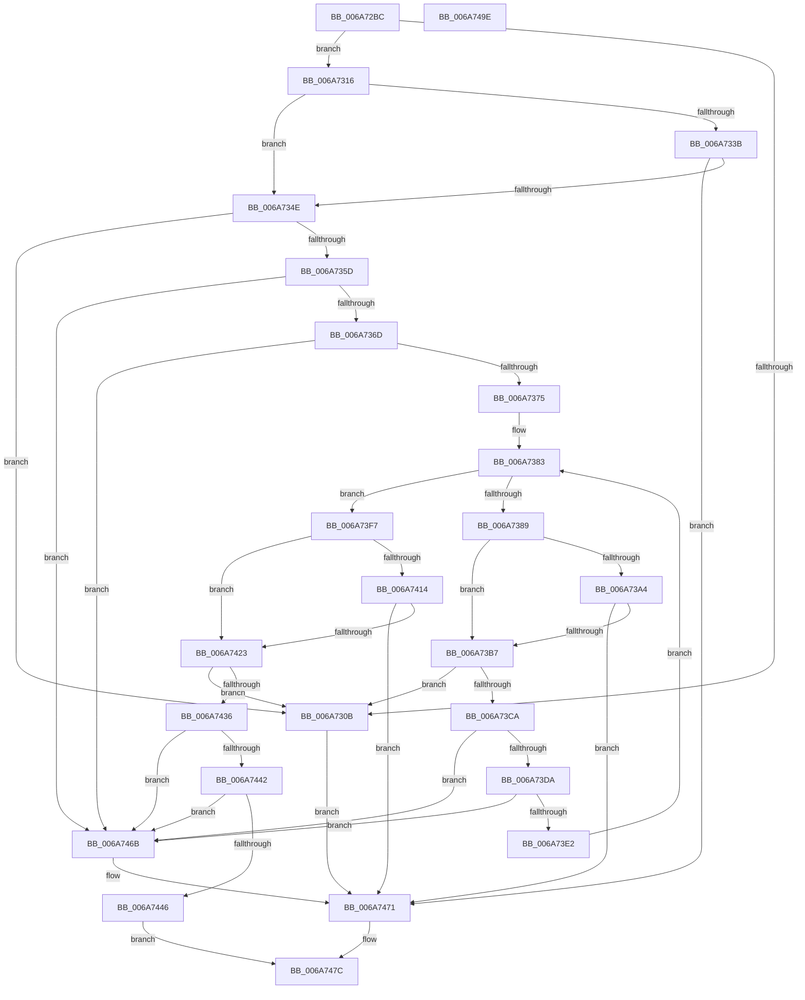

# IpmiLibpKcsSendRequestToBMC

- RVA: `0x006A72BC`–`0x006A749F` (길이 `483` bytes)
- VA: `0x00000001406A72BC`
- 실행 섹션: `.text`
- PDB 이름 있음: `예`; PDB Function 태그: `아니요`
- unwind 정보 RVA: `0x0008A350`
- 디코드: `130`개 명령, `483/483` bytes 표시
- 미해석 바이트: `0` (있으면 어셈블리에 `.byte`로 보존)

> 이 문서는 커널 이미지의 기계어와 PDB 기호를 분석해 생성했습니다. 4번과 5번은 함수 원형과 자료형을 바이너리 사용 방식에서 추정한 C 해석이며 원본 소스 복구 결과는 아닙니다.

## 1. Dependencies

- 직접 호출 지점: **19**; 고유 호출 대상: **4**
- 직접 호출자로 확인된 함수: **1**
- RIP 상대 이미지 참조: **2**

### Outgoing calls
- `0x006A72FE` → [IpmiLibpKcsSpinRegister](IpmiLibpKcsSpinRegister_function_006A74A8.md) (function, `0x006A74A8`)
- `0x006A7318` → [IpmiLibReadOneByte](IpmiLibReadOneByte_function_006A69B8.md) (function, `0x006A69B8`)
- `0x006A732A` → [IpmiLibWriteOneByte](IpmiLibWriteOneByte_function_006A69F8.md) (function, `0x006A69F8`)
- `0x006A733E` → [IpmiLibpHandleSendInterrupt](IpmiLibpHandleSendInterrupt_function_006A77BC.md) (function, `0x006A77BC`)
- `0x006A7354` → [IpmiLibpKcsSpinRegister](IpmiLibpKcsSpinRegister_function_006A74A8.md) (function, `0x006A74A8`)
- `0x006A7360` → [IpmiLibReadOneByte](IpmiLibReadOneByte_function_006A69B8.md) (function, `0x006A69B8`)
- `0x006A7377` → [IpmiLibReadOneByte](IpmiLibReadOneByte_function_006A69B8.md) (function, `0x006A69B8`)
- `0x006A7393` → [IpmiLibWriteOneByte](IpmiLibWriteOneByte_function_006A69F8.md) (function, `0x006A69F8`)
- `0x006A73A7` → [IpmiLibpHandleSendInterrupt](IpmiLibpHandleSendInterrupt_function_006A77BC.md) (function, `0x006A77BC`)
- `0x006A73BD` → [IpmiLibpKcsSpinRegister](IpmiLibpKcsSpinRegister_function_006A74A8.md) (function, `0x006A74A8`)
- `0x006A73CD` → [IpmiLibReadOneByte](IpmiLibReadOneByte_function_006A69B8.md) (function, `0x006A69B8`)
- `0x006A73E4` → [IpmiLibReadOneByte](IpmiLibReadOneByte_function_006A69B8.md) (function, `0x006A69B8`)
- `0x006A73FD` → [IpmiLibWriteOneByte](IpmiLibWriteOneByte_function_006A69F8.md) (function, `0x006A69F8`)
- `0x006A7417` → [IpmiLibpHandleSendInterrupt](IpmiLibpHandleSendInterrupt_function_006A77BC.md) (function, `0x006A77BC`)
- `0x006A7429` → [IpmiLibpKcsSpinRegister](IpmiLibpKcsSpinRegister_function_006A74A8.md) (function, `0x006A74A8`)
- `0x006A7439` → [IpmiLibReadOneByte](IpmiLibReadOneByte_function_006A69B8.md) (function, `0x006A69B8`)
- `0x006A7448` → [IpmiLibReadOneByte](IpmiLibReadOneByte_function_006A69B8.md) (function, `0x006A69B8`)
- `0x006A7457` → [IpmiLibWriteOneByte](IpmiLibWriteOneByte_function_006A69F8.md) (function, `0x006A69F8`)
- `0x006A7477` → [IpmiLibWriteOneByte](IpmiLibWriteOneByte_function_006A69F8.md) (function, `0x006A69F8`)

### Direct callers
- [IpmiLibpKcsBmcTransact](IpmiLibpKcsBmcTransact_function_006A6EA0.md) at `0x006A6ED3`

### Static image references
- `0x006A72DC` → RVA `0x00EFA0D4` (`.data`; write)
- `0x006A732F` → RVA `0x00EFA0A0` (`.data`; read)

## 2. Other-region calls and transfers

- 다른 실행 섹션으로 향하는 call: **0**
- 별도 외부 분기/꼬리 이동을 확인하지 못했습니다.

## 3. Assembly (complete function range)

```asm
006A72BC  48 8B C4                        mov rax, rsp
006A72BF  48 89 58 08                     mov qword ptr [rax + 8], rbx
006A72C3  48 89 68 10                     mov qword ptr [rax + 0x10], rbp
006A72C7  48 89 70 18                     mov qword ptr [rax + 0x18], rsi
006A72CB  48 89 78 20                     mov qword ptr [rax + 0x20], rdi
006A72CF  41 55                           push r13
006A72D1  41 56                           push r14
006A72D3  41 57                           push r15
006A72D5  48 83 EC 20                     sub rsp, 0x20
006A72D9  45 33 FF                        xor r15d, r15d
006A72DC  C7 05 EE 2D 85 00 07 00 00 00   mov dword ptr [rip + 0x852dee], 7
006A72E6  41 0F B7 F0                     movzx esi, r8w
006A72EA  48 8B EA                        mov rbp, rdx
006A72ED  49 8B D1                        mov rdx, r9
006A72F0  49 8B D9                        mov rbx, r9
006A72F3  41 0F B7 FF                     movzx edi, r15w
006A72F7  45 8D 6F 02                     lea r13d, [r15 + 2]
006A72FB  45 8B C5                        mov r8d, r13d
006A72FE  E8 A5 01 00 00                  call 0x1406a74a8
006A7303  45 8D 77 01                     lea r14d, [r15 + 1]
006A7307  85 C0                           test eax, eax
006A7309  74 0B                           je 0x1406a7316
006A730B  41 B9 02 01 00 00               mov r9d, 0x102
006A7311  E9 5B 01 00 00                  jmp 0x1406a7471
006A7316  33 D2                           xor edx, edx
006A7318  E8 9B F6 FF FF                  call 0x1406a69b8
006A731D  41 8A D6                        mov dl, r14b
006A7320  44 89 3D AD 2D 85 00            mov dword ptr [rip + 0x852dad], r15d
006A7327  41 B0 61                        mov r8b, 0x61
006A732A  E8 C9 F6 FF FF                  call 0x1406a69f8
006A732F  44 8B 05 6A 2D 85 00            mov r8d, dword ptr [rip + 0x852d6a]
006A7336  45 84 C6                        test r14b, r8b
006A7339  74 13                           je 0x1406a734e
006A733B  48 8B D3                        mov rdx, rbx
006A733E  E8 79 04 00 00                  call 0x1406a77bc
006A7343  44 8B C8                        mov r9d, eax
006A7346  85 C0                           test eax, eax
006A7348  0F 85 23 01 00 00               jne 0x1406a7471
006A734E  45 8B C5                        mov r8d, r13d
006A7351  48 8B D3                        mov rdx, rbx
006A7354  E8 4F 01 00 00                  call 0x1406a74a8
006A7359  85 C0                           test eax, eax
006A735B  75 AE                           jne 0x1406a730b
006A735D  41 8A D6                        mov dl, r14b
006A7360  E8 53 F6 FF FF                  call 0x1406a69b8
006A7365  84 C0                           test al, al
006A7367  0F 89 FE 00 00 00               jns 0x1406a746b
006A736D  A8 40                           test al, 0x40
006A736F  0F 85 F6 00 00 00               jne 0x1406a746b
006A7375  33 D2                           xor edx, edx
006A7377  E8 3C F6 FF FF                  call 0x1406a69b8
006A737C  44 89 35 51 2D 85 00            mov dword ptr [rip + 0x852d51], r14d
006A7383  66 41 3B F6                     cmp si, r14w
006A7387  76 6E                           jbe 0x1406a73f7
006A7389  44 0F B7 C7                     movzx r8d, di
006A738D  33 D2                           xor edx, edx
006A738F  45 8A 04 28                     mov r8b, byte ptr [r8 + rbp]
006A7393  E8 60 F6 FF FF                  call 0x1406a69f8
006A7398  44 8B 05 01 2D 85 00            mov r8d, dword ptr [rip + 0x852d01]
006A739F  45 84 C6                        test r14b, r8b
006A73A2  74 13                           je 0x1406a73b7
006A73A4  48 8B D3                        mov rdx, rbx
006A73A7  E8 10 04 00 00                  call 0x1406a77bc
006A73AC  44 8B C8                        mov r9d, eax
006A73AF  85 C0                           test eax, eax
006A73B1  0F 85 BA 00 00 00               jne 0x1406a7471
006A73B7  45 8B C5                        mov r8d, r13d
006A73BA  48 8B D3                        mov rdx, rbx
006A73BD  E8 E6 00 00 00                  call 0x1406a74a8
006A73C2  85 C0                           test eax, eax
006A73C4  0F 85 41 FF FF FF               jne 0x1406a730b
006A73CA  41 8A D6                        mov dl, r14b
006A73CD  E8 E6 F5 FF FF                  call 0x1406a69b8
006A73D2  84 C0                           test al, al
006A73D4  0F 89 91 00 00 00               jns 0x1406a746b
006A73DA  A8 40                           test al, 0x40
006A73DC  0F 85 89 00 00 00               jne 0x1406a746b
006A73E2  33 D2                           xor edx, edx
006A73E4  E8 CF F5 FF FF                  call 0x1406a69b8
006A73E9  B8 FF FF 00 00                  mov eax, 0xffff
006A73EE  66 41 03 FE                     add di, r14w
006A73F2  66 03 F0                        add si, ax
006A73F5  EB 8C                           jmp 0x1406a7383
006A73F7  41 B0 62                        mov r8b, 0x62
006A73FA  41 8A D6                        mov dl, r14b
006A73FD  E8 F6 F5 FF FF                  call 0x1406a69f8
006A7402  8B 05 98 2C 85 00               mov eax, dword ptr [rip + 0x852c98]
006A7408  44 89 2D C5 2C 85 00            mov dword ptr [rip + 0x852cc5], r13d
006A740F  41 84 C6                        test r14b, al
006A7412  74 0F                           je 0x1406a7423
006A7414  48 8B D3                        mov rdx, rbx
006A7417  E8 A0 03 00 00                  call 0x1406a77bc
006A741C  44 8B C8                        mov r9d, eax
006A741F  85 C0                           test eax, eax
006A7421  75 4E                           jne 0x1406a7471
006A7423  45 8B C5                        mov r8d, r13d
006A7426  48 8B D3                        mov rdx, rbx
006A7429  E8 7A 00 00 00                  call 0x1406a74a8
006A742E  85 C0                           test eax, eax
006A7430  0F 85 D5 FE FF FF               jne 0x1406a730b
006A7436  41 8A D6                        mov dl, r14b
006A7439  E8 7A F5 FF FF                  call 0x1406a69b8
006A743E  84 C0                           test al, al
006A7440  79 29                           jns 0x1406a746b
006A7442  A8 40                           test al, 0x40
006A7444  75 25                           jne 0x1406a746b
006A7446  33 D2                           xor edx, edx
006A7448  E8 6B F5 FF FF                  call 0x1406a69b8
006A744D  44 0F B7 C7                     movzx r8d, di
006A7451  33 D2                           xor edx, edx
006A7453  45 8A 04 28                     mov r8b, byte ptr [r8 + rbp]
006A7457  E8 9C F5 FF FF                  call 0x1406a69f8
006A745C  C7 05 6E 2C 85 00 03 00 00 00   mov dword ptr [rip + 0x852c6e], 3
006A7466  45 8B CF                        mov r9d, r15d
006A7469  EB 11                           jmp 0x1406a747c
006A746B  41 B9 3E 00 00 C0               mov r9d, 0xc000003e
006A7471  41 B0 60                        mov r8b, 0x60
006A7474  41 8A D6                        mov dl, r14b
006A7477  E8 7C F5 FF FF                  call 0x1406a69f8
006A747C  48 8B 5C 24 40                  mov rbx, qword ptr [rsp + 0x40]
006A7481  41 8B C1                        mov eax, r9d
006A7484  48 8B 6C 24 48                  mov rbp, qword ptr [rsp + 0x48]
006A7489  48 8B 74 24 50                  mov rsi, qword ptr [rsp + 0x50]
006A748E  48 8B 7C 24 58                  mov rdi, qword ptr [rsp + 0x58]
006A7493  48 83 C4 20                     add rsp, 0x20
006A7497  41 5F                           pop r15
006A7499  41 5E                           pop r14
006A749B  41 5D                           pop r13
006A749D  C3                              ret
006A749E  CC                              int3
```

## 4. C-style interpretation (structured pseudocode)

```c
__int64 __fastcall IpmiLibpKcsSendRequestToBMC(__int64 a1, __int64 a2, unsigned __int16 a3, __int64 a4)
{
    __int64 result;
    __int64 v_r15;
    __int64 v_rdi;
    __int64 v_rsi;
    __int64 v_rsp;
    unsigned __int64 v_stack_p10;
    unsigned __int64 v_stack_p18;
    unsigned __int64 v_stack_p20;
    unsigned __int64 v_stack_p8;

    *(unsigned __int64 *)(v_rsp + 8) = v_rbx;
    *(unsigned __int64 *)(v_rsp + 16) = v_rbp;
    *(unsigned __int64 *)(v_rsp + 24) = v_rsi;
    *(unsigned __int64 *)(v_rsp + 32) = v_rdi;
    v_rsp = (v_rsp) - (32);
    v_r15 = 0;
    *(unsigned int *)(v_rip + 8728046) = 7;
    result = IpmiLibpKcsSpinRegister(a1, a4, (unsigned int)((unsigned int)(v_r15 + 2)), a4);
    if ((unsigned int)(result) == 0) goto loc_006A7316;
loc_006A730B:
    goto loc_006A7471;
loc_006A7316:
    a2 = 0;
    result = IpmiLibReadOneByte(a1, a2, (unsigned int)((unsigned int)(v_r15 + 2)), 258);
    *(unsigned int *)(v_rip + 8727981) = 0;
    result = IpmiLibWriteOneByte(a1, (unsigned __int8)(v_r15 + 1), 97, 258);
    if ((((unsigned __int8)(v_r15 + 1)) & ((unsigned __int8)((unsigned int)(*(unsigned int *)(v_rip + 8727914))))) == 0) goto loc_006A734E;
    result = IpmiLibpHandleSendInterrupt(a1, a4, (unsigned int)(*(unsigned int *)(v_rip + 8727914)), 258);
    if ((unsigned int)(result) != 0) goto loc_006A7471;
loc_006A734E:
    result = IpmiLibpKcsSpinRegister(a1, a4, (unsigned int)((unsigned int)(v_r15 + 2)), (unsigned int)((unsigned int)(result)));
    if ((unsigned int)(result) != 0) goto loc_006A730B;
    result = IpmiLibReadOneByte(a1, (unsigned __int8)(v_r15 + 1), (unsigned int)((unsigned int)(v_r15 + 2)), (unsigned int)((unsigned int)(result)));
    if (!sign_flag) goto loc_006A746B;
    if ((((unsigned __int8)(result)) & (64)) != 0) goto loc_006A746B;
    a2 = 0;
    result = IpmiLibReadOneByte(a1, a2, (unsigned int)((unsigned int)(v_r15 + 2)), (unsigned int)((unsigned int)(result)));
    *(unsigned int *)(v_rip + 8727889) = (unsigned int)(v_r15 + 1);
loc_006A7383:
    if (a3 <= ((unsigned __int16)(v_r15 + 1))) goto loc_006A73F7;
    a2 = 0;
    result = IpmiLibWriteOneByte(a1, a2, *(unsigned __int8 *)(0 + a2 * 1), (unsigned int)((unsigned int)(result)));
    if ((((unsigned __int8)(v_r15 + 1)) & ((unsigned __int8)((unsigned int)(*(unsigned int *)(v_rip + 8727809))))) == 0) goto loc_006A73B7;
    result = IpmiLibpHandleSendInterrupt(a1, a4, (unsigned int)(*(unsigned int *)(v_rip + 8727809)), (unsigned int)((unsigned int)(result)));
    if ((unsigned int)(result) != 0) goto loc_006A7471;
loc_006A73B7:
    result = IpmiLibpKcsSpinRegister(a1, a4, (unsigned int)((unsigned int)(v_r15 + 2)), (unsigned int)((unsigned int)(result)));
    if ((unsigned int)(result) != 0) goto loc_006A730B;
    result = IpmiLibReadOneByte(a1, (unsigned __int8)(v_r15 + 1), (unsigned int)((unsigned int)(v_r15 + 2)), (unsigned int)((unsigned int)(result)));
    if (!sign_flag) goto loc_006A746B;
    if ((((unsigned __int8)(result)) & (64)) != 0) goto loc_006A746B;
    a2 = 0;
    result = IpmiLibReadOneByte(a1, a2, (unsigned int)((unsigned int)(v_r15 + 2)), (unsigned int)((unsigned int)(result)));
    v_rdi = (unsigned __int16)((0) + ((unsigned __int16)(v_r15 + 1)));
    v_rsi = (unsigned __int16)((a3) + ((unsigned __int16)((unsigned int)(0xFFFFULL))));
    goto loc_006A7383;
loc_006A73F7:
    result = IpmiLibWriteOneByte(a1, (unsigned __int8)(v_r15 + 1), 98, (unsigned int)((unsigned int)(result)));
    *(unsigned int *)(v_rip + 8727749) = (unsigned int)(v_r15 + 2);
    if ((((unsigned __int8)(v_r15 + 1)) & ((unsigned __int8)((unsigned int)(*(unsigned int *)(v_rip + 8727704))))) == 0) goto loc_006A7423;
    result = IpmiLibpHandleSendInterrupt(a1, a4, 98, (unsigned int)((unsigned int)(result)));
    if ((unsigned int)(result) != 0) goto loc_006A7471;
loc_006A7423:
    result = IpmiLibpKcsSpinRegister(a1, a4, (unsigned int)((unsigned int)(v_r15 + 2)), (unsigned int)((unsigned int)(result)));
    if ((unsigned int)(result) != 0) goto loc_006A730B;
    result = IpmiLibReadOneByte(a1, (unsigned __int8)(v_r15 + 1), (unsigned int)((unsigned int)(v_r15 + 2)), (unsigned int)((unsigned int)(result)));
    if (!sign_flag) goto loc_006A746B;
    if ((((unsigned __int8)(result)) & (64)) != 0) goto loc_006A746B;
    a2 = 0;
    result = IpmiLibReadOneByte(a1, a2, (unsigned int)((unsigned int)(v_r15 + 2)), (unsigned int)((unsigned int)(result)));
    a2 = 0;
    result = IpmiLibWriteOneByte(a1, a2, *(unsigned __int8 *)((unsigned __int16)(v_rdi) + a2 * 1), (unsigned int)((unsigned int)(result)));
    *(unsigned int *)(v_rip + 8727662) = 3;
    goto loc_006A747C;
loc_006A746B:
loc_006A7471:
    result = IpmiLibWriteOneByte(a1, (unsigned __int8)(v_r15 + 1), 96, (unsigned int)(0xC000003EULL));
loc_006A747C:
    v_rsp = (v_rsp) + (32);
    return (unsigned int)((unsigned int)((unsigned int)(0xC000003EULL)));
}
```

## 5. (Beta) C Style

```c
int64_t IpmiLibpKcsSendRequestToBMC(int64_t Arg1, int64_t Arg2, uint16_t Arg3, int64_t Arg4)
{
    int64_t result;
    int64_t local_r15;
    int64_t local_rdi;
    int64_t local_rsi;
    int64_t local_rsp;
    uint64_t v_stack_p10;
    uint64_t v_stack_p18;
    uint64_t v_stack_p20;
    uint64_t v_stack_p8;

    *(uint64_t *)(local_rsp + 0x8) = local_rbx;
    *(uint64_t *)(local_rsp + 0x10) = local_rbp;
    *(uint64_t *)(local_rsp + 0x18) = local_rsi;
    *(uint64_t *)(local_rsp + 0x20) = local_rdi;
    local_rsp = (local_rsp) - (32);
    local_r15 = 0;
    *(uint32_t *)(v_rip + 0x852DEE) = 7;
    result = IpmiLibpKcsSpinRegister(Arg1, Arg4, (uint32_t)((uint32_t)(local_r15 + 2)), Arg4);
    if ((uint32_t)(result) == 0) goto loc_006A7316;
loc_006A730B:
    goto loc_006A7471;
loc_006A7316:
    Arg2 = 0;
    result = IpmiLibReadOneByte(Arg1, Arg2, (uint32_t)((uint32_t)(local_r15 + 2)), 258);
    *(uint32_t *)(v_rip + 0x852DAD) = 0;
    result = IpmiLibWriteOneByte(Arg1, (uint8_t)(local_r15 + 1), 97, 258);
    if ((((uint8_t)(local_r15 + 1)) & ((uint8_t)((uint32_t)(*(uint32_t *)(v_rip + 0x852D6A))))) == 0) goto loc_006A734E;
    result = IpmiLibpHandleSendInterrupt(Arg1, Arg4, (uint32_t)(*(uint32_t *)(v_rip + 0x852D6A)), 258);
    if ((uint32_t)(result) != 0) goto loc_006A7471;
loc_006A734E:
    result = IpmiLibpKcsSpinRegister(Arg1, Arg4, (uint32_t)((uint32_t)(local_r15 + 2)), (uint32_t)((uint32_t)(result)));
    if ((uint32_t)(result) != 0) goto loc_006A730B;
    result = IpmiLibReadOneByte(Arg1, (uint8_t)(local_r15 + 1), (uint32_t)((uint32_t)(local_r15 + 2)), (uint32_t)((uint32_t)(result)));
    if (!sign_flag) goto loc_006A746B;
    if ((((uint8_t)(result)) & (64)) != 0) goto loc_006A746B;
    Arg2 = 0;
    result = IpmiLibReadOneByte(Arg1, Arg2, (uint32_t)((uint32_t)(local_r15 + 2)), (uint32_t)((uint32_t)(result)));
    *(uint32_t *)(v_rip + 0x852D51) = (uint32_t)(local_r15 + 1);
loc_006A7383:
    if (Arg3 <= ((uint16_t)(local_r15 + 1))) goto loc_006A73F7;
    Arg2 = 0;
    result = IpmiLibWriteOneByte(Arg1, Arg2, *(uint8_t *)(0 + Arg2 * 1), (uint32_t)((uint32_t)(result)));
    if ((((uint8_t)(local_r15 + 1)) & ((uint8_t)((uint32_t)(*(uint32_t *)(v_rip + 0x852D01))))) == 0) goto loc_006A73B7;
    result = IpmiLibpHandleSendInterrupt(Arg1, Arg4, (uint32_t)(*(uint32_t *)(v_rip + 0x852D01)), (uint32_t)((uint32_t)(result)));
    if ((uint32_t)(result) != 0) goto loc_006A7471;
loc_006A73B7:
    result = IpmiLibpKcsSpinRegister(Arg1, Arg4, (uint32_t)((uint32_t)(local_r15 + 2)), (uint32_t)((uint32_t)(result)));
    if ((uint32_t)(result) != 0) goto loc_006A730B;
    result = IpmiLibReadOneByte(Arg1, (uint8_t)(local_r15 + 1), (uint32_t)((uint32_t)(local_r15 + 2)), (uint32_t)((uint32_t)(result)));
    if (!sign_flag) goto loc_006A746B;
    if ((((uint8_t)(result)) & (64)) != 0) goto loc_006A746B;
    Arg2 = 0;
    result = IpmiLibReadOneByte(Arg1, Arg2, (uint32_t)((uint32_t)(local_r15 + 2)), (uint32_t)((uint32_t)(result)));
    local_rdi = (uint16_t)((0) + ((uint16_t)(local_r15 + 1)));
    local_rsi = (uint16_t)((Arg3) + ((uint16_t)((uint32_t)(0xFFFFULL))));
    goto loc_006A7383;
loc_006A73F7:
    result = IpmiLibWriteOneByte(Arg1, (uint8_t)(local_r15 + 1), 98, (uint32_t)((uint32_t)(result)));
    *(uint32_t *)(v_rip + 0x852CC5) = (uint32_t)(local_r15 + 2);
    if ((((uint8_t)(local_r15 + 1)) & ((uint8_t)((uint32_t)(*(uint32_t *)(v_rip + 0x852C98))))) == 0) goto loc_006A7423;
    result = IpmiLibpHandleSendInterrupt(Arg1, Arg4, 98, (uint32_t)((uint32_t)(result)));
    if ((uint32_t)(result) != 0) goto loc_006A7471;
loc_006A7423:
    result = IpmiLibpKcsSpinRegister(Arg1, Arg4, (uint32_t)((uint32_t)(local_r15 + 2)), (uint32_t)((uint32_t)(result)));
    if ((uint32_t)(result) != 0) goto loc_006A730B;
    result = IpmiLibReadOneByte(Arg1, (uint8_t)(local_r15 + 1), (uint32_t)((uint32_t)(local_r15 + 2)), (uint32_t)((uint32_t)(result)));
    if (!sign_flag) goto loc_006A746B;
    if ((((uint8_t)(result)) & (64)) != 0) goto loc_006A746B;
    Arg2 = 0;
    result = IpmiLibReadOneByte(Arg1, Arg2, (uint32_t)((uint32_t)(local_r15 + 2)), (uint32_t)((uint32_t)(result)));
    Arg2 = 0;
    result = IpmiLibWriteOneByte(Arg1, Arg2, *(uint8_t *)((uint16_t)(local_rdi) + Arg2 * 1), (uint32_t)((uint32_t)(result)));
    *(uint32_t *)(v_rip + 0x852C6E) = 3;
    goto loc_006A747C;
loc_006A746B:
loc_006A7471:
    result = IpmiLibWriteOneByte(Arg1, (uint8_t)(local_r15 + 1), 96, (uint32_t)(0xC000003EULL));
loc_006A747C:
    local_rsp = (local_rsp) + (32);
    return (uint32_t)((uint32_t)((uint32_t)(0xC000003EULL)));
}
```

## 6. Execution-region graph

[열기: 2D/3D 그래프와 함수 탐색 컨트롤 패널](../../../control-panel.html?section=text&rva=0x006A72BC&view=graph)

- 2D 그래프는 위에서 아래로 흐르고, 3D 그래프는 빈 공간을 드래그해 회전합니다. Shift+드래그는 이동, 휠은 확대·축소, 함수 노드 선택은 대상 보고서 이동입니다.

### Static fallback


