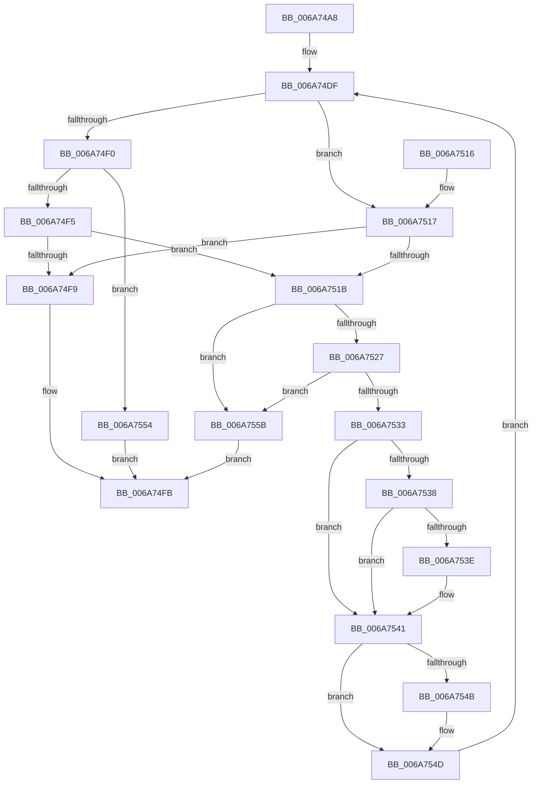

# IpmiLibpKcsSpinRegister

- RVA: `0x006A74A8`–`0x006A7562` (길이 `186` bytes)
- VA: `0x00000001406A74A8`
- 실행 섹션: `.text`
- PDB 이름 있음: `예`; PDB Function 태그: `아니요`
- unwind 정보 RVA: `0x000ADF10`
- 디코드: `58`개 명령, `186/186` bytes 표시
- 미해석 바이트: `0` (있으면 어셈블리에 `.byte`로 보존)

> 이 문서는 커널 이미지의 기계어와 PDB 기호를 분석해 생성했습니다. 4번과 5번은 함수 원형과 자료형을 바이너리 사용 방식에서 추정한 C 해석이며 원본 소스 복구 결과는 아닙니다.

## 1. Dependencies

- 직접 호출 지점: **5**; 고유 호출 대상: **4**
- 직접 호출자로 확인된 함수: **3**
- RIP 상대 이미지 참조: **3**

### Outgoing calls
- `0x006A74D7` → [IpmiLibpGetTimeout](IpmiLibpGetTimeout_function_006A6E4C.md) (function, `0x006A6E4C`)
- `0x006A74E4` → [IpmiLibReadOneByte](IpmiLibReadOneByte_function_006A69B8.md) (function, `0x006A69B8`)
- `0x006A751E` → [IpmiLibpTimeAfter](IpmiLibpTimeAfter_function_006A7568.md) (function, `0x006A7568`)
- `0x006A752A` → [IpmiLibpTimeAfter](IpmiLibpTimeAfter_function_006A7568.md) (function, `0x006A7568`)
- `0x006A754D` → [IpmiLibpDelay](IpmiLibpDelay_function_006A6E04.md) (function, `0x006A6E04`)

### Direct callers
- [IpmiLibpKcsHandleError](IpmiLibpKcsHandleError_function_006A6F48.md) at `0x006A6F79`
- [IpmiLibpKcsReceiveResponseFromBmc](IpmiLibpKcsReceiveResponseFromBmc_function_006A7098.md) at `0x006A710F`
- [IpmiLibpKcsReceiveResponseFromBmc](IpmiLibpKcsReceiveResponseFromBmc_function_006A7098.md) at `0x006A713C`
- [IpmiLibpKcsReceiveResponseFromBmc](IpmiLibpKcsReceiveResponseFromBmc_function_006A7098.md) at `0x006A71A2`
- [IpmiLibpKcsSendRequestToBMC](IpmiLibpKcsSendRequestToBMC_function_006A72BC.md) at `0x006A72FE`
- [IpmiLibpKcsSendRequestToBMC](IpmiLibpKcsSendRequestToBMC_function_006A72BC.md) at `0x006A7354`
- [IpmiLibpKcsSendRequestToBMC](IpmiLibpKcsSendRequestToBMC_function_006A72BC.md) at `0x006A73BD`
- [IpmiLibpKcsSendRequestToBMC](IpmiLibpKcsSendRequestToBMC_function_006A72BC.md) at `0x006A7429`

### Static image references
- `0x006A74C1` → RVA `0x00EFA0C8` (`.data`; read)
- `0x006A74CA` → RVA `0x00EFA0C4` (`.data`; read)
- `0x006A7541` → RVA `0x00EFA0CC` (`.data`; read)

## 2. Other-region calls and transfers

- 다른 실행 섹션으로 향하는 call: **0**
- 별도 외부 분기/꼬리 이동을 확인하지 못했습니다.

## 3. Assembly (complete function range)

```asm
006A74A8  48 8B C4                        mov rax, rsp
006A74AB  48 89 58 08                     mov qword ptr [rax + 8], rbx
006A74AF  48 89 68 10                     mov qword ptr [rax + 0x10], rbp
006A74B3  48 89 70 18                     mov qword ptr [rax + 0x18], rsi
006A74B7  48 89 78 20                     mov qword ptr [rax + 0x20], rdi
006A74BB  41 56                           push r14
006A74BD  48 83 EC 20                     sub rsp, 0x20
006A74C1  8B 2D 01 2C 85 00               mov ebp, dword ptr [rip + 0x852c01]
006A74C7  48 8B DA                        mov rbx, rdx
006A74CA  8B 15 F4 2B 85 00               mov edx, dword ptr [rip + 0x852bf4]
006A74D0  45 33 F6                        xor r14d, r14d
006A74D3  41 0F B7 F0                     movzx esi, r8w
006A74D7  E8 70 F9 FF FF                  call 0x1406a6e4c
006A74DC  48 8B F8                        mov rdi, rax
006A74DF  B2 01                           mov dl, 1
006A74E1  41 FF C6                        inc r14d
006A74E4  E8 CF F4 FF FF                  call 0x1406a69b8
006A74E9  8B D6                           mov edx, esi
006A74EB  83 EA 01                        sub edx, 1
006A74EE  74 27                           je 0x1406a7517
006A74F0  83 FA 01                        cmp edx, 1
006A74F3  75 5F                           jne 0x1406a7554
006A74F5  A8 02                           test al, 2
006A74F7  75 22                           jne 0x1406a751b
006A74F9  33 C0                           xor eax, eax
006A74FB  48 8B 5C 24 30                  mov rbx, qword ptr [rsp + 0x30]
006A7500  48 8B 6C 24 38                  mov rbp, qword ptr [rsp + 0x38]
006A7505  48 8B 74 24 40                  mov rsi, qword ptr [rsp + 0x40]
006A750A  48 8B 7C 24 48                  mov rdi, qword ptr [rsp + 0x48]
006A750F  48 83 C4 20                     add rsp, 0x20
006A7513  41 5E                           pop r14
006A7515  C3                              ret
006A7516  CC                              int3
006A7517  A8 01                           test al, 1
006A7519  75 DE                           jne 0x1406a74f9
006A751B  48 8B D3                        mov rdx, rbx
006A751E  E8 45 00 00 00                  call 0x1406a7568
006A7523  84 C0                           test al, al
006A7525  75 34                           jne 0x1406a755b
006A7527  48 8B D7                        mov rdx, rdi
006A752A  E8 39 00 00 00                  call 0x1406a7568
006A752F  84 C0                           test al, al
006A7531  75 28                           jne 0x1406a755b
006A7533  83 FD 32                        cmp ebp, 0x32
006A7536  73 09                           jae 0x1406a7541
006A7538  41 83 FE 28                     cmp r14d, 0x28
006A753C  75 03                           jne 0x1406a7541
006A753E  83 C5 64                        add ebp, 0x64
006A7541  8B 15 85 2B 85 00               mov edx, dword ptr [rip + 0x852b85]
006A7547  3B EA                           cmp ebp, edx
006A7549  73 02                           jae 0x1406a754d
006A754B  8B D5                           mov edx, ebp
006A754D  E8 B2 F8 FF FF                  call 0x1406a6e04
006A7552  EB 8B                           jmp 0x1406a74df
006A7554  B8 0D 00 00 C0                  mov eax, 0xc000000d
006A7559  EB A0                           jmp 0x1406a74fb
006A755B  B8 02 01 00 00                  mov eax, 0x102
006A7560  EB 99                           jmp 0x1406a74fb
```

## 4. C-style interpretation (structured pseudocode)

```c
__int64 __fastcall IpmiLibpKcsSpinRegister(__int64 a1, __int64 a2, unsigned __int16 a3)
{
    __int64 result;
    __int64 v_r14;
    __int64 v_rbp;
    __int64 v_rsp;
    unsigned __int64 v_stack_p10;
    unsigned __int64 v_stack_p18;
    unsigned __int64 v_stack_p20;
    unsigned __int64 v_stack_p8;

    *(unsigned __int64 *)(v_rsp + 8) = v_rbx;
    *(unsigned __int64 *)(v_rsp + 16) = v_rbp;
    *(unsigned __int64 *)(v_rsp + 24) = v_rsi;
    *(unsigned __int64 *)(v_rsp + 32) = v_rdi;
    v_rsp = (v_rsp) - (32);
    v_r14 = 0;
    result = IpmiLibpGetTimeout(a1, (unsigned int)(*(unsigned int *)(v_rip + 8727540)), a3, a4);
loc_006A74DF:
    v_r14 = (unsigned int)((v_r14) + 1);
    result = IpmiLibReadOneByte(a1, 1, a3, a4);
    a2 = (unsigned int)(((unsigned int)(a3)) - (1));
    if (condition_is_equal) goto loc_006A7517;
    if (((unsigned int)(a2)) != 1) goto loc_006A7554;
    if ((((unsigned __int8)(result)) & (2)) != 0) goto loc_006A751B;
loc_006A74F9:
    result = 0;
loc_006A74FB:
    v_rsp = (v_rsp) + (32);
    return result;
loc_006A7517:
    if (((0) & (1)) != 0) goto loc_006A74F9;
loc_006A751B:
    result = IpmiLibpTimeAfter(a1, v_stack_p8, a3, a4);
    if ((unsigned __int8)(result) != 0) goto loc_006A755B;
    result = IpmiLibpTimeAfter(a1, v_stack_p20, a3, a4);
    if ((unsigned __int8)(result) != 0) goto loc_006A755B;
    if (((unsigned int)(v_stack_p10)) >= 50) goto loc_006A7541;
    v_rbp = v_stack_p10;
    if (((unsigned int)(v_r14)) == 40) {
        v_rbp = (unsigned int)((v_stack_p10) + (100));
    }
    if (((unsigned int)(v_rbp)) < ((unsigned int)((unsigned int)(*(unsigned int *)(v_rip + 8727429))))) {
        a2 = (unsigned int)(v_rbp);
    }
    result = IpmiLibpDelay(a1, a2, a3, a4);
    goto loc_006A74DF;
loc_006A7554:
    goto loc_006A74FB;
loc_006A755B:
    goto loc_006A74FB;
}
```

## 5. (Beta) C Style

```c
int64_t IpmiLibpKcsSpinRegister(int64_t Arg1, int64_t Arg2, uint16_t Arg3)
{
    int64_t result;
    int64_t local_r14;
    int64_t local_rbp;
    int64_t local_rsp;
    uint64_t v_stack_p10;
    uint64_t v_stack_p18;
    uint64_t v_stack_p20;
    uint64_t v_stack_p8;

    *(uint64_t *)(local_rsp + 0x8) = local_rbx;
    *(uint64_t *)(local_rsp + 0x10) = local_rbp;
    *(uint64_t *)(local_rsp + 0x18) = local_rsi;
    *(uint64_t *)(local_rsp + 0x20) = local_rdi;
    local_rsp = (local_rsp) - (32);
    local_r14 = 0;
    result = IpmiLibpGetTimeout(Arg1, (uint32_t)(*(uint32_t *)(v_rip + 0x852BF4)), Arg3, a4);
loc_006A74DF:
    local_r14 = (uint32_t)((local_r14) + 1);
    result = IpmiLibReadOneByte(Arg1, 1, Arg3, a4);
    Arg2 = (uint32_t)(((uint32_t)(Arg3)) - (1));
    if (condition_is_equal) goto loc_006A7517;
    if (((uint32_t)(Arg2)) != 1) goto loc_006A7554;
    if ((((uint8_t)(result)) & (2)) != 0) goto loc_006A751B;
loc_006A74F9:
    result = 0;
loc_006A74FB:
    local_rsp = (local_rsp) + (32);
    return result;
loc_006A7517:
    if (((0) & (1)) != 0) goto loc_006A74F9;
loc_006A751B:
    result = IpmiLibpTimeAfter(Arg1, v_stack_p8, Arg3, a4);
    if ((uint8_t)(result) != 0) goto loc_006A755B;
    result = IpmiLibpTimeAfter(Arg1, v_stack_p20, Arg3, a4);
    if ((uint8_t)(result) != 0) goto loc_006A755B;
    if (((uint32_t)(v_stack_p10)) >= 50) goto loc_006A7541;
    local_rbp = v_stack_p10;
    if (((uint32_t)(local_r14)) == 40) {
        local_rbp = (uint32_t)((v_stack_p10) + (100));
    }
    if (((uint32_t)(local_rbp)) < ((uint32_t)((uint32_t)(*(uint32_t *)(v_rip + 0x852B85))))) {
        Arg2 = (uint32_t)(local_rbp);
    }
    result = IpmiLibpDelay(Arg1, Arg2, Arg3, a4);
    goto loc_006A74DF;
loc_006A7554:
    goto loc_006A74FB;
loc_006A755B:
    goto loc_006A74FB;
}
```

## 6. Execution-region graph

[열기: 2D/3D 그래프와 함수 탐색 컨트롤 패널](../../../control-panel.html?section=text&rva=0x006A74A8&view=graph)

- 2D 그래프는 위에서 아래로 흐르고, 3D 그래프는 빈 공간을 드래그해 회전합니다. Shift+드래그는 이동, 휠은 확대·축소, 함수 노드 선택은 대상 보고서 이동입니다.

### Static fallback


