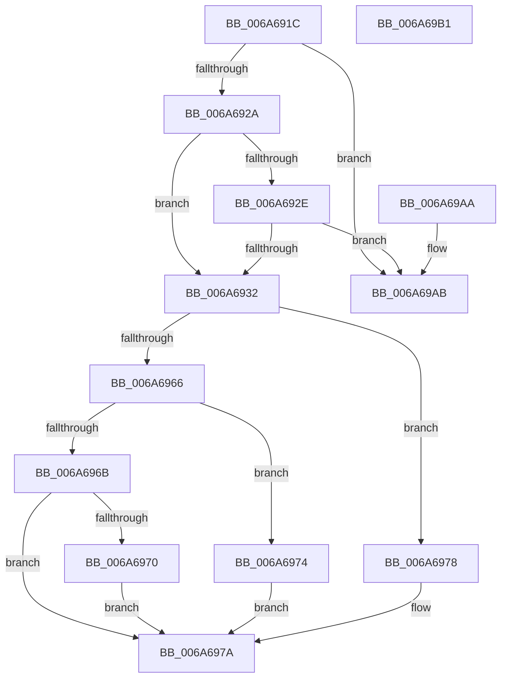

# IpmiLibpParseDeviceInfo

- RVA: `0x006A691C`–`0x006A69B2` (길이 `150` bytes)
- VA: `0x00000001406A691C`
- 실행 섹션: `.text`
- PDB 이름 있음: `예`; PDB Function 태그: `아니요`
- unwind 정보 RVA: `0x000DB714`
- 디코드: `45`개 명령, `150/150` bytes 표시
- 미해석 바이트: `0` (있으면 어셈블리에 `.byte`로 보존)

> 이 문서는 커널 이미지의 기계어와 PDB 기호를 분석해 생성했습니다. 4번과 5번은 함수 원형과 자료형을 바이너리 사용 방식에서 추정한 C 해석이며 원본 소스 복구 결과는 아닙니다.

## 1. Dependencies

- 직접 호출 지점: **0**; 고유 호출 대상: **0**
- 직접 호출자로 확인된 함수: **1**
- RIP 상대 이미지 참조: **8**

### Outgoing calls
- 직접 디코드된 call 명령이 없습니다.

### Direct callers
- [IpmiHwInitializeContext](IpmiHwInitializeContext_function_006A64F8.md) at `0x006A6561`

### Static image references
- `0x006A6935` → RVA `0x00EFA080` (`.data`; read)
- `0x006A693C` → RVA `0x00EFA090` (`.data`; read)
- `0x006A6947` → RVA `0x00EFA080` (`.data`; write)
- `0x006A6954` → RVA `0x00EFA084` (`.data`; write)
- `0x006A697A` → RVA `0x00EFA088` (`.data`; write)
- `0x006A6988` → RVA `0x00EFA090` (`.data`; write)
- `0x006A6995` → RVA `0x00EFA098` (`.data`; write)
- `0x006A69A1` → RVA `0x00EFA099` (`.data`; write)

## 2. Other-region calls and transfers

- 다른 실행 섹션으로 향하는 call: **0**
- 별도 외부 분기/꼬리 이동을 확인하지 못했습니다.

## 3. Assembly (complete function range)

```asm
006A691C  8A 42 05                        mov al, byte ptr [rdx + 5]
006A691F  4C 8B C2                        mov r8, rdx
006A6922  3C 10                           cmp al, 0x10
006A6924  0F 84 81 00 00 00               je 0x1406a69ab
006A692A  3C 15                           cmp al, 0x15
006A692C  74 04                           je 0x1406a6932
006A692E  3C 20                           cmp al, 0x20
006A6930  75 79                           jne 0x1406a69ab
006A6932  0F 57 C0                        xorps xmm0, xmm0
006A6935  0F 11 05 44 37 85 00            movups xmmword ptr [rip + 0x853744], xmm0
006A693C  0F 11 05 4D 37 85 00            movups xmmword ptr [rip + 0x85374d], xmm0
006A6943  0F B6 42 05                     movzx eax, byte ptr [rdx + 5]
006A6947  66 89 05 32 37 85 00            mov word ptr [rip + 0x853732], ax
006A694E  0F B6 42 04                     movzx eax, byte ptr [rdx + 4]
006A6952  33 D2                           xor edx, edx
006A6954  89 05 2A 37 85 00               mov dword ptr [rip + 0x85372a], eax
006A695A  41 0F B6 48 10                  movzx ecx, byte ptr [r8 + 0x10]
006A695F  C1 E9 06                        shr ecx, 6
006A6962  85 C9                           test ecx, ecx
006A6964  74 12                           je 0x1406a6978
006A6966  83 E9 01                        sub ecx, 1
006A6969  74 09                           je 0x1406a6974
006A696B  83 F9 01                        cmp ecx, 1
006A696E  75 0A                           jne 0x1406a697a
006A6970  B2 10                           mov dl, 0x10
006A6972  EB 06                           jmp 0x1406a697a
006A6974  B2 04                           mov dl, 4
006A6976  EB 02                           jmp 0x1406a697a
006A6978  B2 01                           mov dl, 1
006A697A  88 15 08 37 85 00               mov byte ptr [rip + 0x853708], dl
006A6980  49 8B 40 08                     mov rax, qword ptr [r8 + 8]
006A6984  48 83 E0 FE                     and rax, 0xfffffffffffffffe
006A6988  48 89 05 01 37 85 00            mov qword ptr [rip + 0x853701], rax
006A698F  41 8A 40 08                     mov al, byte ptr [r8 + 8]
006A6993  24 01                           and al, 1
006A6995  88 05 FD 36 85 00               mov byte ptr [rip + 0x8536fd], al
006A699B  41 8A 40 06                     mov al, byte ptr [r8 + 6]
006A699F  24 FE                           and al, 0xfe
006A69A1  88 05 F2 36 85 00               mov byte ptr [rip + 0x8536f2], al
006A69A7  33 C0                           xor eax, eax
006A69A9  C3                              ret
006A69AA  CC                              int3
006A69AB  B8 BB 00 00 C0                  mov eax, 0xc00000bb
006A69B0  C3                              ret
006A69B1  CC                              int3
```

## 4. C-style interpretation (structured pseudocode)

```c
__int64 __fastcall IpmiLibpParseDeviceInfo(__int64 a1, __int64 a2)
{
    __int64 result;

    if (((unsigned __int8)(*(unsigned __int8 *)(a2 + 5))) == 16) goto loc_006A69AB;
    if (((unsigned __int8)(*(unsigned __int8 *)(a2 + 5))) == 21) goto loc_006A6932;
    if (((unsigned __int8)(*(unsigned __int8 *)(a2 + 5))) != 32) goto loc_006A69AB;
loc_006A6932:
    *(unsigned __int64 *)(v_rip + 8730436) = v_xmm0;
    *(unsigned __int64 *)(v_rip + 8730445) = v_xmm0;
    *(unsigned __int16 *)(v_rip + 8730418) = (unsigned __int16)(*(unsigned __int8 *)(a2 + 5));
    a2 = 0;
    *(unsigned int *)(v_rip + 8730410) = (unsigned int)(*(unsigned __int8 *)(a2 + 4));
    a1 = (unsigned int)((*(unsigned __int8 *)(a2 + 16)) >> (6));
    if ((unsigned int)(a1) == 0) goto loc_006A6978;
    a1 = (unsigned int)((a1) - (1));
    if (condition_is_equal) goto loc_006A6974;
    if (((unsigned int)(a1)) != 1) goto loc_006A697A;
    goto loc_006A697A;
loc_006A6974:
    goto loc_006A697A;
loc_006A6978:
loc_006A697A:
    *(unsigned __int8 *)(v_rip + 8730376) = 1;
    result = (*(unsigned __int64 *)(a2 + 8)) & (-2);
    *(unsigned __int64 *)(v_rip + 8730369) = result;
    result = (unsigned __int8)((*(unsigned __int8 *)(a2 + 8)) & (1));
    *(unsigned __int8 *)(v_rip + 8730365) = (unsigned __int8)(result);
    result = (unsigned __int8)((*(unsigned __int8 *)(a2 + 6)) & (254));
    *(unsigned __int8 *)(v_rip + 8730354) = (unsigned __int8)(result);
    result = 0;
    return result;
loc_006A69AB:
    return (unsigned int)(0xC00000BBULL);
}
```

## 5. (Beta) C Style

```c
int64_t IpmiLibpParseDeviceInfo(int64_t Arg1, void *Arg2)
{
    uint8_t *arg2 = (uint8_t *)Arg2;

    int64_t result;

    if (((uint8_t)(*(uint8_t *)(arg2 + 0x5))) == 16) goto loc_006A69AB;
    if (((uint8_t)(*(uint8_t *)(arg2 + 0x5))) == 21) goto loc_006A6932;
    if (((uint8_t)(*(uint8_t *)(arg2 + 0x5))) != 32) goto loc_006A69AB;
loc_006A6932:
    *(uint64_t *)(v_rip + 0x853744) = v_xmm0;
    *(uint64_t *)(v_rip + 0x85374D) = v_xmm0;
    *(uint16_t *)(v_rip + 0x853732) = (uint16_t)(*(uint8_t *)(arg2 + 0x5));
    Arg2 = 0;
    *(uint32_t *)(v_rip + 0x85372A) = (uint32_t)(*(uint8_t *)(arg2 + 0x4));
    Arg1 = (uint32_t)((*(uint8_t *)(arg2 + 0x10)) >> (6));
    if ((uint32_t)(Arg1) == 0) goto loc_006A6978;
    Arg1 = (uint32_t)((Arg1) - (1));
    if (condition_is_equal) goto loc_006A6974;
    if (((uint32_t)(Arg1)) != 1) goto loc_006A697A;
    goto loc_006A697A;
loc_006A6974:
    goto loc_006A697A;
loc_006A6978:
loc_006A697A:
    *(uint8_t *)(v_rip + 0x853708) = 1;
    result = (*(uint64_t *)(arg2 + 0x8)) & (-2);
    *(uint64_t *)(v_rip + 0x853701) = result;
    result = (uint8_t)((*(uint8_t *)(arg2 + 0x8)) & (1));
    *(uint8_t *)(v_rip + 0x8536FD) = (uint8_t)(result);
    result = (uint8_t)((*(uint8_t *)(arg2 + 0x6)) & (254));
    *(uint8_t *)(v_rip + 0x8536F2) = (uint8_t)(result);
    result = 0;
    return result;
loc_006A69AB:
    return (uint32_t)(0xC00000BBULL);
}
```

### 관측된 메모리 오프셋

구조체 형식이 확인되지 않은 접근은 인자 기준의 오프셋으로만 기록했습니다.

| 기준 인자 | 오프셋 표현 | 폭 (bit) | 접근 |
|---|---:|---:|---|
| `Arg2` | `+ 0x4` | `8` | `R` |
| `Arg2` | `+ 0x5` | `8` | `R` |
| `Arg2` | `+ 0x6` | `8` | `R` |
| `Arg2` | `+ 0x8` | `8` | `R` |
| `Arg2` | `+ 0x8` | `64` | `R` |
| `Arg2` | `+ 0x10` | `8` | `R` |

## 6. Execution-region graph

[열기: 2D/3D 그래프와 함수 탐색 컨트롤 패널](../../../control-panel.html?section=text&rva=0x006A691C&view=graph)

- 2D 그래프는 위에서 아래로 흐르고, 3D 그래프는 빈 공간을 드래그해 회전합니다. Shift+드래그는 이동, 휠은 확대·축소, 함수 노드 선택은 대상 보고서 이동입니다.

### Static fallback


