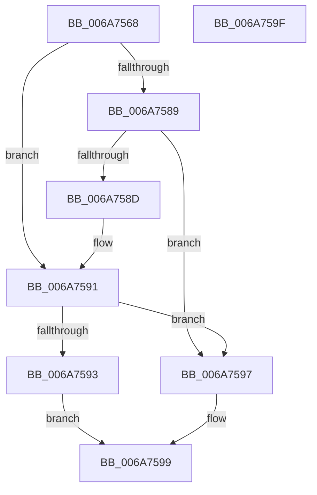

# IpmiLibpTimeAfter

- RVA: `0x006A7568`–`0x006A75A0` (길이 `56` bytes)
- VA: `0x00000001406A7568`
- 실행 섹션: `.text`
- PDB 이름 있음: `예`; PDB Function 태그: `아니요`
- unwind 정보 RVA: `0x000805BC`
- 디코드: `21`개 명령, `56/56` bytes 표시
- 미해석 바이트: `0` (있으면 어셈블리에 `.byte`로 보존)

> 이 문서는 커널 이미지의 기계어와 PDB 기호를 분석해 생성했습니다. 4번과 5번은 함수 원형과 자료형을 바이너리 사용 방식에서 추정한 C 해석이며 원본 소스 복구 결과는 아닙니다.

## 1. Dependencies

- 직접 호출 지점: **1**; 고유 호출 대상: **1**
- 직접 호출자로 확인된 함수: **1**
- RIP 상대 이미지 참조: **0**

### Outgoing calls
- `0x006A7577` → [KeQueryPerformanceCounter](../37/KeQueryPerformanceCounter_function_0037E7E0.md) (function, `0x0037E7E0`)

### Direct callers
- [IpmiLibpKcsSpinRegister](IpmiLibpKcsSpinRegister_function_006A74A8.md) at `0x006A751E`
- [IpmiLibpKcsSpinRegister](IpmiLibpKcsSpinRegister_function_006A74A8.md) at `0x006A752A`

### Static image references
- 디코드된 RIP-relative 메모리 참조가 없습니다.

## 2. Other-region calls and transfers

- 다른 실행 섹션으로 향하는 call: **0**
- 별도 외부 분기/꼬리 이동을 확인하지 못했습니다.

## 3. Assembly (complete function range)

```asm
006A7568  48 89 54 24 10                  mov qword ptr [rsp + 0x10], rdx
006A756D  53                              push rbx
006A756E  48 83 EC 20                     sub rsp, 0x20
006A7572  33 C9                           xor ecx, ecx
006A7574  48 8B DA                        mov rbx, rdx
006A7577  E8 64 72 CD FF                  call 0x14037e7e0
006A757C  48 8B C8                        mov rcx, rax
006A757F  48 C1 E9 20                     shr rcx, 0x20
006A7583  3B 4C 24 3C                     cmp ecx, dword ptr [rsp + 0x3c]
006A7587  75 08                           jne 0x1406a7591
006A7589  3B C3                           cmp eax, ebx
006A758B  73 0A                           jae 0x1406a7597
006A758D  3B 4C 24 3C                     cmp ecx, dword ptr [rsp + 0x3c]
006A7591  7F 04                           jg 0x1406a7597
006A7593  32 C0                           xor al, al
006A7595  EB 02                           jmp 0x1406a7599
006A7597  B0 01                           mov al, 1
006A7599  48 83 C4 20                     add rsp, 0x20
006A759D  5B                              pop rbx
006A759E  C3                              ret
006A759F  CC                              int3
```

## 4. C-style interpretation (structured pseudocode)

```c
__int64 __fastcall IpmiLibpTimeAfter(int a1, __int64 a2)
{
    __int64 result;
    __int64 v_rsp;
    unsigned __int64 v_stack_p10;
    unsigned int v_stack_p14;

    v_stack_p10 = a2;
    v_rsp = (v_rsp) - (32);
    a1 = 0;
    result = KeQueryPerformanceCounter(a1, a2, a3, a4);
    a1 = (result) >> (32);
    if (a1 != v_stack_p14) goto loc_006A7591;
    if (((unsigned int)(result)) >= ((unsigned int)(a2))) goto loc_006A7597;
loc_006A7591:
    if (a1 > v_stack_p14) goto loc_006A7597;
    result = 0;
    goto loc_006A7599;
loc_006A7597:
loc_006A7599:
    v_rsp = (v_rsp) + (32);
    return 1;
}
```

## 5. (Beta) C Style

```c
int64_t IpmiLibpTimeAfter(int32_t Arg1, int64_t Arg2)
{
    int64_t result;
    int64_t local_rsp;
    uint64_t v_stack_p10;
    uint32_t v_stack_p14;

    v_stack_p10 = Arg2;
    local_rsp = (local_rsp) - (32);
    Arg1 = 0;
    result = KeQueryPerformanceCounter(Arg1, Arg2, a3, a4);
    Arg1 = (result) >> (32);
    if (Arg1 != v_stack_p14) goto loc_006A7591;
    if (((uint32_t)(result)) >= ((uint32_t)(Arg2))) goto loc_006A7597;
loc_006A7591:
    if (Arg1 > v_stack_p14) goto loc_006A7597;
    result = 0;
    goto loc_006A7599;
loc_006A7597:
loc_006A7599:
    local_rsp = (local_rsp) + (32);
    return 1;
}
```

## 6. Execution-region graph

[열기: 2D/3D 그래프와 함수 탐색 컨트롤 패널](../../../control-panel.html?section=text&rva=0x006A7568&view=graph)

- 2D 그래프는 위에서 아래로 흐르고, 3D 그래프는 빈 공간을 드래그해 회전합니다. Shift+드래그는 이동, 휠은 확대·축소, 함수 노드 선택은 대상 보고서 이동입니다.

### Static fallback


