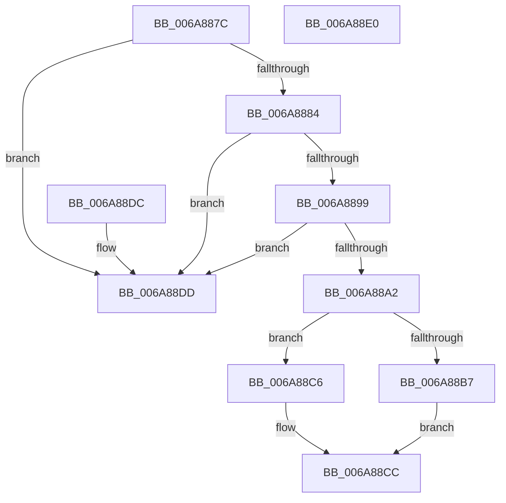

# KevSkipVerification

- RVA: `0x006A887C`–`0x006A88E1` (길이 `101` bytes)
- VA: `0x00000001406A887C`
- 실행 섹션: `.text`
- PDB 이름 있음: `예`; PDB Function 태그: `아니요`
- unwind 정보 RVA: `0x000DB714`
- 디코드: `28`개 명령, `101/101` bytes 표시
- 미해석 바이트: `0` (있으면 어셈블리에 `.byte`로 보존)

> 이 문서는 커널 이미지의 기계어와 PDB 기호를 분석해 생성했습니다. 4번과 5번은 함수 원형과 자료형을 바이너리 사용 방식에서 추정한 C 해석이며 원본 소스 복구 결과는 아닙니다.

## 1. Dependencies

- 직접 호출 지점: **0**; 고유 호출 대상: **0**
- 직접 호출자로 확인된 함수: **1**
- RIP 상대 이미지 참조: **2**

### Outgoing calls
- 직접 디코드된 call 명령이 없습니다.

### Direct callers
- [ExFreePoolSanityChecks](../../pagevrfy/BB/ExFreePoolSanityChecks_function_00BB44A0.md) at `0x00BB44BF`

### Static image references
- `0x006A88AF` → RVA `0x00FC5030` (`ALMOSTRO`; read)
- `0x006A88B7` → RVA `0x00FC8C40` (`ALMOSTRO`; read)

## 2. Other-region calls and transfers

- 다른 실행 섹션으로 향하는 call: **0**
- 별도 외부 분기/꼬리 이동을 확인하지 못했습니다.

## 3. Assembly (complete function range)

```asm
006A887C  44 0F 20 C0                     mov rax, cr8
006A8880  3C 02                           cmp al, 2
006A8882  72 59                           jb 0x1406a88dd
006A8884  65 48 8B 0C 25 20 00 00 00      mov rcx, qword ptr gs:[0x20]
006A888D  33 D2                           xor edx, edx
006A888F  8A 81 BA 38 00 00               mov al, byte ptr [rcx + 0x38ba]
006A8895  84 C0                           test al, al
006A8897  74 44                           je 0x1406a88dd
006A8899  F6 81 BC 38 00 00 08            test byte ptr [rcx + 0x38bc], 8
006A88A0  74 3B                           je 0x1406a88dd
006A88A2  49 B8 08 00 00 00 80 F7 FF FF   movabs r8, 0xfffff78000000008
006A88AC  4D 8B 00                        mov r8, qword ptr [r8]
006A88AF  39 15 7B C7 91 00               cmp dword ptr [rip + 0x91c77b], edx
006A88B5  74 0F                           je 0x1406a88c6
006A88B7  48 8B 05 82 03 92 00            mov rax, qword ptr [rip + 0x920382]
006A88BE  8B 88 14 83 00 00               mov ecx, dword ptr [rax + 0x8314]
006A88C4  EB 06                           jmp 0x1406a88cc
006A88C6  8B 89 14 83 00 00               mov ecx, dword ptr [rcx + 0x8314]
006A88CC  49 C1 E8 12                     shr r8, 0x12
006A88D0  83 C1 64                        add ecx, 0x64
006A88D3  41 3B C8                        cmp ecx, r8d
006A88D6  0F 92 C2                        setb dl
006A88D9  8B C2                           mov eax, edx
006A88DB  C3                              ret
006A88DC  CC                              int3
006A88DD  33 C0                           xor eax, eax
006A88DF  C3                              ret
006A88E0  CC                              int3
```

## 4. C-style interpretation (structured pseudocode)

```c
__int64 __fastcall KevSkipVerification(__int64 a1, int a2)
{
    __int64 result;

    if (((unsigned __int8)(v_cr8)) < 2) goto loc_006A88DD;
    a2 = 0;
    if ((unsigned __int8)(*(unsigned __int8 *)(*(unsigned __int64 *)(gs_base + (0 + 32)) + 14522)) == 0) goto loc_006A88DD;
    if (((*(unsigned __int8 *)(*(unsigned __int64 *)(gs_base + (0 + 32)) + 14524)) & (8)) == 0) goto loc_006A88DD;
    if ((*(unsigned int *)(v_rip + 9553787)) == 0) goto loc_006A88C6;
    goto loc_006A88CC;
loc_006A88C6:
loc_006A88CC:
    a3 = (*(unsigned __int64 *)(a3)) >> (18);
    a1 = (unsigned int)(((unsigned int)(*(unsigned int *)((unsigned int)(*(unsigned int *)(*(unsigned __int64 *)(v_rip + 9569154) + 33556)) + 33556))) + (100));
    a2 = (((unsigned int)(a1)) < ((unsigned int)(a3))) ? 1 : 0;
    return (unsigned int)(a2);
loc_006A88DD:
    result = 0;
    return result;
}
```

## 5. (Beta) C Style

```c
int64_t KevSkipVerification(int64_t Arg1, int32_t Arg2)
{
    int64_t result;

    if (((uint8_t)(v_cr8)) < 2) goto loc_006A88DD;
    Arg2 = 0;
    if ((uint8_t)(*(uint8_t *)(*(uint64_t *)(gs_base + (0 + 0x20)) + 0x38BA)) == 0) goto loc_006A88DD;
    if (((*(uint8_t *)(*(uint64_t *)(gs_base + (0 + 0x20)) + 0x38BC)) & (8)) == 0) goto loc_006A88DD;
    if ((*(uint32_t *)(v_rip + 0x91C77B)) == 0) goto loc_006A88C6;
    goto loc_006A88CC;
loc_006A88C6:
loc_006A88CC:
    a3 = (*(uint64_t *)(a3)) >> (18);
    Arg1 = (uint32_t)(((uint32_t)(*(uint32_t *)((uint32_t)(*(uint32_t *)(*(uint64_t *)(v_rip + 0x920382) + 0x8314)) + 0x8314))) + (100));
    Arg2 = (((uint32_t)(Arg1)) < ((uint32_t)(a3))) ? 1 : 0;
    return (uint32_t)(Arg2);
loc_006A88DD:
    result = 0;
    return result;
}
```

## 6. Execution-region graph

[열기: 2D/3D 그래프와 함수 탐색 컨트롤 패널](../../../control-panel.html?section=text&rva=0x006A887C&view=graph)

- 2D 그래프는 위에서 아래로 흐르고, 3D 그래프는 빈 공간을 드래그해 회전합니다. Shift+드래그는 이동, 휠은 확대·축소, 함수 노드 선택은 대상 보고서 이동입니다.

### Static fallback


