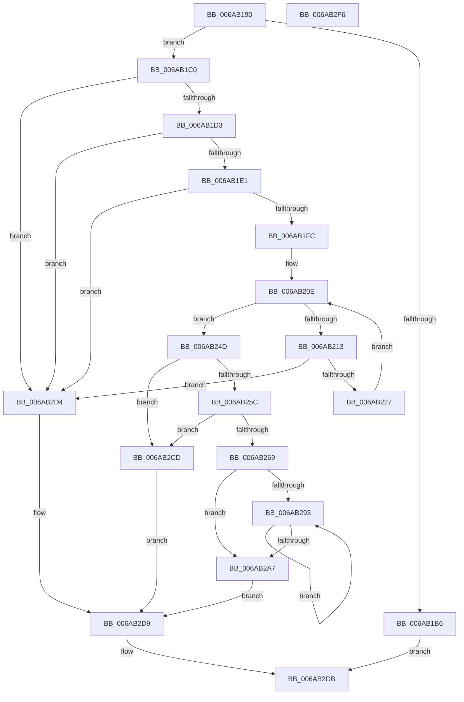

# LkmdTelInsertTriageDataBlock

- RVA: `0x006AB190`–`0x006AB2F7` (길이 `359` bytes)
- VA: `0x00000001406AB190`
- 실행 섹션: `.text`
- PDB 이름 있음: `예`; PDB Function 태그: `아니요`
- unwind 정보 RVA: `0x0005E6B4`
- 디코드: `102`개 명령, `359/359` bytes 표시
- 미해석 바이트: `0` (있으면 어셈블리에 `.byte`로 보존)

> 이 문서는 커널 이미지의 기계어와 PDB 기호를 분석해 생성했습니다. 4번과 5번은 함수 원형과 자료형을 바이너리 사용 방식에서 추정한 C 해석이며 원본 소스 복구 결과는 아닙니다.

## 1. Dependencies

- 직접 호출 지점: **2**; 고유 호출 대상: **1**
- 직접 호출자로 확인된 함수: **1**
- RIP 상대 이미지 참조: **0**

### Outgoing calls
- `0x006AB279` → [memcpy](../6C/memcpy_function_006C6840.md) (function, `0x006C6840`)
- `0x006AB2C6` → [memcpy](../6C/memcpy_function_006C6840.md) (function, `0x006C6840`)

### Direct callers
- [WheapReportLiveDump](../../page/7D/WheapReportLiveDump_function_007D88E8.md) at `0x007D8977`

### Static image references
- 디코드된 RIP-relative 메모리 참조가 없습니다.

## 2. Other-region calls and transfers

- 다른 실행 섹션으로 향하는 call: **0**
- 별도 외부 분기/꼬리 이동을 확인하지 못했습니다.

## 3. Assembly (complete function range)

```asm
006AB190  48 8B C4                        mov rax, rsp
006AB193  48 89 58 08                     mov qword ptr [rax + 8], rbx
006AB197  48 89 68 10                     mov qword ptr [rax + 0x10], rbp
006AB19B  48 89 70 18                     mov qword ptr [rax + 0x18], rsi
006AB19F  48 89 78 20                     mov qword ptr [rax + 0x20], rdi
006AB1A3  41 56                           push r14
006AB1A5  48 83 EC 20                     sub rsp, 0x20
006AB1A9  33 DB                           xor ebx, ebx
006AB1AB  41 8B E8                        mov ebp, r8d
006AB1AE  4C 8B F2                        mov r14, rdx
006AB1B1  45 85 C0                        test r8d, r8d
006AB1B4  75 0A                           jne 0x1406ab1c0
006AB1B6  B8 0D 00 00 C0                  mov eax, 0xc000000d
006AB1BB  E9 1B 01 00 00                  jmp 0x1406ab2db
006AB1C0  48 8B 39                        mov rdi, qword ptr [rcx]
006AB1C3  F7 87 38 10 00 00 00 08 00 00   test dword ptr [rdi + 0x1038], 0x800
006AB1CD  0F 84 01 01 00 00               je 0x1406ab2d4
006AB1D3  8B 97 7C 20 00 00               mov edx, dword ptr [rdi + 0x207c]
006AB1D9  85 D2                           test edx, edx
006AB1DB  0F 84 F3 00 00 00               je 0x1406ab2d4
006AB1E1  8B 8F 78 20 00 00               mov ecx, dword ptr [rdi + 0x2078]
006AB1E7  8B C2                           mov eax, edx
006AB1E9  48 C1 E0 04                     shl rax, 4
006AB1ED  48 03 C1                        add rax, rcx
006AB1F0  48 3D 00 00 04 00               cmp rax, 0x40000
006AB1F6  0F 87 D8 00 00 00               ja 0x1406ab2d4
006AB1FC  4C 8D 57 0C                     lea r10, [rdi + 0xc]
006AB200  41 B9 00 00 04 00               mov r9d, 0x40000
006AB206  4C 03 D1                        add r10, rcx
006AB209  8B F3                           mov esi, ebx
006AB20B  44 8B DB                        mov r11d, ebx
006AB20E  44 3B DA                        cmp r11d, edx
006AB211  73 3A                           jae 0x1406ab24d
006AB213  45 8B 42 FC                     mov r8d, dword ptr [r10 - 4]
006AB217  41 8D 40 07                     lea eax, [r8 + 7]
006AB21B  83 E0 F8                        and eax, 0xfffffff8
006AB21E  44 3B C0                        cmp r8d, eax
006AB221  0F 85 AD 00 00 00               jne 0x1406ab2d4
006AB227  41 8B 0A                        mov ecx, dword ptr [r10]
006AB22A  41 FF C3                        inc r11d
006AB22D  83 C1 07                        add ecx, 7
006AB230  49 83 C2 10                     add r10, 0x10
006AB234  41 03 C8                        add ecx, r8d
006AB237  83 E1 F8                        and ecx, 0xfffffff8
006AB23A  45 3B C1                        cmp r8d, r9d
006AB23D  45 0F 43 C1                     cmovae r8d, r9d
006AB241  3B CE                           cmp ecx, esi
006AB243  45 8B C8                        mov r9d, r8d
006AB246  0F 46 CE                        cmovbe ecx, esi
006AB249  8B F1                           mov esi, ecx
006AB24B  EB C1                           jmp 0x1406ab20e
006AB24D  B9 FC FF 03 00                  mov ecx, 0x3fffc
006AB252  2B CE                           sub ecx, esi
006AB254  81 F9 00 00 04 00               cmp ecx, 0x40000
006AB25A  73 71                           jae 0x1406ab2cd
006AB25C  8D 45 07                        lea eax, [rbp + 7]
006AB25F  83 E0 F8                        and eax, 0xfffffff8
006AB262  83 C0 10                        add eax, 0x10
006AB265  3B C1                           cmp eax, ecx
006AB267  77 64                           ja 0x1406ab2cd
006AB269  41 8B D1                        mov edx, r9d
006AB26C  44 8B C6                        mov r8d, esi
006AB26F  48 03 D7                        add rdx, rdi
006AB272  45 2B C1                        sub r8d, r9d
006AB275  48 8D 4A 10                     lea rcx, [rdx + 0x10]
006AB279  E8 C2 B5 01 00                  call 0x1406c6840
006AB27E  8B 8F 78 20 00 00               mov ecx, dword ptr [rdi + 0x2078]
006AB284  8B D3                           mov edx, ebx
006AB286  8B 87 7C 20 00 00               mov eax, dword ptr [rdi + 0x207c]
006AB28C  48 03 CF                        add rcx, rdi
006AB28F  85 C0                           test eax, eax
006AB291  74 14                           je 0x1406ab2a7
006AB293  83 41 08 10                     add dword ptr [rcx + 8], 0x10
006AB297  FF C2                           inc edx
006AB299  8B 87 7C 20 00 00               mov eax, dword ptr [rdi + 0x207c]
006AB29F  48 83 C1 10                     add rcx, 0x10
006AB2A3  3B D0                           cmp edx, eax
006AB2A5  72 EC                           jb 0x1406ab293
006AB2A7  83 C6 10                        add esi, 0x10
006AB2AA  4C 8B C5                        mov r8, rbp
006AB2AD  FF C0                           inc eax
006AB2AF  49 8B D6                        mov rdx, r14
006AB2B2  89 87 7C 20 00 00               mov dword ptr [rdi + 0x207c], eax
006AB2B8  4C 89 31                        mov qword ptr [rcx], r14
006AB2BB  89 71 08                        mov dword ptr [rcx + 8], esi
006AB2BE  89 69 0C                        mov dword ptr [rcx + 0xc], ebp
006AB2C1  8B CE                           mov ecx, esi
006AB2C3  48 03 CF                        add rcx, rdi
006AB2C6  E8 75 B5 01 00                  call 0x1406c6840
006AB2CB  EB 0C                           jmp 0x1406ab2d9
006AB2CD  BB 23 00 00 C0                  mov ebx, 0xc0000023
006AB2D2  EB 05                           jmp 0x1406ab2d9
006AB2D4  BB 0D 00 00 C0                  mov ebx, 0xc000000d
006AB2D9  8B C3                           mov eax, ebx
006AB2DB  48 8B 5C 24 30                  mov rbx, qword ptr [rsp + 0x30]
006AB2E0  48 8B 6C 24 38                  mov rbp, qword ptr [rsp + 0x38]
006AB2E5  48 8B 74 24 40                  mov rsi, qword ptr [rsp + 0x40]
006AB2EA  48 8B 7C 24 48                  mov rdi, qword ptr [rsp + 0x48]
006AB2EF  48 83 C4 20                     add rsp, 0x20
006AB2F3  41 5E                           pop r14
006AB2F5  C3                              ret
006AB2F6  CC                              int3
```

## 4. C-style interpretation (structured pseudocode)

```c
__int64 __fastcall LkmdTelInsertTriageDataBlock(__int64 a1, __int64 a2, int a3)
{
    __int64 result;
    __int64 v_r10;
    __int64 v_r11;
    __int64 v_rbx;
    __int64 v_rsi;
    __int64 v_rsp;
    unsigned __int64 v_stack_p10;
    unsigned __int64 v_stack_p18;
    unsigned __int64 v_stack_p20;
    unsigned __int64 v_stack_p8;

    *(unsigned __int64 *)(v_rsp + 8) = v_rbx;
    *(unsigned __int64 *)(v_rsp + 16) = v_rbp;
    *(unsigned __int64 *)(v_rsp + 24) = v_rsi;
    *(unsigned __int64 *)(v_rsp + 32) = v_rdi;
    v_rsp = (v_rsp) - (32);
    v_rbx = 0;
    if (a3 != 0) goto loc_006AB1C0;
    goto loc_006AB2DB;
loc_006AB1C0:
    if (((*(unsigned int *)(*(unsigned __int64 *)(a1) + 4152)) & (0x800ULL)) == 0) goto loc_006AB2D4;
    if ((unsigned int)((unsigned int)(*(unsigned int *)(*(unsigned __int64 *)(a1) + 8316))) == 0) goto loc_006AB2D4;
    result = ((unsigned int)((unsigned int)((unsigned int)(*(unsigned int *)(*(unsigned __int64 *)(a1) + 8316))))) << (4);
    result = (result) + ((unsigned int)(*(unsigned int *)(*(unsigned __int64 *)(a1) + 8312)));
    if (result > 0x40000ULL) goto loc_006AB2D4;
    v_r10 = (*(unsigned __int64 *)(a1) + 12) + ((unsigned int)(*(unsigned int *)(*(unsigned __int64 *)(a1) + 8312)));
loc_006AB20E:
    if (0 >= ((unsigned int)((unsigned int)(*(unsigned int *)(*(unsigned __int64 *)(a1) + 8316))))) goto loc_006AB24D;
    result = (unsigned int)(((unsigned int)(*(unsigned int *)(v_r10 - 4)) + 7) & (0xFFFFFFF8ULL));
    if (((unsigned int)((unsigned int)(*(unsigned int *)(v_r10 - 4)))) != ((unsigned int)(result))) goto loc_006AB2D4;
    v_r11 = (unsigned int)((0) + 1);
    a1 = (unsigned int)(((unsigned int)(*(unsigned int *)(v_r10))) + (7));
    v_r10 = (v_r10) + (16);
    a1 = (unsigned int)((a1) + ((unsigned int)((unsigned int)(*(unsigned int *)(v_r10 - 4)))));
    a1 = (unsigned int)((a1) & (0xFFFFFFF8ULL));
    a3 = (unsigned int)(*(unsigned int *)(v_r10 - 4));
    if (((unsigned int)((unsigned int)(*(unsigned int *)(v_r10 - 4)))) >= ((unsigned int)((unsigned int)(0x40000ULL)))) { a3 = (unsigned int)((unsigned int)(0x40000ULL)); }
    if (((unsigned int)(a1)) <= 0) { a1 = 0; }
    goto loc_006AB20E;
loc_006AB24D:
    a1 = (unsigned int)(((unsigned int)(0x3FFFCULL)) - ((unsigned int)((unsigned int)((unsigned int)(a1)))));
    if (((unsigned int)(a1)) >= 0x40000ULL) goto loc_006AB2CD;
    result = (unsigned int)(((unsigned int)(a3) + 7) & (0xFFFFFFF8ULL));
    result = (unsigned int)((result) + (16));
    if (((unsigned int)(result)) > ((unsigned int)(a1))) goto loc_006AB2CD;
    a2 = ((unsigned int)((unsigned int)((unsigned int)(a3)))) + (*(unsigned __int64 *)(a1));
    a3 = (unsigned int)(((unsigned int)((unsigned int)((unsigned int)((unsigned int)(a1))))) - ((unsigned int)((unsigned int)(a3))));
    result = memcpy(a2 + 16, a2, a3, (unsigned int)(a3));
    a1 = ((unsigned int)(*(unsigned int *)(*(unsigned __int64 *)(a1) + 8312))) + (*(unsigned __int64 *)(a1));
    if ((unsigned int)((unsigned int)(*(unsigned int *)(*(unsigned __int64 *)(a1) + 8316))) == 0) goto loc_006AB2A7;
loc_006AB293:
    a2 = (unsigned int)((0) + 1);
    a1 = (a1) + (16);
    if (((unsigned int)(a2)) < ((unsigned int)((unsigned int)(*(unsigned int *)(*(unsigned __int64 *)(a1) + 8316))))) goto loc_006AB293;
loc_006AB2A7:
    v_rsi = (unsigned int)(((unsigned int)((unsigned int)(a1))) + (16));
    result = (unsigned int)(((unsigned int)(*(unsigned int *)(*(unsigned __int64 *)(a1) + 8316))) + 1);
    *(unsigned int *)(*(unsigned __int64 *)(a1) + 8316) = (unsigned int)(result);
    *(unsigned __int64 *)(a1) = a2;
    *(unsigned int *)(a1 + 8) = (unsigned int)(v_rsi);
    *(unsigned int *)(a1 + 12) = (unsigned int)((unsigned int)(a3));
    a1 = ((unsigned int)((unsigned int)(v_rsi))) + (*(unsigned __int64 *)(a1));
    result = memcpy(a1, a2, (unsigned int)(a3), (unsigned int)(a3));
    goto loc_006AB2D9;
loc_006AB2CD:
    goto loc_006AB2D9;
loc_006AB2D4:
loc_006AB2D9:
loc_006AB2DB:
    v_rsp = (v_rsp) + (32);
    return (unsigned int)((unsigned int)((unsigned int)(0xC000000DULL)));
}
```

## 5. (Beta) C Style

```c
int64_t LkmdTelInsertTriageDataBlock(void *Arg1, int64_t Arg2, void *Arg3)
{
    uint8_t *arg1 = (uint8_t *)Arg1;
    uint8_t *arg3 = (uint8_t *)Arg3;

    int64_t result;
    int64_t local_r10;
    int64_t local_r11;
    int64_t local_rbx;
    int64_t local_rsi;
    int64_t local_rsp;
    uint64_t v_stack_p10;
    uint64_t v_stack_p18;
    uint64_t v_stack_p20;
    uint64_t v_stack_p8;

    *(uint64_t *)(local_rsp + 0x8) = local_rbx;
    *(uint64_t *)(local_rsp + 0x10) = local_rbp;
    *(uint64_t *)(local_rsp + 0x18) = local_rsi;
    *(uint64_t *)(local_rsp + 0x20) = local_rdi;
    local_rsp = (local_rsp) - (32);
    local_rbx = 0;
    if (Arg3 != NULL) goto loc_006AB1C0;
    goto loc_006AB2DB;
loc_006AB1C0:
    if (((*(uint32_t *)(*(uint64_t *)(arg1) + 0x1038)) & (0x800ULL)) == 0) goto loc_006AB2D4;
    if ((uint32_t)((uint32_t)(*(uint32_t *)(*(uint64_t *)(arg1) + 0x207C))) == 0) goto loc_006AB2D4;
    result = ((uint32_t)((uint32_t)((uint32_t)(*(uint32_t *)(*(uint64_t *)(arg1) + 0x207C))))) << (4);
    result = (result) + ((uint32_t)(*(uint32_t *)(*(uint64_t *)(arg1) + 0x2078)));
    if (result > 0x40000ULL) goto loc_006AB2D4;
    local_r10 = (*(uint64_t *)(arg1) + 12) + ((uint32_t)(*(uint32_t *)(*(uint64_t *)(arg1) + 0x2078)));
loc_006AB20E:
    if (0 >= ((uint32_t)((uint32_t)(*(uint32_t *)(*(uint64_t *)(arg1) + 0x207C))))) goto loc_006AB24D;
    result = (uint32_t)(((uint32_t)(*(uint32_t *)(local_r10 - 0x4)) + 7) & (0xFFFFFFF8ULL));
    if (((uint32_t)((uint32_t)(*(uint32_t *)(local_r10 - 0x4)))) != ((uint32_t)(result))) goto loc_006AB2D4;
    local_r11 = (uint32_t)((0) + 1);
    Arg1 = (uint32_t)(((uint32_t)(*(uint32_t *)(local_r10))) + (7));
    local_r10 = (local_r10) + (16);
    Arg1 = (uint32_t)((Arg1) + ((uint32_t)((uint32_t)(*(uint32_t *)(local_r10 - 0x4)))));
    Arg1 = (uint32_t)((Arg1) & (0xFFFFFFF8ULL));
    Arg3 = (uint32_t)(*(uint32_t *)(local_r10 - 0x4));
    if (((uint32_t)((uint32_t)(*(uint32_t *)(local_r10 - 0x4)))) >= ((uint32_t)((uint32_t)(0x40000ULL)))) { Arg3 = (uint32_t)((uint32_t)(0x40000ULL)); }
    if (((uint32_t)(Arg1)) <= 0) { Arg1 = 0; }
    goto loc_006AB20E;
loc_006AB24D:
    Arg1 = (uint32_t)(((uint32_t)(0x3FFFCULL)) - ((uint32_t)((uint32_t)((uint32_t)(Arg1)))));
    if (((uint32_t)(Arg1)) >= 0x40000ULL) goto loc_006AB2CD;
    result = (uint32_t)(((uint32_t)(Arg3) + 7) & (0xFFFFFFF8ULL));
    result = (uint32_t)((result) + (16));
    if (((uint32_t)(result)) > ((uint32_t)(Arg1))) goto loc_006AB2CD;
    Arg2 = ((uint32_t)((uint32_t)((uint32_t)(Arg3)))) + (*(uint64_t *)(arg1));
    Arg3 = (uint32_t)(((uint32_t)((uint32_t)((uint32_t)((uint32_t)(Arg1))))) - ((uint32_t)((uint32_t)(Arg3))));
    result = memcpy(Arg2 + 16, Arg2, Arg3, (uint32_t)(Arg3));
    Arg1 = ((uint32_t)(*(uint32_t *)(*(uint64_t *)(arg1) + 0x2078))) + (*(uint64_t *)(arg1));
    if ((uint32_t)((uint32_t)(*(uint32_t *)(*(uint64_t *)(arg1) + 0x207C))) == 0) goto loc_006AB2A7;
loc_006AB293:
    Arg2 = (uint32_t)((0) + 1);
    Arg1 = (Arg1) + (16);
    if (((uint32_t)(Arg2)) < ((uint32_t)((uint32_t)(*(uint32_t *)(*(uint64_t *)(arg1) + 0x207C))))) goto loc_006AB293;
loc_006AB2A7:
    local_rsi = (uint32_t)(((uint32_t)((uint32_t)(Arg1))) + (16));
    result = (uint32_t)(((uint32_t)(*(uint32_t *)(*(uint64_t *)(arg1) + 0x207C))) + 1);
    *(uint32_t *)(*(uint64_t *)(arg1) + 0x207C) = (uint32_t)(result);
    *(uint64_t *)(arg1) = Arg2;
    *(uint32_t *)(arg1 + 0x8) = (uint32_t)(local_rsi);
    *(uint32_t *)(arg1 + 0xC) = (uint32_t)((uint32_t)(Arg3));
    Arg1 = ((uint32_t)((uint32_t)(local_rsi))) + (*(uint64_t *)(arg1));
    result = memcpy(Arg1, Arg2, (uint32_t)(Arg3), (uint32_t)(Arg3));
    goto loc_006AB2D9;
loc_006AB2CD:
    goto loc_006AB2D9;
loc_006AB2D4:
loc_006AB2D9:
loc_006AB2DB:
    local_rsp = (local_rsp) + (32);
    return (uint32_t)((uint32_t)((uint32_t)(0xC000000DULL)));
}
```

### 관측된 메모리 오프셋

구조체 형식이 확인되지 않은 접근은 인자 기준의 오프셋으로만 기록했습니다.

| 기준 인자 | 오프셋 표현 | 폭 (bit) | 접근 |
|---|---:|---:|---|
| `Arg1` | `+ 0x0` | `64` | `R` |
| `Arg3` | `+ 0x7` | `32` | `R` |

## 6. Execution-region graph

[열기: 2D/3D 그래프와 함수 탐색 컨트롤 패널](../../../control-panel.html?section=text&rva=0x006AB190&view=graph)

- 2D 그래프는 위에서 아래로 흐르고, 3D 그래프는 빈 공간을 드래그해 회전합니다. Shift+드래그는 이동, 휠은 확대·축소, 함수 노드 선택은 대상 보고서 이동입니다.

### Static fallback


