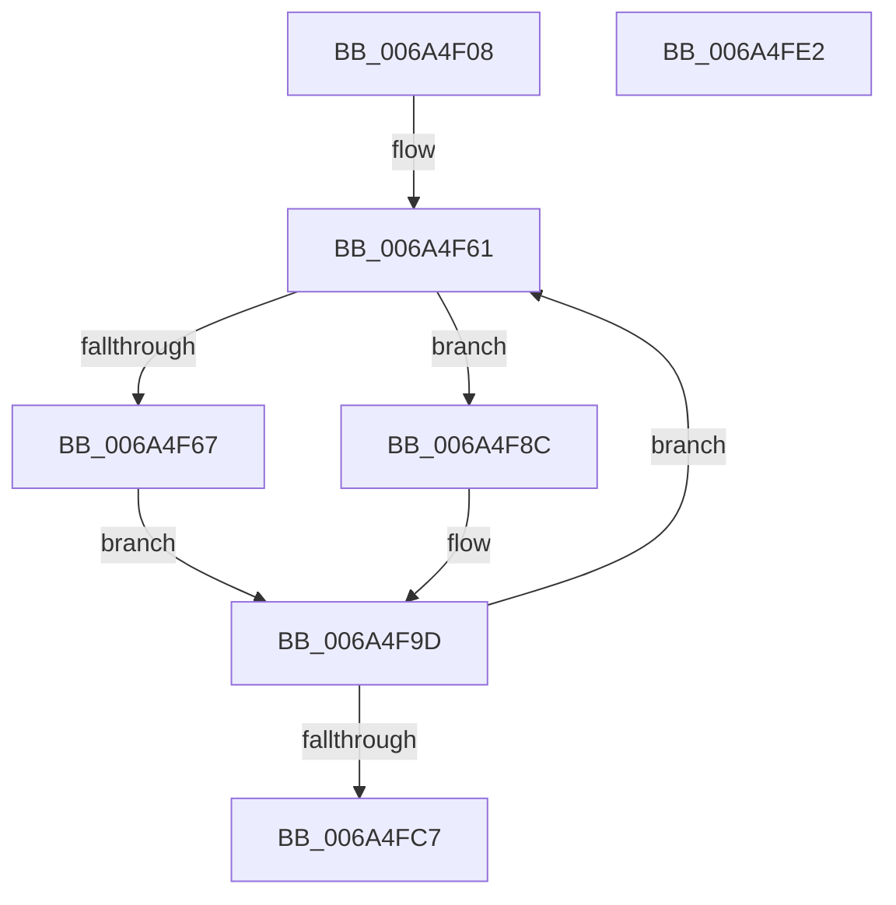

# MBR_ENTRY::ComputeChs

- RVA: `0x006A4F08`–`0x006A4FE3` (길이 `219` bytes)
- VA: `0x00000001406A4F08`
- 실행 섹션: `.text`
- PDB 이름 있음: `예`; PDB Function 태그: `아니요`
- unwind 정보 RVA: `0x0005E6B4`
- 디코드: `69`개 명령, `219/219` bytes 표시
- 미해석 바이트: `0` (있으면 어셈블리에 `.byte`로 보존)

> 이 문서는 커널 이미지의 기계어와 PDB 기호를 분석해 생성했습니다. 4번과 5번은 함수 원형과 자료형을 바이너리 사용 방식에서 추정한 C 해석이며 원본 소스 복구 결과는 아닙니다.

## 1. Dependencies

- 직접 호출 지점: **0**; 고유 호출 대상: **0**
- 직접 호출자로 확인된 함수: **2**
- RIP 상대 이미지 참조: **0**

### Outgoing calls
- 직접 디코드된 call 명령이 없습니다.

### Direct callers
- [SC_GPT::WritePartitionTable](SC_GPT_WritePartitionTable_function_006A3AD4.md) at `0x006A3F53`
- [SC_MBR::WritePartitionTable](SC_MBR_WritePartitionTable_function_006A5440.md) at `0x006A55BD`

### Static image references
- 디코드된 RIP-relative 메모리 참조가 없습니다.

## 2. Other-region calls and transfers

- 다른 실행 섹션으로 향하는 call: **0**
- 별도 외부 분기/꼬리 이동을 확인하지 못했습니다.

## 3. Assembly (complete function range)

```asm
006A4F08  4C 8B DC                        mov r11, rsp
006A4F0B  49 89 5B 08                     mov qword ptr [r11 + 8], rbx
006A4F0F  49 89 6B 10                     mov qword ptr [r11 + 0x10], rbp
006A4F13  49 89 73 18                     mov qword ptr [r11 + 0x18], rsi
006A4F17  49 89 7B 20                     mov qword ptr [r11 + 0x20], rdi
006A4F1B  41 56                           push r14
006A4F1D  48 83 EC 20                     sub rsp, 0x20
006A4F21  8B 6A 0C                        mov ebp, dword ptr [rdx + 0xc]
006A4F24  48 8D 41 01                     lea rax, [rcx + 1]
006A4F28  0F AF 6A 10                     imul ebp, dword ptr [rdx + 0x10]
006A4F2C  49 8D 7B E0                     lea rdi, [r11 - 0x20]
006A4F30  4C 8B C1                        mov r8, rcx
006A4F33  49 89 43 E0                     mov qword ptr [r11 - 0x20], rax
006A4F37  48 8D 41 05                     lea rax, [rcx + 5]
006A4F3B  4C 8B CA                        mov r9, rdx
006A4F3E  8B 49 08                        mov ecx, dword ptr [rcx + 8]
006A4F41  48 8D 1C 24                     lea rbx, [rsp]
006A4F45  89 0C 24                        mov dword ptr [rsp], ecx
006A4F48  41 BE 02 00 00 00               mov r14d, 2
006A4F4E  8B F5                           mov esi, ebp
006A4F50  49 89 43 E8                     mov qword ptr [r11 - 0x18], rax
006A4F54  0F AF 32                        imul esi, dword ptr [rdx]
006A4F57  FF C9                           dec ecx
006A4F59  41 03 48 0C                     add ecx, dword ptr [r8 + 0xc]
006A4F5D  89 4C 24 04                     mov dword ptr [rsp + 4], ecx
006A4F61  8B 03                           mov eax, dword ptr [rbx]
006A4F63  3B C6                           cmp eax, esi
006A4F65  73 25                           jae 0x1406a4f8c
006A4F67  41 8B 49 10                     mov ecx, dword ptr [r9 + 0x10]
006A4F6B  33 D2                           xor edx, edx
006A4F6D  F7 F5                           div ebp
006A4F6F  44 8B C2                        mov r8d, edx
006A4F72  44 8B D0                        mov r10d, eax
006A4F75  33 D2                           xor edx, edx
006A4F77  41 8B C0                        mov eax, r8d
006A4F7A  F7 F1                           div ecx
006A4F7C  33 D2                           xor edx, edx
006A4F7E  44 8B D8                        mov r11d, eax
006A4F81  41 8B C0                        mov eax, r8d
006A4F84  F7 F1                           div ecx
006A4F86  44 8D 42 01                     lea r8d, [rdx + 1]
006A4F8A  EB 11                           jmp 0x1406a4f9d
006A4F8C  45 8B 11                        mov r10d, dword ptr [r9]
006A4F8F  45 8B 59 0C                     mov r11d, dword ptr [r9 + 0xc]
006A4F93  41 FF CA                        dec r10d
006A4F96  45 8B 41 10                     mov r8d, dword ptr [r9 + 0x10]
006A4F9A  41 FF CB                        dec r11d
006A4F9D  48 8B 17                        mov rdx, qword ptr [rdi]
006A4FA0  41 8B CA                        mov ecx, r10d
006A4FA3  C1 E9 02                        shr ecx, 2
006A4FA6  48 83 C3 04                     add rbx, 4
006A4FAA  8A C1                           mov al, cl
006A4FAC  48 83 C7 08                     add rdi, 8
006A4FB0  41 32 C0                        xor al, r8b
006A4FB3  24 3F                           and al, 0x3f
006A4FB5  44 88 1A                        mov byte ptr [rdx], r11b
006A4FB8  32 C1                           xor al, cl
006A4FBA  88 42 01                        mov byte ptr [rdx + 1], al
006A4FBD  44 88 52 02                     mov byte ptr [rdx + 2], r10b
006A4FC1  49 83 EE 01                     sub r14, 1
006A4FC5  75 9A                           jne 0x1406a4f61
006A4FC7  48 8B 5C 24 30                  mov rbx, qword ptr [rsp + 0x30]
006A4FCC  48 8B 6C 24 38                  mov rbp, qword ptr [rsp + 0x38]
006A4FD1  48 8B 74 24 40                  mov rsi, qword ptr [rsp + 0x40]
006A4FD6  48 8B 7C 24 48                  mov rdi, qword ptr [rsp + 0x48]
006A4FDB  48 83 C4 20                     add rsp, 0x20
006A4FDF  41 5E                           pop r14
006A4FE1  C3                              ret
006A4FE2  CC                              int3
```

## 4. C-style interpretation (structured pseudocode)

```c
__int64 __fastcall MBR_ENTRY__ComputeChs(__int64 a1, __int64 a2)
{
    __int64 result;
    __int64 v_r10;
    __int64 v_r11;
    __int64 v_r14;
    __int64 v_rbp;
    __int64 v_rbx;
    __int64 v_rdi;
    __int64 v_rsi;
    __int64 v_rsp;
    unsigned int v_stack_m24;
    unsigned __int64 v_stack_m28;
    unsigned __int64 v_stack_p10;
    unsigned __int64 v_stack_p18;
    unsigned __int64 v_stack_p20;
    unsigned __int64 v_stack_p8;

    *(unsigned __int64 *)(v_rsp + 8) = v_rbx;
    *(unsigned __int64 *)(v_rsp + 16) = v_rbp;
    *(unsigned __int64 *)(v_rsp + 24) = v_rsi;
    *(unsigned __int64 *)(v_rsp + 32) = v_rdi;
    v_rsp = (v_rsp) - (32);
    v_rbp = (unsigned int)(((unsigned int)(*(unsigned int *)(a2 + 12))) * (*(unsigned int *)(a2 + 16)));
    *(unsigned __int64 *)(v_rsp - 32) = a1 + 1;
    v_stack_m28 = (unsigned int)((unsigned int)(*(unsigned int *)(a1 + 8)));
    *(unsigned __int64 *)(v_rsp - 24) = a1 + 5;
    v_rsi = (unsigned int)(((unsigned int)((unsigned int)(v_rbp))) * (*(unsigned int *)(a2)));
    a1 = (unsigned int)(((unsigned int)(*(unsigned int *)(a1 + 8))) - 1);
    a1 = (unsigned int)((a1) + (*(unsigned int *)(a1 + 12)));
    v_stack_m24 = (unsigned int)(a1);
loc_006A4F61:
    if (((unsigned int)((unsigned int)(*(unsigned int *)(v_stack_m28)))) >= ((unsigned int)(v_rsi))) goto loc_006A4F8C;
    a2 = 0;
    a2 = 0;
    a2 = 0;
    goto loc_006A4F9D;
loc_006A4F8C:
    v_r10 = (unsigned int)(((unsigned int)(*(unsigned int *)(a2))) - 1);
    v_r11 = (unsigned int)(((unsigned int)(*(unsigned int *)(a2 + 12))) - 1);
loc_006A4F9D:
    a1 = (unsigned int)(((unsigned int)((unsigned int)(v_r10))) >> (2));
    v_rbx = (v_stack_m28) + (4);
    v_rdi = (v_rsp - 32) + (8);
    result = (unsigned __int8)(((unsigned __int8)(a1)) ^ ((unsigned __int8)((unsigned int)(*(unsigned int *)(a2 + 16)))));
    result = (unsigned __int8)((result) & (63));
    *(unsigned __int8 *)(*(unsigned __int64 *)(v_rsp - 32)) = (unsigned __int8)(v_r11);
    result = (unsigned __int8)((result) ^ ((unsigned __int8)(a1)));
    *(unsigned __int8 *)(*(unsigned __int64 *)(v_rsp - 32) + 1) = (unsigned __int8)(result);
    *(unsigned __int8 *)(*(unsigned __int64 *)(v_rsp - 32) + 2) = (unsigned __int8)(v_r10);
    v_r14 = (2) - (1);
    if (condition_is_not_equal) goto loc_006A4F61;
    v_rsp = (v_rsp) + (32);
    return result;
}
```

## 5. (Beta) C Style

```c
int64_t MBR_ENTRY__ComputeChs(void *Arg1, void *Arg2)
{
    uint8_t *arg1 = (uint8_t *)Arg1;
    uint8_t *arg2 = (uint8_t *)Arg2;

    int64_t result;
    int64_t local_r10;
    int64_t local_r11;
    int64_t local_r14;
    int64_t local_rbp;
    int64_t local_rbx;
    int64_t local_rdi;
    int64_t local_rsi;
    int64_t local_rsp;
    uint32_t v_stack_m24;
    uint64_t v_stack_m28;
    uint64_t v_stack_p10;
    uint64_t v_stack_p18;
    uint64_t v_stack_p20;
    uint64_t v_stack_p8;

    *(uint64_t *)(local_rsp + 0x8) = local_rbx;
    *(uint64_t *)(local_rsp + 0x10) = local_rbp;
    *(uint64_t *)(local_rsp + 0x18) = local_rsi;
    *(uint64_t *)(local_rsp + 0x20) = local_rdi;
    local_rsp = (local_rsp) - (32);
    local_rbp = (uint32_t)(((uint32_t)(*(uint32_t *)(arg2 + 0xC))) * (*(uint32_t *)(arg2 + 0x10)));
    *(void **)(local_rsp - 0x20) = Arg1 + 1;
    v_stack_m28 = (uint32_t)((uint32_t)(*(uint32_t *)(arg1 + 0x8)));
    *(void **)(local_rsp - 0x18) = Arg1 + 5;
    local_rsi = (uint32_t)(((uint32_t)((uint32_t)(local_rbp))) * (*(uint32_t *)(arg2)));
    Arg1 = (uint32_t)(((uint32_t)(*(uint32_t *)(arg1 + 0x8))) - 1);
    Arg1 = (uint32_t)((Arg1) + (*(uint32_t *)(arg1 + 0xC)));
    v_stack_m24 = (uint32_t)(Arg1);
loc_006A4F61:
    if (((uint32_t)((uint32_t)(*(uint32_t *)(v_stack_m28)))) >= ((uint32_t)(local_rsi))) goto loc_006A4F8C;
    Arg2 = 0;
    Arg2 = 0;
    Arg2 = 0;
    goto loc_006A4F9D;
loc_006A4F8C:
    local_r10 = (uint32_t)(((uint32_t)(*(uint32_t *)(arg2))) - 1);
    local_r11 = (uint32_t)(((uint32_t)(*(uint32_t *)(arg2 + 0xC))) - 1);
loc_006A4F9D:
    Arg1 = (uint32_t)(((uint32_t)((uint32_t)(local_r10))) >> (2));
    local_rbx = (v_stack_m28) + (4);
    local_rdi = (local_rsp - 32) + (8);
    result = (uint8_t)(((uint8_t)(Arg1)) ^ ((uint8_t)((uint32_t)(*(uint32_t *)(arg2 + 0x10)))));
    result = (uint8_t)((result) & (63));
    *(uint8_t *)(*(uint64_t *)(local_rsp - 0x20)) = (uint8_t)(local_r11);
    result = (uint8_t)((result) ^ ((uint8_t)(Arg1)));
    *(uint8_t *)(*(uint64_t *)(local_rsp - 0x20) + 0x1) = (uint8_t)(result);
    *(uint8_t *)(*(uint64_t *)(local_rsp - 0x20) + 0x2) = (uint8_t)(local_r10);
    local_r14 = (2) - (1);
    if (condition_is_not_equal) goto loc_006A4F61;
    local_rsp = (local_rsp) + (32);
    return result;
}
```

### 관측된 메모리 오프셋

구조체 형식이 확인되지 않은 접근은 인자 기준의 오프셋으로만 기록했습니다.

| 기준 인자 | 오프셋 표현 | 폭 (bit) | 접근 |
|---|---:|---:|---|
| `Arg1` | `+ 0x1` | `64` | `R` |
| `Arg1` | `+ 0x5` | `64` | `R` |
| `Arg1` | `+ 0x8` | `32` | `R` |
| `Arg1` | `+ 0xC` | `32` | `R` |
| `Arg2` | `+ 0x0` | `32` | `R` |
| `Arg2` | `+ 0xC` | `32` | `R` |
| `Arg2` | `+ 0x10` | `32` | `R` |

## 6. Execution-region graph

[열기: 2D/3D 그래프와 함수 탐색 컨트롤 패널](../../../control-panel.html?section=text&rva=0x006A4F08&view=graph)

- 2D 그래프는 위에서 아래로 흐르고, 3D 그래프는 빈 공간을 드래그해 회전합니다. Shift+드래그는 이동, 휠은 확대·축소, 함수 노드 선택은 대상 보고서 이동입니다.

### Static fallback


