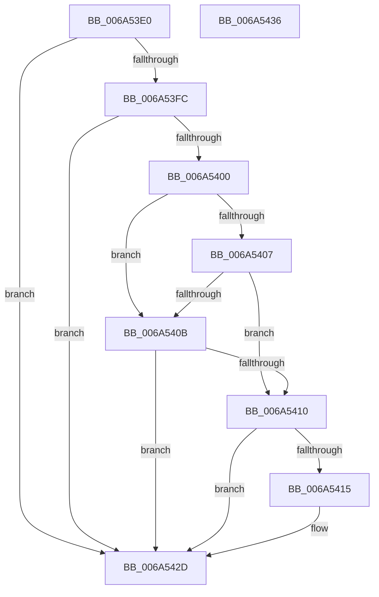

# MBR_ENTRY::Validate

- RVA: `0x006A53E0`–`0x006A5437` (길이 `87` bytes)
- VA: `0x00000001406A53E0`
- 실행 섹션: `.text`
- PDB 이름 있음: `예`; PDB Function 태그: `아니요`
- unwind 정보 RVA: `0x00071750`
- 디코드: `30`개 명령, `87/87` bytes 표시
- 미해석 바이트: `0` (있으면 어셈블리에 `.byte`로 보존)

> 이 문서는 커널 이미지의 기계어와 PDB 기호를 분석해 생성했습니다. 4번과 5번은 함수 원형과 자료형을 바이너리 사용 방식에서 추정한 C 해석이며 원본 소스 복구 결과는 아닙니다.

## 1. Dependencies

- 직접 호출 지점: **0**; 고유 호출 대상: **0**
- 직접 호출자로 확인된 함수: **2**
- RIP 상대 이미지 참조: **0**

### Outgoing calls
- 직접 디코드된 call 명령이 없습니다.

### Direct callers
- [SC_DISK::IsVbr](SC_DISK_IsVbr_function_006A48E0.md) at `0x006A496E`
- [SC_MBR::ReadPartitionTable](SC_MBR_ReadPartitionTable_function_006A5100.md) at `0x006A5216`

### Static image references
- 디코드된 RIP-relative 메모리 참조가 없습니다.

## 2. Other-region calls and transfers

- 다른 실행 섹션으로 향하는 call: **0**
- 별도 외부 분기/꼬리 이동을 확인하지 못했습니다.

## 3. Assembly (complete function range)

```asm
006A53E0  48 89 5C 24 08                  mov qword ptr [rsp + 8], rbx
006A53E5  44 8B 59 08                     mov r11d, dword ptr [rcx + 8]
006A53E9  BB 01 00 00 00                  mov ebx, 1
006A53EE  8A 41 04                        mov al, byte ptr [rcx + 4]
006A53F1  44 8A CB                        mov r9b, bl
006A53F4  45 8D 14 13                     lea r10d, [r11 + rdx]
006A53F8  84 C0                           test al, al
006A53FA  74 31                           je 0x1406a542d
006A53FC  3C EE                           cmp al, 0xee
006A53FE  74 2D                           je 0x1406a542d
006A5400  45 32 C9                        xor r9b, r9b
006A5403  3C 05                           cmp al, 5
006A5405  74 04                           je 0x1406a540b
006A5407  3C 0F                           cmp al, 0xf
006A5409  75 05                           jne 0x1406a5410
006A540B  45 85 DB                        test r11d, r11d
006A540E  74 1D                           je 0x1406a542d
006A5410  4D 3B D0                        cmp r10, r8
006A5413  73 18                           jae 0x1406a542d
006A5415  8B 49 0C                        mov ecx, dword ptr [rcx + 0xc]
006A5418  4B 8D 14 40                     lea rdx, [r8 + r8*2]
006A541C  48 D1 EA                        shr rdx, 1
006A541F  49 2B D2                        sub rdx, r10
006A5422  45 0F B6 C9                     movzx r9d, r9b
006A5426  48 3B CA                        cmp rcx, rdx
006A5429  44 0F 46 CB                     cmovbe r9d, ebx
006A542D  48 8B 5C 24 08                  mov rbx, qword ptr [rsp + 8]
006A5432  41 8A C1                        mov al, r9b
006A5435  C3                              ret
006A5436  CC                              int3
```

## 4. C-style interpretation (structured pseudocode)

```c
__int64 __fastcall MBR_ENTRY__Validate(__int64 a1, __int64 a2, __int64 a3)
{
    unsigned __int64 v_stack_p8;

    v_stack_p8 = v_rbx;
    if ((unsigned __int8)(*(unsigned __int8 *)(a1 + 4)) == 0) goto loc_006A542D;
    if (((unsigned __int8)(*(unsigned __int8 *)(a1 + 4))) == 238) goto loc_006A542D;
    a4 = 0;
    if (((unsigned __int8)(*(unsigned __int8 *)(a1 + 4))) == 5) goto loc_006A540B;
    if (((unsigned __int8)(*(unsigned __int8 *)(a1 + 4))) != 15) goto loc_006A5410;
loc_006A540B:
    if ((unsigned int)((unsigned int)(*(unsigned int *)(a1 + 8))) == 0) goto loc_006A542D;
loc_006A5410:
    if (((unsigned int)(*(unsigned int *)(a1 + 8)) + a2 * 1) < a3) {
        a1 = *(unsigned int *)(a1 + 12);
        a2 = a3 + a3 * 2;
        a2 = (a2) >> (1);
        a2 = (a2) - ((unsigned int)(*(unsigned int *)(a1 + 8)) + a2 * 1);
        a4 = 0;
        if (a1 <= a2) { a4 = 1; }
    }
    return (unsigned __int8)(a4);
}
```

## 5. (Beta) C Style

```c
int64_t MBR_ENTRY__Validate(void *Arg1, int64_t Arg2, void *Arg3)
{
    uint8_t *arg1 = (uint8_t *)Arg1;
    uint8_t *arg3 = (uint8_t *)Arg3;

    uint64_t v_stack_p8;

    v_stack_p8 = local_rbx;
    if ((uint8_t)(*(uint8_t *)(arg1 + 0x4)) == 0) goto loc_006A542D;
    if (((uint8_t)(*(uint8_t *)(arg1 + 0x4))) == 238) goto loc_006A542D;
    a4 = 0;
    if (((uint8_t)(*(uint8_t *)(arg1 + 0x4))) == 5) goto loc_006A540B;
    if (((uint8_t)(*(uint8_t *)(arg1 + 0x4))) != 15) goto loc_006A5410;
loc_006A540B:
    if ((uint32_t)((uint32_t)(*(uint32_t *)(arg1 + 0x8))) == 0) goto loc_006A542D;
loc_006A5410:
    if (((uint32_t)(*(uint32_t *)(arg1 + 0x8)) + Arg2 * 1) < Arg3) {
        Arg1 = *(uint32_t *)(arg1 + 0xC);
        Arg2 = Arg3 + Arg3 * 2;
        Arg2 = (Arg2) >> (1);
        Arg2 = (Arg2) - ((uint32_t)(*(uint32_t *)(arg1 + 0x8)) + Arg2 * 1);
        a4 = 0;
        if (Arg1 <= Arg2) { a4 = 1; }
    }
    return (uint8_t)(a4);
}
```

### 관측된 메모리 오프셋

구조체 형식이 확인되지 않은 접근은 인자 기준의 오프셋으로만 기록했습니다.

| 기준 인자 | 오프셋 표현 | 폭 (bit) | 접근 |
|---|---:|---:|---|
| `Arg1` | `+ 0x4` | `8` | `R` |
| `Arg1` | `+ 0x8` | `32` | `R` |
| `Arg1` | `+ 0xC` | `32` | `R` |
| `Arg3` | `+ 0x0 + r8*2` | `64` | `R` |

## 6. Execution-region graph

[열기: 2D/3D 그래프와 함수 탐색 컨트롤 패널](../../../control-panel.html?section=text&rva=0x006A53E0&view=graph)

- 2D 그래프는 위에서 아래로 흐르고, 3D 그래프는 빈 공간을 드래그해 회전합니다. Shift+드래그는 이동, 휠은 확대·축소, 함수 노드 선택은 대상 보고서 이동입니다.

### Static fallback


