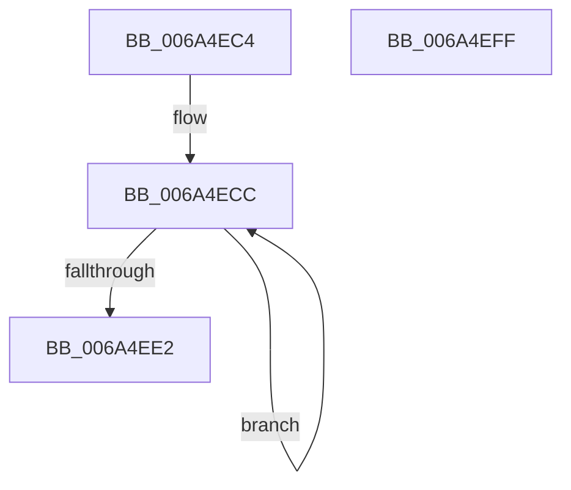

# MBR_HEADER::CheckSum

- RVA: `0x006A4EC4`–`0x006A4F00` (길이 `60` bytes)
- VA: `0x00000001406A4EC4`
- 실행 섹션: `.text`
- PDB 이름 있음: `예`; PDB Function 태그: `아니요`
- unwind 정보 RVA: `0x000DB714`
- 디코드: `17`개 명령, `60/60` bytes 표시
- 미해석 바이트: `0` (있으면 어셈블리에 `.byte`로 보존)

> 이 문서는 커널 이미지의 기계어와 PDB 기호를 분석해 생성했습니다. 4번과 5번은 함수 원형과 자료형을 바이너리 사용 방식에서 추정한 C 해석이며 원본 소스 복구 결과는 아닙니다.

## 1. Dependencies

- 직접 호출 지점: **0**; 고유 호출 대상: **0**
- 직접 호출자로 확인된 함수: **3**
- RIP 상대 이미지 참조: **0**

### Outgoing calls
- 직접 디코드된 call 명령이 없습니다.

### Direct callers
- [SC_MBR::ReadPartitionTable](SC_MBR_ReadPartitionTable_function_006A5100.md) at `0x006A5189`
- [SC_MBR::WritePartitionTable](SC_MBR_WritePartitionTable_function_006A5440.md) at `0x006A54D8`
- [SC_RAW::ReadPartitionTable](SC_RAW_ReadPartitionTable_function_006A5C54.md) at `0x006A5CCE`
- [SC_RAW::ReadPartitionTable](SC_RAW_ReadPartitionTable_function_006A5C54.md) at `0x006A5CE9`

### Static image references
- 디코드된 RIP-relative 메모리 참조가 없습니다.

## 2. Other-region calls and transfers

- 다른 실행 섹션으로 향하는 call: **0**
- 별도 외부 분기/꼬리 이동을 확인하지 못했습니다.

## 3. Assembly (complete function range)

```asm
006A4EC4  0F 57 C9                        xorps xmm1, xmm1
006A4EC7  B8 20 00 00 00                  mov eax, 0x20
006A4ECC  F3 0F 6F 01                     movdqu xmm0, xmmword ptr [rcx]
006A4ED0  48 8D 49 10                     lea rcx, [rcx + 0x10]
006A4ED4  66 0F FE C1                     paddd xmm0, xmm1
006A4ED8  66 0F 6F C8                     movdqa xmm1, xmm0
006A4EDC  48 83 E8 01                     sub rax, 1
006A4EE0  75 EA                           jne 0x1406a4ecc
006A4EE2  66 0F 73 D8 08                  psrldq xmm0, 8
006A4EE7  66 0F FE C8                     paddd xmm1, xmm0
006A4EEB  66 0F 6F C1                     movdqa xmm0, xmm1
006A4EEF  66 0F 73 D8 04                  psrldq xmm0, 4
006A4EF4  66 0F FE C8                     paddd xmm1, xmm0
006A4EF8  66 0F 7E C8                     movd eax, xmm1
006A4EFC  F7 D8                           neg eax
006A4EFE  C3                              ret
006A4EFF  CC                              int3
```

## 4. C-style interpretation (structured pseudocode)

```c
__int64 __fastcall MBR_HEADER__CheckSum(__int64 a1)
{
    __int64 result;

loc_006A4ECC:
    result = (32) - (1);
    if (condition_is_not_equal) goto loc_006A4ECC;
    result = (unsigned int)(-(result));
    return result;
}
```

## 5. (Beta) C Style

```c
int64_t MBR_HEADER__CheckSum(void *Arg1)
{
    uint8_t *arg1 = (uint8_t *)Arg1;

    int64_t result;

loc_006A4ECC:
    result = (32) - (1);
    if (condition_is_not_equal) goto loc_006A4ECC;
    result = (uint32_t)(-(result));
    return result;
}
```

### 관측된 메모리 오프셋

구조체 형식이 확인되지 않은 접근은 인자 기준의 오프셋으로만 기록했습니다.

| 기준 인자 | 오프셋 표현 | 폭 (bit) | 접근 |
|---|---:|---:|---|
| `Arg1` | `+ 0x0` | `128` | `R` |
| `Arg1` | `+ 0x10` | `64` | `R` |

## 6. Execution-region graph

[열기: 2D/3D 그래프와 함수 탐색 컨트롤 패널](../../../control-panel.html?section=text&rva=0x006A4EC4&view=graph)

- 2D 그래프는 위에서 아래로 흐르고, 3D 그래프는 빈 공간을 드래그해 회전합니다. Shift+드래그는 이동, 휠은 확대·축소, 함수 노드 선택은 대상 보고서 이동입니다.

### Static fallback


