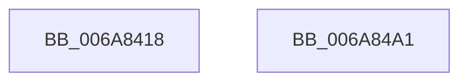

# McTemplateK0hzr0d_EtwWriteTransfer

- RVA: `0x006A8418`–`0x006A84A2` (길이 `138` bytes)
- VA: `0x00000001406A8418`
- 실행 섹션: `.text`
- PDB 이름 있음: `예`; PDB Function 태그: `아니요`
- unwind 정보 RVA: `0x000DB234`
- 디코드: `34`개 명령, `138/138` bytes 표시
- 미해석 바이트: `0` (있으면 어셈블리에 `.byte`로 보존)

> 이 문서는 커널 이미지의 기계어와 PDB 기호를 분석해 생성했습니다. 4번과 5번은 함수 원형과 자료형을 바이너리 사용 방식에서 추정한 C 해석이며 원본 소스 복구 결과는 아닙니다.

## 1. Dependencies

- 직접 호출 지점: **2**; 고유 호출 대상: **2**
- 직접 호출자로 확인된 함수: **1**
- RIP 상대 이미지 참조: **3**

### Outgoing calls
- `0x006A8487` → [McGenEventWrite_EtwWriteTransfer](../42/McGenEventWrite_EtwWriteTransfer_function_00424FC8.md) (function, `0x00424FC8`)
- `0x006A8493` → [_security_check_cookie](_security_check_cookie_function_006AC640.md) (function, `0x006AC640`)

### Direct callers
- [VhdiAutoAttachOneVhd](../../page/83/VhdiAutoAttachOneVhd_function_0083BCD4.md) at `0x0083BDFA`

### Static image references
- `0x006A8429` → RVA `0x00E0A740` (`.data`; read)
- `0x006A844C` → RVA `0x00020EF8` (`.rdata`; read)
- `0x006A846F` → RVA `0x00E06E20` (`.data`; read)

## 2. Other-region calls and transfers

- 다른 실행 섹션으로 향하는 call: **0**
- 별도 외부 분기/꼬리 이동을 확인하지 못했습니다.

## 3. Assembly (complete function range)

```asm
006A8418  66 44 89 4C 24 20               mov word ptr [rsp + 0x20], r9w
006A841E  55                              push rbp
006A841F  48 8B EC                        mov rbp, rsp
006A8422  48 81 EC 80 00 00 00            sub rsp, 0x80
006A8429  48 8B 05 10 23 76 00            mov rax, qword ptr [rip + 0x762310]
006A8430  48 33 C4                        xor rax, rsp
006A8433  48 89 45 F0                     mov qword ptr [rbp - 0x10], rax
006A8437  33 C9                           xor ecx, ecx
006A8439  48 C7 45 C8 02 00 00 00         mov qword ptr [rbp - 0x38], 2
006A8441  48 8D 45 28                     lea rax, [rbp + 0x28]
006A8445  89 4D DC                        mov dword ptr [rbp - 0x24], ecx
006A8448  48 89 45 C0                     mov qword ptr [rbp - 0x40], rax
006A844C  48 8D 15 A5 8A 97 FF            lea rdx, [rip - 0x68755b]
006A8453  48 8B 45 30                     mov rax, qword ptr [rbp + 0x30]
006A8457  45 33 C0                        xor r8d, r8d
006A845A  48 89 45 D0                     mov qword ptr [rbp - 0x30], rax
006A845E  41 0F B7 C1                     movzx eax, r9w
006A8462  44 8D 49 04                     lea r9d, [rcx + 4]
006A8466  03 C0                           add eax, eax
006A8468  4C 89 4D E8                     mov qword ptr [rbp - 0x18], r9
006A846C  89 45 D8                        mov dword ptr [rbp - 0x28], eax
006A846F  48 8D 0D AA E9 75 00            lea rcx, [rip + 0x75e9aa]
006A8476  48 8D 45 38                     lea rax, [rbp + 0x38]
006A847A  48 89 45 E0                     mov qword ptr [rbp - 0x20], rax
006A847E  48 8D 45 B0                     lea rax, [rbp - 0x50]
006A8482  48 89 44 24 20                  mov qword ptr [rsp + 0x20], rax
006A8487  E8 3C CB D7 FF                  call 0x140424fc8
006A848C  48 8B 4D F0                     mov rcx, qword ptr [rbp - 0x10]
006A8490  48 33 CC                        xor rcx, rsp
006A8493  E8 A8 41 00 00                  call 0x1406ac640
006A8498  48 81 C4 80 00 00 00            add rsp, 0x80
006A849F  5D                              pop rbp
006A84A0  C3                              ret
006A84A1  CC                              int3
```

## 4. C-style interpretation (structured pseudocode)

```c
__int64 __fastcall McTemplateK0hzr0d_EtwWriteTransfer(int a1, __int64 a2, int a3, unsigned __int16 a4, __int64 a5, __int64 a6)
{
    __int64 result;
    __int64 v_rsp;
    unsigned __int64 v_stack_m18;
    unsigned __int64 v_stack_m20;
    unsigned __int64 v_stack_m28;
    unsigned int v_stack_m2C;
    unsigned int v_stack_m30;
    unsigned __int64 v_stack_m38;
    unsigned __int64 v_stack_m40;
    unsigned __int64 v_stack_m48;
    unsigned __int64 v_stack_m58;
    unsigned __int64 v_stack_m68;
    unsigned __int16 v_stack_p20;

    v_stack_p20 = a4;
    v_rsp = (v_rsp) - (128);
    result = (*(unsigned __int64 *)(v_rip + 7742224)) ^ (v_rsp);
    v_stack_m18 = result;
    a1 = 0;
    v_stack_m40 = 2;
    v_stack_m2C = 0;
    v_stack_m48 = v_stack_p20;
    a3 = 0;
    v_stack_m38 = a5;
    result = (unsigned int)((a4) + (a4));
    v_stack_m20 = a1 + 4;
    v_stack_m30 = (unsigned int)(result);
    v_stack_m28 = a6;
    v_stack_m68 = v_stack_m58;
    result = McGenEventWrite_EtwWriteTransfer(v_rip + 7727530, v_rip - 6845787, a3, a1 + 4);
    a1 = (v_stack_m18) ^ (v_rsp);
    result = _security_check_cookie(a1, v_rip - 6845787, a3, a1 + 4);
    v_rsp = (v_rsp) + (128);
    return result;
}
```

## 5. (Beta) C Style

```c
int64_t McTemplateK0hzr0d_EtwWriteTransfer(int32_t Arg1, int64_t Arg2, int32_t Arg3, uint16_t Arg4, int64_t Arg5, int64_t Arg6)
{
    int64_t result;
    int64_t local_rsp;
    uint64_t v_stack_m18;
    uint64_t v_stack_m20;
    uint64_t v_stack_m28;
    uint32_t v_stack_m2C;
    uint32_t v_stack_m30;
    uint64_t v_stack_m38;
    uint64_t v_stack_m40;
    uint64_t v_stack_m48;
    uint64_t v_stack_m58;
    uint64_t v_stack_m68;
    uint16_t v_stack_p20;

    v_stack_p20 = Arg4;
    local_rsp = (local_rsp) - (128);
    result = (*(uint64_t *)(v_rip + 0x762310)) ^ (local_rsp);
    v_stack_m18 = result;
    Arg1 = 0;
    v_stack_m40 = 2;
    v_stack_m2C = 0;
    v_stack_m48 = v_stack_p20;
    Arg3 = 0;
    v_stack_m38 = Arg5;
    result = (uint32_t)((Arg4) + (Arg4));
    v_stack_m20 = Arg1 + 4;
    v_stack_m30 = (uint32_t)(result);
    v_stack_m28 = Arg6;
    v_stack_m68 = v_stack_m58;
    result = McGenEventWrite_EtwWriteTransfer(v_rip + 7727530, v_rip - 6845787, Arg3, Arg1 + 4);
    Arg1 = (v_stack_m18) ^ (local_rsp);
    result = _security_check_cookie(Arg1, v_rip - 6845787, Arg3, Arg1 + 4);
    local_rsp = (local_rsp) + (128);
    return result;
}
```

## 6. Execution-region graph

[열기: 2D/3D 그래프와 함수 탐색 컨트롤 패널](../../../control-panel.html?section=text&rva=0x006A8418&view=graph)

- 2D 그래프는 위에서 아래로 흐르고, 3D 그래프는 빈 공간을 드래그해 회전합니다. Shift+드래그는 이동, 휠은 확대·축소, 함수 노드 선택은 대상 보고서 이동입니다.

### Static fallback


