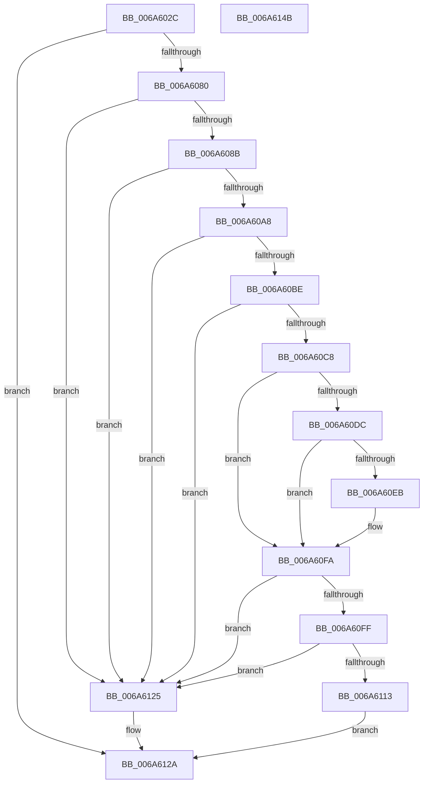

# MinCrypK_ParseRevocationList

- RVA: `0x006A602C`–`0x006A614C` (길이 `288` bytes)
- VA: `0x00000001406A602C`
- 실행 섹션: `.text`
- PDB 이름 있음: `예`; PDB Function 태그: `아니요`
- unwind 정보 RVA: `0x000DAE08`
- 디코드: `62`개 명령, `288/288` bytes 표시
- 미해석 바이트: `0` (있으면 어셈블리에 `.byte`로 보존)

> 이 문서는 커널 이미지의 기계어와 PDB 기호를 분석해 생성했습니다. 4번과 5번은 함수 원형과 자료형을 바이너리 사용 방식에서 추정한 C 해석이며 원본 소스 복구 결과는 아닙니다.

## 1. Dependencies

- 직접 호출 지점: **6**; 고유 호출 대상: **6**
- 직접 호출자로 확인된 함수: **1**
- RIP 상대 이미지 참조: **5**

### Outgoing calls
- `0x006A6073` → [MinCrypK_VerifySignedDataKMode](../../page/83/MinCrypK_VerifySignedDataKMode_function_00838524.md) (function, `0x00838524`)
- `0x006A609D` → [RtlCompareMemory](../6B/RtlCompareMemory_function_006BA670.md) (function, `0x006BA670`)
- `0x006A60B5` → [MinAsn1ParseCTL](../../page/83/MinAsn1ParseCTL_function_00838CF0.md) (function, `0x00838CF0`)
- `0x006A610A` → [MinAsn1DecodeTime](../../page/83/MinAsn1DecodeTime_function_00839E54.md) (function, `0x00839E54`)
- `0x006A611E` → [MinCryptParseRevocationList](../../page/83/MinCryptParseRevocationList_function_008377D0.md) (function, `0x008377D0`)
- `0x006A6135` → [_security_check_cookie](_security_check_cookie_function_006AC640.md) (function, `0x006AC640`)

### Direct callers
- [PopValidateWinresume](../../page/75/PopValidateWinresume_function_0075DFF4.md) at `0x0075E144`

### Static image references
- `0x006A6039` → RVA `0x00E0A740` (`.data`; read)
- `0x006A6090` → RVA `0x00B4B678` (`PAGE`; read)
- `0x006A60D0` → RVA `0x00B4BB38` (`PAGE`; read)
- `0x006A60DC` → RVA `0x00B4BB40` (`PAGE`; read)
- `0x006A60EB` → RVA `0x00B4BB44` (`PAGE`; read)

## 2. Other-region calls and transfers

- 다른 실행 섹션으로 향하는 call: **4**
  - `0x006A6073` → [MinCrypK_VerifySignedDataKMode](../../page/83/MinCrypK_VerifySignedDataKMode_function_00838524.md) (`.text` → `PAGE`)
  - `0x006A60B5` → [MinAsn1ParseCTL](../../page/83/MinAsn1ParseCTL_function_00838CF0.md) (`.text` → `PAGE`)
  - `0x006A610A` → [MinAsn1DecodeTime](../../page/83/MinAsn1DecodeTime_function_00839E54.md) (`.text` → `PAGE`)
  - `0x006A611E` → [MinCryptParseRevocationList](../../page/83/MinCryptParseRevocationList_function_008377D0.md) (`.text` → `PAGE`)
- 별도 외부 분기/꼬리 이동을 확인하지 못했습니다.

## 3. Assembly (complete function range)

```asm
006A602C  48 89 5C 24 18                  mov qword ptr [rsp + 0x18], rbx
006A6031  57                              push rdi
006A6032  48 81 EC 50 01 00 00            sub rsp, 0x150
006A6039  48 8B 05 00 47 76 00            mov rax, qword ptr [rip + 0x764700]
006A6040  48 33 C4                        xor rax, rsp
006A6043  48 89 84 24 40 01 00 00         mov qword ptr [rsp + 0x140], rax
006A604B  48 8B 84 24 80 01 00 00         mov rax, qword ptr [rsp + 0x180]
006A6053  4C 8D 44 24 40                  lea r8, [rsp + 0x40]
006A6058  48 8B BC 24 88 01 00 00         mov rdi, qword ptr [rsp + 0x188]
006A6060  49 8B D9                        mov rbx, r9
006A6063  4C 89 44 24 30                  mov qword ptr [rsp + 0x30], r8
006A6068  48 89 44 24 28                  mov qword ptr [rsp + 0x28], rax
006A606D  48 83 64 24 20 00               and qword ptr [rsp + 0x20], 0
006A6073  E8 AC 24 19 00                  call 0x140838524
006A6078  85 C0                           test eax, eax
006A607A  0F 88 AA 00 00 00               js 0x1406a612a
006A6080  83 7C 24 40 09                  cmp dword ptr [rsp + 0x40], 9
006A6085  0F 85 9A 00 00 00               jne 0x1406a6125
006A608B  48 8B 54 24 48                  mov rdx, qword ptr [rsp + 0x48]
006A6090  48 8D 0D E1 55 4A 00            lea rcx, [rip + 0x4a55e1]
006A6097  41 B8 09 00 00 00               mov r8d, 9
006A609D  E8 CE 45 01 00                  call 0x1406ba670
006A60A2  48 83 F8 09                     cmp rax, 9
006A60A6  75 7D                           jne 0x1406a6125
006A60A8  48 8D 94 24 90 00 00 00         lea rdx, [rsp + 0x90]
006A60B0  48 8D 4C 24 50                  lea rcx, [rsp + 0x50]
006A60B5  E8 36 2C 19 00                  call 0x140838cf0
006A60BA  85 C0                           test eax, eax
006A60BC  78 67                           js 0x1406a6125
006A60BE  83 BC 24 C0 00 00 00 0E         cmp dword ptr [rsp + 0xc0], 0xe
006A60C6  75 5D                           jne 0x1406a6125
006A60C8  4C 8B 84 24 C8 00 00 00         mov r8, qword ptr [rsp + 0xc8]
006A60D0  48 8B 0D 61 5A 4A 00            mov rcx, qword ptr [rip + 0x4a5a61]
006A60D7  49 2B 08                        sub rcx, qword ptr [r8]
006A60DA  75 1E                           jne 0x1406a60fa
006A60DC  8B 0D 5E 5A 4A 00               mov ecx, dword ptr [rip + 0x4a5a5e]
006A60E2  41 8B 40 08                     mov eax, dword ptr [r8 + 8]
006A60E6  48 2B C8                        sub rcx, rax
006A60E9  75 0F                           jne 0x1406a60fa
006A60EB  0F B7 0D 52 5A 4A 00            movzx ecx, word ptr [rip + 0x4a5a52]
006A60F2  41 0F B7 40 0C                  movzx eax, word ptr [r8 + 0xc]
006A60F7  48 2B C8                        sub rcx, rax
006A60FA  48 85 C9                        test rcx, rcx
006A60FD  75 26                           jne 0x1406a6125
006A60FF  48 8B D7                        mov rdx, rdi
006A6102  48 8D 8C 24 F0 00 00 00         lea rcx, [rsp + 0xf0]
006A610A  E8 45 3D 19 00                  call 0x140839e54
006A610F  84 C0                           test al, al
006A6111  74 12                           je 0x1406a6125
006A6113  4C 8B C3                        mov r8, rbx
006A6116  48 8D 8C 24 30 01 00 00         lea rcx, [rsp + 0x130]
006A611E  E8 AD 16 19 00                  call 0x1408377d0
006A6123  EB 05                           jmp 0x1406a612a
006A6125  B8 28 04 00 C0                  mov eax, 0xc0000428
006A612A  48 8B 8C 24 40 01 00 00         mov rcx, qword ptr [rsp + 0x140]
006A6132  48 33 CC                        xor rcx, rsp
006A6135  E8 06 65 00 00                  call 0x1406ac640
006A613A  48 8B 9C 24 70 01 00 00         mov rbx, qword ptr [rsp + 0x170]
006A6142  48 81 C4 50 01 00 00            add rsp, 0x150
006A6149  5F                              pop rdi
006A614A  C3                              ret
006A614B  CC                              int3
```

## 4. C-style interpretation (structured pseudocode)

```c
__int64 __fastcall MinCrypK_ParseRevocationList(__int64 a1, __int64 a2, __int64 a3, __int64 a4, __int64 a5, __int64 a6)
{
    __int64 result;
    __int64 v_rsp;
    unsigned __int64 v_stack_m108;
    unsigned __int64 v_stack_m110;
    unsigned __int64 v_stack_m118;
    unsigned __int64 v_stack_m128;
    unsigned __int64 v_stack_m130;
    unsigned __int64 v_stack_m138;
    unsigned __int64 v_stack_m18;
    unsigned __int64 v_stack_m28;
    unsigned __int64 v_stack_m68;
    unsigned __int64 v_stack_m90;
    unsigned int v_stack_m98;
    unsigned __int64 v_stack_mC8;
    unsigned __int64 v_stack_p18;

    v_stack_p18 = v_rbx;
    v_rsp = (v_rsp) - (336);
    result = (*(unsigned __int64 *)(v_rip + 7751424)) ^ (v_rsp);
    v_stack_m18 = result;
    v_stack_m128 = v_stack_m118;
    v_stack_m130 = a5;
    result = MinCrypK_VerifySignedDataKMode(a1, a2, v_stack_m118, a4);
    if (sign_flag) goto loc_006A612A;
    if (v_stack_m118 != 9) goto loc_006A6125;
    result = RtlCompareMemory(v_rip + 4871649, v_stack_m110, 9, a4);
    if (result != 9) goto loc_006A6125;
    result = MinAsn1ParseCTL(v_stack_m108, v_stack_mC8, 9, a4);
    if (sign_flag) goto loc_006A6125;
    if (v_stack_m98 != 14) goto loc_006A6125;
    a1 = (*(unsigned __int64 *)(v_rip + 4872801)) - (*(unsigned __int64 *)(v_stack_m90));
    if (condition_is_not_equal) goto loc_006A60FA;
    a1 = ((unsigned int)(*(unsigned int *)(v_rip + 4872798))) - ((unsigned int)(*(unsigned int *)(v_stack_m90 + 8)));
    result = (unsigned int)(*(unsigned int *)(v_stack_m90 + 8));
    if (!(condition_is_not_equal)) {
        a1 = *(unsigned __int16 *)(v_rip + 4872786);
        result = *(unsigned __int16 *)(v_stack_m90 + 12);
        a1 = (a1) - (result);
    }
    if (a1 != 0) goto loc_006A6125;
    result = MinAsn1DecodeTime(v_stack_m68, a6, v_stack_m90, a4);
    if ((unsigned __int8)(result) == 0) goto loc_006A6125;
    result = MinCryptParseRevocationList(v_stack_m28, a6, a4, a4);
    goto loc_006A612A;
loc_006A6125:
loc_006A612A:
    a1 = (v_stack_m18) ^ (v_rsp);
    result = _security_check_cookie(a1, a6, a4, a4);
    v_rsp = (v_rsp) + (336);
    return result;
}
```

## 5. (Beta) C Style

```c
int64_t MinCrypK_ParseRevocationList(int64_t Arg1, int64_t Arg2, int64_t Arg3, int64_t Arg4, int64_t Arg5, int64_t Arg6)
{
    int64_t result;
    int64_t local_rsp;
    uint64_t v_stack_m108;
    uint64_t v_stack_m110;
    uint64_t v_stack_m118;
    uint64_t v_stack_m128;
    uint64_t v_stack_m130;
    uint64_t v_stack_m138;
    uint64_t v_stack_m18;
    uint64_t v_stack_m28;
    uint64_t v_stack_m68;
    uint64_t v_stack_m90;
    uint32_t v_stack_m98;
    uint64_t v_stack_mC8;
    uint64_t v_stack_p18;

    v_stack_p18 = local_rbx;
    local_rsp = (local_rsp) - (336);
    result = (*(uint64_t *)(v_rip + 0x764700)) ^ (local_rsp);
    v_stack_m18 = result;
    v_stack_m128 = v_stack_m118;
    v_stack_m130 = Arg5;
    result = MinCrypK_VerifySignedDataKMode(Arg1, Arg2, v_stack_m118, Arg4);
    if (sign_flag) goto loc_006A612A;
    if (v_stack_m118 != 9) goto loc_006A6125;
    result = RtlCompareMemory(v_rip + 4871649, v_stack_m110, 9, Arg4);
    if (result != 9) goto loc_006A6125;
    result = MinAsn1ParseCTL(v_stack_m108, v_stack_mC8, 9, Arg4);
    if (sign_flag) goto loc_006A6125;
    if (v_stack_m98 != 14) goto loc_006A6125;
    Arg1 = (*(uint64_t *)(v_rip + 0x4A5A61)) - (*(uint64_t *)(v_stack_m90));
    if (condition_is_not_equal) goto loc_006A60FA;
    Arg1 = ((uint32_t)(*(uint32_t *)(v_rip + 0x4A5A5E))) - ((uint32_t)(*(uint32_t *)(v_stack_m90 + 0x8)));
    result = (uint32_t)(*(uint32_t *)(v_stack_m90 + 0x8));
    if (!(condition_is_not_equal)) {
        Arg1 = *(uint16_t *)(v_rip + 0x4A5A52);
        result = *(uint16_t *)(v_stack_m90 + 0xC);
        Arg1 = (Arg1) - (result);
    }
    if (Arg1 != 0) goto loc_006A6125;
    result = MinAsn1DecodeTime(v_stack_m68, Arg6, v_stack_m90, Arg4);
    if ((uint8_t)(result) == 0) goto loc_006A6125;
    result = MinCryptParseRevocationList(v_stack_m28, Arg6, Arg4, Arg4);
    goto loc_006A612A;
loc_006A6125:
loc_006A612A:
    Arg1 = (v_stack_m18) ^ (local_rsp);
    result = _security_check_cookie(Arg1, Arg6, Arg4, Arg4);
    local_rsp = (local_rsp) + (336);
    return result;
}
```

## 6. Execution-region graph

[열기: 2D/3D 그래프와 함수 탐색 컨트롤 패널](../../../control-panel.html?section=text&rva=0x006A602C&view=graph)

- 2D 그래프는 위에서 아래로 흐르고, 3D 그래프는 빈 공간을 드래그해 회전합니다. Shift+드래그는 이동, 휠은 확대·축소, 함수 노드 선택은 대상 보고서 이동입니다.

### Static fallback


