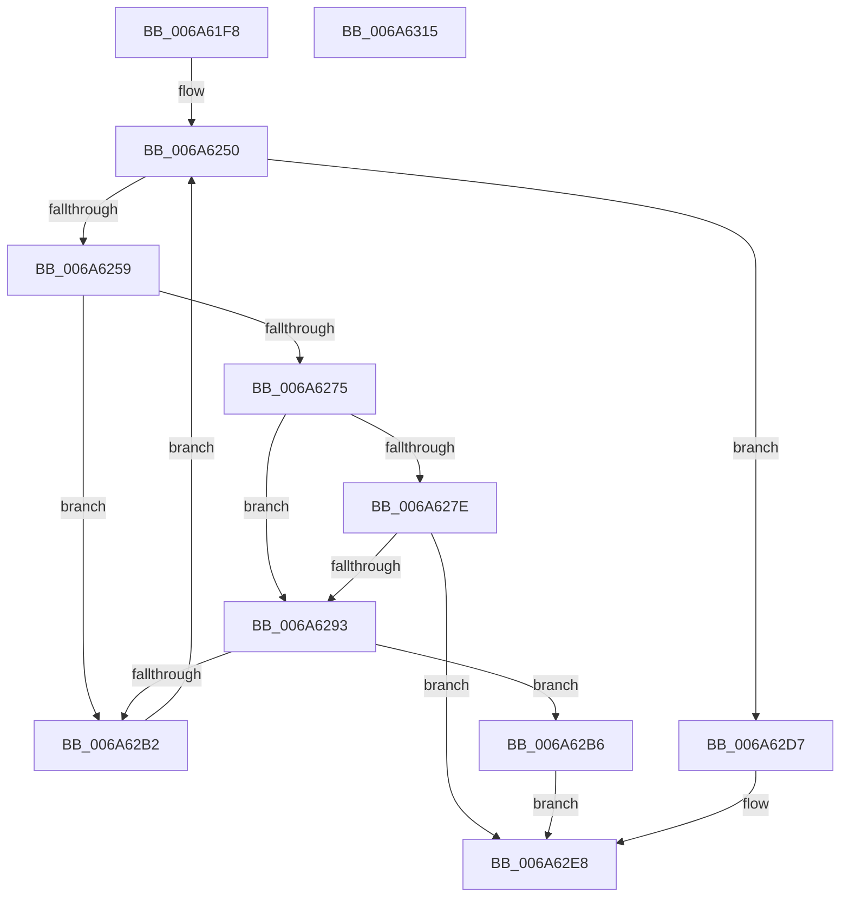

# MinCryptCheckCertsAndKeys

- RVA: `0x006A61F8`–`0x006A6316` (길이 `286` bytes)
- VA: `0x00000001406A61F8`
- 실행 섹션: `.text`
- PDB 이름 있음: `예`; PDB Function 태그: `아니요`
- unwind 정보 RVA: `0x000DAE24`
- 디코드: `81`개 명령, `286/286` bytes 표시
- 미해석 바이트: `0` (있으면 어셈블리에 `.byte`로 보존)

> 이 문서는 커널 이미지의 기계어와 PDB 기호를 분석해 생성했습니다. 4번과 5번은 함수 원형과 자료형을 바이너리 사용 방식에서 추정한 C 해석이며 원본 소스 복구 결과는 아닙니다.

## 1. Dependencies

- 직접 호출 지점: **6**; 고유 호출 대상: **6**
- 직접 호출자로 확인된 함수: **1**
- RIP 상대 이미지 참조: **1**

### Outgoing calls
- `0x006A6247` → [memset](../6C/memset_function_006C6C40.md) (function, `0x006C6C40`)
- `0x006A626C` → [MinAsn1ParseCertificate](../../page/83/MinAsn1ParseCertificate_function_00838D38.md) (function, `0x00838D38`)
- `0x006A628A` → [memcmp](../6C/memcmp_function_006C6B10.md) (function, `0x006C6B10`)
- `0x006A62A8` → [I_MinCryptFindIssuerCertificateByName](../../page/83/I_MinCryptFindIssuerCertificateByName_function_00836530.md) (function, `0x00836530`)
- `0x006A62CE` → [MinCryptVerifySignedHash](../../page/83/MinCryptVerifySignedHash_function_00836278.md) (function, `0x00836278`)
- `0x006A62F5` → [_security_check_cookie](_security_check_cookie_function_006AC640.md) (function, `0x006AC640`)

### Direct callers
- [MinCryptVerifyCertificateWithPolicy2](../../page/83/MinCryptVerifyCertificateWithPolicy2_function_008368A8.md) at `0x008373B2`

### Static image references
- `0x006A620F` → RVA `0x00E0A740` (`.data`; read)

## 2. Other-region calls and transfers

- 다른 실행 섹션으로 향하는 call: **3**
  - `0x006A626C` → [MinAsn1ParseCertificate](../../page/83/MinAsn1ParseCertificate_function_00838D38.md) (`.text` → `PAGE`)
  - `0x006A62A8` → [I_MinCryptFindIssuerCertificateByName](../../page/83/I_MinCryptFindIssuerCertificateByName_function_00836530.md) (`.text` → `PAGE`)
  - `0x006A62CE` → [MinCryptVerifySignedHash](../../page/83/MinCryptVerifySignedHash_function_00836278.md) (`.text` → `PAGE`)
- 별도 외부 분기/꼬리 이동을 확인하지 못했습니다.

## 3. Assembly (complete function range)

```asm
006A61F8  48 89 5C 24 08                  mov qword ptr [rsp + 8], rbx
006A61FD  55                              push rbp
006A61FE  56                              push rsi
006A61FF  57                              push rdi
006A6200  41 54                           push r12
006A6202  41 55                           push r13
006A6204  41 56                           push r14
006A6206  41 57                           push r15
006A6208  48 81 EC 30 01 00 00            sub rsp, 0x130
006A620F  48 8B 05 2A 45 76 00            mov rax, qword ptr [rip + 0x76452a]
006A6216  48 33 C4                        xor rax, rsp
006A6219  48 89 84 24 20 01 00 00         mov qword ptr [rsp + 0x120], rax
006A6221  4C 8B B4 24 90 01 00 00         mov r14, qword ptr [rsp + 0x190]
006A6229  45 8B E8                        mov r13d, r8d
006A622C  4C 8B E2                        mov r12, rdx
006A622F  44 8B F9                        mov r15d, ecx
006A6232  33 D2                           xor edx, edx
006A6234  48 8D 4C 24 30                  lea rcx, [rsp + 0x30]
006A6239  41 B8 F0 00 00 00               mov r8d, 0xf0
006A623F  49 8B E9                        mov rbp, r9
006A6242  BF 28 04 00 C0                  mov edi, 0xc0000428
006A6247  E8 F4 09 02 00                  call 0x1406c6c40
006A624C  33 DB                           xor ebx, ebx
006A624E  8B F3                           mov esi, ebx
006A6250  3B B4 24 98 01 00 00            cmp esi, dword ptr [rsp + 0x198]
006A6257  73 7E                           jae 0x1406a62d7
006A6259  8B CE                           mov ecx, esi
006A625B  4C 8D 44 24 30                  lea r8, [rsp + 0x30]
006A6260  48 03 C9                        add rcx, rcx
006A6263  41 8B 14 CE                     mov edx, dword ptr [r14 + rcx*8]
006A6267  49 8B 4C CE 08                  mov rcx, qword ptr [r14 + rcx*8 + 8]
006A626C  E8 C7 2A 19 00                  call 0x140838d38
006A6271  85 C0                           test eax, eax
006A6273  78 3D                           js 0x1406a62b2
006A6275  8B 45 10                        mov eax, dword ptr [rbp + 0x10]
006A6278  39 44 24 40                     cmp dword ptr [rsp + 0x40], eax
006A627C  75 15                           jne 0x1406a6293
006A627E  48 8B 55 18                     mov rdx, qword ptr [rbp + 0x18]
006A6282  44 8B C0                        mov r8d, eax
006A6285  48 8B 4C 24 48                  mov rcx, qword ptr [rsp + 0x48]
006A628A  E8 81 08 02 00                  call 0x1406c6b10
006A628F  85 C0                           test eax, eax
006A6291  74 55                           je 0x1406a62e8
006A6293  45 33 C9                        xor r9d, r9d
006A6296  48 89 5C 24 20                  mov qword ptr [rsp + 0x20], rbx
006A629B  48 8D 4D 70                     lea rcx, [rbp + 0x70]
006A629F  4C 8D 44 24 30                  lea r8, [rsp + 0x30]
006A62A4  41 8D 51 01                     lea edx, [r9 + 1]
006A62A8  E8 83 02 19 00                  call 0x140836530
006A62AD  48 85 C0                        test rax, rax
006A62B0  75 04                           jne 0x1406a62b6
006A62B2  FF C6                           inc esi
006A62B4  EB 9A                           jmp 0x1406a6250
006A62B6  48 05 B0 00 00 00               add rax, 0xb0
006A62BC  4C 8D 4D 40                     lea r9, [rbp + 0x40]
006A62C0  45 8B C5                        mov r8d, r13d
006A62C3  48 89 44 24 20                  mov qword ptr [rsp + 0x20], rax
006A62C8  49 8B D4                        mov rdx, r12
006A62CB  41 8B CF                        mov ecx, r15d
006A62CE  E8 A5 FF 18 00                  call 0x140836278
006A62D3  8B D8                           mov ebx, eax
006A62D5  EB 11                           jmp 0x1406a62e8
006A62D7  39 9C 24 A8 01 00 00            cmp dword ptr [rsp + 0x1a8], ebx
006A62DE  B8 02 00 00 C0                  mov eax, 0xc0000002
006A62E3  0F 47 F8                        cmova edi, eax
006A62E6  8B DF                           mov ebx, edi
006A62E8  8B C3                           mov eax, ebx
006A62EA  48 8B 8C 24 20 01 00 00         mov rcx, qword ptr [rsp + 0x120]
006A62F2  48 33 CC                        xor rcx, rsp
006A62F5  E8 46 63 00 00                  call 0x1406ac640
006A62FA  48 8B 9C 24 70 01 00 00         mov rbx, qword ptr [rsp + 0x170]
006A6302  48 81 C4 30 01 00 00            add rsp, 0x130
006A6309  41 5F                           pop r15
006A630B  41 5E                           pop r14
006A630D  41 5D                           pop r13
006A630F  41 5C                           pop r12
006A6311  5F                              pop rdi
006A6312  5E                              pop rsi
006A6313  5D                              pop rbp
006A6314  C3                              ret
006A6315  CC                              int3
```

## 4. C-style interpretation (structured pseudocode)

```c
__int64 __fastcall MinCryptCheckCertsAndKeys(int a1, __int64 a2, int a3, __int64 a4, __int64 a5, unsigned int a6, __int64 a7, unsigned int a8)
{
    __int64 result;
    __int64 v_rbx;
    __int64 v_rdi;
    __int64 v_rsi;
    __int64 v_rsp;
    unsigned __int64 v_stack_m120;
    unsigned int v_stack_m128;
    unsigned __int64 v_stack_m138;
    unsigned __int64 v_stack_m148;
    unsigned __int64 v_stack_m48;
    unsigned __int64 v_stack_p8;

    v_stack_p8 = v_rbx;
    v_rsp = (v_rsp) - (304);
    result = (*(unsigned __int64 *)(v_rip + 7750954)) ^ (v_rsp);
    v_stack_m48 = result;
    a2 = 0;
    result = memset(v_stack_m138, a2, 240, a4);
    v_rbx = 0;
loc_006A6250:
    if (0 >= a6) goto loc_006A62D7;
    a1 = (0) + (0);
    result = MinAsn1ParseCertificate(*(unsigned __int64 *)(a5 + a1 * 8 + 8), (unsigned int)(*(unsigned int *)(a5 + a1 * 8)), v_stack_m138, a4);
    if (sign_flag) goto loc_006A62B2;
    if (v_stack_m128 != ((unsigned int)((unsigned int)(*(unsigned int *)(a4 + 16))))) goto loc_006A6293;
    result = memcmp(v_stack_m120, *(unsigned __int64 *)(a4 + 24), (unsigned int)((unsigned int)((unsigned int)(*(unsigned int *)(a4 + 16)))), a4);
    if ((unsigned int)(result) == 0) goto loc_006A62E8;
loc_006A6293:
    a4 = 0;
    v_stack_m148 = 0;
    result = I_MinCryptFindIssuerCertificateByName(a4 + 112, a4 + 1, v_stack_m138, a4);
    if (result != 0) goto loc_006A62B6;
loc_006A62B2:
    v_rsi = (unsigned int)((0) + 1);
    goto loc_006A6250;
loc_006A62B6:
    result = (result) + (176);
    v_stack_m148 = result;
    result = MinCryptVerifySignedHash((unsigned int)((unsigned int)((unsigned int)(a1))), 0, (unsigned int)((unsigned int)((unsigned int)(a3))), a4 + 64);
    goto loc_006A62E8;
loc_006A62D7:
    v_rdi = (unsigned int)(0xC0000428ULL);
    if (a8 > ((unsigned int)((unsigned int)((unsigned int)(result))))) { v_rdi = (unsigned int)((unsigned int)(0xC0000002ULL)); }
loc_006A62E8:
    a1 = (v_stack_m48) ^ (v_rsp);
    result = _security_check_cookie(a1, 0, (unsigned int)((unsigned int)((unsigned int)(a3))), a4 + 64);
    v_rsp = (v_rsp) + (304);
    return result;
}
```

## 5. (Beta) C Style

```c
int64_t MinCryptCheckCertsAndKeys(int32_t Arg1, int64_t Arg2, int32_t Arg3, void *Arg4, void *Arg5, uint32_t Arg6, uint64_t Arg7, uint32_t Arg8)
{
    uint8_t *arg4 = (uint8_t *)Arg4;
    uint8_t *arg5 = (uint8_t *)Arg5;

    int64_t result;
    int64_t local_rbx;
    int64_t local_rdi;
    int64_t local_rsi;
    int64_t local_rsp;
    uint64_t v_stack_m120;
    uint32_t v_stack_m128;
    uint64_t v_stack_m138;
    uint64_t v_stack_m148;
    uint64_t v_stack_m48;
    uint64_t v_stack_p8;

    v_stack_p8 = local_rbx;
    local_rsp = (local_rsp) - (304);
    result = (*(uint64_t *)(v_rip + 0x76452A)) ^ (local_rsp);
    v_stack_m48 = result;
    Arg2 = 0;
    result = memset(v_stack_m138, Arg2, 240, Arg4);
    local_rbx = 0;
loc_006A6250:
    if (0 >= Arg6) goto loc_006A62D7;
    Arg1 = (0) + (0);
    result = MinAsn1ParseCertificate(*(uint64_t *)(arg5 + Arg1 * 8 + 0x8), (uint32_t)(*(uint32_t *)(arg5 + Arg1 * 8)), v_stack_m138, Arg4);
    if (sign_flag) goto loc_006A62B2;
    if (v_stack_m128 != ((uint32_t)((uint32_t)(*(uint32_t *)(arg4 + 0x10))))) goto loc_006A6293;
    result = memcmp(v_stack_m120, *(uint64_t *)(arg4 + 0x18), (uint32_t)((uint32_t)((uint32_t)(*(uint32_t *)(arg4 + 0x10)))), Arg4);
    if ((uint32_t)(result) == 0) goto loc_006A62E8;
loc_006A6293:
    Arg4 = 0;
    v_stack_m148 = 0;
    result = I_MinCryptFindIssuerCertificateByName(Arg4 + 112, Arg4 + 1, v_stack_m138, Arg4);
    if (result != 0) goto loc_006A62B6;
loc_006A62B2:
    local_rsi = (uint32_t)((0) + 1);
    goto loc_006A6250;
loc_006A62B6:
    result = (result) + (176);
    v_stack_m148 = result;
    result = MinCryptVerifySignedHash((uint32_t)((uint32_t)((uint32_t)(Arg1))), 0, (uint32_t)((uint32_t)((uint32_t)(Arg3))), Arg4 + 64);
    goto loc_006A62E8;
loc_006A62D7:
    local_rdi = (uint32_t)(0xC0000428ULL);
    if (Arg8 > ((uint32_t)((uint32_t)((uint32_t)(result))))) { local_rdi = (uint32_t)((uint32_t)(0xC0000002ULL)); }
loc_006A62E8:
    Arg1 = (v_stack_m48) ^ (local_rsp);
    result = _security_check_cookie(Arg1, 0, (uint32_t)((uint32_t)((uint32_t)(Arg3))), Arg4 + 64);
    local_rsp = (local_rsp) + (304);
    return result;
}
```

### 관측된 메모리 오프셋

구조체 형식이 확인되지 않은 접근은 인자 기준의 오프셋으로만 기록했습니다.

| 기준 인자 | 오프셋 표현 | 폭 (bit) | 접근 |
|---|---:|---:|---|
| `Arg4` | `+ 0x10` | `32` | `R` |
| `Arg4` | `+ 0x18` | `64` | `R` |
| `Arg4` | `+ 0x40` | `64` | `R` |
| `Arg4` | `+ 0x70` | `64` | `R` |
| `Arg5` | `+ 0x0 + rcx*8` | `32` | `R` |
| `Arg5` | `+ 0x8 + rcx*8` | `64` | `R` |

## 6. Execution-region graph

[열기: 2D/3D 그래프와 함수 탐색 컨트롤 패널](../../../control-panel.html?section=text&rva=0x006A61F8&view=graph)

- 2D 그래프는 위에서 아래로 흐르고, 3D 그래프는 빈 공간을 드래그해 회전합니다. Shift+드래그는 이동, 휠은 확대·축소, 함수 노드 선택은 대상 보고서 이동입니다.

### Static fallback


