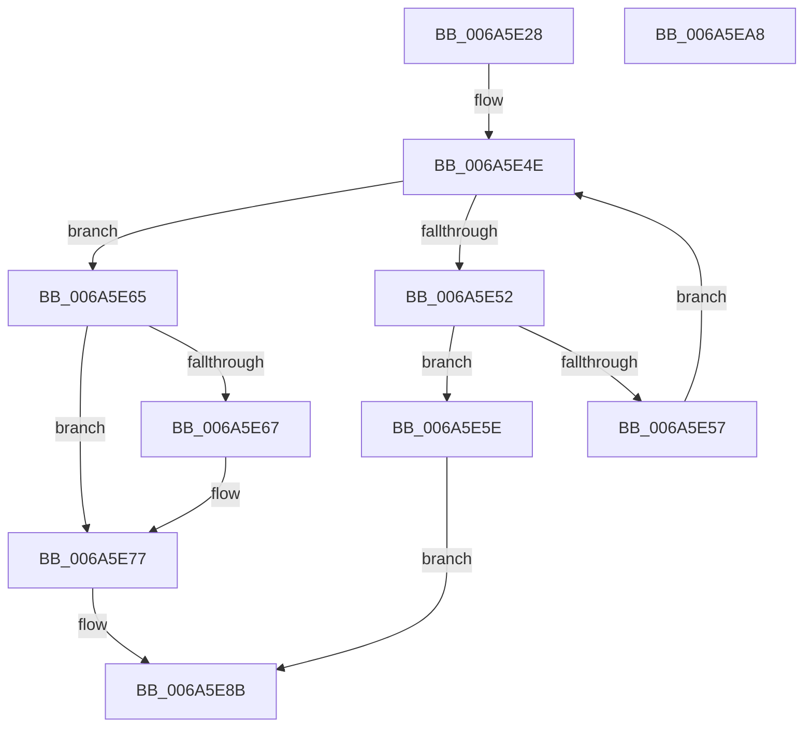

# MinCryptCopyAsn1IntToFixedBuffer

- RVA: `0x006A5E28`–`0x006A5EA9` (길이 `129` bytes)
- VA: `0x00000001406A5E28`
- 실행 섹션: `.text`
- PDB 이름 있음: `예`; PDB Function 태그: `아니요`
- unwind 정보 RVA: `0x0005E6B4`
- 디코드: `42`개 명령, `129/129` bytes 표시
- 미해석 바이트: `0` (있으면 어셈블리에 `.byte`로 보존)

> 이 문서는 커널 이미지의 기계어와 PDB 기호를 분석해 생성했습니다. 4번과 5번은 함수 원형과 자료형을 바이너리 사용 방식에서 추정한 C 해석이며 원본 소스 복구 결과는 아닙니다.

## 1. Dependencies

- 직접 호출 지점: **2**; 고유 호출 대상: **2**
- 직접 호출자로 확인된 함수: **1**
- RIP 상대 이미지 참조: **0**

### Outgoing calls
- `0x006A5E72` → [memset](../6C/memset_function_006C6C40.md) (function, `0x006C6C40`)
- `0x006A5E86` → [memcpy](../6C/memcpy_function_006C6840.md) (function, `0x006C6840`)

### Direct callers
- [MinCryptVerifySignedHash2](../../page/83/MinCryptVerifySignedHash2_function_008362A0.md) at `0x008363DF`
- [MinCryptVerifySignedHash2](../../page/83/MinCryptVerifySignedHash2_function_008362A0.md) at `0x008363FF`

### Static image references
- 디코드된 RIP-relative 메모리 참조가 없습니다.

## 2. Other-region calls and transfers

- 다른 실행 섹션으로 향하는 call: **0**
- 별도 외부 분기/꼬리 이동을 확인하지 못했습니다.

## 3. Assembly (complete function range)

```asm
006A5E28  48 8B C4                        mov rax, rsp
006A5E2B  48 89 58 08                     mov qword ptr [rax + 8], rbx
006A5E2F  48 89 68 10                     mov qword ptr [rax + 0x10], rbp
006A5E33  48 89 70 18                     mov qword ptr [rax + 0x18], rsi
006A5E37  48 89 78 20                     mov qword ptr [rax + 0x20], rdi
006A5E3B  41 56                           push r14
006A5E3D  48 83 EC 20                     sub rsp, 0x20
006A5E41  41 8B E9                        mov ebp, r9d
006A5E44  4D 8B F0                        mov r14, r8
006A5E47  8B DA                           mov ebx, edx
006A5E49  48 8B F1                        mov rsi, rcx
006A5E4C  33 FF                           xor edi, edi
006A5E4E  3B DD                           cmp ebx, ebp
006A5E50  76 13                           jbe 0x1406a5e65
006A5E52  40 38 3E                        cmp byte ptr [rsi], dil
006A5E55  75 07                           jne 0x1406a5e5e
006A5E57  48 FF C6                        inc rsi
006A5E5A  FF CB                           dec ebx
006A5E5C  EB F0                           jmp 0x1406a5e4e
006A5E5E  BF 28 04 00 C0                  mov edi, 0xc0000428
006A5E63  EB 26                           jmp 0x1406a5e8b
006A5E65  73 10                           jae 0x1406a5e77
006A5E67  44 8B C5                        mov r8d, ebp
006A5E6A  33 D2                           xor edx, edx
006A5E6C  44 2B C3                        sub r8d, ebx
006A5E6F  49 8B CE                        mov rcx, r14
006A5E72  E8 C9 0D 02 00                  call 0x1406c6c40
006A5E77  44 8B C3                        mov r8d, ebx
006A5E7A  48 8B CD                        mov rcx, rbp
006A5E7D  49 2B C8                        sub rcx, r8
006A5E80  48 8B D6                        mov rdx, rsi
006A5E83  49 03 CE                        add rcx, r14
006A5E86  E8 B5 09 02 00                  call 0x1406c6840
006A5E8B  48 8B 5C 24 30                  mov rbx, qword ptr [rsp + 0x30]
006A5E90  8B C7                           mov eax, edi
006A5E92  48 8B 7C 24 48                  mov rdi, qword ptr [rsp + 0x48]
006A5E97  48 8B 6C 24 38                  mov rbp, qword ptr [rsp + 0x38]
006A5E9C  48 8B 74 24 40                  mov rsi, qword ptr [rsp + 0x40]
006A5EA1  48 83 C4 20                     add rsp, 0x20
006A5EA5  41 5E                           pop r14
006A5EA7  C3                              ret
006A5EA8  CC                              int3
```

## 4. C-style interpretation (structured pseudocode)

```c
__int64 __fastcall MinCryptCopyAsn1IntToFixedBuffer(__int64 a1, int a2, __int64 a3, int a4)
{
    __int64 result;
    __int64 v_rbx;
    __int64 v_rdi;
    __int64 v_rsi;
    __int64 v_rsp;
    unsigned __int64 v_stack_p10;
    unsigned __int64 v_stack_p18;
    unsigned __int64 v_stack_p20;
    unsigned __int64 v_stack_p8;

    *(unsigned __int64 *)(v_rsp + 8) = v_rbx;
    *(unsigned __int64 *)(v_rsp + 16) = v_rbp;
    *(unsigned __int64 *)(v_rsp + 24) = v_rsi;
    *(unsigned __int64 *)(v_rsp + 32) = v_rdi;
    v_rsp = (v_rsp) - (32);
    v_rdi = 0;
loc_006A5E4E:
    if (((unsigned int)((unsigned int)(a2))) <= ((unsigned int)((unsigned int)(a4)))) goto loc_006A5E65;
    if ((*(unsigned __int8 *)(a1)) != 0) goto loc_006A5E5E;
    v_rsi = (a1) + 1;
    v_rbx = (unsigned int)(((unsigned int)(a2)) - 1);
    goto loc_006A5E4E;
loc_006A5E5E:
    goto loc_006A5E8B;
loc_006A5E65:
    result = v_rsp;
    if ((*(unsigned __int8 *)(a1)) < 0) {
        a3 = (unsigned int)((unsigned int)(a4));
        a2 = 0;
        a3 = (unsigned int)((a3) - ((unsigned int)(v_rbx)));
        a1 = a3;
        result = memset(a1, a2, a3, a4);
    }
    a1 = ((unsigned int)(a4)) - ((unsigned int)((unsigned int)(v_rbx)));
    a1 = (a1) + (a3);
    result = memcpy(a1, v_rsi, (unsigned int)((unsigned int)(v_rbx)), a4);
loc_006A5E8B:
    v_rsp = (v_rsp) + (32);
    return (unsigned int)((unsigned int)((unsigned int)(0xC0000428ULL)));
}
```

## 5. (Beta) C Style

```c
int64_t MinCryptCopyAsn1IntToFixedBuffer(int64_t Arg1, int32_t Arg2, int64_t Arg3, int32_t Arg4)
{
    int64_t result;
    int64_t local_rbx;
    int64_t local_rdi;
    int64_t local_rsi;
    int64_t local_rsp;
    uint64_t v_stack_p10;
    uint64_t v_stack_p18;
    uint64_t v_stack_p20;
    uint64_t v_stack_p8;

    *(uint64_t *)(local_rsp + 0x8) = local_rbx;
    *(uint64_t *)(local_rsp + 0x10) = local_rbp;
    *(uint64_t *)(local_rsp + 0x18) = local_rsi;
    *(uint64_t *)(local_rsp + 0x20) = local_rdi;
    local_rsp = (local_rsp) - (32);
    local_rdi = 0;
loc_006A5E4E:
    if (((uint32_t)((uint32_t)(Arg2))) <= ((uint32_t)((uint32_t)(Arg4)))) goto loc_006A5E65;
    if ((*(uint8_t *)(Arg1)) != 0) goto loc_006A5E5E;
    local_rsi = (Arg1) + 1;
    local_rbx = (uint32_t)(((uint32_t)(Arg2)) - 1);
    goto loc_006A5E4E;
loc_006A5E5E:
    goto loc_006A5E8B;
loc_006A5E65:
    result = local_rsp;
    if ((*(uint8_t *)(Arg1)) < 0) {
        Arg3 = (uint32_t)((uint32_t)(Arg4));
        Arg2 = 0;
        Arg3 = (uint32_t)((Arg3) - ((uint32_t)(local_rbx)));
        Arg1 = Arg3;
        result = memset(Arg1, Arg2, Arg3, Arg4);
    }
    Arg1 = ((uint32_t)(Arg4)) - ((uint32_t)((uint32_t)(local_rbx)));
    Arg1 = (Arg1) + (Arg3);
    result = memcpy(Arg1, local_rsi, (uint32_t)((uint32_t)(local_rbx)), Arg4);
loc_006A5E8B:
    local_rsp = (local_rsp) + (32);
    return (uint32_t)((uint32_t)((uint32_t)(0xC0000428ULL)));
}
```

## 6. Execution-region graph

[열기: 2D/3D 그래프와 함수 탐색 컨트롤 패널](../../../control-panel.html?section=text&rva=0x006A5E28&view=graph)

- 2D 그래프는 위에서 아래로 흐르고, 3D 그래프는 빈 공간을 드래그해 회전합니다. Shift+드래그는 이동, 휠은 확대·축소, 함수 노드 선택은 대상 보고서 이동입니다.

### Static fallback


