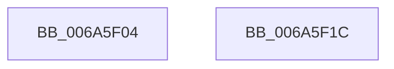

# MinCryptHashMemory

- RVA: `0x006A5F04`–`0x006A5F1D` (길이 `25` bytes)
- VA: `0x00000001406A5F04`
- 실행 섹션: `.text`
- PDB 이름 있음: `예`; PDB Function 태그: `아니요`
- unwind 정보 RVA: `0x0005D2F4`
- 디코드: `7`개 명령, `25/25` bytes 표시
- 미해석 바이트: `0` (있으면 어셈블리에 `.byte`로 보존)

> 이 문서는 커널 이미지의 기계어와 PDB 기호를 분석해 생성했습니다. 4번과 5번은 함수 원형과 자료형을 바이너리 사용 방식에서 추정한 C 해석이며 원본 소스 복구 결과는 아닙니다.

## 1. Dependencies

- 직접 호출 지점: **1**; 고유 호출 대상: **1**
- 직접 호출자로 확인된 함수: **6**
- RIP 상대 이미지 참조: **0**

### Outgoing calls
- `0x006A5F12` → [HashpHashMemory](../../page/84/HashpHashMemory_function_008419AC.md) (function, `0x008419AC`)

### Direct callers
- [MinCrypK_HashMemory](../../page/83/MinCrypK_HashMemory_function_00836174.md) at `0x0083618C`
- [MinCryptVerifyCertificateWithPolicy2](../../page/83/MinCryptVerifyCertificateWithPolicy2_function_008368A8.md) at `0x00836C5A`
- [I_MinCryptVerifyAuthenticodeTimeStamp](../../page/83/I_MinCryptVerifyAuthenticodeTimeStamp_function_00838090.md) at `0x008381D2`
- [I_MinCryptVerifyRFC3161TimeStamp](../../page/83/I_MinCryptVerifyRFC3161TimeStamp_function_008382A4.md) at `0x008383B4`
- [I_MinCryptVerifySignerAuthenticatedAttributes](../../page/83/I_MinCryptVerifySignerAuthenticatedAttributes_function_00838430.md) at `0x008384F6`
- [MinCrypK_VerifySignedDataKModeEx](../../page/83/MinCrypK_VerifySignedDataKModeEx_function_00838568.md) at `0x00838849`

### Static image references
- 디코드된 RIP-relative 메모리 참조가 없습니다.

## 2. Other-region calls and transfers

- 다른 실행 섹션으로 향하는 call: **1**
  - `0x006A5F12` → [HashpHashMemory](../../page/84/HashpHashMemory_function_008419AC.md) (`.text` → `PAGE`)
- 별도 외부 분기/꼬리 이동을 확인하지 못했습니다.

## 3. Assembly (complete function range)

```asm
006A5F04  48 83 EC 38                     sub rsp, 0x38
006A5F08  48 8B 44 24 60                  mov rax, qword ptr [rsp + 0x60]
006A5F0D  48 89 44 24 20                  mov qword ptr [rsp + 0x20], rax
006A5F12  E8 95 BA 19 00                  call 0x1408419ac
006A5F17  48 83 C4 38                     add rsp, 0x38
006A5F1B  C3                              ret
006A5F1C  CC                              int3
```

## 4. C-style interpretation (structured pseudocode)

```c
__int64 __fastcall MinCryptHashMemory(__int64 a1, __int64 a2, __int64 a3, __int64 a4, __int64 a5)
{
    __int64 result;
    __int64 v_rsp;
    unsigned __int64 v_stack_m18;

    v_rsp = (v_rsp) - (56);
    v_stack_m18 = a5;
    result = HashpHashMemory(a1, a2, a3, a4);
    v_rsp = (v_rsp) + (56);
    return result;
}
```

## 5. (Beta) C Style

```c
int64_t MinCryptHashMemory(int64_t Arg1, int64_t Arg2, int64_t Arg3, int64_t Arg4, int64_t Arg5)
{
    int64_t result;
    int64_t local_rsp;
    uint64_t v_stack_m18;

    local_rsp = (local_rsp) - (56);
    v_stack_m18 = Arg5;
    result = HashpHashMemory(Arg1, Arg2, Arg3, Arg4);
    local_rsp = (local_rsp) + (56);
    return result;
}
```

## 6. Execution-region graph

[열기: 2D/3D 그래프와 함수 탐색 컨트롤 패널](../../../control-panel.html?section=text&rva=0x006A5F04&view=graph)

- 2D 그래프는 위에서 아래로 흐르고, 3D 그래프는 빈 공간을 드래그해 회전합니다. Shift+드래그는 이동, 휠은 확대·축소, 함수 노드 선택은 대상 보고서 이동입니다.

### Static fallback


