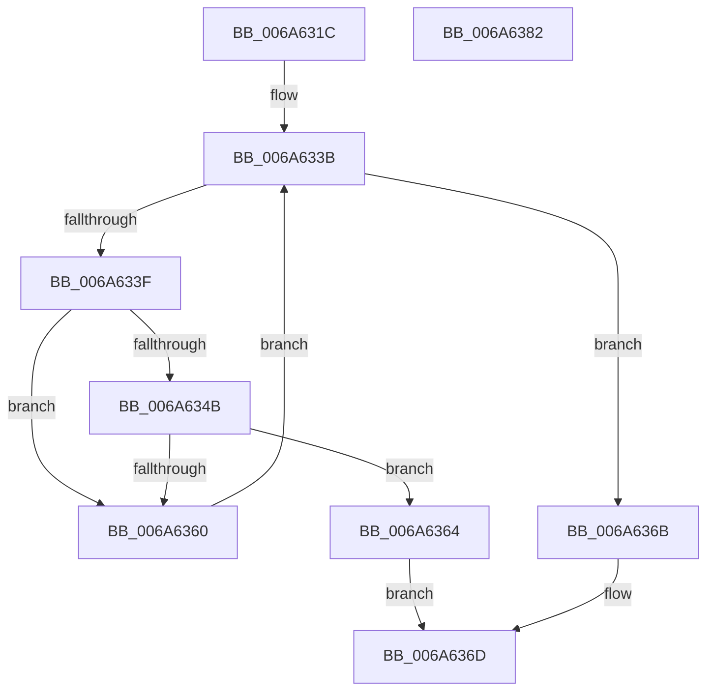

# MinCryptIsCertPresent

- RVA: `0x006A631C`–`0x006A6383` (길이 `103` bytes)
- VA: `0x00000001406A631C`
- 실행 섹션: `.text`
- PDB 이름 있음: `예`; PDB Function 태그: `아니요`
- unwind 정보 RVA: `0x0005C954`
- 디코드: `34`개 명령, `103/103` bytes 표시
- 미해석 바이트: `0` (있으면 어셈블리에 `.byte`로 보존)

> 이 문서는 커널 이미지의 기계어와 PDB 기호를 분석해 생성했습니다. 4번과 5번은 함수 원형과 자료형을 바이너리 사용 방식에서 추정한 C 해석이며 원본 소스 복구 결과는 아닙니다.

## 1. Dependencies

- 직접 호출 지점: **1**; 고유 호출 대상: **1**
- 직접 호출자로 확인된 함수: **1**
- RIP 상대 이미지 참조: **0**

### Outgoing calls
- `0x006A6357` → [memcmp](../6C/memcmp_function_006C6B10.md) (function, `0x006C6B10`)

### Direct callers
- [MinCryptVerifyCertificateWithPolicy2](../../page/83/MinCryptVerifyCertificateWithPolicy2_function_008368A8.md) at `0x0083701D`

### Static image references
- 디코드된 RIP-relative 메모리 참조가 없습니다.

## 2. Other-region calls and transfers

- 다른 실행 섹션으로 향하는 call: **0**
- 별도 외부 분기/꼬리 이동을 확인하지 못했습니다.

## 3. Assembly (complete function range)

```asm
006A631C  48 89 5C 24 08                  mov qword ptr [rsp + 8], rbx
006A6321  48 89 6C 24 10                  mov qword ptr [rsp + 0x10], rbp
006A6326  48 89 74 24 18                  mov qword ptr [rsp + 0x18], rsi
006A632B  57                              push rdi
006A632C  48 83 EC 20                     sub rsp, 0x20
006A6330  41 8B E8                        mov ebp, r8d
006A6333  48 8B FA                        mov rdi, rdx
006A6336  48 8B F1                        mov rsi, rcx
006A6339  33 DB                           xor ebx, ebx
006A633B  3B DD                           cmp ebx, ebp
006A633D  73 2C                           jae 0x1406a636b
006A633F  8B D3                           mov edx, ebx
006A6341  48 03 D2                        add rdx, rdx
006A6344  8B 04 D7                        mov eax, dword ptr [rdi + rdx*8]
006A6347  39 06                           cmp dword ptr [rsi], eax
006A6349  75 15                           jne 0x1406a6360
006A634B  48 8B 54 D7 08                  mov rdx, qword ptr [rdi + rdx*8 + 8]
006A6350  44 8B C0                        mov r8d, eax
006A6353  48 8B 4E 08                     mov rcx, qword ptr [rsi + 8]
006A6357  E8 B4 07 02 00                  call 0x1406c6b10
006A635C  85 C0                           test eax, eax
006A635E  74 04                           je 0x1406a6364
006A6360  FF C3                           inc ebx
006A6362  EB D7                           jmp 0x1406a633b
006A6364  B8 01 00 00 00                  mov eax, 1
006A6369  EB 02                           jmp 0x1406a636d
006A636B  33 C0                           xor eax, eax
006A636D  48 8B 5C 24 30                  mov rbx, qword ptr [rsp + 0x30]
006A6372  48 8B 6C 24 38                  mov rbp, qword ptr [rsp + 0x38]
006A6377  48 8B 74 24 40                  mov rsi, qword ptr [rsp + 0x40]
006A637C  48 83 C4 20                     add rsp, 0x20
006A6380  5F                              pop rdi
006A6381  C3                              ret
006A6382  CC                              int3
```

## 4. C-style interpretation (structured pseudocode)

```c
__int64 __fastcall MinCryptIsCertPresent(__int64 a1, __int64 a2, int a3)
{
    __int64 result;
    __int64 v_rbx;
    __int64 v_rsp;
    unsigned __int64 v_stack_p10;
    unsigned __int64 v_stack_p18;
    unsigned __int64 v_stack_p8;

    v_stack_p8 = v_rbx;
    v_stack_p10 = v_rbp;
    v_stack_p18 = v_rsi;
    v_rsp = (v_rsp) - (32);
    v_rbx = 0;
loc_006A633B:
    if (0 >= ((unsigned int)((unsigned int)(a3)))) goto loc_006A636B;
    a2 = (0) + (0);
    if ((*(unsigned int *)(a1)) != ((unsigned int)((unsigned int)(*(unsigned int *)(a2 + a2 * 8))))) goto loc_006A6360;
    result = memcmp(*(unsigned __int64 *)(a1 + 8), *(unsigned __int64 *)(a2 + a2 * 8 + 8), (unsigned int)((unsigned int)((unsigned int)(*(unsigned int *)(a2 + a2 * 8)))), a4);
    if ((unsigned int)(result) == 0) goto loc_006A6364;
loc_006A6360:
    v_rbx = (unsigned int)((v_rbx) + 1);
    goto loc_006A633B;
loc_006A6364:
    goto loc_006A636D;
loc_006A636B:
    result = 0;
loc_006A636D:
    v_rsp = (v_rsp) + (32);
    return result;
}
```

## 5. (Beta) C Style

```c
int64_t MinCryptIsCertPresent(void *Arg1, void *Arg2, int32_t Arg3)
{
    uint8_t *arg1 = (uint8_t *)Arg1;
    uint8_t *arg2 = (uint8_t *)Arg2;

    int64_t result;
    int64_t local_rbx;
    int64_t local_rsp;
    uint64_t v_stack_p10;
    uint64_t v_stack_p18;
    uint64_t v_stack_p8;

    v_stack_p8 = local_rbx;
    v_stack_p10 = local_rbp;
    v_stack_p18 = local_rsi;
    local_rsp = (local_rsp) - (32);
    local_rbx = 0;
loc_006A633B:
    if (0 >= ((uint32_t)((uint32_t)(Arg3)))) goto loc_006A636B;
    Arg2 = (0) + (0);
    if ((*(uint32_t *)(arg1)) != ((uint32_t)((uint32_t)(*(uint32_t *)(arg2 + arg2 * 8))))) goto loc_006A6360;
    result = memcmp(*(uint64_t *)(arg1 + 0x8), *(uint64_t *)(arg2 + arg2 * 8 + 0x8), (uint32_t)((uint32_t)((uint32_t)(*(uint32_t *)(arg2 + arg2 * 8)))), a4);
    if ((uint32_t)(result) == 0) goto loc_006A6364;
loc_006A6360:
    local_rbx = (uint32_t)((local_rbx) + 1);
    goto loc_006A633B;
loc_006A6364:
    goto loc_006A636D;
loc_006A636B:
    result = 0;
loc_006A636D:
    local_rsp = (local_rsp) + (32);
    return result;
}
```

### 관측된 메모리 오프셋

구조체 형식이 확인되지 않은 접근은 인자 기준의 오프셋으로만 기록했습니다.

| 기준 인자 | 오프셋 표현 | 폭 (bit) | 접근 |
|---|---:|---:|---|
| `Arg1` | `+ 0x0` | `32` | `R` |
| `Arg1` | `+ 0x8` | `64` | `R` |
| `Arg2` | `+ 0x0 + rdx*8` | `32` | `R` |
| `Arg2` | `+ 0x8 + rdx*8` | `64` | `R` |

## 6. Execution-region graph

[열기: 2D/3D 그래프와 함수 탐색 컨트롤 패널](../../../control-panel.html?section=text&rva=0x006A631C&view=graph)

- 2D 그래프는 위에서 아래로 흐르고, 3D 그래프는 빈 공간을 드래그해 회전합니다. Shift+드래그는 이동, 휠은 확대·축소, 함수 노드 선택은 대상 보고서 이동입니다.

### Static fallback


