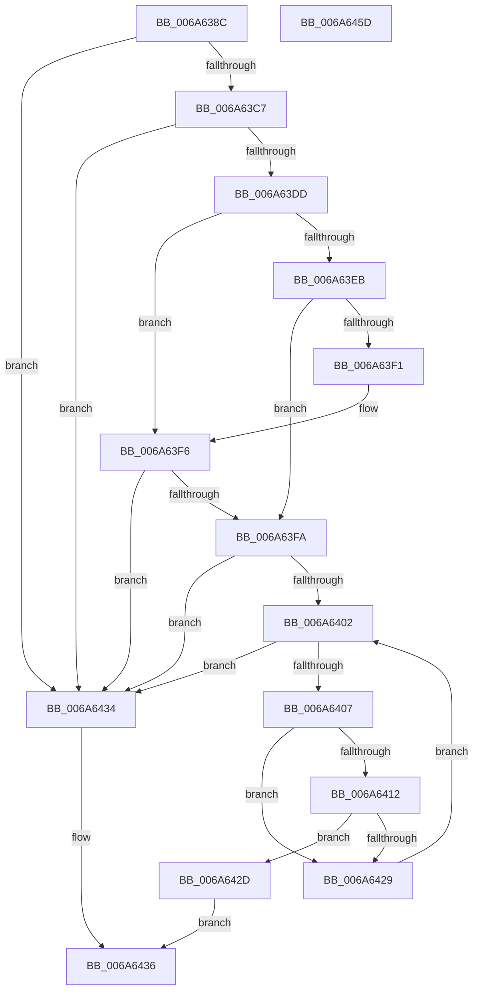

# MinCryptIsKeyPresent

- RVA: `0x006A638C`–`0x006A645E` (길이 `210` bytes)
- VA: `0x00000001406A638C`
- 실행 섹션: `.text`
- PDB 이름 있음: `예`; PDB Function 태그: `아니요`
- unwind 정보 RVA: `0x000DAE4C`
- 디코드: `64`개 명령, `210/210` bytes 표시
- 미해석 바이트: `0` (있으면 어셈블리에 `.byte`로 보존)

> 이 문서는 커널 이미지의 기계어와 PDB 기호를 분석해 생성했습니다. 4번과 5번은 함수 원형과 자료형을 바이너리 사용 방식에서 추정한 C 해석이며 원본 소스 복구 결과는 아닙니다.

## 1. Dependencies

- 직접 호출 지점: **4**; 고유 호출 대상: **4**
- 직접 호출자로 확인된 함수: **1**
- RIP 상대 이미지 참조: **1**

### Outgoing calls
- `0x006A63BC` → [MinAsn1ParsePublicKeyInfo](../../page/83/MinAsn1ParsePublicKeyInfo_function_00838E94.md) (function, `0x00838E94`)
- `0x006A63D4` → [MinAsn1ParseRSAPublicKey](../../page/83/MinAsn1ParseRSAPublicKey_function_00838EDC.md) (function, `0x00838EDC`)
- `0x006A641F` → [RtlCompareMemory](../6B/RtlCompareMemory_function_006BA670.md) (function, `0x006BA670`)
- `0x006A6441` → [_security_check_cookie](_security_check_cookie_function_006AC640.md) (function, `0x006AC640`)

### Direct callers
- [MinCryptVerifyCertificateWithPolicy2](../../page/83/MinCryptVerifyCertificateWithPolicy2_function_008368A8.md) at `0x00837031`

### Static image references
- `0x006A639F` → RVA `0x00E0A740` (`.data`; read)

## 2. Other-region calls and transfers

- 다른 실행 섹션으로 향하는 call: **2**
  - `0x006A63BC` → [MinAsn1ParsePublicKeyInfo](../../page/83/MinAsn1ParsePublicKeyInfo_function_00838E94.md) (`.text` → `PAGE`)
  - `0x006A63D4` → [MinAsn1ParseRSAPublicKey](../../page/83/MinAsn1ParseRSAPublicKey_function_00838EDC.md) (`.text` → `PAGE`)
- 별도 외부 분기/꼬리 이동을 확인하지 못했습니다.

## 3. Assembly (complete function range)

```asm
006A638C  48 89 5C 24 18                  mov qword ptr [rsp + 0x18], rbx
006A6391  55                              push rbp
006A6392  56                              push rsi
006A6393  57                              push rdi
006A6394  41 56                           push r14
006A6396  41 57                           push r15
006A6398  48 81 EC B0 00 00 00            sub rsp, 0xb0
006A639F  48 8B 05 9A 43 76 00            mov rax, qword ptr [rip + 0x76439a]
006A63A6  48 33 C4                        xor rax, rsp
006A63A9  48 89 84 24 A0 00 00 00         mov qword ptr [rsp + 0xa0], rax
006A63B1  4C 8B F2                        mov r14, rdx
006A63B4  45 8B F8                        mov r15d, r8d
006A63B7  48 8D 54 24 60                  lea rdx, [rsp + 0x60]
006A63BC  E8 D3 2A 19 00                  call 0x140838e94
006A63C1  33 FF                           xor edi, edi
006A63C3  85 C0                           test eax, eax
006A63C5  78 6D                           js 0x1406a6434
006A63C7  48 8D 54 24 20                  lea rdx, [rsp + 0x20]
006A63CC  48 8D 8C 24 90 00 00 00         lea rcx, [rsp + 0x90]
006A63D4  E8 03 2B 19 00                  call 0x140838edc
006A63D9  85 C0                           test eax, eax
006A63DB  78 57                           js 0x1406a6434
006A63DD  8B 74 24 40                     mov esi, dword ptr [rsp + 0x40]
006A63E1  48 8B 6C 24 48                  mov rbp, qword ptr [rsp + 0x48]
006A63E6  83 FE 01                        cmp esi, 1
006A63E9  76 0B                           jbe 0x1406a63f6
006A63EB  40 38 7D 00                     cmp byte ptr [rbp], dil
006A63EF  75 09                           jne 0x1406a63fa
006A63F1  48 FF C5                        inc rbp
006A63F4  FF CE                           dec esi
006A63F6  85 F6                           test esi, esi
006A63F8  74 3A                           je 0x1406a6434
006A63FA  81 FE 00 02 00 00               cmp esi, 0x200
006A6400  77 32                           ja 0x1406a6434
006A6402  41 3B FF                        cmp edi, r15d
006A6405  73 2D                           jae 0x1406a6434
006A6407  8B D7                           mov edx, edi
006A6409  48 03 D2                        add rdx, rdx
006A640C  41 3B 34 D6                     cmp esi, dword ptr [r14 + rdx*8]
006A6410  75 17                           jne 0x1406a6429
006A6412  49 8B 54 D6 08                  mov rdx, qword ptr [r14 + rdx*8 + 8]
006A6417  48 8B CD                        mov rcx, rbp
006A641A  44 8B C6                        mov r8d, esi
006A641D  8B DE                           mov ebx, esi
006A641F  E8 4C 42 01 00                  call 0x1406ba670
006A6424  48 3B C3                        cmp rax, rbx
006A6427  74 04                           je 0x1406a642d
006A6429  FF C7                           inc edi
006A642B  EB D5                           jmp 0x1406a6402
006A642D  B8 01 00 00 00                  mov eax, 1
006A6432  EB 02                           jmp 0x1406a6436
006A6434  33 C0                           xor eax, eax
006A6436  48 8B 8C 24 A0 00 00 00         mov rcx, qword ptr [rsp + 0xa0]
006A643E  48 33 CC                        xor rcx, rsp
006A6441  E8 FA 61 00 00                  call 0x1406ac640
006A6446  48 8B 9C 24 F0 00 00 00         mov rbx, qword ptr [rsp + 0xf0]
006A644E  48 81 C4 B0 00 00 00            add rsp, 0xb0
006A6455  41 5F                           pop r15
006A6457  41 5E                           pop r14
006A6459  5F                              pop rdi
006A645A  5E                              pop rsi
006A645B  5D                              pop rbp
006A645C  C3                              ret
006A645D  CC                              int3
```

## 4. C-style interpretation (structured pseudocode)

```c
__int64 __fastcall MinCryptIsKeyPresent(__int64 a1, __int64 a2, int a3)
{
    __int64 result;
    __int64 v_rbp;
    __int64 v_rdi;
    __int64 v_rsi;
    __int64 v_rsp;
    unsigned __int64 v_stack_m38;
    unsigned __int64 v_stack_m48;
    unsigned __int64 v_stack_m78;
    unsigned __int64 v_stack_m90;
    unsigned int v_stack_m98;
    unsigned __int64 v_stack_mB8;
    unsigned __int64 v_stack_p18;

    v_stack_p18 = v_rbx;
    v_rsp = (v_rsp) - (176);
    result = (*(unsigned __int64 *)(v_rip + 7750554)) ^ (v_rsp);
    v_stack_m38 = result;
    result = MinAsn1ParsePublicKeyInfo(a1, v_stack_m78, a3, a4);
    v_rdi = 0;
    if (sign_flag) goto loc_006A6434;
    result = MinAsn1ParseRSAPublicKey(v_stack_m48, v_stack_mB8, a3, a4);
    if (sign_flag) goto loc_006A6434;
    if (((unsigned int)((unsigned int)(v_stack_m98))) <= 1) goto loc_006A63F6;
    if ((*(unsigned __int8 *)(v_stack_m90)) != 0) goto loc_006A63FA;
    v_rbp = (v_stack_m90) + 1;
    v_rsi = (unsigned int)(((unsigned int)(v_stack_m98)) - 1);
loc_006A63F6:
    if ((unsigned int)(v_rsi) == 0) goto loc_006A6434;
loc_006A63FA:
    if (((unsigned int)(v_rsi)) > 512) goto loc_006A6434;
loc_006A6402:
    if (0 >= ((unsigned int)((unsigned int)(a3)))) goto loc_006A6434;
    a2 = (0) + (0);
    if (((unsigned int)(v_rsi)) != (*(unsigned int *)(a2 + a2 * 8))) goto loc_006A6429;
    result = RtlCompareMemory(v_rbp, *(unsigned __int64 *)(a2 + a2 * 8 + 8), (unsigned int)((unsigned int)(v_rsi)), a4);
    if (result == ((unsigned int)((unsigned int)(v_rsi)))) goto loc_006A642D;
loc_006A6429:
    v_rdi = (unsigned int)((v_rdi) + 1);
    goto loc_006A6402;
loc_006A642D:
    goto loc_006A6436;
loc_006A6434:
    result = 0;
loc_006A6436:
    a1 = (v_stack_m38) ^ (v_rsp);
    result = _security_check_cookie(a1, *(unsigned __int64 *)(a2 + a2 * 8 + 8), (unsigned int)((unsigned int)(v_rsi)), a4);
    v_rsp = (v_rsp) + (176);
    return result;
}
```

## 5. (Beta) C Style

```c
int64_t MinCryptIsKeyPresent(int64_t Arg1, void *Arg2, int32_t Arg3)
{
    uint8_t *arg2 = (uint8_t *)Arg2;

    int64_t result;
    int64_t local_rbp;
    int64_t local_rdi;
    int64_t local_rsi;
    int64_t local_rsp;
    uint64_t v_stack_m38;
    uint64_t v_stack_m48;
    uint64_t v_stack_m78;
    uint64_t v_stack_m90;
    uint32_t v_stack_m98;
    uint64_t v_stack_mB8;
    uint64_t v_stack_p18;

    v_stack_p18 = local_rbx;
    local_rsp = (local_rsp) - (176);
    result = (*(uint64_t *)(v_rip + 0x76439A)) ^ (local_rsp);
    v_stack_m38 = result;
    result = MinAsn1ParsePublicKeyInfo(Arg1, v_stack_m78, Arg3, a4);
    local_rdi = 0;
    if (sign_flag) goto loc_006A6434;
    result = MinAsn1ParseRSAPublicKey(v_stack_m48, v_stack_mB8, Arg3, a4);
    if (sign_flag) goto loc_006A6434;
    if (((uint32_t)((uint32_t)(v_stack_m98))) <= 1) goto loc_006A63F6;
    if ((*(uint8_t *)(v_stack_m90)) != 0) goto loc_006A63FA;
    local_rbp = (v_stack_m90) + 1;
    local_rsi = (uint32_t)(((uint32_t)(v_stack_m98)) - 1);
loc_006A63F6:
    if ((uint32_t)(local_rsi) == 0) goto loc_006A6434;
loc_006A63FA:
    if (((uint32_t)(local_rsi)) > 512) goto loc_006A6434;
loc_006A6402:
    if (0 >= ((uint32_t)((uint32_t)(Arg3)))) goto loc_006A6434;
    Arg2 = (0) + (0);
    if (((uint32_t)(local_rsi)) != (*(uint32_t *)(arg2 + arg2 * 8))) goto loc_006A6429;
    result = RtlCompareMemory(local_rbp, *(uint64_t *)(arg2 + arg2 * 8 + 0x8), (uint32_t)((uint32_t)(local_rsi)), a4);
    if (result == ((uint32_t)((uint32_t)(local_rsi)))) goto loc_006A642D;
loc_006A6429:
    local_rdi = (uint32_t)((local_rdi) + 1);
    goto loc_006A6402;
loc_006A642D:
    goto loc_006A6436;
loc_006A6434:
    result = 0;
loc_006A6436:
    Arg1 = (v_stack_m38) ^ (local_rsp);
    result = _security_check_cookie(Arg1, *(uint64_t *)(arg2 + arg2 * 8 + 0x8), (uint32_t)((uint32_t)(local_rsi)), a4);
    local_rsp = (local_rsp) + (176);
    return result;
}
```

### 관측된 메모리 오프셋

구조체 형식이 확인되지 않은 접근은 인자 기준의 오프셋으로만 기록했습니다.

| 기준 인자 | 오프셋 표현 | 폭 (bit) | 접근 |
|---|---:|---:|---|
| `Arg2` | `+ 0x0 + rdx*8` | `32` | `R` |
| `Arg2` | `+ 0x8 + rdx*8` | `64` | `R` |

## 6. Execution-region graph

[열기: 2D/3D 그래프와 함수 탐색 컨트롤 패널](../../../control-panel.html?section=text&rva=0x006A638C&view=graph)

- 2D 그래프는 위에서 아래로 흐르고, 3D 그래프는 빈 공간을 드래그해 회전합니다. Shift+드래그는 이동, 휠은 확대·축소, 함수 노드 선택은 대상 보고서 이동입니다.

### Static fallback


