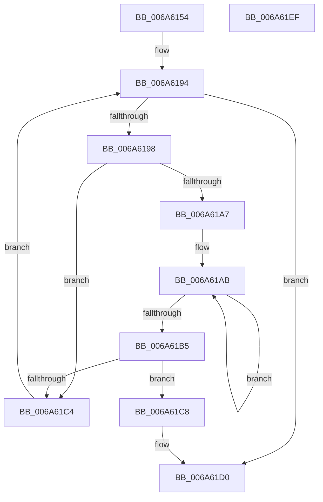

# MinCryptK_GetBootAppSvnFromRevocationList

- RVA: `0x006A6154`–`0x006A61F0` (길이 `156` bytes)
- VA: `0x00000001406A6154`
- 실행 섹션: `.text`
- PDB 이름 있음: `예`; PDB Function 태그: `아니요`
- unwind 정보 RVA: `0x00075C18`
- 디코드: `50`개 명령, `156/156` bytes 표시
- 미해석 바이트: `0` (있으면 어셈블리에 `.byte`로 보존)

> 이 문서는 커널 이미지의 기계어와 PDB 기호를 분석해 생성했습니다. 4번과 5번은 함수 원형과 자료형을 바이너리 사용 방식에서 추정한 C 해석이며 원본 소스 복구 결과는 아닙니다.

## 1. Dependencies

- 직접 호출 지점: **1**; 고유 호출 대상: **1**
- 직접 호출자로 확인된 함수: **1**
- RIP 상대 이미지 참조: **1**

### Outgoing calls
- `0x006A61BB` → [memcmp](../6C/memcmp_function_006C6B10.md) (function, `0x006C6B10`)

### Direct callers
- [PopValidateWinresume](../../page/75/PopValidateWinresume_function_0075DFF4.md) at `0x0075E257`

### Static image references
- `0x006A6176` → RVA `0x00B01F90` (` ?? ::NNGAKEGL::`string'`; read)

## 2. Other-region calls and transfers

- 다른 실행 섹션으로 향하는 call: **0**
- 별도 외부 분기/꼬리 이동을 확인하지 못했습니다.

## 3. Assembly (complete function range)

```asm
006A6154  48 89 5C 24 08                  mov qword ptr [rsp + 8], rbx
006A6159  48 89 6C 24 10                  mov qword ptr [rsp + 0x10], rbp
006A615E  48 89 74 24 18                  mov qword ptr [rsp + 0x18], rsi
006A6163  57                              push rdi
006A6164  41 54                           push r12
006A6166  41 55                           push r13
006A6168  41 56                           push r14
006A616A  41 57                           push r15
006A616C  48 83 EC 20                     sub rsp, 0x20
006A6170  8B A9 C0 00 00 00               mov ebp, dword ptr [rcx + 0xc0]
006A6176  4C 8D 2D 13 BE 45 00            lea r13, [rip + 0x45be13]
006A617D  4C 8B A1 C8 00 00 00            mov r12, qword ptr [rcx + 0xc8]
006A6184  33 DB                           xor ebx, ebx
006A6186  C1 ED 05                        shr ebp, 5
006A6189  4D 8B F1                        mov r14, r9
006A618C  45 8B F8                        mov r15d, r8d
006A618F  BE 25 02 00 C0                  mov esi, 0xc0000225
006A6194  3B DD                           cmp ebx, ebp
006A6196  73 38                           jae 0x1406a61d0
006A6198  8B FB                           mov edi, ebx
006A619A  48 C1 E7 05                     shl rdi, 5
006A619E  49 03 FC                        add rdi, r12
006A61A1  44 3B 7F 14                     cmp r15d, dword ptr [rdi + 0x14]
006A61A5  75 1D                           jne 0x1406a61c4
006A61A7  49 83 C8 FF                     or r8, 0xffffffffffffffff
006A61AB  49 FF C0                        inc r8
006A61AE  43 80 3C 28 00                  cmp byte ptr [r8 + r13], 0
006A61B3  75 F6                           jne 0x1406a61ab
006A61B5  48 8B D7                        mov rdx, rdi
006A61B8  49 8B CD                        mov rcx, r13
006A61BB  E8 50 09 02 00                  call 0x1406c6b10
006A61C0  85 C0                           test eax, eax
006A61C2  74 04                           je 0x1406a61c8
006A61C4  FF C3                           inc ebx
006A61C6  EB CC                           jmp 0x1406a6194
006A61C8  8B 47 1C                        mov eax, dword ptr [rdi + 0x1c]
006A61CB  33 F6                           xor esi, esi
006A61CD  41 89 06                        mov dword ptr [r14], eax
006A61D0  48 8B 5C 24 50                  mov rbx, qword ptr [rsp + 0x50]
006A61D5  8B C6                           mov eax, esi
006A61D7  48 8B 74 24 60                  mov rsi, qword ptr [rsp + 0x60]
006A61DC  48 8B 6C 24 58                  mov rbp, qword ptr [rsp + 0x58]
006A61E1  48 83 C4 20                     add rsp, 0x20
006A61E5  41 5F                           pop r15
006A61E7  41 5E                           pop r14
006A61E9  41 5D                           pop r13
006A61EB  41 5C                           pop r12
006A61ED  5F                              pop rdi
006A61EE  C3                              ret
006A61EF  CC                              int3
```

## 4. C-style interpretation (structured pseudocode)

```c
__int64 __fastcall MinCryptK_GetBootAppSvnFromRevocationList(__int64 a1, __int64 a2, __int64 a3, __int64 a4)
{
    __int64 result;
    __int64 v_rbp;
    __int64 v_rbx;
    __int64 v_rdi;
    __int64 v_rsi;
    __int64 v_rsp;
    unsigned __int64 v_stack_p10;
    unsigned __int64 v_stack_p18;
    unsigned __int64 v_stack_p8;

    v_stack_p8 = v_rbx;
    v_stack_p10 = v_rbp;
    v_stack_p18 = v_rsi;
    v_rsp = (v_rsp) - (32);
    v_rbx = 0;
    v_rbp = (unsigned int)(((unsigned int)(*(unsigned int *)(a1 + 192))) >> (5));
loc_006A6194:
    if (0 >= ((unsigned int)(v_rbp))) goto loc_006A61D0;
    v_rdi = (0) << (5);
    v_rdi = (v_rdi) + (*(unsigned __int64 *)(a1 + 200));
    if (((unsigned int)((unsigned int)((unsigned int)(a3)))) != (*(unsigned int *)(v_rdi + 20))) goto loc_006A61C4;
    a3 = (a3) | (-1);
loc_006A61AB:
    a3 = (a3) + 1;
    if ((*(unsigned __int8 *)(a3 + v_rip + 4570643 * 1)) != 0) goto loc_006A61AB;
    result = memcmp(v_rip + 4570643, v_rdi, a3, a4);
    if ((unsigned int)(result) == 0) goto loc_006A61C8;
loc_006A61C4:
    v_rbx = (unsigned int)((v_rbx) + 1);
    goto loc_006A6194;
loc_006A61C8:
    v_rsi = 0;
    *(unsigned int *)(a4) = (unsigned int)((unsigned int)(*(unsigned int *)(v_rdi + 28)));
loc_006A61D0:
    v_rsp = (v_rsp) + (32);
    return 0;
}
```

## 5. (Beta) C Style

```c
int64_t MinCryptK_GetBootAppSvnFromRevocationList(void *Arg1, int64_t Arg2, int64_t Arg3, void *Arg4)
{
    uint8_t *arg1 = (uint8_t *)Arg1;
    uint8_t *arg4 = (uint8_t *)Arg4;

    int64_t result;
    int64_t local_rbp;
    int64_t local_rbx;
    int64_t local_rdi;
    int64_t local_rsi;
    int64_t local_rsp;
    uint64_t v_stack_p10;
    uint64_t v_stack_p18;
    uint64_t v_stack_p8;

    v_stack_p8 = local_rbx;
    v_stack_p10 = local_rbp;
    v_stack_p18 = local_rsi;
    local_rsp = (local_rsp) - (32);
    local_rbx = 0;
    local_rbp = (uint32_t)(((uint32_t)(*(uint32_t *)(arg1 + 0xC0))) >> (5));
loc_006A6194:
    if (0 >= ((uint32_t)(local_rbp))) goto loc_006A61D0;
    local_rdi = (0) << (5);
    local_rdi = (local_rdi) + (*(uint64_t *)(arg1 + 0xC8));
    if (((uint32_t)((uint32_t)((uint32_t)(Arg3)))) != (*(uint32_t *)(local_rdi + 0x14))) goto loc_006A61C4;
    Arg3 = (Arg3) | (-1);
loc_006A61AB:
    Arg3 = (Arg3) + 1;
    if ((*(uint8_t *)(Arg3 + v_rip + 0x45BE13 * 1)) != 0) goto loc_006A61AB;
    result = memcmp(v_rip + 4570643, local_rdi, Arg3, Arg4);
    if ((uint32_t)(result) == 0) goto loc_006A61C8;
loc_006A61C4:
    local_rbx = (uint32_t)((local_rbx) + 1);
    goto loc_006A6194;
loc_006A61C8:
    local_rsi = 0;
    *(uint32_t *)(arg4) = (uint32_t)((uint32_t)(*(uint32_t *)(local_rdi + 0x1C)));
loc_006A61D0:
    local_rsp = (local_rsp) + (32);
    return 0;
}
```

### 관측된 메모리 오프셋

구조체 형식이 확인되지 않은 접근은 인자 기준의 오프셋으로만 기록했습니다.

| 기준 인자 | 오프셋 표현 | 폭 (bit) | 접근 |
|---|---:|---:|---|
| `Arg1` | `+ 0xC0` | `32` | `R` |
| `Arg1` | `+ 0xC8` | `64` | `R` |
| `Arg4` | `+ 0x0` | `32` | `W` |

## 6. Execution-region graph

[열기: 2D/3D 그래프와 함수 탐색 컨트롤 패널](../../../control-panel.html?section=text&rva=0x006A6154&view=graph)

- 2D 그래프는 위에서 아래로 흐르고, 3D 그래프는 빈 공간을 드래그해 회전합니다. Shift+드래그는 이동, 휠은 확대·축소, 함수 노드 선택은 대상 보고서 이동입니다.

### Static fallback


