# NtReplacePartitionUnit

- RVA: `0x006A85A0`–`0x006A8873` (길이 `723` bytes)
- VA: `0x00000001406A85A0`
- 실행 섹션: `.text`
- PDB 이름 있음: `예`; PDB Function 태그: `아니요`
- unwind 정보 RVA: `0x000DB3A0`
- 디코드: `188`개 명령, `723/723` bytes 표시
- 미해석 바이트: `0` (있으면 어셈블리에 `.byte`로 보존)

> 이 문서는 커널 이미지의 기계어와 PDB 기호를 분석해 생성했습니다. 4번과 5번은 함수 원형과 자료형을 바이너리 사용 방식에서 추정한 C 해석이며 원본 소스 복구 결과는 아닙니다.

## 1. Dependencies

- 직접 호출 지점: **12**; 고유 호출 대상: **7**
- 직접 호출자로 확인된 함수: **0**
- RIP 상대 이미지 참조: **1**

### Outgoing calls
- `0x006A860C` → [SeSinglePrivilegeCheck](../../page/87/SeSinglePrivilegeCheck_function_00871E20.md) (function, `0x00871E20`)
- `0x006A862E` → [IoReplacePartitionUnit](../../page/72/IoReplacePartitionUnit_function_00727FD0.md) (function, `0x00727FD0`)
- `0x006A864F` → [ExRaiseDatatypeMisalignment](../../page/89/ExRaiseDatatypeMisalignment_function_00899FD0.md) (function, `0x00899FD0`)
- `0x006A8673` → [ExRaiseDatatypeMisalignment](../../page/89/ExRaiseDatatypeMisalignment_function_00899FD0.md) (function, `0x00899FD0`)
- `0x006A870B` → [PiControlMakeUserModeCallersCopy](../../page/8E/PiControlMakeUserModeCallersCopy_function_008E4630.md) (function, `0x008E4630`)
- `0x006A8736` → [PiControlMakeUserModeCallersCopy](../../page/8E/PiControlMakeUserModeCallersCopy_function_008E4630.md) (function, `0x008E4630`)
- `0x006A877A` → [PnpDeviceObjectFromDeviceInstanceWithTag](../../page/8E/PnpDeviceObjectFromDeviceInstanceWithTag_function_008E7490.md) (function, `0x008E7490`)
- `0x006A87B7` → [PnpDeviceObjectFromDeviceInstanceWithTag](../../page/8E/PnpDeviceObjectFromDeviceInstanceWithTag_function_008E7490.md) (function, `0x008E7490`)
- `0x006A8819` → [ObfDereferenceObjectWithTag](../2F/ObfDereferenceObjectWithTag_function_002F78E0.md) (function, `0x002F78E0`)
- `0x006A882B` → [ObfDereferenceObjectWithTag](../2F/ObfDereferenceObjectWithTag_function_002F78E0.md) (function, `0x002F78E0`)
- `0x006A883F` → [ExFreePoolWithTag](../../poolcode/B8/ExFreePoolWithTag_function_00B82870.md) (function, `0x00B82870`)
- `0x006A8850` → [ExFreePoolWithTag](../../poolcode/B8/ExFreePoolWithTag_function_00B82870.md) (function, `0x00B82870`)

### Direct callers
- 이 함수 시작 RVA로 연결되는 직접 call은 확인되지 않았습니다. 간접 호출은 완전히 역산할 수 없습니다.

### Static image references
- `0x006A8605` → RVA `0x00FD9B30` (`PAGEDATA`; read)

## 2. Other-region calls and transfers

- 다른 실행 섹션으로 향하는 call: **10**
  - `0x006A860C` → [SeSinglePrivilegeCheck](../../page/87/SeSinglePrivilegeCheck_function_00871E20.md) (`.text` → `PAGE`)
  - `0x006A862E` → [IoReplacePartitionUnit](../../page/72/IoReplacePartitionUnit_function_00727FD0.md) (`.text` → `PAGE`)
  - `0x006A864F` → [ExRaiseDatatypeMisalignment](../../page/89/ExRaiseDatatypeMisalignment_function_00899FD0.md) (`.text` → `PAGE`)
  - `0x006A8673` → [ExRaiseDatatypeMisalignment](../../page/89/ExRaiseDatatypeMisalignment_function_00899FD0.md) (`.text` → `PAGE`)
  - `0x006A870B` → [PiControlMakeUserModeCallersCopy](../../page/8E/PiControlMakeUserModeCallersCopy_function_008E4630.md) (`.text` → `PAGE`)
  - `0x006A8736` → [PiControlMakeUserModeCallersCopy](../../page/8E/PiControlMakeUserModeCallersCopy_function_008E4630.md) (`.text` → `PAGE`)
  - `0x006A877A` → [PnpDeviceObjectFromDeviceInstanceWithTag](../../page/8E/PnpDeviceObjectFromDeviceInstanceWithTag_function_008E7490.md) (`.text` → `PAGE`)
  - `0x006A87B7` → [PnpDeviceObjectFromDeviceInstanceWithTag](../../page/8E/PnpDeviceObjectFromDeviceInstanceWithTag_function_008E7490.md) (`.text` → `PAGE`)
  - `0x006A883F` → [ExFreePoolWithTag](../../poolcode/B8/ExFreePoolWithTag_function_00B82870.md) (`.text` → `POOLCODE`)
  - `0x006A8850` → [ExFreePoolWithTag](../../poolcode/B8/ExFreePoolWithTag_function_00B82870.md) (`.text` → `POOLCODE`)
- 별도 외부 분기/꼬리 이동을 확인하지 못했습니다.

## 3. Assembly (complete function range)

```asm
006A85A0  48 8B C4                        mov rax, rsp
006A85A3  48 89 58 08                     mov qword ptr [rax + 8], rbx
006A85A7  48 89 70 10                     mov qword ptr [rax + 0x10], rsi
006A85AB  48 89 78 18                     mov qword ptr [rax + 0x18], rdi
006A85AF  41 54                           push r12
006A85B1  41 56                           push r14
006A85B3  41 57                           push r15
006A85B5  48 83 EC 70                     sub rsp, 0x70
006A85B9  45 8B E0                        mov r12d, r8d
006A85BC  4C 8B FA                        mov r15, rdx
006A85BF  48 8B D9                        mov rbx, rcx
006A85C2  0F 57 C0                        xorps xmm0, xmm0
006A85C5  0F 11 40 C0                     movups xmmword ptr [rax - 0x40], xmm0
006A85C9  0F 57 C9                        xorps xmm1, xmm1
006A85CC  0F 11 48 D0                     movups xmmword ptr [rax - 0x30], xmm1
006A85D0  48 83 60 20 00                  and qword ptr [rax + 0x20], 0
006A85D5  45 33 F6                        xor r14d, r14d
006A85D8  4C 89 74 24 38                  mov qword ptr [rsp + 0x38], r14
006A85DD  4C 21 70 A8                     and qword ptr [rax - 0x58], r14
006A85E1  33 F6                           xor esi, esi
006A85E3  65 48 8B 04 25 88 01 00 00      mov rax, qword ptr gs:[0x188]
006A85EC  8D 7E 01                        lea edi, [rsi + 1]
006A85EF  40 38 B8 32 02 00 00            cmp byte ptr [rax + 0x232], dil
006A85F6  74 0A                           je 0x1406a8602
006A85F8  BB 22 00 00 C0                  mov ebx, 0xc0000022
006A85FD  E9 0A 02 00 00                  jmp 0x1406a880c
006A8602  40 8A D7                        mov dl, dil
006A8605  48 8B 0D 24 15 93 00            mov rcx, qword ptr [rip + 0x931524]
006A860C  E8 0F 98 1C 00                  call 0x140871e20
006A8611  84 C0                           test al, al
006A8613  75 0A                           jne 0x1406a861f
006A8615  BB 61 00 00 C0                  mov ebx, 0xc0000061
006A861A  E9 ED 01 00 00                  jmp 0x1406a880c
006A861F  41 B8 00 00 00 80               mov r8d, 0x80000000
006A8625  45 3B E0                        cmp r12d, r8d
006A8628  75 10                           jne 0x1406a863a
006A862A  33 D2                           xor edx, edx
006A862C  33 C9                           xor ecx, ecx
006A862E  E8 9D F9 07 00                  call 0x140727fd0
006A8633  8B D8                           mov ebx, eax
006A8635  E9 D2 01 00 00                  jmp 0x1406a880c
006A863A  45 85 E4                        test r12d, r12d
006A863D  74 0A                           je 0x1406a8649
006A863F  BB F1 00 00 C0                  mov ebx, 0xc00000f1
006A8644  E9 C3 01 00 00                  jmp 0x1406a880c
006A8649  41 F6 C7 07                     test r15b, 7
006A864D  74 05                           je 0x1406a8654
006A864F  E8 7C 19 1F 00                  call 0x140899fd0
006A8654  49 8D 47 10                     lea rax, [r15 + 0x10]
006A8658  48 B9 00 00 FF FF FF 7F 00 00   movabs rcx, 0x7fffffff0000
006A8662  48 3B C1                        cmp rax, rcx
006A8665  77 05                           ja 0x1406a866c
006A8667  49 3B C7                        cmp rax, r15
006A866A  73 02                           jae 0x1406a866e
006A866C  8A 01                           mov al, byte ptr [rcx]
006A866E  F6 C3 07                        test bl, 7
006A8671  74 05                           je 0x1406a8678
006A8673  E8 58 19 1F 00                  call 0x140899fd0
006A8678  48 8D 43 10                     lea rax, [rbx + 0x10]
006A867C  48 3B C1                        cmp rax, rcx
006A867F  77 05                           ja 0x1406a8686
006A8681  48 3B C3                        cmp rax, rbx
006A8684  73 02                           jae 0x1406a8688
006A8686  8A 01                           mov al, byte ptr [rcx]
006A8688  41 0F 10 07                     movups xmm0, xmmword ptr [r15]
006A868C  F3 0F 7F 44 24 48               movdqu xmmword ptr [rsp + 0x48], xmm0
006A8692  0F 10 0B                        movups xmm1, xmmword ptr [rbx]
006A8695  F3 0F 7F 4C 24 58               movdqu xmmword ptr [rsp + 0x58], xmm1
006A869B  0F B7 44 24 58                  movzx eax, word ptr [rsp + 0x58]
006A86A0  66 2B C7                        sub ax, di
006A86A3  B9 C8 00 00 00                  mov ecx, 0xc8
006A86A8  66 3B C1                        cmp ax, cx
006A86AB  0F 87 4A 01 00 00               ja 0x1406a87fb
006A86B1  48 8B 44 24 58                  mov rax, qword ptr [rsp + 0x58]
006A86B6  48 C1 E8 10                     shr rax, 0x10
006A86BA  40 84 C7                        test dil, al
006A86BD  0F 85 38 01 00 00               jne 0x1406a87fb
006A86C3  0F B7 44 24 48                  movzx eax, word ptr [rsp + 0x48]
006A86C8  66 2B C7                        sub ax, di
006A86CB  66 3B C1                        cmp ax, cx
006A86CE  0F 87 20 01 00 00               ja 0x1406a87f4
006A86D4  48 8B 44 24 48                  mov rax, qword ptr [rsp + 0x48]
006A86D9  48 C1 E8 10                     shr rax, 0x10
006A86DD  40 84 C7                        test dil, al
006A86E0  0F 85 0E 01 00 00               jne 0x1406a87f4
006A86E6  44 0F B7 44 24 48               movzx r8d, word ptr [rsp + 0x48]
006A86EC  89 7C 24 28                     mov dword ptr [rsp + 0x28], edi
006A86F0  40 88 7C 24 20                  mov byte ptr [rsp + 0x20], dil
006A86F5  41 BF 02 00 00 00               mov r15d, 2
006A86FB  45 8B CF                        mov r9d, r15d
006A86FE  48 8B 54 24 50                  mov rdx, qword ptr [rsp + 0x50]
006A8703  48 8D 8C 24 A8 00 00 00         lea rcx, [rsp + 0xa8]
006A870B  E8 20 BF 23 00                  call 0x1408e4630
006A8710  8B D8                           mov ebx, eax
006A8712  85 C0                           test eax, eax
006A8714  0F 88 F2 00 00 00               js 0x1406a880c
006A871A  44 0F B7 44 24 58               movzx r8d, word ptr [rsp + 0x58]
006A8720  89 7C 24 28                     mov dword ptr [rsp + 0x28], edi
006A8724  40 88 7C 24 20                  mov byte ptr [rsp + 0x20], dil
006A8729  45 8B CF                        mov r9d, r15d
006A872C  48 8B 54 24 60                  mov rdx, qword ptr [rsp + 0x60]
006A8731  48 8D 4C 24 30                  lea rcx, [rsp + 0x30]
006A8736  E8 F5 BE 23 00                  call 0x1408e4630
006A873B  8B D8                           mov ebx, eax
006A873D  85 C0                           test eax, eax
006A873F  0F 88 C7 00 00 00               js 0x1406a880c
006A8745  48 8B 84 24 A8 00 00 00         mov rax, qword ptr [rsp + 0xa8]
006A874D  48 89 44 24 50                  mov qword ptr [rsp + 0x50], rax
006A8752  0F B7 44 24 48                  movzx eax, word ptr [rsp + 0x48]
006A8757  66 89 44 24 4A                  mov word ptr [rsp + 0x4a], ax
006A875C  48 8B 44 24 30                  mov rax, qword ptr [rsp + 0x30]
006A8761  48 89 44 24 60                  mov qword ptr [rsp + 0x60], rax
006A8766  0F B7 44 24 58                  movzx eax, word ptr [rsp + 0x58]
006A876B  66 89 44 24 5A                  mov word ptr [rsp + 0x5a], ax
006A8770  BA 44 66 6C 74                  mov edx, 0x746c6644
006A8775  48 8D 4C 24 48                  lea rcx, [rsp + 0x48]
006A877A  E8 11 ED 23 00                  call 0x1408e7490
006A877F  4C 8B F0                        mov r14, rax
006A8782  48 85 C0                        test rax, rax
006A8785  74 20                           je 0x1406a87a7
006A8787  48 8B 88 38 01 00 00            mov rcx, qword ptr [rax + 0x138]
006A878E  48 8B 49 28                     mov rcx, qword ptr [rcx + 0x28]
006A8792  48 85 C9                        test rcx, rcx
006A8795  74 10                           je 0x1406a87a7
006A8797  F7 81 8C 01 00 00 00 00 02 00   test dword ptr [rcx + 0x18c], 0x20000
006A87A1  75 04                           jne 0x1406a87a7
006A87A3  8B C7                           mov eax, edi
006A87A5  EB 02                           jmp 0x1406a87a9
006A87A7  33 C0                           xor eax, eax
006A87A9  85 C0                           test eax, eax
006A87AB  74 47                           je 0x1406a87f4
006A87AD  BA 44 66 6C 74                  mov edx, 0x746c6644
006A87B2  48 8D 4C 24 58                  lea rcx, [rsp + 0x58]
006A87B7  E8 D4 EC 23 00                  call 0x1408e7490
006A87BC  48 8B F0                        mov rsi, rax
006A87BF  48 85 C0                        test rax, rax
006A87C2  74 1C                           je 0x1406a87e0
006A87C4  48 8B 88 38 01 00 00            mov rcx, qword ptr [rax + 0x138]
006A87CB  48 8B 49 28                     mov rcx, qword ptr [rcx + 0x28]
006A87CF  48 85 C9                        test rcx, rcx
006A87D2  74 0C                           je 0x1406a87e0
006A87D4  F7 81 8C 01 00 00 00 00 02 00   test dword ptr [rcx + 0x18c], 0x20000
006A87DE  74 02                           je 0x1406a87e2
006A87E0  33 FF                           xor edi, edi
006A87E2  85 FF                           test edi, edi
006A87E4  74 15                           je 0x1406a87fb
006A87E6  45 33 C0                        xor r8d, r8d
006A87E9  49 8B D6                        mov rdx, r14
006A87EC  48 8B C8                        mov rcx, rax
006A87EF  E9 3A FE FF FF                  jmp 0x1406a862e
006A87F4  BB F0 00 00 C0                  mov ebx, 0xc00000f0
006A87F9  EB 11                           jmp 0x1406a880c
006A87FB  BB EF 00 00 C0                  mov ebx, 0xc00000ef
006A8800  EB 0A                           jmp 0x1406a880c
006A8802  8B D8                           mov ebx, eax
006A8804  4C 8B 74 24 38                  mov r14, qword ptr [rsp + 0x38]
006A8809  49 8B F6                        mov rsi, r14
006A880C  4D 85 F6                        test r14, r14
006A880F  74 0D                           je 0x1406a881e
006A8811  BA 44 66 6C 74                  mov edx, 0x746c6644
006A8816  49 8B CE                        mov rcx, r14
006A8819  E8 C2 F0 C4 FF                  call 0x1402f78e0
006A881E  48 85 F6                        test rsi, rsi
006A8821  74 0D                           je 0x1406a8830
006A8823  BA 44 66 6C 74                  mov edx, 0x746c6644
006A8828  48 8B CE                        mov rcx, rsi
006A882B  E8 B0 F0 C4 FF                  call 0x1402f78e0
006A8830  48 8B 8C 24 A8 00 00 00         mov rcx, qword ptr [rsp + 0xa8]
006A8838  48 85 C9                        test rcx, rcx
006A883B  74 07                           je 0x1406a8844
006A883D  33 D2                           xor edx, edx
006A883F  E8 2C A0 4D 00                  call 0x140b82870
006A8844  48 8B 4C 24 30                  mov rcx, qword ptr [rsp + 0x30]
006A8849  48 85 C9                        test rcx, rcx
006A884C  74 07                           je 0x1406a8855
006A884E  33 D2                           xor edx, edx
006A8850  E8 1B A0 4D 00                  call 0x140b82870
006A8855  8B C3                           mov eax, ebx
006A8857  4C 8D 5C 24 70                  lea r11, [rsp + 0x70]
006A885C  49 8B 5B 20                     mov rbx, qword ptr [r11 + 0x20]
006A8860  49 8B 73 28                     mov rsi, qword ptr [r11 + 0x28]
006A8864  49 8B 7B 30                     mov rdi, qword ptr [r11 + 0x30]
006A8868  49 8B E3                        mov rsp, r11
006A886B  41 5F                           pop r15
006A886D  41 5E                           pop r14
006A886F  41 5C                           pop r12
006A8871  C3                              ret
006A8872  CC                              int3
```

## 4. C-style interpretation (structured pseudocode)

```c
__int64 __fastcall NtReplacePartitionUnit(__int64 a1, __int64 a2, int a3)
{
    __int64 result;
    __int64 v_r14;
    __int64 v_rdi;
    __int64 v_rsi;
    __int64 v_rsp;
    unsigned __int64 v_stack_m18;
    unsigned __int64 v_stack_m28;
    unsigned __int16 v_stack_m2E;
    unsigned __int64 v_stack_m30;
    unsigned __int64 v_stack_m38;
    unsigned __int16 v_stack_m3E;
    unsigned __int64 v_stack_m40;
    unsigned __int64 v_stack_m50;
    unsigned __int64 v_stack_m58;
    unsigned int v_stack_m60;
    unsigned __int8 v_stack_m68;
    unsigned __int64 v_stack_p20;

    *(unsigned __int64 *)(v_rsp + 8) = v_rbx;
    *(unsigned __int64 *)(v_rsp + 16) = v_rsi;
    *(unsigned __int64 *)(v_rsp + 24) = v_rdi;
    v_rsp = (v_rsp) - (112);
    *(unsigned __int64 *)(v_rsp - 64) = v_xmm0;
    *(unsigned __int64 *)(v_rsp - 48) = v_xmm1;
    v_r14 = 0;
    v_stack_m50 = 0;
    v_rsi = 0;
    if ((*(unsigned __int8 *)(*(unsigned __int64 *)(gs_base + (0 + 392)) + 562)) == ((unsigned __int8)(v_rsi + 1))) goto loc_006A8602;
    goto loc_006A880C;
loc_006A8602:
    result = SeSinglePrivilegeCheck(*(unsigned __int64 *)(v_rip + 9639204), (unsigned __int8)(v_rsi + 1), a3, a4);
    if ((unsigned __int8)(result) != 0) goto loc_006A861F;
    goto loc_006A880C;
loc_006A861F:
    if (((unsigned int)((unsigned int)(a3))) != ((unsigned int)((unsigned int)(0x80000000ULL)))) goto loc_006A863A;
    a2 = 0;
    a1 = 0;
loc_006A862E:
    result = IoReplacePartitionUnit(a1, a2, (unsigned int)(0x80000000ULL), a4);
    goto loc_006A880C;
loc_006A863A:
    if ((unsigned int)((unsigned int)(a3)) == 0) goto loc_006A8649;
    goto loc_006A880C;
loc_006A8649:
    if (((0) & (7)) != 0) {
        result = ExRaiseDatatypeMisalignment(a1, a2, (unsigned int)(0x80000000ULL), a4);
    }
    if ((a2 + 16) > 0) goto loc_006A866C;
    result = a2 + 16;
    if ((a2 + 16) < 0) {
        result = *(unsigned __int8 *)(a1);
    }
    if ((((unsigned __int8)((unsigned int)(0xC00000F1ULL))) & (7)) != 0) {
        result = ExRaiseDatatypeMisalignment(a1, a2, (unsigned int)(0x80000000ULL), a4);
    }
    if (((unsigned int)(0xC00000F1ULL) + 16) > 0) goto loc_006A8686;
    result = (unsigned int)(0xC00000F1ULL) + 16;
    if (((unsigned int)(0xC00000F1ULL) + 16) < ((unsigned int)(0xC00000F1ULL))) {
        result = *(unsigned __int8 *)(a1);
    }
    v_stack_m40 = v_xmm0;
    v_stack_m30 = v_xmm1;
    result = (unsigned __int16)((v_stack_m30) - ((unsigned __int16)(v_rsi + 1)));
    if (((unsigned __int16)(result)) > 200) goto loc_006A87FB;
    result = (v_stack_m30) >> (16);
    if ((((unsigned __int8)(v_rsi + 1)) & ((unsigned __int8)(result))) != 0) goto loc_006A87FB;
    result = (unsigned __int16)((v_stack_m40) - ((unsigned __int16)(v_rsi + 1)));
    if (((unsigned __int16)(result)) > 200) goto loc_006A87F4;
    result = (v_stack_m40) >> (16);
    if ((((unsigned __int8)(v_rsi + 1)) & ((unsigned __int8)(result))) != 0) goto loc_006A87F4;
    v_stack_m60 = (unsigned int)(v_rsi + 1);
    v_stack_m68 = (unsigned __int8)(v_rsi + 1);
    result = PiControlMakeUserModeCallersCopy(v_stack_p20, v_stack_m38, v_stack_m40, 2);
    if (sign_flag) goto loc_006A880C;
    v_stack_m60 = (unsigned int)(v_rsi + 1);
    v_stack_m68 = (unsigned __int8)(v_rsi + 1);
    result = PiControlMakeUserModeCallersCopy(v_stack_m58, v_stack_m28, v_stack_m30, 2);
    if (sign_flag) goto loc_006A880C;
    v_stack_m38 = v_stack_p20;
    v_stack_m3E = (unsigned __int16)(v_stack_m40);
    v_stack_m28 = v_stack_m58;
    v_stack_m2E = (unsigned __int16)(v_stack_m30);
    result = PnpDeviceObjectFromDeviceInstanceWithTag(v_stack_m40, (unsigned int)(0x746C6644ULL), v_stack_m30, 2);
    if (result == 0) goto loc_006A87A7;
    if (*(unsigned __int64 *)(*(unsigned __int64 *)(result + 312) + 40) == 0) goto loc_006A87A7;
    if (((*(unsigned int *)(*(unsigned __int64 *)(*(unsigned __int64 *)(result + 312) + 40) + 396)) & (0x20000ULL)) != 0) goto loc_006A87A7;
    goto loc_006A87A9;
loc_006A87A7:
    result = 0;
loc_006A87A9:
    if (0 == 0) goto loc_006A87F4;
    result = PnpDeviceObjectFromDeviceInstanceWithTag(v_stack_m30, (unsigned int)(0x746C6644ULL), v_stack_m30, 2);
    if (result == 0) goto loc_006A87E0;
    if (*(unsigned __int64 *)(*(unsigned __int64 *)(result + 312) + 40) == 0) goto loc_006A87E0;
    v_rdi = v_rsi + 1;
    if (((*(unsigned int *)(*(unsigned __int64 *)(*(unsigned __int64 *)(result + 312) + 40) + 396)) & (0x20000ULL)) != 0) {
        v_rdi = 0;
    }
    if (0 == 0) goto loc_006A87FB;
    a3 = 0;
    goto loc_006A862E;
loc_006A87F4:
    goto loc_006A880C;
loc_006A87FB:
    goto loc_006A880C;
loc_006A880C:
    if (result != 0) {
        a2 = 0x746C6644ULL;
        a1 = result;
        result = ObfDereferenceObjectWithTag(a1, a2, a3, 2);
    }
    if (result != 0) {
        a2 = 0x746C6644ULL;
        a1 = result;
        result = ObfDereferenceObjectWithTag(a1, a2, a3, 2);
    }
    if (v_stack_p20 != 0) {
        a2 = 0;
        result = ExFreePoolWithTag(v_stack_p20, a2, a3, 2);
    }
    if (v_stack_m58 != 0) {
        a2 = 0;
        result = ExFreePoolWithTag(v_stack_m58, a2, a3, 2);
    }
    return (unsigned int)((unsigned int)((unsigned int)(0xC00000EFULL)));
}
```

## 5. (Beta) C Style

```c
int64_t NtReplacePartitionUnit(int64_t Arg1, int64_t Arg2, int32_t Arg3)
{
    int64_t result;
    int64_t local_r14;
    int64_t local_rdi;
    int64_t local_rsi;
    int64_t local_rsp;
    uint64_t v_stack_m18;
    uint64_t v_stack_m28;
    uint16_t v_stack_m2E;
    uint64_t v_stack_m30;
    uint64_t v_stack_m38;
    uint16_t v_stack_m3E;
    uint64_t v_stack_m40;
    uint64_t v_stack_m50;
    uint64_t v_stack_m58;
    uint32_t v_stack_m60;
    uint8_t v_stack_m68;
    uint64_t v_stack_p20;

    *(uint64_t *)(local_rsp + 0x8) = local_rbx;
    *(uint64_t *)(local_rsp + 0x10) = local_rsi;
    *(uint64_t *)(local_rsp + 0x18) = local_rdi;
    local_rsp = (local_rsp) - (112);
    *(uint64_t *)(local_rsp - 0x40) = v_xmm0;
    *(uint64_t *)(local_rsp - 0x30) = v_xmm1;
    local_r14 = 0;
    v_stack_m50 = 0;
    local_rsi = 0;
    if ((*(uint8_t *)(*(uint64_t *)(gs_base + (0 + 0x188)) + 0x232)) == ((uint8_t)(local_rsi + 1))) goto loc_006A8602;
    goto loc_006A880C;
loc_006A8602:
    result = SeSinglePrivilegeCheck(*(uint64_t *)(v_rip + 0x931524), (uint8_t)(local_rsi + 1), Arg3, a4);
    if ((uint8_t)(result) != 0) goto loc_006A861F;
    goto loc_006A880C;
loc_006A861F:
    if (((uint32_t)((uint32_t)(Arg3))) != ((uint32_t)((uint32_t)(0x80000000ULL)))) goto loc_006A863A;
    Arg2 = 0;
    Arg1 = 0;
loc_006A862E:
    result = IoReplacePartitionUnit(Arg1, Arg2, (uint32_t)(0x80000000ULL), a4);
    goto loc_006A880C;
loc_006A863A:
    if ((uint32_t)((uint32_t)(Arg3)) == 0) goto loc_006A8649;
    goto loc_006A880C;
loc_006A8649:
    if (((0) & (7)) != 0) {
        result = ExRaiseDatatypeMisalignment(Arg1, Arg2, (uint32_t)(0x80000000ULL), a4);
    }
    if ((Arg2 + 16) > 0) goto loc_006A866C;
    result = Arg2 + 16;
    if ((Arg2 + 16) < 0) {
        result = *(uint8_t *)(Arg1);
    }
    if ((((uint8_t)((uint32_t)(0xC00000F1ULL))) & (7)) != 0) {
        result = ExRaiseDatatypeMisalignment(Arg1, Arg2, (uint32_t)(0x80000000ULL), a4);
    }
    if (((uint32_t)(0xC00000F1ULL) + 16) > 0) goto loc_006A8686;
    result = (uint32_t)(0xC00000F1ULL) + 16;
    if (((uint32_t)(0xC00000F1ULL) + 16) < ((uint32_t)(0xC00000F1ULL))) {
        result = *(uint8_t *)(Arg1);
    }
    v_stack_m40 = v_xmm0;
    v_stack_m30 = v_xmm1;
    result = (uint16_t)((v_stack_m30) - ((uint16_t)(local_rsi + 1)));
    if (((uint16_t)(result)) > 200) goto loc_006A87FB;
    result = (v_stack_m30) >> (16);
    if ((((uint8_t)(local_rsi + 1)) & ((uint8_t)(result))) != 0) goto loc_006A87FB;
    result = (uint16_t)((v_stack_m40) - ((uint16_t)(local_rsi + 1)));
    if (((uint16_t)(result)) > 200) goto loc_006A87F4;
    result = (v_stack_m40) >> (16);
    if ((((uint8_t)(local_rsi + 1)) & ((uint8_t)(result))) != 0) goto loc_006A87F4;
    v_stack_m60 = (uint32_t)(local_rsi + 1);
    v_stack_m68 = (uint8_t)(local_rsi + 1);
    result = PiControlMakeUserModeCallersCopy(v_stack_p20, v_stack_m38, v_stack_m40, 2);
    if (sign_flag) goto loc_006A880C;
    v_stack_m60 = (uint32_t)(local_rsi + 1);
    v_stack_m68 = (uint8_t)(local_rsi + 1);
    result = PiControlMakeUserModeCallersCopy(v_stack_m58, v_stack_m28, v_stack_m30, 2);
    if (sign_flag) goto loc_006A880C;
    v_stack_m38 = v_stack_p20;
    v_stack_m3E = (uint16_t)(v_stack_m40);
    v_stack_m28 = v_stack_m58;
    v_stack_m2E = (uint16_t)(v_stack_m30);
    result = PnpDeviceObjectFromDeviceInstanceWithTag(v_stack_m40, (uint32_t)(0x746C6644ULL), v_stack_m30, 2);
    if (result == 0) goto loc_006A87A7;
    if (*(uint64_t *)(*(uint64_t *)(result + 0x138) + 0x28) == 0) goto loc_006A87A7;
    if (((*(uint32_t *)(*(uint64_t *)(*(uint64_t *)(result + 0x138) + 0x28) + 0x18C)) & (0x20000ULL)) != 0) goto loc_006A87A7;
    goto loc_006A87A9;
loc_006A87A7:
    result = 0;
loc_006A87A9:
    if (0 == 0) goto loc_006A87F4;
    result = PnpDeviceObjectFromDeviceInstanceWithTag(v_stack_m30, (uint32_t)(0x746C6644ULL), v_stack_m30, 2);
    if (result == 0) goto loc_006A87E0;
    if (*(uint64_t *)(*(uint64_t *)(result + 0x138) + 0x28) == 0) goto loc_006A87E0;
    local_rdi = local_rsi + 1;
    if (((*(uint32_t *)(*(uint64_t *)(*(uint64_t *)(result + 0x138) + 0x28) + 0x18C)) & (0x20000ULL)) != 0) {
        local_rdi = 0;
    }
    if (0 == 0) goto loc_006A87FB;
    Arg3 = 0;
    goto loc_006A862E;
loc_006A87F4:
    goto loc_006A880C;
loc_006A87FB:
    goto loc_006A880C;
loc_006A880C:
    if (result != 0) {
        Arg2 = 0x746C6644ULL;
        Arg1 = result;
        result = ObfDereferenceObjectWithTag(Arg1, Arg2, Arg3, 2);
    }
    if (result != 0) {
        Arg2 = 0x746C6644ULL;
        Arg1 = result;
        result = ObfDereferenceObjectWithTag(Arg1, Arg2, Arg3, 2);
    }
    if (v_stack_p20 != 0) {
        Arg2 = 0;
        result = ExFreePoolWithTag(v_stack_p20, Arg2, Arg3, 2);
    }
    if (v_stack_m58 != 0) {
        Arg2 = 0;
        result = ExFreePoolWithTag(v_stack_m58, Arg2, Arg3, 2);
    }
    return (uint32_t)((uint32_t)((uint32_t)(0xC00000EFULL)));
}
```

## 6. Execution-region graph

[열기: 2D/3D 그래프와 함수 탐색 컨트롤 패널](../../../control-panel.html?section=text&rva=0x006A85A0&view=graph)

- 2D 그래프는 위에서 아래로 흐르고, 3D 그래프는 빈 공간을 드래그해 회전합니다. Shift+드래그는 이동, 휠은 확대·축소, 함수 노드 선택은 대상 보고서 이동입니다.

### Static fallback

```mermaid
flowchart TD
  bb_006A85A0[BB_006A85A0]
  bb_006A85F8[BB_006A85F8]
  bb_006A8602[BB_006A8602]
  bb_006A8615[BB_006A8615]
  bb_006A861F[BB_006A861F]
  bb_006A862A[BB_006A862A]
  bb_006A862E[BB_006A862E]
  bb_006A863A[BB_006A863A]
  bb_006A863F[BB_006A863F]
  bb_006A8649[BB_006A8649]
  bb_006A864F[BB_006A864F]
  bb_006A8654[BB_006A8654]
  bb_006A8667[BB_006A8667]
  bb_006A866C[BB_006A866C]
  bb_006A866E[BB_006A866E]
  bb_006A8673[BB_006A8673]
  bb_006A8678[BB_006A8678]
  bb_006A8681[BB_006A8681]
  bb_006A8686[BB_006A8686]
  bb_006A8688[BB_006A8688]
  bb_006A86B1[BB_006A86B1]
  bb_006A86C3[BB_006A86C3]
  bb_006A86D4[BB_006A86D4]
  bb_006A86E6[BB_006A86E6]
  bb_006A871A[BB_006A871A]
  bb_006A8745[BB_006A8745]
  bb_006A8787[BB_006A8787]
  bb_006A8797[BB_006A8797]
  bb_006A87A3[BB_006A87A3]
  bb_006A87A7[BB_006A87A7]
  bb_006A87A9[BB_006A87A9]
  bb_006A87AD[BB_006A87AD]
  bb_006A87C4[BB_006A87C4]
  bb_006A87D4[BB_006A87D4]
  bb_006A87E0[BB_006A87E0]
  bb_006A87E2[BB_006A87E2]
  bb_006A87E6[BB_006A87E6]
  bb_006A87F4[BB_006A87F4]
  bb_006A87FB[BB_006A87FB]
  bb_006A8802[BB_006A8802]
  bb_006A880C[BB_006A880C]
  bb_006A8811[BB_006A8811]
  bb_006A881E[BB_006A881E]
  bb_006A8823[BB_006A8823]
  bb_006A8830[BB_006A8830]
  bb_006A883D[BB_006A883D]
  bb_006A8844[BB_006A8844]
  bb_006A884E[BB_006A884E]
  bb_006A8855[BB_006A8855]
  bb_006A8872[BB_006A8872]
  bb_006A85A0 -->|branch| bb_006A8602
  bb_006A85A0 -->|fallthrough| bb_006A85F8
  bb_006A85F8 -->|branch| bb_006A880C
  bb_006A8602 -->|branch| bb_006A861F
  bb_006A8602 -->|fallthrough| bb_006A8615
  bb_006A8615 -->|branch| bb_006A880C
  bb_006A861F -->|branch| bb_006A863A
  bb_006A861F -->|fallthrough| bb_006A862A
  bb_006A862A -->|flow| bb_006A862E
  bb_006A862E -->|branch| bb_006A880C
  bb_006A863A -->|branch| bb_006A8649
  bb_006A863A -->|fallthrough| bb_006A863F
  bb_006A863F -->|branch| bb_006A880C
  bb_006A8649 -->|branch| bb_006A8654
  bb_006A8649 -->|fallthrough| bb_006A864F
  bb_006A864F -->|flow| bb_006A8654
  bb_006A8654 -->|branch| bb_006A866C
  bb_006A8654 -->|fallthrough| bb_006A8667
  bb_006A8667 -->|branch| bb_006A866E
  bb_006A8667 -->|fallthrough| bb_006A866C
  bb_006A866C -->|flow| bb_006A866E
  bb_006A866E -->|branch| bb_006A8678
  bb_006A866E -->|fallthrough| bb_006A8673
  bb_006A8673 -->|flow| bb_006A8678
  bb_006A8678 -->|branch| bb_006A8686
  bb_006A8678 -->|fallthrough| bb_006A8681
  bb_006A8681 -->|branch| bb_006A8688
  bb_006A8681 -->|fallthrough| bb_006A8686
  bb_006A8686 -->|flow| bb_006A8688
  bb_006A8688 -->|branch| bb_006A87FB
  bb_006A8688 -->|fallthrough| bb_006A86B1
  bb_006A86B1 -->|branch| bb_006A87FB
  bb_006A86B1 -->|fallthrough| bb_006A86C3
  bb_006A86C3 -->|branch| bb_006A87F4
  bb_006A86C3 -->|fallthrough| bb_006A86D4
  bb_006A86D4 -->|branch| bb_006A87F4
  bb_006A86D4 -->|fallthrough| bb_006A86E6
  bb_006A86E6 -->|branch| bb_006A880C
  bb_006A86E6 -->|fallthrough| bb_006A871A
  bb_006A871A -->|branch| bb_006A880C
  bb_006A871A -->|fallthrough| bb_006A8745
  bb_006A8745 -->|branch| bb_006A87A7
  bb_006A8745 -->|fallthrough| bb_006A8787
  bb_006A8787 -->|branch| bb_006A87A7
  bb_006A8787 -->|fallthrough| bb_006A8797
  bb_006A8797 -->|branch| bb_006A87A7
  bb_006A8797 -->|fallthrough| bb_006A87A3
  bb_006A87A3 -->|branch| bb_006A87A9
  bb_006A87A7 -->|flow| bb_006A87A9
  bb_006A87A9 -->|branch| bb_006A87F4
  bb_006A87A9 -->|fallthrough| bb_006A87AD
  bb_006A87AD -->|branch| bb_006A87E0
  bb_006A87AD -->|fallthrough| bb_006A87C4
  bb_006A87C4 -->|branch| bb_006A87E0
  bb_006A87C4 -->|fallthrough| bb_006A87D4
  bb_006A87D4 -->|branch| bb_006A87E2
  bb_006A87D4 -->|fallthrough| bb_006A87E0
  bb_006A87E0 -->|flow| bb_006A87E2
  bb_006A87E2 -->|branch| bb_006A87FB
  bb_006A87E2 -->|fallthrough| bb_006A87E6
  bb_006A87E6 -->|branch| bb_006A862E
  bb_006A87F4 -->|branch| bb_006A880C
  bb_006A87FB -->|branch| bb_006A880C
  bb_006A8802 -->|flow| bb_006A880C
  bb_006A880C -->|branch| bb_006A881E
  bb_006A880C -->|fallthrough| bb_006A8811
  bb_006A8811 -->|flow| bb_006A881E
  bb_006A881E -->|branch| bb_006A8830
  bb_006A881E -->|fallthrough| bb_006A8823
  bb_006A8823 -->|flow| bb_006A8830
  bb_006A8830 -->|branch| bb_006A8844
  bb_006A8830 -->|fallthrough| bb_006A883D
  bb_006A883D -->|flow| bb_006A8844
  bb_006A8844 -->|branch| bb_006A8855
  bb_006A8844 -->|fallthrough| bb_006A884E
  bb_006A884E -->|flow| bb_006A8855
```


