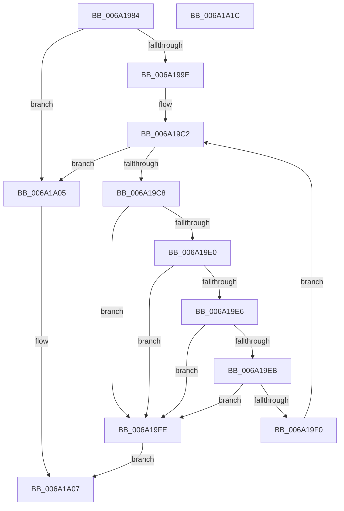

# RaspConvertDeltas

- RVA: `0x006A1984`–`0x006A1A1D` (길이 `153` bytes)
- VA: `0x00000001406A1984`
- 실행 섹션: `.text`
- PDB 이름 있음: `예`; PDB Function 태그: `아니요`
- unwind 정보 RVA: `0x000A5A38`
- 디코드: `45`개 명령, `153/153` bytes 표시
- 미해석 바이트: `0` (있으면 어셈블리에 `.byte`로 보존)

> 이 문서는 커널 이미지의 기계어와 PDB 기호를 분석해 생성했습니다. 4번과 5번은 함수 원형과 자료형을 바이너리 사용 방식에서 추정한 C 해석이며 원본 소스 복구 결과는 아닙니다.

## 1. Dependencies

- 직접 호출 지점: **0**; 고유 호출 대상: **0**
- 직접 호출자로 확인된 함수: **1**
- RIP 상대 이미지 참조: **0**

### Outgoing calls
- 직접 디코드된 call 명령이 없습니다.

### Direct callers
- [RaspGetUnscaledGlyphData](RaspGetUnscaledGlyphData_function_006A1E84.md) at `0x006A1F21`

### Static image references
- 디코드된 RIP-relative 메모리 참조가 없습니다.

## 2. Other-region calls and transfers

- 다른 실행 섹션으로 향하는 call: **0**
- 별도 외부 분기/꼬리 이동을 확인하지 못했습니다.

## 3. Assembly (complete function range)

```asm
006A1984  48 8B C4                        mov rax, rsp
006A1987  48 89 58 08                     mov qword ptr [rax + 8], rbx
006A198B  48 89 68 10                     mov qword ptr [rax + 0x10], rbp
006A198F  48 89 70 18                     mov qword ptr [rax + 0x18], rsi
006A1993  48 89 78 20                     mov qword ptr [rax + 0x20], rdi
006A1997  33 C0                           xor eax, eax
006A1999  66 39 01                        cmp word ptr [rcx], ax
006A199C  7E 67                           jle 0x1406a1a05
006A199E  44 0F B7 59 18                  movzx r11d, word ptr [rcx + 0x18]
006A19A3  44 0F B7 D0                     movzx r10d, ax
006A19A7  48 8B 51 32                     mov rdx, qword ptr [rcx + 0x32]
006A19AB  4C 8B 41 3A                     mov r8, qword ptr [rcx + 0x3a]
006A19AF  0F B7 71 0A                     movzx esi, word ptr [rcx + 0xa]
006A19B3  0F B7 69 02                     movzx ebp, word ptr [rcx + 2]
006A19B7  0F B7 59 0E                     movzx ebx, word ptr [rcx + 0xe]
006A19BB  0F B7 79 06                     movzx edi, word ptr [rcx + 6]
006A19BF  0F B7 C8                        movzx ecx, ax
006A19C2  66 45 3B D3                     cmp r10w, r11w
006A19C6  73 3D                           jae 0x1406a1a05
006A19C8  66 03 02                        add ax, word ptr [rdx]
006A19CB  66 41 03 08                     add cx, word ptr [r8]
006A19CF  66 89 02                        mov word ptr [rdx], ax
006A19D2  66 41 89 08                     mov word ptr [r8], cx
006A19D6  44 0F B7 0A                     movzx r9d, word ptr [rdx]
006A19DA  66 44 3B CE                     cmp r9w, si
006A19DE  7F 1E                           jg 0x1406a19fe
006A19E0  66 44 3B CD                     cmp r9w, bp
006A19E4  7C 18                           jl 0x1406a19fe
006A19E6  66 3B CB                        cmp cx, bx
006A19E9  7F 13                           jg 0x1406a19fe
006A19EB  66 3B CF                        cmp cx, di
006A19EE  7C 0E                           jl 0x1406a19fe
006A19F0  48 83 C2 04                     add rdx, 4
006A19F4  49 83 C0 04                     add r8, 4
006A19F8  66 41 FF C2                     inc r10w
006A19FC  EB C4                           jmp 0x1406a19c2
006A19FE  B8 01 00 00 C0                  mov eax, 0xc0000001
006A1A03  EB 02                           jmp 0x1406a1a07
006A1A05  33 C0                           xor eax, eax
006A1A07  48 8B 5C 24 08                  mov rbx, qword ptr [rsp + 8]
006A1A0C  48 8B 6C 24 10                  mov rbp, qword ptr [rsp + 0x10]
006A1A11  48 8B 74 24 18                  mov rsi, qword ptr [rsp + 0x18]
006A1A16  48 8B 7C 24 20                  mov rdi, qword ptr [rsp + 0x20]
006A1A1B  C3                              ret
006A1A1C  CC                              int3
```

## 4. C-style interpretation (structured pseudocode)

```c
__int64 __fastcall RaspConvertDeltas(__int64 a1)
{
    __int64 result;
    __int64 v_r10;
    unsigned __int64 v_stack_p10;
    unsigned __int64 v_stack_p18;
    unsigned __int64 v_stack_p20;
    unsigned __int64 v_stack_p8;

    *(unsigned __int64 *)(v_rsp + 8) = v_rbx;
    *(unsigned __int64 *)(v_rsp + 16) = v_rbp;
    *(unsigned __int64 *)(v_rsp + 24) = v_rsi;
    *(unsigned __int64 *)(v_rsp + 32) = v_rdi;
    result = 0;
    if ((*(unsigned __int16 *)(a1)) <= 0) goto loc_006A1A05;
loc_006A19C2:
    if (0 >= ((unsigned __int16)(*(unsigned __int16 *)(a1 + 24)))) goto loc_006A1A05;
    result = (unsigned __int16)((result) + (*(unsigned __int16 *)(*(unsigned __int64 *)(a1 + 50))));
    a1 = (unsigned __int16)((0) + (*(unsigned __int16 *)(*(unsigned __int64 *)(a1 + 58))));
    *(unsigned __int16 *)(*(unsigned __int64 *)(a1 + 50)) = (unsigned __int16)(result);
    *(unsigned __int16 *)(*(unsigned __int64 *)(a1 + 58)) = (unsigned __int16)(a1);
    if (((unsigned __int16)(*(unsigned __int16 *)(*(unsigned __int64 *)(a1 + 50)))) > ((unsigned __int16)(*(unsigned __int16 *)(a1 + 10)))) goto loc_006A19FE;
    if (((unsigned __int16)(*(unsigned __int16 *)(*(unsigned __int64 *)(a1 + 50)))) < ((unsigned __int16)(*(unsigned __int16 *)(a1 + 2)))) goto loc_006A19FE;
    if (((unsigned __int16)(a1)) > ((unsigned __int16)(*(unsigned __int16 *)(a1 + 14)))) goto loc_006A19FE;
    if (((unsigned __int16)(a1)) < ((unsigned __int16)(*(unsigned __int16 *)(a1 + 6)))) goto loc_006A19FE;
    a2 = (*(unsigned __int64 *)(a1 + 50)) + (4);
    a3 = (*(unsigned __int64 *)(a1 + 58)) + (4);
    v_r10 = (unsigned __int16)((0) + 1);
    goto loc_006A19C2;
loc_006A19FE:
    goto loc_006A1A07;
loc_006A1A05:
    result = 0;
loc_006A1A07:
    return result;
}
```

## 5. (Beta) C Style

```c
int64_t RaspConvertDeltas(void *Arg1)
{
    uint8_t *arg1 = (uint8_t *)Arg1;

    int64_t result;
    int64_t local_r10;
    uint64_t v_stack_p10;
    uint64_t v_stack_p18;
    uint64_t v_stack_p20;
    uint64_t v_stack_p8;

    *(uint64_t *)(local_rsp + 0x8) = local_rbx;
    *(uint64_t *)(local_rsp + 0x10) = local_rbp;
    *(uint64_t *)(local_rsp + 0x18) = local_rsi;
    *(uint64_t *)(local_rsp + 0x20) = local_rdi;
    result = 0;
    if ((*(uint16_t *)(arg1)) <= 0) goto loc_006A1A05;
loc_006A19C2:
    if (0 >= ((uint16_t)(*(uint16_t *)(arg1 + 0x18)))) goto loc_006A1A05;
    result = (uint16_t)((result) + (*(uint16_t *)(*(uint64_t *)(arg1 + 0x32))));
    Arg1 = (uint16_t)((0) + (*(uint16_t *)(*(uint64_t *)(arg1 + 0x3A))));
    *(uint16_t *)(*(uint64_t *)(arg1 + 0x32)) = (uint16_t)(result);
    *(uint16_t *)(*(uint64_t *)(arg1 + 0x3A)) = (uint16_t)(Arg1);
    if (((uint16_t)(*(uint16_t *)(*(uint64_t *)(arg1 + 0x32)))) > ((uint16_t)(*(uint16_t *)(arg1 + 0xA)))) goto loc_006A19FE;
    if (((uint16_t)(*(uint16_t *)(*(uint64_t *)(arg1 + 0x32)))) < ((uint16_t)(*(uint16_t *)(arg1 + 0x2)))) goto loc_006A19FE;
    if (((uint16_t)(Arg1)) > ((uint16_t)(*(uint16_t *)(arg1 + 0xE)))) goto loc_006A19FE;
    if (((uint16_t)(Arg1)) < ((uint16_t)(*(uint16_t *)(arg1 + 0x6)))) goto loc_006A19FE;
    a2 = (*(uint64_t *)(arg1 + 0x32)) + (4);
    a3 = (*(uint64_t *)(arg1 + 0x3A)) + (4);
    local_r10 = (uint16_t)((0) + 1);
    goto loc_006A19C2;
loc_006A19FE:
    goto loc_006A1A07;
loc_006A1A05:
    result = 0;
loc_006A1A07:
    return result;
}
```

### 관측된 메모리 오프셋

구조체 형식이 확인되지 않은 접근은 인자 기준의 오프셋으로만 기록했습니다.

| 기준 인자 | 오프셋 표현 | 폭 (bit) | 접근 |
|---|---:|---:|---|
| `Arg1` | `+ 0x0` | `16` | `R` |
| `Arg1` | `+ 0x2` | `16` | `R` |
| `Arg1` | `+ 0x6` | `16` | `R` |
| `Arg1` | `+ 0xA` | `16` | `R` |
| `Arg1` | `+ 0xE` | `16` | `R` |
| `Arg1` | `+ 0x18` | `16` | `R` |
| `Arg1` | `+ 0x32` | `64` | `R` |
| `Arg1` | `+ 0x3A` | `64` | `R` |

## 6. Execution-region graph

[열기: 2D/3D 그래프와 함수 탐색 컨트롤 패널](../../../control-panel.html?section=text&rva=0x006A1984&view=graph)

- 2D 그래프는 위에서 아래로 흐르고, 3D 그래프는 빈 공간을 드래그해 회전합니다. Shift+드래그는 이동, 휠은 확대·축소, 함수 노드 선택은 대상 보고서 이동입니다.

### Static fallback


