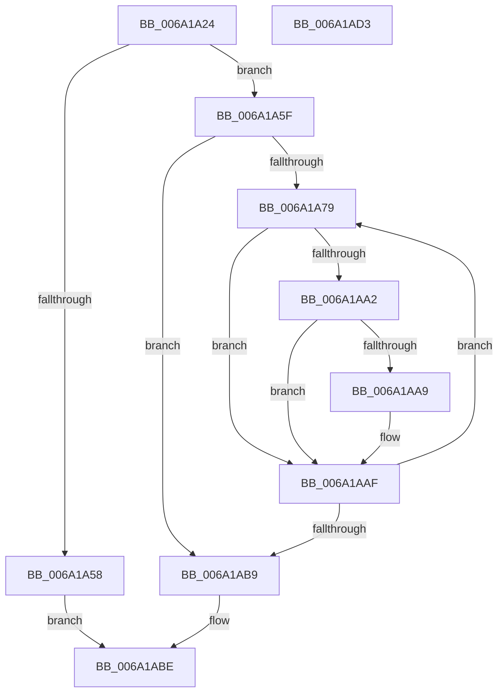

# RaspCreatePointList

- RVA: `0x006A1A24`–`0x006A1AD4` (길이 `176` bytes)
- VA: `0x00000001406A1A24`
- 실행 섹션: `.text`
- PDB 이름 있음: `예`; PDB Function 태그: `아니요`
- unwind 정보 RVA: `0x0005C954`
- 디코드: `52`개 명령, `176/176` bytes 표시
- 미해석 바이트: `0` (있으면 어셈블리에 `.byte`로 보존)

> 이 문서는 커널 이미지의 기계어와 PDB 기호를 분석해 생성했습니다. 4번과 5번은 함수 원형과 자료형을 바이너리 사용 방식에서 추정한 C 해석이며 원본 소스 복구 결과는 아닙니다.

## 1. Dependencies

- 직접 호출 지점: **2**; 고유 호출 대상: **2**
- 직접 호출자로 확인된 함수: **1**
- RIP 상대 이미지 참조: **0**

### Outgoing calls
- `0x006A1A49` → [RaspAllocateMemory](../3E/RaspAllocateMemory_function_003E42F8.md) (function, `0x003E42F8`)
- `0x006A1A6C` → [memset](../6C/memset_function_006C6C40.md) (function, `0x006C6C40`)

### Direct callers
- [RaspRasterize](RaspRasterize_function_006A2AA4.md) at `0x006A2B14`

### Static image references
- 디코드된 RIP-relative 메모리 참조가 없습니다.

## 2. Other-region calls and transfers

- 다른 실행 섹션으로 향하는 call: **0**
- 별도 외부 분기/꼬리 이동을 확인하지 못했습니다.

## 3. Assembly (complete function range)

```asm
006A1A24  48 89 5C 24 08                  mov qword ptr [rsp + 8], rbx
006A1A29  48 89 6C 24 10                  mov qword ptr [rsp + 0x10], rbp
006A1A2E  48 89 74 24 18                  mov qword ptr [rsp + 0x18], rsi
006A1A33  57                              push rdi
006A1A34  48 83 EC 20                     sub rsp, 0x20
006A1A38  0F B7 41 18                     movzx eax, word ptr [rcx + 0x18]
006A1A3C  48 8B F9                        mov rdi, rcx
006A1A3F  48 8B F2                        mov rsi, rdx
006A1A42  49 8B D0                        mov rdx, r8
006A1A45  48 6B C8 11                     imul rcx, rax, 0x11
006A1A49  E8 AA 28 D4 FF                  call 0x1403e42f8
006A1A4E  33 ED                           xor ebp, ebp
006A1A50  48 8B D8                        mov rbx, rax
006A1A53  48 85 C0                        test rax, rax
006A1A56  75 07                           jne 0x1406a1a5f
006A1A58  B8 9A 00 00 C0                  mov eax, 0xc000009a
006A1A5D  EB 5F                           jmp 0x1406a1abe
006A1A5F  0F B7 47 18                     movzx eax, word ptr [rdi + 0x18]
006A1A63  33 D2                           xor edx, edx
006A1A65  4C 6B C0 11                     imul r8, rax, 0x11
006A1A69  48 8B CB                        mov rcx, rbx
006A1A6C  E8 CF 51 02 00                  call 0x1406c6c40
006A1A71  8B D5                           mov edx, ebp
006A1A73  66 3B 6F 18                     cmp bp, word ptr [rdi + 0x18]
006A1A77  73 40                           jae 0x1406a1ab9
006A1A79  48 8B 47 32                     mov rax, qword ptr [rdi + 0x32]
006A1A7D  44 8B C2                        mov r8d, edx
006A1A80  4D 6B C8 11                     imul r9, r8, 0x11
006A1A84  42 8B 0C 80                     mov ecx, dword ptr [rax + r8*4]
006A1A88  41 89 0C 19                     mov dword ptr [r9 + rbx], ecx
006A1A8C  48 8B 47 3A                     mov rax, qword ptr [rdi + 0x3a]
006A1A90  42 8B 0C 80                     mov ecx, dword ptr [rax + r8*4]
006A1A94  41 89 4C 19 04                  mov dword ptr [r9 + rbx + 4], ecx
006A1A99  48 8B 47 2A                     mov rax, qword ptr [rdi + 0x2a]
006A1A9D  48 85 C0                        test rax, rax
006A1AA0  74 0D                           je 0x1406a1aaf
006A1AA2  42 F6 04 00 01                  test byte ptr [rax + r8], 1
006A1AA7  74 06                           je 0x1406a1aaf
006A1AA9  41 C6 44 19 10 01               mov byte ptr [r9 + rbx + 0x10], 1
006A1AAF  0F B7 47 18                     movzx eax, word ptr [rdi + 0x18]
006A1AB3  FF C2                           inc edx
006A1AB5  3B D0                           cmp edx, eax
006A1AB7  72 C0                           jb 0x1406a1a79
006A1AB9  48 89 1E                        mov qword ptr [rsi], rbx
006A1ABC  33 C0                           xor eax, eax
006A1ABE  48 8B 5C 24 30                  mov rbx, qword ptr [rsp + 0x30]
006A1AC3  48 8B 6C 24 38                  mov rbp, qword ptr [rsp + 0x38]
006A1AC8  48 8B 74 24 40                  mov rsi, qword ptr [rsp + 0x40]
006A1ACD  48 83 C4 20                     add rsp, 0x20
006A1AD1  5F                              pop rdi
006A1AD2  C3                              ret
006A1AD3  CC                              int3
```

## 4. C-style interpretation (structured pseudocode)

```c
__int64 __fastcall RaspCreatePointList(__int64 a1, __int64 a2, __int64 a3)
{
    __int64 result;
    __int64 v_rbp;
    __int64 v_rsp;
    unsigned __int64 v_stack_p10;
    unsigned __int64 v_stack_p18;
    unsigned __int64 v_stack_p8;

    v_stack_p8 = v_rbx;
    v_stack_p10 = v_rbp;
    v_stack_p18 = v_rsi;
    v_rsp = (v_rsp) - (32);
    a1 = (a1) * (*(unsigned __int16 *)(a1 + 24));
    result = RaspAllocateMemory(a1, a3, a3, a4);
    v_rbp = 0;
    if (result != 0) goto loc_006A1A5F;
    goto loc_006A1ABE;
loc_006A1A5F:
    a2 = 0;
    a3 = (a3) * (*(unsigned __int16 *)(a1 + 24));
    result = memset(result, a2, a3, a4);
    if (0 >= (*(unsigned __int16 *)(a1 + 24))) goto loc_006A1AB9;
loc_006A1A79:
    a4 = (a4) * (0);
    *(unsigned int *)(a4 + result * 1) = (unsigned int)((unsigned int)(*(unsigned int *)(*(unsigned __int64 *)(a1 + 50) + 0 * 4)));
    *(unsigned int *)(a4 + result * 1 + 4) = (unsigned int)((unsigned int)(*(unsigned int *)(*(unsigned __int64 *)(a1 + 58) + 0 * 4)));
    if (*(unsigned __int64 *)(a1 + 42) == 0) goto loc_006A1AAF;
    if (((*(unsigned __int8 *)(*(unsigned __int64 *)(a1 + 42) + 0 * 1)) & (1)) != 0) {
        *(unsigned __int8 *)(a4 + result * 1 + 16) = 1;
    }
    a2 = (unsigned int)((0) + 1);
    if (((unsigned int)(a2)) < ((unsigned int)(*(unsigned __int16 *)(a1 + 24)))) goto loc_006A1A79;
loc_006A1AB9:
    *(unsigned __int64 *)(a2) = result;
    result = 0;
loc_006A1ABE:
    v_rsp = (v_rsp) + (32);
    return result;
}
```

## 5. (Beta) C Style

```c
int64_t RaspCreatePointList(void *Arg1, void *Arg2, int64_t Arg3)
{
    uint8_t *arg1 = (uint8_t *)Arg1;
    uint8_t *arg2 = (uint8_t *)Arg2;

    int64_t result;
    int64_t local_rbp;
    int64_t local_rsp;
    uint64_t v_stack_p10;
    uint64_t v_stack_p18;
    uint64_t v_stack_p8;

    v_stack_p8 = local_rbx;
    v_stack_p10 = local_rbp;
    v_stack_p18 = local_rsi;
    local_rsp = (local_rsp) - (32);
    Arg1 = (Arg1) * (*(uint16_t *)(arg1 + 0x18));
    result = RaspAllocateMemory(Arg1, Arg3, Arg3, a4);
    local_rbp = 0;
    if (result != 0) goto loc_006A1A5F;
    goto loc_006A1ABE;
loc_006A1A5F:
    Arg2 = 0;
    Arg3 = (Arg3) * (*(uint16_t *)(arg1 + 0x18));
    result = memset(result, Arg2, Arg3, a4);
    if (0 >= (*(uint16_t *)(arg1 + 0x18))) goto loc_006A1AB9;
loc_006A1A79:
    a4 = (a4) * (0);
    *(uint32_t *)(a4 + result * 1) = (uint32_t)((uint32_t)(*(uint32_t *)(*(uint64_t *)(arg1 + 0x32) + 0x0 * 4)));
    *(uint32_t *)(a4 + result * 1 + 0x4) = (uint32_t)((uint32_t)(*(uint32_t *)(*(uint64_t *)(arg1 + 0x3A) + 0x0 * 4)));
    if (*(uint64_t *)(arg1 + 0x2A) == 0) goto loc_006A1AAF;
    if (((*(uint8_t *)(*(uint64_t *)(arg1 + 0x2A) + 0x0 * 1)) & (1)) != 0) {
        *(uint8_t *)(a4 + result * 1 + 0x10) = 1;
    }
    Arg2 = (uint32_t)((0) + 1);
    if (((uint32_t)(Arg2)) < ((uint32_t)(*(uint16_t *)(arg1 + 0x18)))) goto loc_006A1A79;
loc_006A1AB9:
    *(uint64_t *)(arg2) = result;
    result = 0;
loc_006A1ABE:
    local_rsp = (local_rsp) + (32);
    return result;
}
```

### 관측된 메모리 오프셋

구조체 형식이 확인되지 않은 접근은 인자 기준의 오프셋으로만 기록했습니다.

| 기준 인자 | 오프셋 표현 | 폭 (bit) | 접근 |
|---|---:|---:|---|
| `Arg1` | `+ 0x18` | `16` | `R` |
| `Arg1` | `+ 0x2A` | `64` | `R` |
| `Arg1` | `+ 0x32` | `64` | `R` |
| `Arg1` | `+ 0x3A` | `64` | `R` |
| `Arg2` | `+ 0x0` | `64` | `W` |

## 6. Execution-region graph

[열기: 2D/3D 그래프와 함수 탐색 컨트롤 패널](../../../control-panel.html?section=text&rva=0x006A1A24&view=graph)

- 2D 그래프는 위에서 아래로 흐르고, 3D 그래프는 빈 공간을 드래그해 회전합니다. Shift+드래그는 이동, 휠은 확대·축소, 함수 노드 선택은 대상 보고서 이동입니다.

### Static fallback


