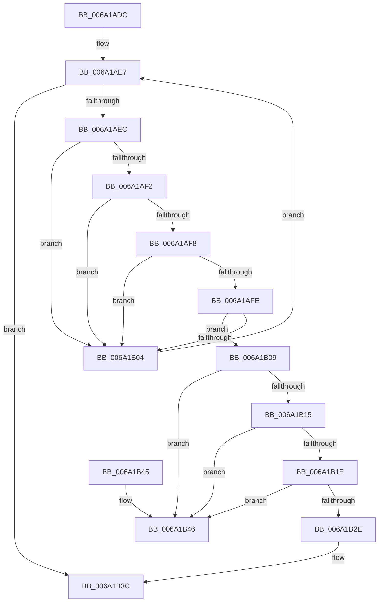

# RaspGetCacheEntry

- RVA: `0x006A1ADC`–`0x006A1B4D` (길이 `113` bytes)
- VA: `0x00000001406A1ADC`
- 실행 섹션: `.text`
- PDB 이름 있음: `예`; PDB Function 태그: `아니요`
- unwind 정보 RVA: `0x000DB714`
- 디코드: `37`개 명령, `113/113` bytes 표시
- 미해석 바이트: `0` (있으면 어셈블리에 `.byte`로 보존)

> 이 문서는 커널 이미지의 기계어와 PDB 기호를 분석해 생성했습니다. 4번과 5번은 함수 원형과 자료형을 바이너리 사용 방식에서 추정한 C 해석이며 원본 소스 복구 결과는 아닙니다.

## 1. Dependencies

- 직접 호출 지점: **0**; 고유 호출 대상: **0**
- 직접 호출자로 확인된 함수: **2**
- RIP 상대 이미지 참조: **0**

### Outgoing calls
- 직접 디코드된 call 명령이 없습니다.

### Direct callers
- [BgpRasPrintGlyph](../47/BgpRasPrintGlyph_function_0047F3B4.md) at `0x0047F4AC`
- [RaspGetXExtent](RaspGetXExtent_function_006A1F7C.md) at `0x006A2014`

### Static image references
- 디코드된 RIP-relative 메모리 참조가 없습니다.

## 2. Other-region calls and transfers

- 다른 실행 섹션으로 향하는 call: **0**
- 별도 외부 분기/꼬리 이동을 확인하지 못했습니다.

## 3. Assembly (complete function range)

```asm
006A1ADC  48 8B 01                        mov rax, qword ptr [rcx]
006A1ADF  45 33 D2                        xor r10d, r10d
006A1AE2  4C 8B 5C 24 28                  mov r11, qword ptr [rsp + 0x28]
006A1AE7  48 3B C1                        cmp rax, rcx
006A1AEA  74 50                           je 0x1406a1b3c
006A1AEC  66 39 50 3C                     cmp word ptr [rax + 0x3c], dx
006A1AF0  75 12                           jne 0x1406a1b04
006A1AF2  44 39 40 28                     cmp dword ptr [rax + 0x28], r8d
006A1AF6  75 0C                           jne 0x1406a1b04
006A1AF8  44 39 48 24                     cmp dword ptr [rax + 0x24], r9d
006A1AFC  75 06                           jne 0x1406a1b04
006A1AFE  4C 39 58 18                     cmp qword ptr [rax + 0x18], r11
006A1B02  74 05                           je 0x1406a1b09
006A1B04  48 8B 00                        mov rax, qword ptr [rax]
006A1B07  EB DE                           jmp 0x1406a1ae7
006A1B09  48 8B 10                        mov rdx, qword ptr [rax]
006A1B0C  4C 8B D0                        mov r10, rax
006A1B0F  48 39 42 08                     cmp qword ptr [rdx + 8], rax
006A1B13  75 31                           jne 0x1406a1b46
006A1B15  4C 8B 40 08                     mov r8, qword ptr [rax + 8]
006A1B19  49 39 00                        cmp qword ptr [r8], rax
006A1B1C  75 28                           jne 0x1406a1b46
006A1B1E  49 89 10                        mov qword ptr [r8], rdx
006A1B21  4C 89 42 08                     mov qword ptr [rdx + 8], r8
006A1B25  48 8B 11                        mov rdx, qword ptr [rcx]
006A1B28  48 39 4A 08                     cmp qword ptr [rdx + 8], rcx
006A1B2C  75 18                           jne 0x1406a1b46
006A1B2E  48 89 10                        mov qword ptr [rax], rdx
006A1B31  48 89 48 08                     mov qword ptr [rax + 8], rcx
006A1B35  48 89 42 08                     mov qword ptr [rdx + 8], rax
006A1B39  48 89 01                        mov qword ptr [rcx], rax
006A1B3C  48 8B 44 24 30                  mov rax, qword ptr [rsp + 0x30]
006A1B41  4C 89 10                        mov qword ptr [rax], r10
006A1B44  C3                              ret
006A1B45  CC                              int3
006A1B46  B9 03 00 00 00                  mov ecx, 3
006A1B4B  CD 29                           int 0x29
```

## 4. C-style interpretation (structured pseudocode)

```c
__int64 __fastcall RaspGetCacheEntry(__int64 a1, unsigned __int16 a2, int a3, int a4, __int64 a5, __int64 a6)
{
    __int64 v_r10;

    v_r10 = 0;
loc_006A1AE7:
    if ((*(unsigned __int64 *)(a1)) == a1) goto loc_006A1B3C;
    if ((*(unsigned __int16 *)(*(unsigned __int64 *)(a1) + 60)) != a2) goto loc_006A1B04;
    if ((*(unsigned int *)(*(unsigned __int64 *)(a1) + 40)) != a3) goto loc_006A1B04;
    if ((*(unsigned int *)(*(unsigned __int64 *)(a1) + 36)) != a4) goto loc_006A1B04;
    if ((*(unsigned __int64 *)(*(unsigned __int64 *)(a1) + 24)) == a5) goto loc_006A1B09;
loc_006A1B04:
    goto loc_006A1AE7;
loc_006A1B09:
    if ((*(unsigned __int64 *)(*(unsigned __int64 *)(*(unsigned __int64 *)(*(unsigned __int64 *)(a1))) + 8)) != (*(unsigned __int64 *)(*(unsigned __int64 *)(a1)))) goto loc_006A1B46;
    if ((*(unsigned __int64 *)(*(unsigned __int64 *)(*(unsigned __int64 *)(*(unsigned __int64 *)(a1)) + 8))) != (*(unsigned __int64 *)(*(unsigned __int64 *)(a1)))) goto loc_006A1B46;
    *(unsigned __int64 *)(*(unsigned __int64 *)(*(unsigned __int64 *)(*(unsigned __int64 *)(a1)) + 8)) = *(unsigned __int64 *)(*(unsigned __int64 *)(*(unsigned __int64 *)(a1)));
    *(unsigned __int64 *)(*(unsigned __int64 *)(*(unsigned __int64 *)(*(unsigned __int64 *)(a1))) + 8) = *(unsigned __int64 *)(*(unsigned __int64 *)(*(unsigned __int64 *)(a1)) + 8);
    if ((*(unsigned __int64 *)(*(unsigned __int64 *)(a1) + 8)) != a1) goto loc_006A1B46;
    *(unsigned __int64 *)(*(unsigned __int64 *)(*(unsigned __int64 *)(a1))) = *(unsigned __int64 *)(a1);
    *(unsigned __int64 *)(*(unsigned __int64 *)(*(unsigned __int64 *)(a1)) + 8) = a1;
    *(unsigned __int64 *)(*(unsigned __int64 *)(a1) + 8) = *(unsigned __int64 *)(*(unsigned __int64 *)(a1));
    *(unsigned __int64 *)(a1) = *(unsigned __int64 *)(*(unsigned __int64 *)(a1));
loc_006A1B3C:
    *(unsigned __int64 *)(a6) = *(unsigned __int64 *)(*(unsigned __int64 *)(a1));
    return a6;
loc_006A1B46:
    return a6;
}
```

## 5. (Beta) C Style

```c
void *RaspGetCacheEntry(void *Arg1, uint16_t Arg2, int32_t Arg3, int32_t Arg4, int64_t Arg5, void *Arg6)
{
    uint8_t *arg1 = (uint8_t *)Arg1;
    uint8_t *arg6 = (uint8_t *)Arg6;

    int64_t local_r10;

    local_r10 = 0;
loc_006A1AE7:
    if ((*(uint64_t *)(arg1)) == Arg1) goto loc_006A1B3C;
    if ((*(uint16_t *)(*(uint64_t *)(arg1) + 0x3C)) != Arg2) goto loc_006A1B04;
    if ((*(uint32_t *)(*(uint64_t *)(arg1) + 0x28)) != Arg3) goto loc_006A1B04;
    if ((*(uint32_t *)(*(uint64_t *)(arg1) + 0x24)) != Arg4) goto loc_006A1B04;
    if ((*(uint64_t *)(*(uint64_t *)(arg1) + 0x18)) == Arg5) goto loc_006A1B09;
loc_006A1B04:
    goto loc_006A1AE7;
loc_006A1B09:
    if ((*(uint64_t *)(*(uint64_t *)(*(uint64_t *)(*(uint64_t *)(arg1))) + 0x8)) != (*(uint64_t *)(*(uint64_t *)(arg1)))) goto loc_006A1B46;
    if ((*(uint64_t *)(*(uint64_t *)(*(uint64_t *)(*(uint64_t *)(arg1)) + 0x8))) != (*(uint64_t *)(*(uint64_t *)(arg1)))) goto loc_006A1B46;
    *(uint64_t *)(*(uint64_t *)(*(uint64_t *)(*(uint64_t *)(arg1)) + 0x8)) = *(uint64_t *)(*(uint64_t *)(*(uint64_t *)(arg1)));
    *(uint64_t *)(*(uint64_t *)(*(uint64_t *)(*(uint64_t *)(arg1))) + 0x8) = *(uint64_t *)(*(uint64_t *)(*(uint64_t *)(arg1)) + 0x8);
    if ((*(uint64_t *)(*(uint64_t *)(arg1) + 0x8)) != Arg1) goto loc_006A1B46;
    *(uint64_t *)(*(uint64_t *)(*(uint64_t *)(arg1))) = *(uint64_t *)(arg1);
    *(void **)(*(uint64_t *)(*(uint64_t *)(arg1)) + 0x8) = Arg1;
    *(uint64_t *)(*(uint64_t *)(arg1) + 0x8) = *(uint64_t *)(*(uint64_t *)(arg1));
    *(uint64_t *)(arg1) = *(uint64_t *)(*(uint64_t *)(arg1));
loc_006A1B3C:
    *(uint64_t *)(arg6) = *(uint64_t *)(*(uint64_t *)(arg1));
    return Arg6;
loc_006A1B46:
    return Arg6;
}
```

### 관측된 메모리 오프셋

구조체 형식이 확인되지 않은 접근은 인자 기준의 오프셋으로만 기록했습니다.

| 기준 인자 | 오프셋 표현 | 폭 (bit) | 접근 |
|---|---:|---:|---|
| `Arg1` | `+ 0x0` | `64` | `R` |
| `Arg1` | `+ 0x0` | `64` | `W` |
| `Arg6` | `+ 0x0` | `64` | `W` |

## 6. Execution-region graph

[열기: 2D/3D 그래프와 함수 탐색 컨트롤 패널](../../../control-panel.html?section=text&rva=0x006A1ADC&view=graph)

- 2D 그래프는 위에서 아래로 흐르고, 3D 그래프는 빈 공간을 드래그해 회전합니다. Shift+드래그는 이동, 휠은 확대·축소, 함수 노드 선택은 대상 보고서 이동입니다.

### Static fallback


