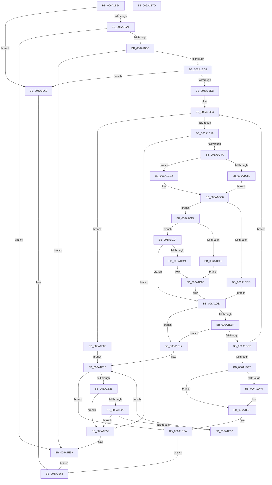

# RaspGetCompositeGlyphList

- RVA: `0x006A1B54`–`0x006A1E7E` (길이 `810` bytes)
- VA: `0x00000001406A1B54`
- 실행 섹션: `.text`
- PDB 이름 있음: `예`; PDB Function 태그: `아니요`
- unwind 정보 RVA: `0x0008E084`
- 디코드: `232`개 명령, `810/810` bytes 표시
- 미해석 바이트: `0` (있으면 어셈블리에 `.byte`로 보존)

> 이 문서는 커널 이미지의 기계어와 PDB 기호를 분석해 생성했습니다. 4번과 5번은 함수 원형과 자료형을 바이너리 사용 방식에서 추정한 C 해석이며 원본 소스 복구 결과는 아닙니다.

## 1. Dependencies

- 직접 호출 지점: **18**; 고유 호출 대상: **5**
- 직접 호출자로 확인된 함수: **1**
- RIP 상대 이미지 참조: **0**

### Outgoing calls
- `0x006A1BDC` → [FioFwReadUshortAtOffset](../4F/FioFwReadUshortAtOffset_function_004F98A0.md) (function, `0x004F98A0`)
- `0x006A1C08` → [RaspAllocateMemory](../3E/RaspAllocateMemory_function_003E42F8.md) (function, `0x003E42F8`)
- `0x006A1C51` → [FioFwReadUshortAtOffset](../4F/FioFwReadUshortAtOffset_function_004F98A0.md) (function, `0x004F98A0`)
- `0x006A1C6C` → [FioFwReadUshortAtOffset](../4F/FioFwReadUshortAtOffset_function_004F98A0.md) (function, `0x004F98A0`)
- `0x006A1C83` → [FioFwReadUshortAtOffset](../4F/FioFwReadUshortAtOffset_function_004F98A0.md) (function, `0x004F98A0`)
- `0x006A1CA0` → [FioFwReadUshortAtOffset](../4F/FioFwReadUshortAtOffset_function_004F98A0.md) (function, `0x004F98A0`)
- `0x006A1CD5` → [FioFwReadUshortAtOffset](../4F/FioFwReadUshortAtOffset_function_004F98A0.md) (function, `0x004F98A0`)
- `0x006A1CF9` → [FioFwReadUshortAtOffset](../4F/FioFwReadUshortAtOffset_function_004F98A0.md) (function, `0x004F98A0`)
- `0x006A1D10` → [FioFwReadUshortAtOffset](../4F/FioFwReadUshortAtOffset_function_004F98A0.md) (function, `0x004F98A0`)
- `0x006A1D2D` → [FioFwReadUshortAtOffset](../4F/FioFwReadUshortAtOffset_function_004F98A0.md) (function, `0x004F98A0`)
- `0x006A1D44` → [FioFwReadUshortAtOffset](../4F/FioFwReadUshortAtOffset_function_004F98A0.md) (function, `0x004F98A0`)
- `0x006A1D5D` → [FioFwReadUshortAtOffset](../4F/FioFwReadUshortAtOffset_function_004F98A0.md) (function, `0x004F98A0`)
- `0x006A1D74` → [FioFwReadUshortAtOffset](../4F/FioFwReadUshortAtOffset_function_004F98A0.md) (function, `0x004F98A0`)
- `0x006A1D8E` → [RaspMapGlyphIndexToLocation](RaspMapGlyphIndexToLocation_function_006A29B4.md) (function, `0x006A29B4`)
- `0x006A1DB1` → [RaspLoadGlyphData](RaspLoadGlyphData_function_006A2818.md) (function, `0x006A2818`)
- `0x006A1DF9` → [FioFwReadUshortAtOffset](../4F/FioFwReadUshortAtOffset_function_004F98A0.md) (function, `0x004F98A0`)
- `0x006A1E40` → [RaspFreeMemory](../3E/RaspFreeMemory_function_003E28E4.md) (function, `0x003E28E4`)
- `0x006A1E4B` → [RaspFreeMemory](../3E/RaspFreeMemory_function_003E28E4.md) (function, `0x003E28E4`)

### Direct callers
- [RaspLoadCompositeGlyphData](RaspLoadCompositeGlyphData_function_006A261C.md) at `0x006A2720`

### Static image references
- 디코드된 RIP-relative 메모리 참조가 없습니다.

## 2. Other-region calls and transfers

- 다른 실행 섹션으로 향하는 call: **0**
- 별도 외부 분기/꼬리 이동을 확인하지 못했습니다.

## 3. Assembly (complete function range)

```asm
006A1B54  48 89 5C 24 08                  mov qword ptr [rsp + 8], rbx
006A1B59  4C 89 4C 24 20                  mov qword ptr [rsp + 0x20], r9
006A1B5E  4C 89 44 24 18                  mov qword ptr [rsp + 0x18], r8
006A1B63  55                              push rbp
006A1B64  56                              push rsi
006A1B65  57                              push rdi
006A1B66  41 54                           push r12
006A1B68  41 55                           push r13
006A1B6A  41 56                           push r14
006A1B6C  41 57                           push r15
006A1B6E  48 8B EC                        mov rbp, rsp
006A1B71  48 83 EC 50                     sub rsp, 0x50
006A1B75  33 FF                           xor edi, edi
006A1B77  4C 8B E9                        mov r13, rcx
006A1B7A  48 8B 4D 68                     mov rcx, qword ptr [rbp + 0x68]
006A1B7E  66 89 7D E0                     mov word ptr [rbp - 0x20], di
006A1B82  66 89 7D EC                     mov word ptr [rbp - 0x14], di
006A1B86  66 89 7D E4                     mov word ptr [rbp - 0x1c], di
006A1B8A  89 39                           mov dword ptr [rcx], edi
006A1B8C  48 8B 4D 60                     mov rcx, qword ptr [rbp + 0x60]
006A1B90  89 7D F0                        mov dword ptr [rbp - 0x10], edi
006A1B93  66 89 7D 48                     mov word ptr [rbp + 0x48], di
006A1B97  48 89 7D F8                     mov qword ptr [rbp - 8], rdi
006A1B9B  66 89 39                        mov word ptr [rcx], di
006A1B9E  66 41 89 39                     mov word ptr [r9], di
006A1BA2  66 41 89 38                     mov word ptr [r8], di
006A1BA6  83 FA FF                        cmp edx, -1
006A1BA9  0F 84 B1 02 00 00               je 0x1406a1e60
006A1BAF  4D 85 ED                        test r13, r13
006A1BB2  0F 84 A1 02 00 00               je 0x1406a1e59
006A1BB8  41 8B 45 3C                     mov eax, dword ptr [r13 + 0x3c]
006A1BBC  85 C0                           test eax, eax
006A1BBE  0F 84 95 02 00 00               je 0x1406a1e59
006A1BC4  8D 1C 10                        lea ebx, [rax + rdx]
006A1BC7  66 89 7D E8                     mov word ptr [rbp - 0x18], di
006A1BCB  49 8B 45 10                     mov rax, qword ptr [r13 + 0x10]
006A1BCF  4C 8D 45 E8                     lea r8, [rbp - 0x18]
006A1BD3  8B D3                           mov edx, ebx
006A1BD5  4C 8B 70 10                     mov r14, qword ptr [rax + 0x10]
006A1BD9  49 8B CE                        mov rcx, r14
006A1BDC  E8 BF 7C E5 FF                  call 0x1404f98a0
006A1BE1  66 39 7D E8                     cmp word ptr [rbp - 0x18], di
006A1BE5  0F 8D 75 02 00 00               jge 0x1406a1e60
006A1BEB  48 8B 7D 70                     mov rdi, qword ptr [rbp + 0x70]
006A1BEF  83 C3 0A                        add ebx, 0xa
006A1BF2  89 5D E8                        mov dword ptr [rbp - 0x18], ebx
006A1BF5  48 89 7F 08                     mov qword ptr [rdi + 8], rdi
006A1BF9  48 89 3F                        mov qword ptr [rdi], rdi
006A1BFC  4C 8B 65 78                     mov r12, qword ptr [rbp + 0x78]
006A1C00  B9 2A 00 00 00                  mov ecx, 0x2a
006A1C05  49 8B D4                        mov rdx, r12
006A1C08  E8 EB 26 D4 FF                  call 0x1403e42f8
006A1C0D  48 8B F0                        mov rsi, rax
006A1C10  48 85 C0                        test rax, rax
006A1C13  0F 84 F6 01 00 00               je 0x1406a1e0f
006A1C19  33 C0                           xor eax, eax
006A1C1B  0F 57 C0                        xorps xmm0, xmm0
006A1C1E  0F 11 06                        movups xmmword ptr [rsi], xmm0
006A1C21  0F 11 46 10                     movups xmmword ptr [rsi + 0x10], xmm0
006A1C25  48 89 46 20                     mov qword ptr [rsi + 0x20], rax
006A1C29  66 89 46 28                     mov word ptr [rsi + 0x28], ax
006A1C2D  48 8B 47 08                     mov rax, qword ptr [rdi + 8]
006A1C31  48 39 38                        cmp qword ptr [rax], rdi
006A1C34  0F 85 18 02 00 00               jne 0x1406a1e52
006A1C3A  48 89 3E                        mov qword ptr [rsi], rdi
006A1C3D  4C 8D 45 EC                     lea r8, [rbp - 0x14]
006A1C41  48 89 46 08                     mov qword ptr [rsi + 8], rax
006A1C45  8B D3                           mov edx, ebx
006A1C47  48 89 30                        mov qword ptr [rax], rsi
006A1C4A  49 8B CE                        mov rcx, r14
006A1C4D  48 89 77 08                     mov qword ptr [rdi + 8], rsi
006A1C51  E8 4A 7C E5 FF                  call 0x1404f98a0
006A1C56  44 0F B7 65 EC                  movzx r12d, word ptr [rbp - 0x14]
006A1C5B  4C 8D 45 E4                     lea r8, [rbp - 0x1c]
006A1C5F  83 C3 02                        add ebx, 2
006A1C62  66 44 89 66 18                  mov word ptr [rsi + 0x18], r12w
006A1C67  8B D3                           mov edx, ebx
006A1C69  49 8B CE                        mov rcx, r14
006A1C6C  E8 2F 7C E5 FF                  call 0x1404f98a0
006A1C71  0F B7 45 E4                     movzx eax, word ptr [rbp - 0x1c]
006A1C75  4C 8D 45 E0                     lea r8, [rbp - 0x20]
006A1C79  8D 53 02                        lea edx, [rbx + 2]
006A1C7C  66 89 46 1A                     mov word ptr [rsi + 0x1a], ax
006A1C80  49 8B CE                        mov rcx, r14
006A1C83  E8 18 7C E5 FF                  call 0x1404f98a0
006A1C88  41 F6 C4 01                     test r12b, 1
006A1C8C  74 24                           je 0x1406a1cb2
006A1C8E  0F B7 45 E0                     movzx eax, word ptr [rbp - 0x20]
006A1C92  4C 8D 45 E0                     lea r8, [rbp - 0x20]
006A1C96  8D 53 04                        lea edx, [rbx + 4]
006A1C99  66 89 46 1C                     mov word ptr [rsi + 0x1c], ax
006A1C9D  49 8B CE                        mov rcx, r14
006A1CA0  E8 FB 7B E5 FF                  call 0x1404f98a0
006A1CA5  0F B7 45 E0                     movzx eax, word ptr [rbp - 0x20]
006A1CA9  83 C3 06                        add ebx, 6
006A1CAC  66 89 46 1E                     mov word ptr [rsi + 0x1e], ax
006A1CB0  EB 14                           jmp 0x1406a1cc6
006A1CB2  0F B7 4D E0                     movzx ecx, word ptr [rbp - 0x20]
006A1CB6  83 C3 04                        add ebx, 4
006A1CB9  0F B7 C1                        movzx eax, cx
006A1CBC  88 4E 1D                        mov byte ptr [rsi + 0x1d], cl
006A1CBF  66 C1 F8 08                     sar ax, 8
006A1CC3  88 46 1C                        mov byte ptr [rsi + 0x1c], al
006A1CC6  41 F6 C4 08                     test r12b, 8
006A1CCA  74 1E                           je 0x1406a1cea
006A1CCC  4C 8D 45 48                     lea r8, [rbp + 0x48]
006A1CD0  8B D3                           mov edx, ebx
006A1CD2  49 8B CE                        mov rcx, r14
006A1CD5  E8 C6 7B E5 FF                  call 0x1404f98a0
006A1CDA  0F B7 45 48                     movzx eax, word ptr [rbp + 0x48]
006A1CDE  83 C3 02                        add ebx, 2
006A1CE1  66 89 46 20                     mov word ptr [rsi + 0x20], ax
006A1CE5  E9 99 00 00 00                  jmp 0x1406a1d83
006A1CEA  41 F6 C4 40                     test r12b, 0x40
006A1CEE  74 2F                           je 0x1406a1d1f
006A1CF0  4C 8D 45 48                     lea r8, [rbp + 0x48]
006A1CF4  8B D3                           mov edx, ebx
006A1CF6  49 8B CE                        mov rcx, r14
006A1CF9  E8 A2 7B E5 FF                  call 0x1404f98a0
006A1CFE  0F B7 45 48                     movzx eax, word ptr [rbp + 0x48]
006A1D02  4C 8D 45 48                     lea r8, [rbp + 0x48]
006A1D06  8D 53 02                        lea edx, [rbx + 2]
006A1D09  66 89 46 20                     mov word ptr [rsi + 0x20], ax
006A1D0D  49 8B CE                        mov rcx, r14
006A1D10  E8 8B 7B E5 FF                  call 0x1404f98a0
006A1D15  0F B7 45 48                     movzx eax, word ptr [rbp + 0x48]
006A1D19  66 89 46 22                     mov word ptr [rsi + 0x22], ax
006A1D1D  EB 61                           jmp 0x1406a1d80
006A1D1F  45 84 E4                        test r12b, r12b
006A1D22  79 5F                           jns 0x1406a1d83
006A1D24  4C 8D 45 48                     lea r8, [rbp + 0x48]
006A1D28  8B D3                           mov edx, ebx
006A1D2A  49 8B CE                        mov rcx, r14
006A1D2D  E8 6E 7B E5 FF                  call 0x1404f98a0
006A1D32  0F B7 45 48                     movzx eax, word ptr [rbp + 0x48]
006A1D36  4C 8D 45 48                     lea r8, [rbp + 0x48]
006A1D3A  8D 53 02                        lea edx, [rbx + 2]
006A1D3D  66 89 46 20                     mov word ptr [rsi + 0x20], ax
006A1D41  49 8B CE                        mov rcx, r14
006A1D44  E8 57 7B E5 FF                  call 0x1404f98a0
006A1D49  0F B7 45 48                     movzx eax, word ptr [rbp + 0x48]
006A1D4D  4C 8D 45 48                     lea r8, [rbp + 0x48]
006A1D51  83 C3 04                        add ebx, 4
006A1D54  66 89 46 22                     mov word ptr [rsi + 0x22], ax
006A1D58  8B D3                           mov edx, ebx
006A1D5A  49 8B CE                        mov rcx, r14
006A1D5D  E8 3E 7B E5 FF                  call 0x1404f98a0
006A1D62  0F B7 45 48                     movzx eax, word ptr [rbp + 0x48]
006A1D66  4C 8D 45 48                     lea r8, [rbp + 0x48]
006A1D6A  8D 53 02                        lea edx, [rbx + 2]
006A1D6D  66 89 46 24                     mov word ptr [rsi + 0x24], ax
006A1D71  49 8B CE                        mov rcx, r14
006A1D74  E8 27 7B E5 FF                  call 0x1404f98a0
006A1D79  0F BF 45 48                     movsx eax, word ptr [rbp + 0x48]
006A1D7D  89 46 26                        mov dword ptr [rsi + 0x26], eax
006A1D80  83 C3 04                        add ebx, 4
006A1D83  0F B7 55 E4                     movzx edx, word ptr [rbp - 0x1c]
006A1D87  4C 8D 45 F0                     lea r8, [rbp - 0x10]
006A1D8B  49 8B CD                        mov rcx, r13
006A1D8E  E8 21 0C 00 00                  call 0x1406a29b4
006A1D93  44 8B F8                        mov r15d, eax
006A1D96  85 C0                           test eax, eax
006A1D98  78 7D                           js 0x1406a1e17
006A1D9A  48 8B 45 78                     mov rax, qword ptr [rbp + 0x78]
006A1D9E  4C 8D 4D F8                     lea r9, [rbp - 8]
006A1DA2  8B 55 F0                        mov edx, dword ptr [rbp - 0x10]
006A1DA5  4C 8D 45 E4                     lea r8, [rbp - 0x1c]
006A1DA9  49 8B CD                        mov rcx, r13
006A1DAC  48 89 44 24 20                  mov qword ptr [rsp + 0x20], rax
006A1DB1  E8 62 0A 00 00                  call 0x1406a2818
006A1DB6  44 8B F8                        mov r15d, eax
006A1DB9  85 C0                           test eax, eax
006A1DBB  78 5A                           js 0x1406a1e17
006A1DBD  48 8B 45 F8                     mov rax, qword ptr [rbp - 8]
006A1DC1  48 8B 4D 50                     mov rcx, qword ptr [rbp + 0x50]
006A1DC5  48 89 46 10                     mov qword ptr [rsi + 0x10], rax
006A1DC9  48 8B 55 F8                     mov rdx, qword ptr [rbp - 8]
006A1DCD  0F B7 42 18                     movzx eax, word ptr [rdx + 0x18]
006A1DD1  66 01 01                        add word ptr [rcx], ax
006A1DD4  48 8B 4D 58                     mov rcx, qword ptr [rbp + 0x58]
006A1DD8  0F B7 02                        movzx eax, word ptr [rdx]
006A1DDB  66 01 01                        add word ptr [rcx], ax
006A1DDE  41 F6 C4 20                     test r12b, 0x20
006A1DE2  0F 85 14 FE FF FF               jne 0x1406a1bfc
006A1DE8  66 41 0F BA E4 08               bt r12w, 8
006A1DEE  73 11                           jae 0x1406a1e01
006A1DF0  4C 8B 45 60                     mov r8, qword ptr [rbp + 0x60]
006A1DF4  8B D3                           mov edx, ebx
006A1DF6  49 8B CE                        mov rcx, r14
006A1DF9  E8 A2 7A E5 FF                  call 0x1404f98a0
006A1DFE  83 C3 02                        add ebx, 2
006A1E01  48 8B 45 68                     mov rax, qword ptr [rbp + 0x68]
006A1E05  2B 5D E8                        sub ebx, dword ptr [rbp - 0x18]
006A1E08  89 18                           mov dword ptr [rax], ebx
006A1E0A  41 8B C7                        mov eax, r15d
006A1E0D  EB 56                           jmp 0x1406a1e65
006A1E0F  41 BF 9A 00 00 C0               mov r15d, 0xc000009a
006A1E15  EB 04                           jmp 0x1406a1e1b
006A1E17  4C 8B 65 78                     mov r12, qword ptr [rbp + 0x78]
006A1E1B  48 8B 1F                        mov rbx, qword ptr [rdi]
006A1E1E  48 3B DF                        cmp rbx, rdi
006A1E21  74 E7                           je 0x1406a1e0a
006A1E23  48 39 7B 08                     cmp qword ptr [rbx + 8], rdi
006A1E27  75 29                           jne 0x1406a1e52
006A1E29  48 8B 03                        mov rax, qword ptr [rbx]
006A1E2C  48 39 58 08                     cmp qword ptr [rax + 8], rbx
006A1E30  75 20                           jne 0x1406a1e52
006A1E32  48 89 07                        mov qword ptr [rdi], rax
006A1E35  49 8B D4                        mov rdx, r12
006A1E38  48 89 78 08                     mov qword ptr [rax + 8], rdi
006A1E3C  48 8B 4B 10                     mov rcx, qword ptr [rbx + 0x10]
006A1E40  E8 9F 0A D4 FF                  call 0x1403e28e4
006A1E45  49 8B D4                        mov rdx, r12
006A1E48  48 8B CB                        mov rcx, rbx
006A1E4B  E8 94 0A D4 FF                  call 0x1403e28e4
006A1E50  EB C9                           jmp 0x1406a1e1b
006A1E52  B9 03 00 00 00                  mov ecx, 3
006A1E57  CD 29                           int 0x29
006A1E59  B8 01 00 00 C0                  mov eax, 0xc0000001
006A1E5E  EB 05                           jmp 0x1406a1e65
006A1E60  B8 0D 00 00 C0                  mov eax, 0xc000000d
006A1E65  48 8B 9C 24 90 00 00 00         mov rbx, qword ptr [rsp + 0x90]
006A1E6D  48 83 C4 50                     add rsp, 0x50
006A1E71  41 5F                           pop r15
006A1E73  41 5E                           pop r14
006A1E75  41 5D                           pop r13
006A1E77  41 5C                           pop r12
006A1E79  5F                              pop rdi
006A1E7A  5E                              pop rsi
006A1E7B  5D                              pop rbp
006A1E7C  C3                              ret
006A1E7D  CC                              int3
```

## 4. C-style interpretation (structured pseudocode)

```c
__int64 __fastcall RaspGetCompositeGlyphList(__int64 a1, __int64 a2, __int64 a3, __int64 a4, __int64 a5, __int64 a6, __int64 a7, __int64 a8)
{
    __int64 result;
    __int64 v_rbx;
    __int64 v_rdi;
    __int64 v_rsp;
    unsigned __int64 v_stack_m40;
    unsigned int v_stack_m48;
    unsigned __int16 v_stack_m4C;
    unsigned __int16 v_stack_m50;
    unsigned __int16 v_stack_m54;
    unsigned __int16 v_stack_m58;
    unsigned __int64 v_stack_m68;
    unsigned __int16 v_stack_p10;
    unsigned __int64 v_stack_p18;
    unsigned __int64 v_stack_p20;
    unsigned __int64 v_stack_p8;

    v_stack_p8 = v_rbx;
    v_stack_p20 = a4;
    v_stack_p18 = a3;
    v_rsp = (v_rsp) - (80);
    v_rdi = 0;
    v_stack_m58 = 0;
    v_stack_m4C = 0;
    v_stack_m54 = 0;
    *(unsigned int *)(a6) = 0;
    v_stack_m48 = 0;
    v_stack_p10 = 0;
    v_stack_m40 = 0;
    *(unsigned __int16 *)(a5) = 0;
    *(unsigned __int16 *)(a4) = 0;
    *(unsigned __int16 *)(a3) = 0;
    if (((unsigned int)(a2)) == -1) goto loc_006A1E60;
    if (a1 == 0) goto loc_006A1E59;
    if ((unsigned int)((unsigned int)(*(unsigned int *)(a1 + 60))) == 0) goto loc_006A1E59;
    v_stack_m50 = 0;
    result = FioFwReadUshortAtOffset(*(unsigned __int64 *)(*(unsigned __int64 *)(a1 + 16) + 16), (unsigned int)((unsigned int)((unsigned int)(*(unsigned int *)(a1 + 60)) + a2 * 1)), v_stack_m50, a4);
    if (v_stack_m50 >= 0) goto loc_006A1E60;
    v_rbx = (unsigned int)(((unsigned int)(*(unsigned int *)(a1 + 60)) + a2 * 1) + (10));
    v_stack_m50 = (unsigned int)(v_rbx);
    *(unsigned __int64 *)(a7 + 8) = a7;
    *(unsigned __int64 *)(a7) = a7;
loc_006A1BFC:
    result = RaspAllocateMemory(42, a8, v_stack_m50, a4);
    if (result == 0) goto loc_006A1E0F;
    result = 0;
    *(unsigned __int64 *)(result) = v_xmm0;
    *(unsigned __int64 *)(result + 16) = v_xmm0;
    *(unsigned __int64 *)(result + 32) = 0;
    *(unsigned __int16 *)(result + 40) = 0;
    if ((*(unsigned __int64 *)(*(unsigned __int64 *)(a7 + 8))) != a7) goto loc_006A1E52;
    *(unsigned __int64 *)(result) = a7;
    *(unsigned __int64 *)(result + 8) = *(unsigned __int64 *)(a7 + 8);
    *(unsigned __int64 *)(*(unsigned __int64 *)(a7 + 8)) = 0;
    *(unsigned __int64 *)(a7 + 8) = 0;
    result = FioFwReadUshortAtOffset(*(unsigned __int64 *)(*(unsigned __int64 *)(a1 + 16) + 16), (unsigned int)((unsigned int)(v_rbx)), v_stack_m4C, a4);
    v_rbx = (unsigned int)((v_rbx) + (2));
    *(unsigned __int16 *)(result + 24) = (unsigned __int16)(v_stack_m4C);
    result = FioFwReadUshortAtOffset(*(unsigned __int64 *)(*(unsigned __int64 *)(a1 + 16) + 16), (unsigned int)((unsigned int)(v_rbx)), v_stack_m54, a4);
    *(unsigned __int16 *)(result + 26) = (unsigned __int16)(v_stack_m54);
    result = FioFwReadUshortAtOffset(*(unsigned __int64 *)(*(unsigned __int64 *)(a1 + 16) + 16), v_rbx + 2, v_stack_m58, a4);
    if ((((unsigned __int8)(v_stack_m4C)) & (1)) == 0) goto loc_006A1CB2;
    *(unsigned __int16 *)(result + 28) = (unsigned __int16)(v_stack_m58);
    result = FioFwReadUshortAtOffset(*(unsigned __int64 *)(*(unsigned __int64 *)(a1 + 16) + 16), v_rbx + 4, v_stack_m58, a4);
    v_rbx = (unsigned int)((v_rbx) + (6));
    *(unsigned __int16 *)(result + 30) = (unsigned __int16)(v_stack_m58);
    goto loc_006A1CC6;
loc_006A1CB2:
    v_rbx = (unsigned int)((v_rbx) + (4));
    *(unsigned __int8 *)(result + 29) = (unsigned __int8)(v_stack_m58);
    result = (unsigned __int16)(((unsigned __int16)(v_stack_m58)) >> (8));
    *(unsigned __int8 *)(result + 28) = (unsigned __int8)(result);
loc_006A1CC6:
    if ((((unsigned __int8)(v_stack_m4C)) & (8)) == 0) goto loc_006A1CEA;
    result = FioFwReadUshortAtOffset(*(unsigned __int64 *)(*(unsigned __int64 *)(a1 + 16) + 16), (unsigned int)((unsigned int)(v_rbx)), v_stack_p10, a4);
    v_rbx = (unsigned int)((v_rbx) + (2));
    *(unsigned __int16 *)(result + 32) = (unsigned __int16)(v_stack_p10);
    goto loc_006A1D83;
loc_006A1CEA:
    if ((((unsigned __int8)(v_stack_m4C)) & (64)) == 0) goto loc_006A1D1F;
    result = FioFwReadUshortAtOffset(*(unsigned __int64 *)(*(unsigned __int64 *)(a1 + 16) + 16), (unsigned int)((unsigned int)(v_rbx)), v_stack_p10, a4);
    *(unsigned __int16 *)(result + 32) = (unsigned __int16)(v_stack_p10);
    result = FioFwReadUshortAtOffset(*(unsigned __int64 *)(*(unsigned __int64 *)(a1 + 16) + 16), v_rbx + 2, v_stack_p10, a4);
    *(unsigned __int16 *)(result + 34) = (unsigned __int16)(v_stack_p10);
    goto loc_006A1D80;
loc_006A1D1F:
    if (!sign_flag) goto loc_006A1D83;
    result = FioFwReadUshortAtOffset(*(unsigned __int64 *)(*(unsigned __int64 *)(a1 + 16) + 16), (unsigned int)((unsigned int)(v_rbx)), v_stack_p10, a4);
    *(unsigned __int16 *)(result + 32) = (unsigned __int16)(v_stack_p10);
    result = FioFwReadUshortAtOffset(*(unsigned __int64 *)(*(unsigned __int64 *)(a1 + 16) + 16), v_rbx + 2, v_stack_p10, a4);
    v_rbx = (unsigned int)((v_rbx) + (4));
    *(unsigned __int16 *)(result + 34) = (unsigned __int16)(v_stack_p10);
    result = FioFwReadUshortAtOffset(*(unsigned __int64 *)(*(unsigned __int64 *)(a1 + 16) + 16), (unsigned int)((unsigned int)(v_rbx)), v_stack_p10, a4);
    *(unsigned __int16 *)(result + 36) = (unsigned __int16)(v_stack_p10);
    result = FioFwReadUshortAtOffset(*(unsigned __int64 *)(*(unsigned __int64 *)(a1 + 16) + 16), v_rbx + 2, v_stack_p10, a4);
    *(unsigned int *)(result + 38) = (unsigned int)((__int16)(v_stack_p10));
loc_006A1D80:
    v_rbx = (unsigned int)((v_rbx) + (4));
loc_006A1D83:
    result = RaspMapGlyphIndexToLocation(a1, v_stack_m54, v_stack_m48, a4);
    if (sign_flag) goto loc_006A1E17;
    v_stack_m68 = a8;
    result = RaspLoadGlyphData(a1, (unsigned int)(v_stack_m48), v_stack_m54, v_stack_m40);
    if (sign_flag) goto loc_006A1E17;
    *(unsigned __int64 *)(result + 16) = v_stack_m40;
    if ((((unsigned __int8)(v_stack_m4C)) & (32)) != 0) goto loc_006A1BFC;
    result = *(unsigned __int16 *)(v_stack_m40);
    if (!(condition_is_above_or_equal)) {
        a3 = a5;
        a2 = (unsigned int)(v_rbx);
        a1 = *(unsigned __int64 *)(*(unsigned __int64 *)(a1 + 16) + 16);
        result = FioFwReadUshortAtOffset(a1, a2, a3, v_stack_m40);
        v_rbx = (unsigned int)((v_rbx) + (2));
    }
    v_rbx = (unsigned int)((v_rbx) - (v_stack_m50));
    *(unsigned int *)(a6) = (unsigned int)(v_rbx);
loc_006A1E0A:
    goto loc_006A1E65;
loc_006A1E0F:
    goto loc_006A1E1B;
loc_006A1E17:
loc_006A1E1B:
    if ((*(unsigned __int64 *)(a7)) == a7) goto loc_006A1E0A;
    if ((*(unsigned __int64 *)(*(unsigned __int64 *)(a7) + 8)) != a7) goto loc_006A1E52;
    if ((*(unsigned __int64 *)(*(unsigned __int64 *)(*(unsigned __int64 *)(a7)) + 8)) != (*(unsigned __int64 *)(a7))) goto loc_006A1E52;
    *(unsigned __int64 *)(a7) = *(unsigned __int64 *)(*(unsigned __int64 *)(a7));
    *(unsigned __int64 *)(*(unsigned __int64 *)(*(unsigned __int64 *)(a7)) + 8) = a7;
    result = RaspFreeMemory(*(unsigned __int64 *)(*(unsigned __int64 *)(a7) + 16), a8, a3, v_stack_m40);
    result = RaspFreeMemory(*(unsigned __int64 *)(a7), a8, a3, v_stack_m40);
    goto loc_006A1E1B;
loc_006A1E52:
loc_006A1E59:
    goto loc_006A1E65;
loc_006A1E60:
loc_006A1E65:
    v_rsp = (v_rsp) + (80);
    return (unsigned int)(0xC000000DULL);
}
```

## 5. (Beta) C Style

```c
int64_t RaspGetCompositeGlyphList(int64_t Arg1, int64_t Arg2, void *Arg3, void *Arg4, void *Arg5, void *Arg6, void *Arg7, int64_t Arg8)
{
    uint8_t *arg3 = (uint8_t *)Arg3;
    uint8_t *arg4 = (uint8_t *)Arg4;
    uint8_t *arg5 = (uint8_t *)Arg5;
    uint8_t *arg6 = (uint8_t *)Arg6;
    uint8_t *arg7 = (uint8_t *)Arg7;

    int64_t result;
    int64_t local_rbx;
    int64_t local_rdi;
    int64_t local_rsp;
    uint64_t v_stack_m40;
    uint32_t v_stack_m48;
    uint16_t v_stack_m4C;
    uint16_t v_stack_m50;
    uint16_t v_stack_m54;
    uint16_t v_stack_m58;
    uint64_t v_stack_m68;
    uint16_t v_stack_p10;
    uint64_t v_stack_p18;
    uint64_t v_stack_p20;
    uint64_t v_stack_p8;

    v_stack_p8 = local_rbx;
    v_stack_p20 = Arg4;
    v_stack_p18 = Arg3;
    local_rsp = (local_rsp) - (80);
    local_rdi = 0;
    v_stack_m58 = 0;
    v_stack_m4C = 0;
    v_stack_m54 = 0;
    *(uint32_t *)(arg6) = 0;
    v_stack_m48 = 0;
    v_stack_p10 = 0;
    v_stack_m40 = 0;
    *(uint16_t *)(arg5) = 0;
    *(uint16_t *)(arg4) = 0;
    *(uint16_t *)(arg3) = 0;
    if (((uint32_t)(Arg2)) == -1) goto loc_006A1E60;
    if (Arg1 == 0) goto loc_006A1E59;
    if ((uint32_t)((uint32_t)(*(uint32_t *)(Arg1 + 0x3C))) == 0) goto loc_006A1E59;
    v_stack_m50 = 0;
    result = FioFwReadUshortAtOffset(*(uint64_t *)(*(uint64_t *)(Arg1 + 0x10) + 0x10), (uint32_t)((uint32_t)((uint32_t)(*(uint32_t *)(Arg1 + 0x3C)) + Arg2 * 1)), v_stack_m50, Arg4);
    if (v_stack_m50 >= 0) goto loc_006A1E60;
    local_rbx = (uint32_t)(((uint32_t)(*(uint32_t *)(Arg1 + 0x3C)) + Arg2 * 1) + (10));
    v_stack_m50 = (uint32_t)(local_rbx);
    *(void **)(arg7 + 0x8) = Arg7;
    *(void **)(arg7) = Arg7;
loc_006A1BFC:
    result = RaspAllocateMemory(42, Arg8, v_stack_m50, Arg4);
    if (result == 0) goto loc_006A1E0F;
    result = 0;
    *(uint64_t *)(result) = v_xmm0;
    *(uint64_t *)(result + 0x10) = v_xmm0;
    *(uint64_t *)(result + 0x20) = 0;
    *(uint16_t *)(result + 0x28) = 0;
    if ((*(uint64_t *)(*(uint64_t *)(arg7 + 0x8))) != Arg7) goto loc_006A1E52;
    *(void **)(result) = Arg7;
    *(uint64_t *)(result + 0x8) = *(uint64_t *)(arg7 + 0x8);
    *(uint64_t *)(*(uint64_t *)(arg7 + 0x8)) = 0;
    *(uint64_t *)(arg7 + 0x8) = 0;
    result = FioFwReadUshortAtOffset(*(uint64_t *)(*(uint64_t *)(Arg1 + 0x10) + 0x10), (uint32_t)((uint32_t)(local_rbx)), v_stack_m4C, Arg4);
    local_rbx = (uint32_t)((local_rbx) + (2));
    *(uint16_t *)(result + 0x18) = (uint16_t)(v_stack_m4C);
    result = FioFwReadUshortAtOffset(*(uint64_t *)(*(uint64_t *)(Arg1 + 0x10) + 0x10), (uint32_t)((uint32_t)(local_rbx)), v_stack_m54, Arg4);
    *(uint16_t *)(result + 0x1A) = (uint16_t)(v_stack_m54);
    result = FioFwReadUshortAtOffset(*(uint64_t *)(*(uint64_t *)(Arg1 + 0x10) + 0x10), local_rbx + 2, v_stack_m58, Arg4);
    if ((((uint8_t)(v_stack_m4C)) & (1)) == 0) goto loc_006A1CB2;
    *(uint16_t *)(result + 0x1C) = (uint16_t)(v_stack_m58);
    result = FioFwReadUshortAtOffset(*(uint64_t *)(*(uint64_t *)(Arg1 + 0x10) + 0x10), local_rbx + 4, v_stack_m58, Arg4);
    local_rbx = (uint32_t)((local_rbx) + (6));
    *(uint16_t *)(result + 0x1E) = (uint16_t)(v_stack_m58);
    goto loc_006A1CC6;
loc_006A1CB2:
    local_rbx = (uint32_t)((local_rbx) + (4));
    *(uint8_t *)(result + 0x1D) = (uint8_t)(v_stack_m58);
    result = (uint16_t)(((uint16_t)(v_stack_m58)) >> (8));
    *(uint8_t *)(result + 0x1C) = (uint8_t)(result);
loc_006A1CC6:
    if ((((uint8_t)(v_stack_m4C)) & (8)) == 0) goto loc_006A1CEA;
    result = FioFwReadUshortAtOffset(*(uint64_t *)(*(uint64_t *)(Arg1 + 0x10) + 0x10), (uint32_t)((uint32_t)(local_rbx)), v_stack_p10, Arg4);
    local_rbx = (uint32_t)((local_rbx) + (2));
    *(uint16_t *)(result + 0x20) = (uint16_t)(v_stack_p10);
    goto loc_006A1D83;
loc_006A1CEA:
    if ((((uint8_t)(v_stack_m4C)) & (64)) == 0) goto loc_006A1D1F;
    result = FioFwReadUshortAtOffset(*(uint64_t *)(*(uint64_t *)(Arg1 + 0x10) + 0x10), (uint32_t)((uint32_t)(local_rbx)), v_stack_p10, Arg4);
    *(uint16_t *)(result + 0x20) = (uint16_t)(v_stack_p10);
    result = FioFwReadUshortAtOffset(*(uint64_t *)(*(uint64_t *)(Arg1 + 0x10) + 0x10), local_rbx + 2, v_stack_p10, Arg4);
    *(uint16_t *)(result + 0x22) = (uint16_t)(v_stack_p10);
    goto loc_006A1D80;
loc_006A1D1F:
    if (!sign_flag) goto loc_006A1D83;
    result = FioFwReadUshortAtOffset(*(uint64_t *)(*(uint64_t *)(Arg1 + 0x10) + 0x10), (uint32_t)((uint32_t)(local_rbx)), v_stack_p10, Arg4);
    *(uint16_t *)(result + 0x20) = (uint16_t)(v_stack_p10);
    result = FioFwReadUshortAtOffset(*(uint64_t *)(*(uint64_t *)(Arg1 + 0x10) + 0x10), local_rbx + 2, v_stack_p10, Arg4);
    local_rbx = (uint32_t)((local_rbx) + (4));
    *(uint16_t *)(result + 0x22) = (uint16_t)(v_stack_p10);
    result = FioFwReadUshortAtOffset(*(uint64_t *)(*(uint64_t *)(Arg1 + 0x10) + 0x10), (uint32_t)((uint32_t)(local_rbx)), v_stack_p10, Arg4);
    *(uint16_t *)(result + 0x24) = (uint16_t)(v_stack_p10);
    result = FioFwReadUshortAtOffset(*(uint64_t *)(*(uint64_t *)(Arg1 + 0x10) + 0x10), local_rbx + 2, v_stack_p10, Arg4);
    *(uint32_t *)(result + 0x26) = (uint32_t)((int16_t)(v_stack_p10));
loc_006A1D80:
    local_rbx = (uint32_t)((local_rbx) + (4));
loc_006A1D83:
    result = RaspMapGlyphIndexToLocation(Arg1, v_stack_m54, v_stack_m48, Arg4);
    if (sign_flag) goto loc_006A1E17;
    v_stack_m68 = Arg8;
    result = RaspLoadGlyphData(Arg1, (uint32_t)(v_stack_m48), v_stack_m54, v_stack_m40);
    if (sign_flag) goto loc_006A1E17;
    *(uint64_t *)(result + 0x10) = v_stack_m40;
    if ((((uint8_t)(v_stack_m4C)) & (32)) != 0) goto loc_006A1BFC;
    result = *(uint16_t *)(v_stack_m40);
    if (!(condition_is_above_or_equal)) {
        Arg3 = Arg5;
        Arg2 = (uint32_t)(local_rbx);
        Arg1 = *(uint64_t *)(*(uint64_t *)(Arg1 + 0x10) + 0x10);
        result = FioFwReadUshortAtOffset(Arg1, Arg2, Arg3, v_stack_m40);
        local_rbx = (uint32_t)((local_rbx) + (2));
    }
    local_rbx = (uint32_t)((local_rbx) - (v_stack_m50));
    *(uint32_t *)(arg6) = (uint32_t)(local_rbx);
loc_006A1E0A:
    goto loc_006A1E65;
loc_006A1E0F:
    goto loc_006A1E1B;
loc_006A1E17:
loc_006A1E1B:
    if ((*(uint64_t *)(arg7)) == Arg7) goto loc_006A1E0A;
    if ((*(uint64_t *)(*(uint64_t *)(arg7) + 0x8)) != Arg7) goto loc_006A1E52;
    if ((*(uint64_t *)(*(uint64_t *)(*(uint64_t *)(arg7)) + 0x8)) != (*(uint64_t *)(arg7))) goto loc_006A1E52;
    *(uint64_t *)(arg7) = *(uint64_t *)(*(uint64_t *)(arg7));
    *(void **)(*(uint64_t *)(*(uint64_t *)(arg7)) + 0x8) = Arg7;
    result = RaspFreeMemory(*(uint64_t *)(*(uint64_t *)(arg7) + 0x10), Arg8, Arg3, v_stack_m40);
    result = RaspFreeMemory(*(uint64_t *)(arg7), Arg8, Arg3, v_stack_m40);
    goto loc_006A1E1B;
loc_006A1E52:
loc_006A1E59:
    goto loc_006A1E65;
loc_006A1E60:
loc_006A1E65:
    local_rsp = (local_rsp) + (80);
    return (uint32_t)(0xC000000DULL);
}
```

### 관측된 메모리 오프셋

구조체 형식이 확인되지 않은 접근은 인자 기준의 오프셋으로만 기록했습니다.

| 기준 인자 | 오프셋 표현 | 폭 (bit) | 접근 |
|---|---:|---:|---|
| `Arg3` | `+ 0x0` | `16` | `W` |
| `Arg4` | `+ 0x0` | `16` | `W` |
| `Arg5` | `+ 0x0` | `16` | `W` |
| `Arg6` | `+ 0x0` | `32` | `W` |
| `Arg7` | `+ 0x0` | `64` | `R` |
| `Arg7` | `+ 0x0` | `64` | `W` |
| `Arg7` | `+ 0x8` | `64` | `R` |
| `Arg7` | `+ 0x8` | `64` | `W` |

## 6. Execution-region graph

[열기: 2D/3D 그래프와 함수 탐색 컨트롤 패널](../../../control-panel.html?section=text&rva=0x006A1B54&view=graph)

- 2D 그래프는 위에서 아래로 흐르고, 3D 그래프는 빈 공간을 드래그해 회전합니다. Shift+드래그는 이동, 휠은 확대·축소, 함수 노드 선택은 대상 보고서 이동입니다.

### Static fallback


