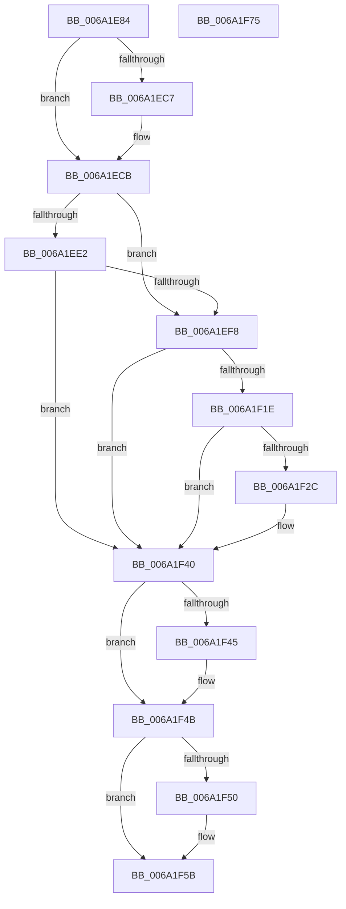

# RaspGetUnscaledGlyphData

- RVA: `0x006A1E84`–`0x006A1F76` (길이 `242` bytes)
- VA: `0x00000001406A1E84`
- 실행 섹션: `.text`
- PDB 이름 있음: `예`; PDB Function 태그: `아니요`
- unwind 정보 RVA: `0x000DA6A8`
- 디코드: `83`개 명령, `242/242` bytes 표시
- 미해석 바이트: `0` (있으면 어셈블리에 `.byte`로 보존)

> 이 문서는 커널 이미지의 기계어와 PDB 기호를 분석해 생성했습니다. 4번과 5번은 함수 원형과 자료형을 바이너리 사용 방식에서 추정한 C 해석이며 원본 소스 복구 결과는 아닙니다.

## 1. Dependencies

- 직접 호출 지점: **7**; 고유 호출 대상: **6**
- 직접 호출자로 확인된 함수: **1**
- RIP 상대 이미지 참조: **0**

### Outgoing calls
- `0x006A1EBB` → [RaspMapCharacterCodeToGlyphIndex](RaspMapCharacterCodeToGlyphIndex_function_006A28FC.md) (function, `0x006A28FC`)
- `0x006A1ED5` → [RaspMapGlyphIndexToLocation](RaspMapGlyphIndexToLocation_function_006A29B4.md) (function, `0x006A29B4`)
- `0x006A1EED` → [RaspMapGlyphIndexToLocation](RaspMapGlyphIndexToLocation_function_006A29B4.md) (function, `0x006A29B4`)
- `0x006A1F0F` → [RaspLoadGlyphData](RaspLoadGlyphData_function_006A2818.md) (function, `0x006A2818`)
- `0x006A1F21` → [RaspConvertDeltas](RaspConvertDeltas_function_006A1984.md) (function, `0x006A1984`)
- `0x006A1F39` → [RaspLoadBearings](RaspLoadBearings_function_006A24A8.md) (function, `0x006A24A8`)
- `0x006A1F56` → [RaspFreeMemory](../3E/RaspFreeMemory_function_003E28E4.md) (function, `0x003E28E4`)

### Direct callers
- [RaspRasterize](RaspRasterize_function_006A2AA4.md) at `0x006A2AE4`

### Static image references
- 디코드된 RIP-relative 메모리 참조가 없습니다.

## 2. Other-region calls and transfers

- 다른 실행 섹션으로 향하는 call: **0**
- 별도 외부 분기/꼬리 이동을 확인하지 못했습니다.

## 3. Assembly (complete function range)

```asm
006A1E84  48 89 5C 24 10                  mov qword ptr [rsp + 0x10], rbx
006A1E89  55                              push rbp
006A1E8A  56                              push rsi
006A1E8B  57                              push rdi
006A1E8C  41 54                           push r12
006A1E8E  41 55                           push r13
006A1E90  41 56                           push r14
006A1E92  41 57                           push r15
006A1E94  48 8B EC                        mov rbp, rsp
006A1E97  48 83 EC 40                     sub rsp, 0x40
006A1E9B  33 FF                           xor edi, edi
006A1E9D  4C 8B F1                        mov r14, rcx
006A1EA0  48 8B 49 18                     mov rcx, qword ptr [rcx + 0x18]
006A1EA4  8B DF                           mov ebx, edi
006A1EA6  4D 8B E0                        mov r12, r8
006A1EA9  48 89 5D F0                     mov qword ptr [rbp - 0x10], rbx
006A1EAD  4C 8D 45 40                     lea r8, [rbp + 0x40]
006A1EB1  66 89 7D 40                     mov word ptr [rbp + 0x40], di
006A1EB5  4D 8B E9                        mov r13, r9
006A1EB8  89 7D 50                        mov dword ptr [rbp + 0x50], edi
006A1EBB  E8 3C 0A 00 00                  call 0x1406a28fc
006A1EC0  0F B7 F7                        movzx esi, di
006A1EC3  85 C0                           test eax, eax
006A1EC5  78 04                           js 0x1406a1ecb
006A1EC7  0F B7 75 40                     movzx esi, word ptr [rbp + 0x40]
006A1ECB  0F B7 D6                        movzx edx, si
006A1ECE  4C 8D 45 50                     lea r8, [rbp + 0x50]
006A1ED2  49 8B CE                        mov rcx, r14
006A1ED5  E8 DA 0A 00 00                  call 0x1406a29b4
006A1EDA  4C 8B 7D 60                     mov r15, qword ptr [rbp + 0x60]
006A1EDE  85 C0                           test eax, eax
006A1EE0  79 16                           jns 0x1406a1ef8
006A1EE2  4C 8D 45 50                     lea r8, [rbp + 0x50]
006A1EE6  33 D2                           xor edx, edx
006A1EE8  49 8B CE                        mov rcx, r14
006A1EEB  8B F7                           mov esi, edi
006A1EED  E8 C2 0A 00 00                  call 0x1406a29b4
006A1EF2  8B F8                           mov edi, eax
006A1EF4  85 C0                           test eax, eax
006A1EF6  78 48                           js 0x1406a1f40
006A1EF8  8B 55 50                        mov edx, dword ptr [rbp + 0x50]
006A1EFB  4C 8D 4D F0                     lea r9, [rbp - 0x10]
006A1EFF  4C 8D 45 40                     lea r8, [rbp + 0x40]
006A1F03  66 89 75 40                     mov word ptr [rbp + 0x40], si
006A1F07  49 8B CE                        mov rcx, r14
006A1F0A  4C 89 7C 24 20                  mov qword ptr [rsp + 0x20], r15
006A1F0F  E8 04 09 00 00                  call 0x1406a2818
006A1F14  48 8B 5D F0                     mov rbx, qword ptr [rbp - 0x10]
006A1F18  8B F8                           mov edi, eax
006A1F1A  85 C0                           test eax, eax
006A1F1C  78 22                           js 0x1406a1f40
006A1F1E  48 8B CB                        mov rcx, rbx
006A1F21  E8 5E FA FF FF                  call 0x1406a1984
006A1F26  8B F8                           mov edi, eax
006A1F28  85 C0                           test eax, eax
006A1F2A  78 14                           js 0x1406a1f40
006A1F2C  0F B7 55 40                     movzx edx, word ptr [rbp + 0x40]
006A1F30  4D 8B CD                        mov r9, r13
006A1F33  4C 8B C3                        mov r8, rbx
006A1F36  49 8B CE                        mov rcx, r14
006A1F39  E8 6A 05 00 00                  call 0x1406a24a8
006A1F3E  8B F8                           mov edi, eax
006A1F40  4D 85 E4                        test r12, r12
006A1F43  74 06                           je 0x1406a1f4b
006A1F45  49 89 1C 24                     mov qword ptr [r12], rbx
006A1F49  33 DB                           xor ebx, ebx
006A1F4B  48 85 DB                        test rbx, rbx
006A1F4E  74 0B                           je 0x1406a1f5b
006A1F50  49 8B D7                        mov rdx, r15
006A1F53  48 8B CB                        mov rcx, rbx
006A1F56  E8 89 09 D4 FF                  call 0x1403e28e4
006A1F5B  48 8B 9C 24 88 00 00 00         mov rbx, qword ptr [rsp + 0x88]
006A1F63  8B C7                           mov eax, edi
006A1F65  48 83 C4 40                     add rsp, 0x40
006A1F69  41 5F                           pop r15
006A1F6B  41 5E                           pop r14
006A1F6D  41 5D                           pop r13
006A1F6F  41 5C                           pop r12
006A1F71  5F                              pop rdi
006A1F72  5E                              pop rsi
006A1F73  5D                              pop rbp
006A1F74  C3                              ret
006A1F75  CC                              int3
```

## 4. C-style interpretation (structured pseudocode)

```c
__int64 __fastcall RaspGetUnscaledGlyphData(__int64 a1, __int64 a2, __int64 a3, __int64 a4, __int64 a5)
{
    __int64 result;
    __int64 v_rbx;
    __int64 v_rdi;
    __int64 v_rsi;
    __int64 v_rsp;
    unsigned __int64 v_stack_m48;
    unsigned __int64 v_stack_m58;
    unsigned __int64 v_stack_p10;
    unsigned int v_stack_p18;
    unsigned __int64 v_stack_p8;

    v_stack_p10 = v_rbx;
    v_rsp = (v_rsp) - (64);
    v_rdi = 0;
    v_stack_m48 = 0;
    v_stack_p8 = 0;
    v_stack_p18 = 0;
    result = RaspMapCharacterCodeToGlyphIndex(*(unsigned __int64 *)(a1 + 24), a2, v_stack_p8, a4);
    v_rsi = 0;
    if (!(sign_flag)) {
        v_rsi = v_stack_p8;
    }
    result = RaspMapGlyphIndexToLocation(a1, (unsigned __int16)(v_rsi), v_stack_p18, a4);
    if (!sign_flag) goto loc_006A1EF8;
    a2 = 0;
    result = RaspMapGlyphIndexToLocation(a1, a2, v_stack_p18, a4);
    if (sign_flag) goto loc_006A1F40;
loc_006A1EF8:
    v_stack_p8 = 0;
    v_stack_m58 = a5;
    result = RaspLoadGlyphData(a1, (unsigned int)(v_stack_p18), v_stack_p8, v_stack_m48);
    if (sign_flag) goto loc_006A1F40;
    result = RaspConvertDeltas(v_stack_m48, (unsigned int)(v_stack_p18), v_stack_p8, v_stack_m48);
    v_rdi = (unsigned int)((unsigned int)(result));
    if (!(sign_flag)) {
        a2 = v_stack_p8;
        a4 = a4;
        a3 = v_stack_m48;
        a1 = a1;
        result = RaspLoadBearings(a1, a2, a3, a4);
        v_rdi = (unsigned int)(result);
    }
    v_rbx = v_stack_m48;
    if (a3 != 0) {
        *(unsigned __int64 *)(a3) = v_stack_m48;
        v_rbx = 0;
    }
    if (0 != 0) {
        a2 = a5;
        a1 = 0;
        result = RaspFreeMemory(a1, a2, a3, a4);
    }
    v_rsp = (v_rsp) + (64);
    return (unsigned int)((unsigned int)(v_rdi));
}
```

## 5. (Beta) C Style

```c
int64_t RaspGetUnscaledGlyphData(void *Arg1, int64_t Arg2, int64_t Arg3, int64_t Arg4, int64_t Arg5)
{
    uint8_t *arg1 = (uint8_t *)Arg1;

    int64_t result;
    int64_t local_rbx;
    int64_t local_rdi;
    int64_t local_rsi;
    int64_t local_rsp;
    uint64_t v_stack_m48;
    uint64_t v_stack_m58;
    uint64_t v_stack_p10;
    uint32_t v_stack_p18;
    uint64_t v_stack_p8;

    v_stack_p10 = local_rbx;
    local_rsp = (local_rsp) - (64);
    local_rdi = 0;
    v_stack_m48 = 0;
    v_stack_p8 = 0;
    v_stack_p18 = 0;
    result = RaspMapCharacterCodeToGlyphIndex(*(uint64_t *)(arg1 + 0x18), Arg2, v_stack_p8, Arg4);
    local_rsi = 0;
    if (!(sign_flag)) {
        local_rsi = v_stack_p8;
    }
    result = RaspMapGlyphIndexToLocation(Arg1, (uint16_t)(local_rsi), v_stack_p18, Arg4);
    if (!sign_flag) goto loc_006A1EF8;
    Arg2 = 0;
    result = RaspMapGlyphIndexToLocation(Arg1, Arg2, v_stack_p18, Arg4);
    if (sign_flag) goto loc_006A1F40;
loc_006A1EF8:
    v_stack_p8 = 0;
    v_stack_m58 = Arg5;
    result = RaspLoadGlyphData(Arg1, (uint32_t)(v_stack_p18), v_stack_p8, v_stack_m48);
    if (sign_flag) goto loc_006A1F40;
    result = RaspConvertDeltas(v_stack_m48, (uint32_t)(v_stack_p18), v_stack_p8, v_stack_m48);
    local_rdi = (uint32_t)((uint32_t)(result));
    if (!(sign_flag)) {
        Arg2 = v_stack_p8;
        Arg4 = Arg4;
        Arg3 = v_stack_m48;
        Arg1 = Arg1;
        result = RaspLoadBearings(Arg1, Arg2, Arg3, Arg4);
        local_rdi = (uint32_t)(result);
    }
    local_rbx = v_stack_m48;
    if (Arg3 != 0) {
        *(uint64_t *)(Arg3) = v_stack_m48;
        local_rbx = 0;
    }
    if (0 != 0) {
        Arg2 = Arg5;
        Arg1 = 0;
        result = RaspFreeMemory(Arg1, Arg2, Arg3, Arg4);
    }
    local_rsp = (local_rsp) + (64);
    return (uint32_t)((uint32_t)(local_rdi));
}
```

### 관측된 메모리 오프셋

구조체 형식이 확인되지 않은 접근은 인자 기준의 오프셋으로만 기록했습니다.

| 기준 인자 | 오프셋 표현 | 폭 (bit) | 접근 |
|---|---:|---:|---|
| `Arg1` | `+ 0x18` | `64` | `R` |

## 6. Execution-region graph

[열기: 2D/3D 그래프와 함수 탐색 컨트롤 패널](../../../control-panel.html?section=text&rva=0x006A1E84&view=graph)

- 2D 그래프는 위에서 아래로 흐르고, 3D 그래프는 빈 공간을 드래그해 회전합니다. Shift+드래그는 이동, 휠은 확대·축소, 함수 노드 선택은 대상 보고서 이동입니다.

### Static fallback


