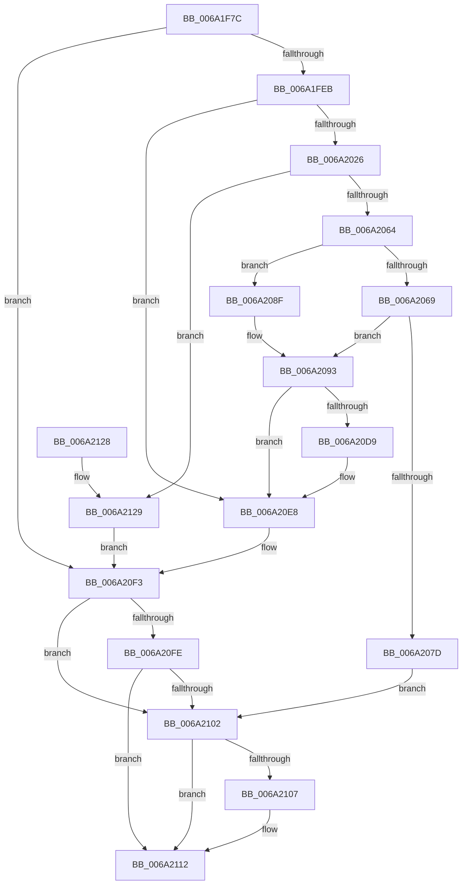

# RaspGetXExtent

- RVA: `0x006A1F7C`–`0x006A2132` (길이 `438` bytes)
- VA: `0x00000001406A1F7C`
- 실행 섹션: `.text`
- PDB 이름 있음: `예`; PDB Function 태그: `아니요`
- unwind 정보 RVA: `0x000DA678`
- 디코드: `128`개 명령, `438/438` bytes 표시
- 미해석 바이트: `0` (있으면 어셈블리에 `.byte`로 보존)

> 이 문서는 커널 이미지의 기계어와 PDB 기호를 분석해 생성했습니다. 4번과 5번은 함수 원형과 자료형을 바이너리 사용 방식에서 추정한 C 해석이며 원본 소스 복구 결과는 아닙니다.

## 1. Dependencies

- 직접 호출 지점: **6**; 고유 호출 대상: **6**
- 직접 호출자로 확인된 함수: **2**
- RIP 상대 이미지 참조: **1**

### Outgoing calls
- `0x006A1FB6` → [memset](../6C/memset_function_006C6C40.md) (function, `0x006C6C40`)
- `0x006A2014` → [RaspGetCacheEntry](RaspGetCacheEntry_function_006A1ADC.md) (function, `0x006A1ADC`)
- `0x006A2055` → [RaspRasterize](RaspRasterize_function_006A2AA4.md) (function, `0x006A2AA4`)
- `0x006A2070` → [RaspAllocateMemory](../3E/RaspAllocateMemory_function_003E42F8.md) (function, `0x003E42F8`)
- `0x006A20E3` → [RaspAddCacheEntry](../../pagebgfx/BC/RaspAddCacheEntry_function_00BC2E0C.md) (function, `0x00BC2E0C`)
- `0x006A210D` → [RaspFreeMemory](../3E/RaspFreeMemory_function_003E28E4.md) (function, `0x003E28E4`)

### Direct callers
- [BcpGetCharacterMaxResourceProfile](BcpGetCharacterMaxResourceProfile_function_006A0800.md) at `0x006A0871`
- [BgpRasGetGlyphAdvanceWidth](BgpRasGetGlyphAdvanceWidth_function_006A1888.md) at `0x006A18C1`

### Static image references
- `0x006A2000` → RVA `0x00EF0300` (`.data`; read)

## 2. Other-region calls and transfers

- 다른 실행 섹션으로 향하는 call: **1**
  - `0x006A20E3` → [RaspAddCacheEntry](../../pagebgfx/BC/RaspAddCacheEntry_function_00BC2E0C.md) (`.text` → `PAGEBGFX`)
- 별도 외부 분기/꼬리 이동을 확인하지 못했습니다.

## 3. Assembly (complete function range)

```asm
006A1F7C  4C 89 4C 24 20                  mov qword ptr [rsp + 0x20], r9
006A1F81  48 89 54 24 10                  mov qword ptr [rsp + 0x10], rdx
006A1F86  55                              push rbp
006A1F87  53                              push rbx
006A1F88  56                              push rsi
006A1F89  57                              push rdi
006A1F8A  41 54                           push r12
006A1F8C  41 55                           push r13
006A1F8E  41 56                           push r14
006A1F90  41 57                           push r15
006A1F92  48 8D 6C 24 F1                  lea rbp, [rsp - 0xf]
006A1F97  48 81 EC C8 00 00 00            sub rsp, 0xc8
006A1F9E  4C 8B 75 7F                     mov r14, qword ptr [rbp + 0x7f]
006A1FA2  48 8B DA                        mov rbx, rdx
006A1FA5  33 D2                           xor edx, edx
006A1FA7  4D 8B E0                        mov r12, r8
006A1FAA  44 0F B7 E9                     movzx r13d, cx
006A1FAE  48 8D 4D B7                     lea rcx, [rbp - 0x49]
006A1FB2  44 8D 42 46                     lea r8d, [rdx + 0x46]
006A1FB6  E8 85 4C 02 00                  call 0x1406c6c40
006A1FBB  83 65 57 00                     and dword ptr [rbp + 0x57], 0
006A1FBF  33 F6                           xor esi, esi
006A1FC1  48 21 75 7F                     and qword ptr [rbp + 0x7f], rsi
006A1FC5  33 FF                           xor edi, edi
006A1FC7  4D 8B 3E                        mov r15, qword ptr [r14]
006A1FCA  33 C9                           xor ecx, ecx
006A1FCC  33 C0                           xor eax, eax
006A1FCE  48 89 7D 6F                     mov qword ptr [rbp + 0x6f], rdi
006A1FD2  89 4D 77                        mov dword ptr [rbp + 0x77], ecx
006A1FD5  0F 57 C0                        xorps xmm0, xmm0
006A1FD8  48 89 45 A7                     mov qword ptr [rbp - 0x59], rax
006A1FDC  0F 11 45 97                     movups xmmword ptr [rbp - 0x69], xmm0
006A1FE0  66 41 83 FD 20                  cmp r13w, 0x20
006A1FE5  0F 82 08 01 00 00               jb 0x1406a20f3
006A1FEB  48 8B 43 08                     mov rax, qword ptr [rbx + 8]
006A1FEF  48 8D 4D 7F                     lea rcx, [rbp + 0x7f]
006A1FF3  44 8B 43 10                     mov r8d, dword ptr [rbx + 0x10]
006A1FF7  41 0F B7 D5                     movzx edx, r13w
006A1FFB  48 89 4C 24 28                  mov qword ptr [rsp + 0x28], rcx
006A2000  48 8D 0D F9 E2 84 00            lea rcx, [rip + 0x84e2f9]
006A2007  48 89 45 67                     mov qword ptr [rbp + 0x67], rax
006A200B  44 8B 48 28                     mov r9d, dword ptr [rax + 0x28]
006A200F  48 89 44 24 20                  mov qword ptr [rsp + 0x20], rax
006A2014  E8 C3 FA FF FF                  call 0x1406a1adc
006A2019  48 8B 5D 7F                     mov rbx, qword ptr [rbp + 0x7f]
006A201D  48 85 DB                        test rbx, rbx
006A2020  0F 85 C2 00 00 00               jne 0x1406a20e8
006A2026  48 8B 7D 5F                     mov rdi, qword ptr [rbp + 0x5f]
006A202A  48 8D 45 57                     lea rax, [rbp + 0x57]
006A202E  4C 89 74 24 40                  mov qword ptr [rsp + 0x40], r14
006A2033  41 0F B7 D5                     movzx edx, r13w
006A2037  48 89 44 24 38                  mov qword ptr [rsp + 0x38], rax
006A203C  48 8B CF                        mov rcx, rdi
006A203F  48 8D 45 77                     lea rax, [rbp + 0x77]
006A2043  48 89 44 24 30                  mov qword ptr [rsp + 0x30], rax
006A2048  48 8D 45 6F                     lea rax, [rbp + 0x6f]
006A204C  48 89 44 24 28                  mov qword ptr [rsp + 0x28], rax
006A2051  21 74 24 20                     and dword ptr [rsp + 0x20], esi
006A2055  E8 4A 0A 00 00                  call 0x1406a2aa4
006A205A  8B F0                           mov esi, eax
006A205C  85 C0                           test eax, eax
006A205E  0F 88 C5 00 00 00               js 0x1406a2129
006A2064  4D 85 FF                        test r15, r15
006A2067  75 26                           jne 0x1406a208f
006A2069  48 8D 55 97                     lea rdx, [rbp - 0x69]
006A206D  8D 4B 46                        lea ecx, [rbx + 0x46]
006A2070  E8 83 22 D4 FF                  call 0x1403e42f8
006A2075  48 8B D8                        mov rbx, rax
006A2078  48 85 C0                        test rax, rax
006A207B  75 16                           jne 0x1406a2093
006A207D  8B 45 77                        mov eax, dword ptr [rbp + 0x77]
006A2080  BE 17 00 00 C0                  mov esi, 0xc0000017
006A2085  48 8B 7D 6F                     mov rdi, qword ptr [rbp + 0x6f]
006A2089  41 89 04 24                     mov dword ptr [r12], eax
006A208D  EB 73                           jmp 0x1406a2102
006A208F  48 8D 5D B7                     lea rbx, [rbp - 0x49]
006A2093  8B 47 10                        mov eax, dword ptr [rdi + 0x10]
006A2096  49 8B 56 10                     mov rdx, qword ptr [r14 + 0x10]
006A209A  4C 8B 45 67                     mov r8, qword ptr [rbp + 0x67]
006A209E  48 8B 7D 6F                     mov rdi, qword ptr [rbp + 0x6f]
006A20A2  41 8B 48 28                     mov ecx, dword ptr [r8 + 0x28]
006A20A6  89 43 28                        mov dword ptr [rbx + 0x28], eax
006A20A9  8B 45 77                        mov eax, dword ptr [rbp + 0x77]
006A20AC  89 43 2C                        mov dword ptr [rbx + 0x2c], eax
006A20AF  8B 45 57                        mov eax, dword ptr [rbp + 0x57]
006A20B2  89 43 30                        mov dword ptr [rbx + 0x30], eax
006A20B5  B8 04 00 00 00                  mov eax, 4
006A20BA  89 43 34                        mov dword ptr [rbx + 0x34], eax
006A20BD  89 43 38                        mov dword ptr [rbx + 0x38], eax
006A20C0  66 44 89 6B 3C                  mov word ptr [rbx + 0x3c], r13w
006A20C5  89 4B 24                        mov dword ptr [rbx + 0x24], ecx
006A20C8  4C 89 43 18                     mov qword ptr [rbx + 0x18], r8
006A20CC  48 89 7B 10                     mov qword ptr [rbx + 0x10], rdi
006A20D0  48 89 53 3E                     mov qword ptr [rbx + 0x3e], rdx
006A20D4  4D 85 FF                        test r15, r15
006A20D7  75 0F                           jne 0x1406a20e8
006A20D9  48 8B D3                        mov rdx, rbx
006A20DC  48 8D 0D 1D E2 84 00            lea rcx, [rip + 0x84e21d]
006A20E3  E8 24 0D 52 00                  call 0x140bc2e0c
006A20E8  48 8B 43 3E                     mov rax, qword ptr [rbx + 0x3e]
006A20EC  8B 4B 2C                        mov ecx, dword ptr [rbx + 0x2c]
006A20EF  49 89 46 10                     mov qword ptr [r14 + 0x10], rax
006A20F3  41 89 0C 24                     mov dword ptr [r12], ecx
006A20F7  8B C6                           mov eax, esi
006A20F9  4D 85 FF                        test r15, r15
006A20FC  75 04                           jne 0x1406a2102
006A20FE  85 C0                           test eax, eax
006A2100  79 10                           jns 0x1406a2112
006A2102  48 85 FF                        test rdi, rdi
006A2105  74 0B                           je 0x1406a2112
006A2107  49 8B D6                        mov rdx, r14
006A210A  48 8B CF                        mov rcx, rdi
006A210D  E8 D2 07 D4 FF                  call 0x1403e28e4
006A2112  8B C6                           mov eax, esi
006A2114  48 81 C4 C8 00 00 00            add rsp, 0xc8
006A211B  41 5F                           pop r15
006A211D  41 5E                           pop r14
006A211F  41 5D                           pop r13
006A2121  41 5C                           pop r12
006A2123  5F                              pop rdi
006A2124  5E                              pop rsi
006A2125  5B                              pop rbx
006A2126  5D                              pop rbp
006A2127  C3                              ret
006A2128  CC                              int3
006A2129  48 8B 7D 6F                     mov rdi, qword ptr [rbp + 0x6f]
006A212D  8B 4D 77                        mov ecx, dword ptr [rbp + 0x77]
006A2130  EB C1                           jmp 0x1406a20f3
```

## 4. C-style interpretation (structured pseudocode)

```c
__int64 __fastcall RaspGetXExtent(unsigned __int16 a1, __int64 a2, __int64 a3, __int64 a4, unsigned int a5, __int64 a6)
{
    __int64 result;
    __int64 v_rdi;
    __int64 v_rsi;
    __int64 v_rsp;
    unsigned __int64 v_stack_m4F;
    unsigned __int64 v_stack_m98;
    unsigned __int64 v_stack_mA8;
    unsigned __int64 v_stack_mB8;
    unsigned __int64 v_stack_mC8;
    unsigned __int64 v_stack_mD0;
    unsigned __int64 v_stack_mD8;
    unsigned __int64 v_stack_mE0;
    unsigned __int64 v_stack_mE8;
    unsigned __int64 v_stack_p10;
    unsigned __int64 v_stack_p18;
    unsigned __int64 v_stack_p20;
    unsigned int v_stack_p28;
    unsigned int v_stack_p8;

    v_stack_p20 = a4;
    v_stack_p10 = a2;
    v_rsp = (v_rsp) - (200);
    a2 = 0;
    result = memset(v_stack_m98, a2, a2 + 70, a4);
    v_rsi = 0;
    v_rdi = 0;
    a1 = 0;
    result = 0;
    v_stack_p20 = 0;
    v_stack_p28 = 0;
    v_stack_mA8 = 0;
    v_stack_mB8 = v_xmm0;
    if (0 < 32) goto loc_006A20F3;
    v_stack_mE0 = a6;
    v_stack_p18 = *(unsigned __int64 *)(a2 + 8);
    v_stack_mE8 = *(unsigned __int64 *)(a2 + 8);
    result = RaspGetCacheEntry(v_rip + 8708857, 0, (unsigned int)(*(unsigned int *)(a2 + 16)), (unsigned int)(*(unsigned int *)(*(unsigned __int64 *)(a2 + 8) + 40)));
    if (a6 != 0) goto loc_006A20E8;
    v_stack_mC8 = a6;
    v_stack_mD0 = v_stack_p8;
    v_stack_mD8 = a5;
    v_stack_mE0 = v_stack_p20;
    result = RaspRasterize(v_stack_p10, 0, (unsigned int)(*(unsigned int *)(a2 + 16)), (unsigned int)(*(unsigned int *)(*(unsigned __int64 *)(a2 + 8) + 40)));
    if (sign_flag) goto loc_006A2129;
    if (*(unsigned __int64 *)(a6) != 0) goto loc_006A208F;
    result = RaspAllocateMemory(a6 + 70, v_stack_mB8, (unsigned int)(*(unsigned int *)(a2 + 16)), (unsigned int)(*(unsigned int *)(*(unsigned __int64 *)(a2 + 8) + 40)));
    if (result != 0) goto loc_006A2093;
    *(unsigned int *)(a3) = (unsigned int)((unsigned int)(a5));
    goto loc_006A2102;
loc_006A208F:
loc_006A2093:
    *(unsigned int *)(v_stack_m98 + 40) = (unsigned int)((unsigned int)(*(unsigned int *)(v_stack_p20 + 16)));
    *(unsigned int *)(v_stack_m98 + 44) = (unsigned int)((unsigned int)(a5));
    *(unsigned int *)(v_stack_m98 + 48) = (unsigned int)((unsigned int)(v_stack_p8));
    *(unsigned int *)(v_stack_m98 + 52) = 4;
    *(unsigned int *)(v_stack_m98 + 56) = 4;
    *(unsigned __int16 *)(v_stack_m98 + 60) = 0;
    *(unsigned int *)(v_stack_m98 + 36) = (unsigned int)((unsigned int)(*(unsigned int *)(v_stack_p18 + 40)));
    *(unsigned __int64 *)(v_stack_m98 + 24) = v_stack_p18;
    *(unsigned __int64 *)(v_stack_m98 + 16) = v_stack_p20;
    *(unsigned __int64 *)(v_stack_m98 + 62) = *(unsigned __int64 *)(a6 + 16);
    result = 4;
    if (*(unsigned __int64 *)(a6) == 0) {
        a2 = v_stack_m98;
        a1 = v_rip + 8708637;
        result = RaspAddCacheEntry(a1, a2, v_stack_p18, (unsigned int)(*(unsigned int *)(*(unsigned __int64 *)(a2 + 8) + 40)));
    }
    *(unsigned __int64 *)(a6 + 16) = *(unsigned __int64 *)(v_stack_m98 + 62);
loc_006A20F3:
    *(unsigned int *)(a3) = (unsigned int)((unsigned int)(*(unsigned int *)(v_stack_m98 + 44)));
    if (*(unsigned __int64 *)(a6) != 0) goto loc_006A2102;
    if (!sign_flag) goto loc_006A2112;
loc_006A2102:
    result = (unsigned int)((unsigned int)((unsigned int)(0xC0000017ULL)));
    if (v_stack_p20 != 0) {
        a2 = a6;
        a1 = v_stack_p20;
        result = RaspFreeMemory(a1, a2, v_stack_p18, (unsigned int)(*(unsigned int *)(*(unsigned __int64 *)(a2 + 8) + 40)));
    }
    v_rsp = (v_rsp) + (200);
    return (unsigned int)((unsigned int)((unsigned int)(0xC0000017ULL)));
loc_006A2129:
    goto loc_006A20F3;
}
```

## 5. (Beta) C Style

```c
int64_t RaspGetXExtent(uint16_t Arg1, void *Arg2, void *Arg3, int64_t Arg4, uint32_t Arg5, void *Arg6)
{
    uint8_t *arg2 = (uint8_t *)Arg2;
    uint8_t *arg3 = (uint8_t *)Arg3;
    uint8_t *arg6 = (uint8_t *)Arg6;

    int64_t result;
    int64_t local_rdi;
    int64_t local_rsi;
    int64_t local_rsp;
    uint64_t v_stack_m4F;
    uint64_t v_stack_m98;
    uint64_t v_stack_mA8;
    uint64_t v_stack_mB8;
    uint64_t v_stack_mC8;
    uint64_t v_stack_mD0;
    uint64_t v_stack_mD8;
    uint64_t v_stack_mE0;
    uint64_t v_stack_mE8;
    uint64_t v_stack_p10;
    uint64_t v_stack_p18;
    uint64_t v_stack_p20;
    uint32_t v_stack_p28;
    uint32_t v_stack_p8;

    v_stack_p20 = Arg4;
    v_stack_p10 = Arg2;
    local_rsp = (local_rsp) - (200);
    Arg2 = 0;
    result = memset(v_stack_m98, Arg2, Arg2 + 70, Arg4);
    local_rsi = 0;
    local_rdi = 0;
    Arg1 = 0;
    result = 0;
    v_stack_p20 = 0;
    v_stack_p28 = 0;
    v_stack_mA8 = 0;
    v_stack_mB8 = v_xmm0;
    if (0 < 32) goto loc_006A20F3;
    v_stack_mE0 = Arg6;
    v_stack_p18 = *(uint64_t *)(arg2 + 0x8);
    v_stack_mE8 = *(uint64_t *)(arg2 + 0x8);
    result = RaspGetCacheEntry(v_rip + 8708857, 0, (uint32_t)(*(uint32_t *)(arg2 + 0x10)), (uint32_t)(*(uint32_t *)(*(uint64_t *)(arg2 + 0x8) + 0x28)));
    if (Arg6 != NULL) goto loc_006A20E8;
    v_stack_mC8 = Arg6;
    v_stack_mD0 = v_stack_p8;
    v_stack_mD8 = Arg5;
    v_stack_mE0 = v_stack_p20;
    result = RaspRasterize(v_stack_p10, 0, (uint32_t)(*(uint32_t *)(arg2 + 0x10)), (uint32_t)(*(uint32_t *)(*(uint64_t *)(arg2 + 0x8) + 0x28)));
    if (sign_flag) goto loc_006A2129;
    if (*(uint64_t *)(arg6) != 0) goto loc_006A208F;
    result = RaspAllocateMemory(Arg6 + 70, v_stack_mB8, (uint32_t)(*(uint32_t *)(arg2 + 0x10)), (uint32_t)(*(uint32_t *)(*(uint64_t *)(arg2 + 0x8) + 0x28)));
    if (result != 0) goto loc_006A2093;
    *(uint32_t *)(arg3) = (uint32_t)((uint32_t)(Arg5));
    goto loc_006A2102;
loc_006A208F:
loc_006A2093:
    *(uint32_t *)(v_stack_m98 + 0x28) = (uint32_t)((uint32_t)(*(uint32_t *)(v_stack_p20 + 0x10)));
    *(uint32_t *)(v_stack_m98 + 0x2C) = (uint32_t)((uint32_t)(Arg5));
    *(uint32_t *)(v_stack_m98 + 0x30) = (uint32_t)((uint32_t)(v_stack_p8));
    *(uint32_t *)(v_stack_m98 + 0x34) = 4;
    *(uint32_t *)(v_stack_m98 + 0x38) = 4;
    *(uint16_t *)(v_stack_m98 + 0x3C) = 0;
    *(uint32_t *)(v_stack_m98 + 0x24) = (uint32_t)((uint32_t)(*(uint32_t *)(v_stack_p18 + 0x28)));
    *(uint64_t *)(v_stack_m98 + 0x18) = v_stack_p18;
    *(uint64_t *)(v_stack_m98 + 0x10) = v_stack_p20;
    *(uint64_t *)(v_stack_m98 + 0x3E) = *(uint64_t *)(arg6 + 0x10);
    result = 4;
    if (*(uint64_t *)(arg6) == 0) {
        Arg2 = v_stack_m98;
        Arg1 = v_rip + 8708637;
        result = RaspAddCacheEntry(Arg1, Arg2, v_stack_p18, (uint32_t)(*(uint32_t *)(*(uint64_t *)(arg2 + 0x8) + 0x28)));
    }
    *(uint64_t *)(arg6 + 0x10) = *(uint64_t *)(v_stack_m98 + 0x3E);
loc_006A20F3:
    *(uint32_t *)(arg3) = (uint32_t)((uint32_t)(*(uint32_t *)(v_stack_m98 + 0x2C)));
    if (*(uint64_t *)(arg6) != 0) goto loc_006A2102;
    if (!sign_flag) goto loc_006A2112;
loc_006A2102:
    result = (uint32_t)((uint32_t)((uint32_t)(0xC0000017ULL)));
    if (v_stack_p20 != 0) {
        Arg2 = Arg6;
        Arg1 = v_stack_p20;
        result = RaspFreeMemory(Arg1, Arg2, v_stack_p18, (uint32_t)(*(uint32_t *)(*(uint64_t *)(arg2 + 0x8) + 0x28)));
    }
    local_rsp = (local_rsp) + (200);
    return (uint32_t)((uint32_t)((uint32_t)(0xC0000017ULL)));
loc_006A2129:
    goto loc_006A20F3;
}
```

### 관측된 메모리 오프셋

구조체 형식이 확인되지 않은 접근은 인자 기준의 오프셋으로만 기록했습니다.

| 기준 인자 | 오프셋 표현 | 폭 (bit) | 접근 |
|---|---:|---:|---|
| `Arg2` | `+ 0x8` | `64` | `R` |
| `Arg2` | `+ 0x10` | `32` | `R` |
| `Arg3` | `+ 0x0` | `32` | `W` |
| `Arg6` | `+ 0x0` | `64` | `R` |
| `Arg6` | `+ 0x10` | `64` | `R` |
| `Arg6` | `+ 0x10` | `64` | `W` |

## 6. Execution-region graph

[열기: 2D/3D 그래프와 함수 탐색 컨트롤 패널](../../../control-panel.html?section=text&rva=0x006A1F7C&view=graph)

- 2D 그래프는 위에서 아래로 흐르고, 3D 그래프는 빈 공간을 드래그해 회전합니다. Shift+드래그는 이동, 휠은 확대·축소, 함수 노드 선택은 대상 보고서 이동입니다.

### Static fallback


