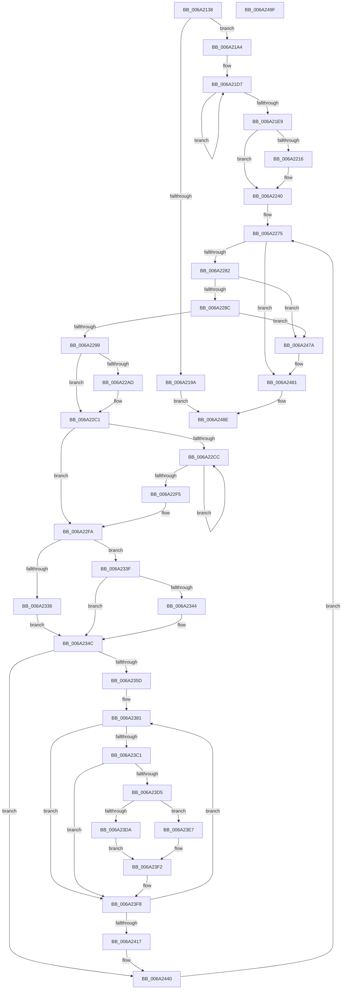

# RaspInitializeCompositeGlyphData

- RVA: `0x006A2138`–`0x006A24A0` (길이 `872` bytes)
- VA: `0x00000001406A2138`
- 실행 섹션: `.text`
- PDB 이름 있음: `예`; PDB Function 태그: `아니요`
- unwind 정보 RVA: `0x00089D74`
- 디코드: `221`개 명령, `872/872` bytes 표시
- 미해석 바이트: `0` (있으면 어셈블리에 `.byte`로 보존)

> 이 문서는 커널 이미지의 기계어와 PDB 기호를 분석해 생성했습니다. 4번과 5번은 함수 원형과 자료형을 바이너리 사용 방식에서 추정한 C 해석이며 원본 소스 복구 결과는 아닙니다.

## 1. Dependencies

- 직접 호출 지점: **6**; 고유 호출 대상: **5**
- 직접 호출자로 확인된 함수: **1**
- RIP 상대 이미지 참조: **0**

### Outgoing calls
- `0x006A218D` → [RaspAllocateMemory](../3E/RaspAllocateMemory_function_003E42F8.md) (function, `0x003E42F8`)
- `0x006A21AC` → [memset](../6C/memset_function_006C6C40.md) (function, `0x006C6C40`)
- `0x006A222F` → [FioFwReadBytesAtOffset](../3E/FioFwReadBytesAtOffset_function_003E5948.md) (function, `0x003E5948`)
- `0x006A2313` → [memcpy](../6C/memcpy_function_006C6840.md) (function, `0x006C6840`)
- `0x006A244B` → [RaspFreeMemory](../3E/RaspFreeMemory_function_003E28E4.md) (function, `0x003E28E4`)
- `0x006A245B` → [RaspFreeMemory](../3E/RaspFreeMemory_function_003E28E4.md) (function, `0x003E28E4`)

### Direct callers
- [RaspLoadCompositeGlyphData](RaspLoadCompositeGlyphData_function_006A261C.md) at `0x006A276E`

### Static image references
- 디코드된 RIP-relative 메모리 참조가 없습니다.

## 2. Other-region calls and transfers

- 다른 실행 섹션으로 향하는 call: **0**
- 별도 외부 분기/꼬리 이동을 확인하지 못했습니다.

## 3. Assembly (complete function range)

```asm
006A2138  4C 89 44 24 18                  mov qword ptr [rsp + 0x18], r8
006A213D  48 89 54 24 10                  mov qword ptr [rsp + 0x10], rdx
006A2142  48 89 4C 24 08                  mov qword ptr [rsp + 8], rcx
006A2147  53                              push rbx
006A2148  55                              push rbp
006A2149  56                              push rsi
006A214A  57                              push rdi
006A214B  41 54                           push r12
006A214D  41 55                           push r13
006A214F  41 56                           push r14
006A2151  41 57                           push r15
006A2153  48 83 EC 48                     sub rsp, 0x48
006A2157  0F B7 BC 24 B8 00 00 00         movzx edi, word ptr [rsp + 0xb8]
006A215F  4C 8B E2                        mov r12, rdx
006A2162  4C 0F BF B4 24 B0 00 00 00      movsx r14, word ptr [rsp + 0xb0]
006A216B  48 8B 94 24 D8 00 00 00         mov rdx, qword ptr [rsp + 0xd8]
006A2173  41 0F B7 F1                     movzx esi, r9w
006A2177  8B EE                           mov ebp, esi
006A2179  8D 04 3E                        lea eax, [rsi + rdi]
006A217C  44 8D 14 F0                     lea r10d, [rax + rsi*8]
006A2180  41 8D 46 29                     lea eax, [r14 + 0x29]
006A2184  41 8D 04 42                     lea eax, [r10 + rax*2]
006A2188  8B C8                           mov ecx, eax
006A218A  44 8B F8                        mov r15d, eax
006A218D  E8 66 21 D4 FF                  call 0x1403e42f8
006A2192  48 8B D8                        mov rbx, rax
006A2195  48 85 C0                        test rax, rax
006A2198  75 0A                           jne 0x1406a21a4
006A219A  B8 9A 00 00 C0                  mov eax, 0xc000009a
006A219F  E9 EA 02 00 00                  jmp 0x1406a248e
006A21A4  4D 8B C7                        mov r8, r15
006A21A7  33 D2                           xor edx, edx
006A21A9  48 8B CB                        mov rcx, rbx
006A21AC  E8 8F 4A 02 00                  call 0x1406c6c40
006A21B1  48 8B 94 24 A0 00 00 00         mov rdx, qword ptr [rsp + 0xa0]
006A21B9  48 8D 4B 02                     lea rcx, [rbx + 2]
006A21BD  41 B8 04 00 00 00               mov r8d, 4
006A21C3  48 89 5C 24 38                  mov qword ptr [rsp + 0x38], rbx
006A21C8  4C 8B FB                        mov r15, rbx
006A21CB  66 44 89 33                     mov word ptr [rbx], r14w
006A21CF  48 83 C2 02                     add rdx, 2
006A21D3  45 8D 58 FD                     lea r11d, [r8 - 3]
006A21D7  0F BF 02                        movsx eax, word ptr [rdx]
006A21DA  48 8D 52 02                     lea rdx, [rdx + 2]
006A21DE  89 01                           mov dword ptr [rcx], eax
006A21E0  48 8D 49 04                     lea rcx, [rcx + 4]
006A21E4  4D 2B C3                        sub r8, r11
006A21E7  75 EE                           jne 0x1406a21d7
006A21E9  8B 43 02                        mov eax, dword ptr [rbx + 2]
006A21EC  48 8D 53 12                     lea rdx, [rbx + 0x12]
006A21F0  66 89 7B 16                     mov word ptr [rbx + 0x16], di
006A21F4  45 33 D2                        xor r10d, r10d
006A21F7  66 89 73 18                     mov word ptr [rbx + 0x18], si
006A21FB  48 83 C3 42                     add rbx, 0x42
006A21FF  48 89 54 24 28                  mov qword ptr [rsp + 0x28], rdx
006A2204  89 02                           mov dword ptr [rdx], eax
006A2206  49 89 5F 1A                     mov qword ptr [r15 + 0x1a], rbx
006A220A  4E 8D 34 73                     lea r14, [rbx + r14*2]
006A220E  4D 8B CE                        mov r9, r14
006A2211  66 85 FF                        test di, di
006A2214  74 2A                           je 0x1406a2240
006A2216  8B 94 24 C0 00 00 00            mov edx, dword ptr [rsp + 0xc0]
006A221D  44 8B C7                        mov r8d, edi
006A2220  48 8B 8C 24 90 00 00 00         mov rcx, qword ptr [rsp + 0x90]
006A2228  4D 89 77 22                     mov qword ptr [r15 + 0x22], r14
006A222C  4C 03 F7                        add r14, rdi
006A222F  E8 14 37 D4 FF                  call 0x1403e5948
006A2234  48 8B 54 24 28                  mov rdx, qword ptr [rsp + 0x28]
006A2239  45 33 D2                        xor r10d, r10d
006A223C  45 8D 5A 01                     lea r11d, [r10 + 1]
006A2240  4D 8B 6F 1A                     mov r13, qword ptr [r15 + 0x1a]
006A2244  8D 45 02                        lea eax, [rbp + 2]
006A2247  49 03 F6                        add rsi, r14
006A224A  4D 89 77 2A                     mov qword ptr [r15 + 0x2a], r14
006A224E  49 89 77 32                     mov qword ptr [r15 + 0x32], rsi
006A2252  45 0F B7 CA                     movzx r9d, r10w
006A2256  66 44 89 94 24 B8 00 00 00      mov word ptr [rsp + 0xb8], r10w
006A225F  66 44 89 94 24 B0 00 00 00      mov word ptr [rsp + 0xb0], r10w
006A2268  48 8D 3C 86                     lea rdi, [rsi + rax*4]
006A226C  4C 89 6C 24 20                  mov qword ptr [rsp + 0x20], r13
006A2271  49 89 7F 3A                     mov qword ptr [r15 + 0x3a], rdi
006A2275  49 8B 1C 24                     mov rbx, qword ptr [r12]
006A2279  49 3B DC                        cmp rbx, r12
006A227C  0F 84 FF 01 00 00               je 0x1406a2481
006A2282  4C 39 63 08                     cmp qword ptr [rbx + 8], r12
006A2286  0F 85 EE 01 00 00               jne 0x1406a247a
006A228C  48 8B 03                        mov rax, qword ptr [rbx]
006A228F  48 39 58 08                     cmp qword ptr [rax + 8], rbx
006A2293  0F 85 E1 01 00 00               jne 0x1406a247a
006A2299  49 89 04 24                     mov qword ptr [r12], rax
006A229D  4C 89 60 08                     mov qword ptr [rax + 8], r12
006A22A1  66 0F BA 63 18 09               bt word ptr [rbx + 0x18], 9
006A22A7  48 8B 6B 10                     mov rbp, qword ptr [rbx + 0x10]
006A22AB  73 14                           jae 0x1406a22c1
006A22AD  0F B7 43 1A                     movzx eax, word ptr [rbx + 0x1a]
006A22B1  48 8B 8C 24 C8 00 00 00         mov rcx, qword ptr [rsp + 0xc8]
006A22B9  66 89 01                        mov word ptr [rcx], ax
006A22BC  8B 45 02                        mov eax, dword ptr [rbp + 2]
006A22BF  89 02                           mov dword ptr [rdx], eax
006A22C1  45 0F B7 C2                     movzx r8d, r10w
006A22C5  66 44 3B 55 00                  cmp r10w, word ptr [rbp]
006A22CA  7D 2E                           jge 0x1406a22fa
006A22CC  48 8B 45 1A                     mov rax, qword ptr [rbp + 0x1a]
006A22D0  41 0F B7 C9                     movzx ecx, r9w
006A22D4  41 0F B7 D0                     movzx edx, r8w
006A22D8  66 45 03 C3                     add r8w, r11w
006A22DC  66 03 0C 50                     add cx, word ptr [rax + rdx*2]
006A22E0  66 41 89 4D 00                  mov word ptr [r13], cx
006A22E5  49 83 C5 02                     add r13, 2
006A22E9  0F BF 4D 00                     movsx ecx, word ptr [rbp]
006A22ED  41 0F B7 C0                     movzx eax, r8w
006A22F1  3B C1                           cmp eax, ecx
006A22F3  7C D7                           jl 0x1406a22cc
006A22F5  4C 89 6C 24 20                  mov qword ptr [rsp + 0x20], r13
006A22FA  44 0F B7 45 18                  movzx r8d, word ptr [rbp + 0x18]
006A22FF  49 8B CE                        mov rcx, r14
006A2302  48 8B 55 2A                     mov rdx, qword ptr [rbp + 0x2a]
006A2306  66 45 03 C8                     add r9w, r8w
006A230A  66 44 89 8C 24 A8 00 00 00      mov word ptr [rsp + 0xa8], r9w
006A2313  E8 28 45 02 00                  call 0x1406c6840
006A2318  44 0F B7 4D 18                  movzx r9d, word ptr [rbp + 0x18]
006A231D  B9 00 40 00 00                  mov ecx, 0x4000
006A2322  0F B7 53 18                     movzx edx, word ptr [rbx + 0x18]
006A2326  4D 03 F1                        add r14, r9
006A2329  4C 89 74 24 30                  mov qword ptr [rsp + 0x30], r14
006A232E  0F B7 C1                        movzx eax, cx
006A2331  F6 C2 08                        test dl, 8
006A2334  74 09                           je 0x1406a233f
006A2336  0F B7 43 20                     movzx eax, word ptr [rbx + 0x20]
006A233A  0F B7 C8                        movzx ecx, ax
006A233D  EB 0D                           jmp 0x1406a234c
006A233F  F6 C2 40                        test dl, 0x40
006A2342  74 08                           je 0x1406a234c
006A2344  0F B7 43 20                     movzx eax, word ptr [rbx + 0x20]
006A2348  0F B7 4B 22                     movzx ecx, word ptr [rbx + 0x22]
006A234C  45 33 DB                        xor r11d, r11d
006A234F  45 0F B7 C3                     movzx r8d, r11w
006A2353  66 45 3B D9                     cmp r11w, r9w
006A2357  0F 83 E3 00 00 00               jae 0x1406a2440
006A235D  44 0F B7 BC 24 B8 00 00 00      movzx r15d, word ptr [rsp + 0xb8]
006A2366  45 8D 73 01                     lea r14d, [r11 + 1]
006A236A  44 0F B7 A4 24 B0 00 00 00      movzx r12d, word ptr [rsp + 0xb0]
006A2373  41 BD 00 40 00 00               mov r13d, 0x4000
006A2379  4C 0F BF C8                     movsx r9, ax
006A237D  4C 0F BF D1                     movsx r10, cx
006A2381  48 8B 45 32                     mov rax, qword ptr [rbp + 0x32]
006A2385  41 0F B7 D0                     movzx edx, r8w
006A2389  0F B7 0C 90                     movzx ecx, word ptr [rax + rdx*4]
006A238D  66 89 0E                        mov word ptr [rsi], cx
006A2390  48 8B 45 3A                     mov rax, qword ptr [rbp + 0x3a]
006A2394  0F B7 0C 90                     movzx ecx, word ptr [rax + rdx*4]
006A2398  66 89 0F                        mov word ptr [rdi], cx
006A239B  48 0F BF 06                     movsx rax, word ptr [rsi]
006A239F  49 0F AF C1                     imul rax, r9
006A23A3  48 99                           cqo
006A23A5  49 F7 FD                        idiv r13
006A23A8  66 89 06                        mov word ptr [rsi], ax
006A23AB  48 0F BF 07                     movsx rax, word ptr [rdi]
006A23AF  49 0F AF C2                     imul rax, r10
006A23B3  48 99                           cqo
006A23B5  49 F7 FD                        idiv r13
006A23B8  66 89 07                        mov word ptr [rdi], ax
006A23BB  66 45 85 C0                     test r8w, r8w
006A23BF  75 37                           jne 0x1406a23f8
006A23C1  66 44 29 3E                     sub word ptr [rsi], r15w
006A23C5  66 44 29 27                     sub word ptr [rdi], r12w
006A23C9  0F B7 4B 18                     movzx ecx, word ptr [rbx + 0x18]
006A23CD  0F B7 07                        movzx eax, word ptr [rdi]
006A23D0  F6 C1 02                        test cl, 2
006A23D3  74 23                           je 0x1406a23f8
006A23D5  41 84 CE                        test r14b, cl
006A23D8  74 0D                           je 0x1406a23e7
006A23DA  0F B7 43 1C                     movzx eax, word ptr [rbx + 0x1c]
006A23DE  66 01 06                        add word ptr [rsi], ax
006A23E1  0F B7 43 1E                     movzx eax, word ptr [rbx + 0x1e]
006A23E5  EB 0B                           jmp 0x1406a23f2
006A23E7  0F BE 43 1C                     movsx eax, byte ptr [rbx + 0x1c]
006A23EB  66 01 06                        add word ptr [rsi], ax
006A23EE  0F BE 43 1D                     movsx eax, byte ptr [rbx + 0x1d]
006A23F2  66 01 07                        add word ptr [rdi], ax
006A23F5  0F B7 07                        movzx eax, word ptr [rdi]
006A23F8  66 44 03 3E                     add r15w, word ptr [rsi]
006A23FC  66 44 03 E0                     add r12w, ax
006A2400  48 83 C6 04                     add rsi, 4
006A2404  48 83 C7 04                     add rdi, 4
006A2408  66 45 03 C6                     add r8w, r14w
006A240C  66 44 3B 45 18                  cmp r8w, word ptr [rbp + 0x18]
006A2411  0F 82 6A FF FF FF               jb 0x1406a2381
006A2417  4C 8B 74 24 30                  mov r14, qword ptr [rsp + 0x30]
006A241C  4C 8B 6C 24 20                  mov r13, qword ptr [rsp + 0x20]
006A2421  66 44 89 A4 24 B0 00 00 00      mov word ptr [rsp + 0xb0], r12w
006A242A  4C 8B A4 24 98 00 00 00         mov r12, qword ptr [rsp + 0x98]
006A2432  66 44 89 BC 24 B8 00 00 00      mov word ptr [rsp + 0xb8], r15w
006A243B  4C 8B 7C 24 38                  mov r15, qword ptr [rsp + 0x38]
006A2440  48 8B 94 24 D8 00 00 00         mov rdx, qword ptr [rsp + 0xd8]
006A2448  48 8B CD                        mov rcx, rbp
006A244B  E8 94 04 D4 FF                  call 0x1403e28e4
006A2450  48 8B 94 24 D8 00 00 00         mov rdx, qword ptr [rsp + 0xd8]
006A2458  48 8B CB                        mov rcx, rbx
006A245B  E8 84 04 D4 FF                  call 0x1403e28e4
006A2460  44 0F B7 8C 24 A8 00 00 00      movzx r9d, word ptr [rsp + 0xa8]
006A2469  45 33 D2                        xor r10d, r10d
006A246C  48 8B 54 24 28                  mov rdx, qword ptr [rsp + 0x28]
006A2471  45 8D 5A 01                     lea r11d, [r10 + 1]
006A2475  E9 FB FD FF FF                  jmp 0x1406a2275
006A247A  B9 03 00 00 00                  mov ecx, 3
006A247F  CD 29                           int 0x29
006A2481  48 8B 84 24 D0 00 00 00         mov rax, qword ptr [rsp + 0xd0]
006A2489  4C 89 38                        mov qword ptr [rax], r15
006A248C  33 C0                           xor eax, eax
006A248E  48 83 C4 48                     add rsp, 0x48
006A2492  41 5F                           pop r15
006A2494  41 5E                           pop r14
006A2496  41 5D                           pop r13
006A2498  41 5C                           pop r12
006A249A  5F                              pop rdi
006A249B  5E                              pop rsi
006A249C  5D                              pop rbp
006A249D  5B                              pop rbx
006A249E  C3                              ret
006A249F  CC                              int3
```

## 4. C-style interpretation (structured pseudocode)

```c
__int64 __fastcall RaspInitializeCompositeGlyphData(__int64 a1, __int64 a2, __int64 a3, unsigned __int16 a4, unsigned __int16 a5, unsigned __int16 a6, unsigned int a7, __int64 a8, __int64 a9, __int64 a10)
{
    __int64 result;
    __int64 v_r10;
    __int64 v_r11;
    __int64 v_r12;
    __int64 v_r13;
    __int64 v_r14;
    __int64 v_r15;
    __int64 v_rbx;
    __int64 v_rdi;
    __int64 v_rsi;
    __int64 v_rsp;
    unsigned __int64 v_stack_m50;
    unsigned __int64 v_stack_m58;
    unsigned __int64 v_stack_m60;
    unsigned __int64 v_stack_m68;
    unsigned __int64 v_stack_p10;
    unsigned __int64 v_stack_p18;
    unsigned __int16 v_stack_p20;
    unsigned __int16 v_stack_p28;
    unsigned __int16 v_stack_p30;
    unsigned __int64 v_stack_p8;

    v_stack_p18 = a3;
    v_stack_p10 = a2;
    v_stack_p8 = a1;
    v_rsp = (v_rsp) - (72);
    result = RaspAllocateMemory((unsigned int)((unsigned int)(a4 + a6 * 1 + a4 * 8 + (__int16)(a5) + 41 * 2)), a10, a3, a4);
    if (result != 0) goto loc_006A21A4;
    goto loc_006A248E;
loc_006A21A4:
    a2 = 0;
    result = memset(result, a2, (unsigned int)((unsigned int)(a4 + a6 * 1 + a4 * 8 + (__int16)(a5) + 41 * 2)), a4);
    v_stack_m50 = result;
    *(unsigned __int16 *)(result) = (unsigned __int16)((__int16)(a5));
    a2 = (v_stack_p18) + (2);
loc_006A21D7:
    *(unsigned int *)(result + 2) = (unsigned int)((__int16)(*(unsigned __int16 *)(a2)));
    a3 = (4) - (4 - 3);
    if (condition_is_not_equal) goto loc_006A21D7;
    *(unsigned __int16 *)(result + 22) = a6;
    v_r10 = 0;
    *(unsigned __int16 *)(result + 24) = a4;
    v_rbx = (result) + (66);
    v_stack_m60 = result + 18;
    *(unsigned int *)(result + 18) = (unsigned int)((unsigned int)(*(unsigned int *)(result + 2)));
    *(unsigned __int64 *)(result + 26) = v_rbx;
    result = (unsigned int)(*(unsigned int *)(result + 2));
    v_r11 = 4 - 3;
    v_r14 = v_rbx + (__int16)(a5) * 2;
    if (a6 != 0) {
        a2 = a7;
        a3 = a6;
        a1 = v_stack_p8;
        *(unsigned __int64 *)(result + 34) = v_rbx + (__int16)(a5) * 2;
        v_r14 = (v_rbx + (__int16)(a5) * 2) + (a6);
        result = FioFwReadBytesAtOffset(a1, a2, a3, v_rbx + (__int16)(a5) * 2);
        a2 = v_stack_m60;
        v_r10 = 0;
        v_r11 = v_r10 + 1;
    }
    v_rsi = (a4) + (v_r14);
    *(unsigned __int64 *)(result + 42) = v_r14;
    *(unsigned __int64 *)(result + 50) = v_rsi;
    v_stack_p30 = 0;
    v_stack_p28 = 0;
    v_stack_m68 = *(unsigned __int64 *)(result + 26);
    *(unsigned __int64 *)(result + 58) = v_rsi + (unsigned int)(a4) + 2 * 4;
loc_006A2275:
    if ((*(unsigned __int64 *)(a2)) == a2) goto loc_006A2481;
    if ((*(unsigned __int64 *)(*(unsigned __int64 *)(a2) + 8)) != a2) goto loc_006A247A;
    if ((*(unsigned __int64 *)(*(unsigned __int64 *)(*(unsigned __int64 *)(a2)) + 8)) != (*(unsigned __int64 *)(a2))) goto loc_006A247A;
    *(unsigned __int64 *)(a2) = *(unsigned __int64 *)(*(unsigned __int64 *)(a2));
    *(unsigned __int64 *)(*(unsigned __int64 *)(*(unsigned __int64 *)(a2)) + 8) = a2;
    result = *(unsigned __int64 *)(*(unsigned __int64 *)(a2));
    if ((*(unsigned __int64 *)(*(unsigned __int64 *)(*(unsigned __int64 *)(a2)) + 8)) < (*(unsigned __int64 *)(a2))) {
        result = *(unsigned __int16 *)(*(unsigned __int64 *)(a2) + 26);
        a1 = a8;
        *(unsigned __int16 *)(a1) = (unsigned __int16)(result);
        result = *(unsigned int *)(*(unsigned __int64 *)(*(unsigned __int64 *)(a2) + 16) + 2);
        *(unsigned int *)(a2) = (unsigned int)(result);
    }
    if (0 >= (*(unsigned __int16 *)(*(unsigned __int64 *)(*(unsigned __int64 *)(a2) + 16)))) goto loc_006A22FA;
loc_006A22CC:
    a3 = (unsigned __int16)((0) + ((unsigned __int16)(v_r11)));
    a1 = (unsigned __int16)((0) + (*(unsigned __int16 *)(*(unsigned __int64 *)(*(unsigned __int64 *)(*(unsigned __int64 *)(a2) + 16) + 26) + 0 * 2)));
    *(unsigned __int16 *)(*(unsigned __int64 *)(result + 26)) = (unsigned __int16)(a1);
    v_r13 = (*(unsigned __int64 *)(result + 26)) + (2);
    if (((unsigned int)((unsigned __int16)(a3))) < ((unsigned int)((__int16)(*(unsigned __int16 *)(*(unsigned __int64 *)(*(unsigned __int64 *)(a2) + 16)))))) goto loc_006A22CC;
    v_stack_m68 = v_r13;
loc_006A22FA:
    a4 = (unsigned __int16)((0) + ((unsigned __int16)(*(unsigned __int16 *)(*(unsigned __int64 *)(*(unsigned __int64 *)(a2) + 16) + 24))));
    v_stack_p20 = a4;
    result = memcpy(v_r14, *(unsigned __int64 *)(*(unsigned __int64 *)(*(unsigned __int64 *)(a2) + 16) + 42), *(unsigned __int16 *)(*(unsigned __int64 *)(*(unsigned __int64 *)(a2) + 16) + 24), a4);
    v_r14 = (v_r14) + (*(unsigned __int16 *)(*(unsigned __int64 *)(*(unsigned __int64 *)(a2) + 16) + 24));
    v_stack_m58 = v_r14;
    if ((((unsigned __int8)(*(unsigned __int16 *)(*(unsigned __int64 *)(a2) + 24))) & (8)) == 0) goto loc_006A233F;
    goto loc_006A234C;
loc_006A233F:
    result = *(unsigned __int16 *)(*(unsigned __int64 *)(a2) + 32);
    if ((((unsigned __int8)(*(unsigned __int16 *)(*(unsigned __int64 *)(a2) + 24))) & (64)) != 0) {
        result = *(unsigned __int16 *)(*(unsigned __int64 *)(a2) + 32);
        a1 = *(unsigned __int16 *)(*(unsigned __int64 *)(a2) + 34);
    }
    v_r11 = 0;
    if (0 >= ((unsigned __int16)(*(unsigned __int16 *)(*(unsigned __int64 *)(*(unsigned __int64 *)(a2) + 16) + 24)))) goto loc_006A2440;
loc_006A2381:
    *(unsigned __int16 *)(v_rsi) = (unsigned __int16)(*(unsigned __int16 *)(*(unsigned __int64 *)(*(unsigned __int64 *)(*(unsigned __int64 *)(a2) + 16) + 50) + 0 * 4));
    *(unsigned __int16 *)(v_rsi + (unsigned int)(a4) + 2 * 4) = (unsigned __int16)(*(unsigned __int16 *)(*(unsigned __int64 *)(*(unsigned __int64 *)(*(unsigned __int64 *)(a2) + 16) + 58) + 0 * 4));
    result = ((__int16)(*(unsigned __int16 *)(v_rsi))) * ((__int16)((unsigned __int16)(result)));
    *(unsigned __int16 *)(v_rsi) = (unsigned __int16)(result);
    result = ((__int16)(*(unsigned __int16 *)(v_rsi + (unsigned int)(a4) + 2 * 4))) * ((__int16)((unsigned __int16)(a1)));
    *(unsigned __int16 *)(v_rsi + (unsigned int)(a4) + 2 * 4) = (unsigned __int16)(result);
    if (0 != 0) goto loc_006A23F8;
    if ((((unsigned __int8)(*(unsigned __int16 *)(*(unsigned __int64 *)(a2) + 24))) & (2)) == 0) goto loc_006A23F8;
    if ((((unsigned __int8)(v_r11 + 1)) & ((unsigned __int8)(*(unsigned __int16 *)(*(unsigned __int64 *)(a2) + 24)))) == 0) goto loc_006A23E7;
    goto loc_006A23F2;
loc_006A23E7:
loc_006A23F2:
loc_006A23F8:
    v_r15 = (unsigned __int16)((a6) + (*(unsigned __int16 *)(v_rsi)));
    v_r12 = (unsigned __int16)((a5) + ((unsigned __int16)(*(unsigned __int16 *)(v_rsi + (unsigned int)(a4) + 2 * 4))));
    v_rsi = (v_rsi) + (4);
    v_rdi = (v_rsi + (unsigned int)(a4) + 2 * 4) + (4);
    a3 = (unsigned __int16)((0) + ((unsigned __int16)(v_r11 + 1)));
    if (((unsigned __int16)(a3)) < (*(unsigned __int16 *)(*(unsigned __int64 *)(*(unsigned __int64 *)(a2) + 16) + 24))) goto loc_006A2381;
    v_stack_p28 = (unsigned __int16)(v_r12);
    v_stack_p30 = (unsigned __int16)(v_r15);
loc_006A2440:
    result = RaspFreeMemory(*(unsigned __int64 *)(*(unsigned __int64 *)(a2) + 16), a10, a3, (__int16)((unsigned __int16)(result)));
    result = RaspFreeMemory(*(unsigned __int64 *)(a2), a10, a3, (__int16)((unsigned __int16)(result)));
    v_r10 = 0;
    goto loc_006A2275;
loc_006A247A:
loc_006A2481:
    *(unsigned __int64 *)(a9) = v_stack_m50;
    result = 0;
loc_006A248E:
    v_rsp = (v_rsp) + (72);
    return result;
}
```

## 5. (Beta) C Style

```c
int64_t RaspInitializeCompositeGlyphData(int64_t Arg1, int64_t Arg2, int64_t Arg3, void *Arg4, void *Arg5, uint16_t Arg6, uint32_t Arg7, void *Arg8, void *Arg9, int64_t Arg10)
{
    uint8_t *arg4 = (uint8_t *)Arg4;
    uint8_t *arg5 = (uint8_t *)Arg5;
    uint8_t *arg8 = (uint8_t *)Arg8;
    uint8_t *arg9 = (uint8_t *)Arg9;

    int64_t result;
    int64_t local_r10;
    int64_t local_r11;
    int64_t local_r12;
    int64_t local_r13;
    int64_t local_r14;
    int64_t local_r15;
    int64_t local_rbx;
    int64_t local_rdi;
    int64_t local_rsi;
    int64_t local_rsp;
    uint64_t v_stack_m50;
    uint64_t v_stack_m58;
    uint64_t v_stack_m60;
    uint64_t v_stack_m68;
    uint64_t v_stack_p10;
    uint64_t v_stack_p18;
    uint16_t v_stack_p20;
    uint16_t v_stack_p28;
    uint16_t v_stack_p30;
    uint64_t v_stack_p8;

    v_stack_p18 = Arg3;
    v_stack_p10 = Arg2;
    v_stack_p8 = Arg1;
    local_rsp = (local_rsp) - (72);
    result = RaspAllocateMemory((uint32_t)((uint32_t)(Arg4 + Arg6 * 1 + Arg4 * 8 + (int16_t)(Arg5) + 41 * 2)), Arg10, Arg3, Arg4);
    if (result != 0) goto loc_006A21A4;
    goto loc_006A248E;
loc_006A21A4:
    Arg2 = 0;
    result = memset(result, Arg2, (uint32_t)((uint32_t)(Arg4 + Arg6 * 1 + Arg4 * 8 + (int16_t)(Arg5) + 41 * 2)), Arg4);
    v_stack_m50 = result;
    *(uint16_t *)(result) = (uint16_t)((int16_t)(Arg5));
    Arg2 = (v_stack_p18) + (2);
loc_006A21D7:
    *(uint32_t *)(result + 0x2) = (uint32_t)((int16_t)(*(uint16_t *)(Arg2)));
    Arg3 = (4) - (4 - 3);
    if (condition_is_not_equal) goto loc_006A21D7;
    *(uint16_t *)(result + 0x16) = Arg6;
    local_r10 = 0;
    *(uint16_t *)(result + 0x18) = Arg4;
    local_rbx = (result) + (66);
    v_stack_m60 = result + 18;
    *(uint32_t *)(result + 0x12) = (uint32_t)((uint32_t)(*(uint32_t *)(result + 0x2)));
    *(uint64_t *)(result + 0x1A) = local_rbx;
    result = (uint32_t)(*(uint32_t *)(result + 0x2));
    local_r11 = 4 - 3;
    local_r14 = local_rbx + (int16_t)(Arg5) * 2;
    if (Arg6 != 0) {
        Arg2 = Arg7;
        Arg3 = Arg6;
        Arg1 = v_stack_p8;
        *(uint64_t *)(result + 0x22) = local_rbx + (int16_t)(Arg5) * 2;
        local_r14 = (local_rbx + (int16_t)(Arg5) * 2) + (Arg6);
        result = FioFwReadBytesAtOffset(Arg1, Arg2, Arg3, local_rbx + (int16_t)(Arg5) * 2);
        Arg2 = v_stack_m60;
        local_r10 = 0;
        local_r11 = local_r10 + 1;
    }
    local_rsi = (Arg4) + (local_r14);
    *(uint64_t *)(result + 0x2A) = local_r14;
    *(uint64_t *)(result + 0x32) = local_rsi;
    v_stack_p30 = 0;
    v_stack_p28 = 0;
    v_stack_m68 = *(uint64_t *)(result + 0x1A);
    *(uint64_t *)(result + 0x3A) = local_rsi + (uint32_t)(Arg4) + 2 * 4;
loc_006A2275:
    if ((*(uint64_t *)(Arg2)) == Arg2) goto loc_006A2481;
    if ((*(uint64_t *)(*(uint64_t *)(Arg2) + 0x8)) != Arg2) goto loc_006A247A;
    if ((*(uint64_t *)(*(uint64_t *)(*(uint64_t *)(Arg2)) + 0x8)) != (*(uint64_t *)(Arg2))) goto loc_006A247A;
    *(uint64_t *)(Arg2) = *(uint64_t *)(*(uint64_t *)(Arg2));
    *(uint64_t *)(*(uint64_t *)(*(uint64_t *)(Arg2)) + 0x8) = Arg2;
    result = *(uint64_t *)(*(uint64_t *)(Arg2));
    if ((*(uint64_t *)(*(uint64_t *)(*(uint64_t *)(Arg2)) + 0x8)) < (*(uint64_t *)(Arg2))) {
        result = *(uint16_t *)(*(uint64_t *)(Arg2) + 0x1A);
        Arg1 = Arg8;
        *(uint16_t *)(Arg1) = (uint16_t)(result);
        result = *(uint32_t *)(*(uint64_t *)(*(uint64_t *)(Arg2) + 0x10) + 0x2);
        *(uint32_t *)(Arg2) = (uint32_t)(result);
    }
    if (0 >= (*(uint16_t *)(*(uint64_t *)(*(uint64_t *)(Arg2) + 0x10)))) goto loc_006A22FA;
loc_006A22CC:
    Arg3 = (uint16_t)((0) + ((uint16_t)(local_r11)));
    Arg1 = (uint16_t)((0) + (*(uint16_t *)(*(uint64_t *)(*(uint64_t *)(*(uint64_t *)(Arg2) + 0x10) + 0x1A) + 0x0 * 2)));
    *(uint16_t *)(*(uint64_t *)(result + 0x1A)) = (uint16_t)(Arg1);
    local_r13 = (*(uint64_t *)(result + 0x1A)) + (2);
    if (((uint32_t)((uint16_t)(Arg3))) < ((uint32_t)((int16_t)(*(uint16_t *)(*(uint64_t *)(*(uint64_t *)(Arg2) + 0x10)))))) goto loc_006A22CC;
    v_stack_m68 = local_r13;
loc_006A22FA:
    Arg4 = (uint16_t)((0) + ((uint16_t)(*(uint16_t *)(*(uint64_t *)(*(uint64_t *)(Arg2) + 0x10) + 0x18))));
    v_stack_p20 = Arg4;
    result = memcpy(local_r14, *(uint64_t *)(*(uint64_t *)(*(uint64_t *)(Arg2) + 0x10) + 0x2A), *(uint16_t *)(*(uint64_t *)(*(uint64_t *)(Arg2) + 0x10) + 0x18), Arg4);
    local_r14 = (local_r14) + (*(uint16_t *)(*(uint64_t *)(*(uint64_t *)(Arg2) + 0x10) + 0x18));
    v_stack_m58 = local_r14;
    if ((((uint8_t)(*(uint16_t *)(*(uint64_t *)(Arg2) + 0x18))) & (8)) == 0) goto loc_006A233F;
    goto loc_006A234C;
loc_006A233F:
    result = *(uint16_t *)(*(uint64_t *)(Arg2) + 0x20);
    if ((((uint8_t)(*(uint16_t *)(*(uint64_t *)(Arg2) + 0x18))) & (64)) != 0) {
        result = *(uint16_t *)(*(uint64_t *)(Arg2) + 0x20);
        Arg1 = *(uint16_t *)(*(uint64_t *)(Arg2) + 0x22);
    }
    local_r11 = 0;
    if (0 >= ((uint16_t)(*(uint16_t *)(*(uint64_t *)(*(uint64_t *)(Arg2) + 0x10) + 0x18)))) goto loc_006A2440;
loc_006A2381:
    *(uint16_t *)(local_rsi) = (uint16_t)(*(uint16_t *)(*(uint64_t *)(*(uint64_t *)(*(uint64_t *)(Arg2) + 0x10) + 0x32) + 0x0 * 4));
    *(uint16_t *)(local_rsi + (uint32_t)(arg4) + 0x2 * 4) = (uint16_t)(*(uint16_t *)(*(uint64_t *)(*(uint64_t *)(*(uint64_t *)(Arg2) + 0x10) + 0x3A) + 0x0 * 4));
    result = ((int16_t)(*(uint16_t *)(local_rsi))) * ((int16_t)((uint16_t)(result)));
    *(uint16_t *)(local_rsi) = (uint16_t)(result);
    result = ((int16_t)(*(uint16_t *)(local_rsi + (uint32_t)(arg4) + 0x2 * 4))) * ((int16_t)((uint16_t)(Arg1)));
    *(uint16_t *)(local_rsi + (uint32_t)(arg4) + 0x2 * 4) = (uint16_t)(result);
    if (0 != 0) goto loc_006A23F8;
    if ((((uint8_t)(*(uint16_t *)(*(uint64_t *)(Arg2) + 0x18))) & (2)) == 0) goto loc_006A23F8;
    if ((((uint8_t)(local_r11 + 1)) & ((uint8_t)(*(uint16_t *)(*(uint64_t *)(Arg2) + 0x18)))) == 0) goto loc_006A23E7;
    goto loc_006A23F2;
loc_006A23E7:
loc_006A23F2:
loc_006A23F8:
    local_r15 = (uint16_t)((Arg6) + (*(uint16_t *)(local_rsi)));
    local_r12 = (uint16_t)((Arg5) + ((uint16_t)(*(uint16_t *)(local_rsi + (uint32_t)(arg4) + 0x2 * 4))));
    local_rsi = (local_rsi) + (4);
    local_rdi = (local_rsi + (uint32_t)(Arg4) + 2 * 4) + (4);
    Arg3 = (uint16_t)((0) + ((uint16_t)(local_r11 + 1)));
    if (((uint16_t)(Arg3)) < (*(uint16_t *)(*(uint64_t *)(*(uint64_t *)(Arg2) + 0x10) + 0x18))) goto loc_006A2381;
    v_stack_p28 = (uint16_t)(local_r12);
    v_stack_p30 = (uint16_t)(local_r15);
loc_006A2440:
    result = RaspFreeMemory(*(uint64_t *)(*(uint64_t *)(Arg2) + 0x10), Arg10, Arg3, (int16_t)((uint16_t)(result)));
    result = RaspFreeMemory(*(uint64_t *)(Arg2), Arg10, Arg3, (int16_t)((uint16_t)(result)));
    local_r10 = 0;
    goto loc_006A2275;
loc_006A247A:
loc_006A2481:
    *(uint64_t *)(arg9) = v_stack_m50;
    result = 0;
loc_006A248E:
    local_rsp = (local_rsp) + (72);
    return result;
}
```

### 관측된 메모리 오프셋

구조체 형식이 확인되지 않은 접근은 인자 기준의 오프셋으로만 기록했습니다.

| 기준 인자 | 오프셋 표현 | 폭 (bit) | 접근 |
|---|---:|---:|---|
| `Arg4` | `+ 0x0` | `16` | `R` |
| `Arg4` | `+ 0x0` | `16` | `R/W` |
| `Arg4` | `+ 0x0` | `16` | `W` |
| `Arg4` | `+ 0x0 + rax*2` | `32` | `R` |
| `Arg4` | `+ 0x0 + rax*4` | `64` | `R` |
| `Arg4` | `+ 0x0 + rdi*1` | `32` | `R` |
| `Arg4` | `+ 0x0 + rsi*8` | `32` | `R` |
| `Arg4` | `+ 0x2` | `32` | `R` |
| `Arg5` | `+ 0x29` | `32` | `R` |
| `Arg8` | `+ 0x0` | `16` | `W` |
| `Arg9` | `+ 0x0` | `64` | `W` |

## 6. Execution-region graph

[열기: 2D/3D 그래프와 함수 탐색 컨트롤 패널](../../../control-panel.html?section=text&rva=0x006A2138&view=graph)

- 2D 그래프는 위에서 아래로 흐르고, 3D 그래프는 빈 공간을 드래그해 회전합니다. Shift+드래그는 이동, 휠은 확대·축소, 함수 노드 선택은 대상 보고서 이동입니다.

### Static fallback


