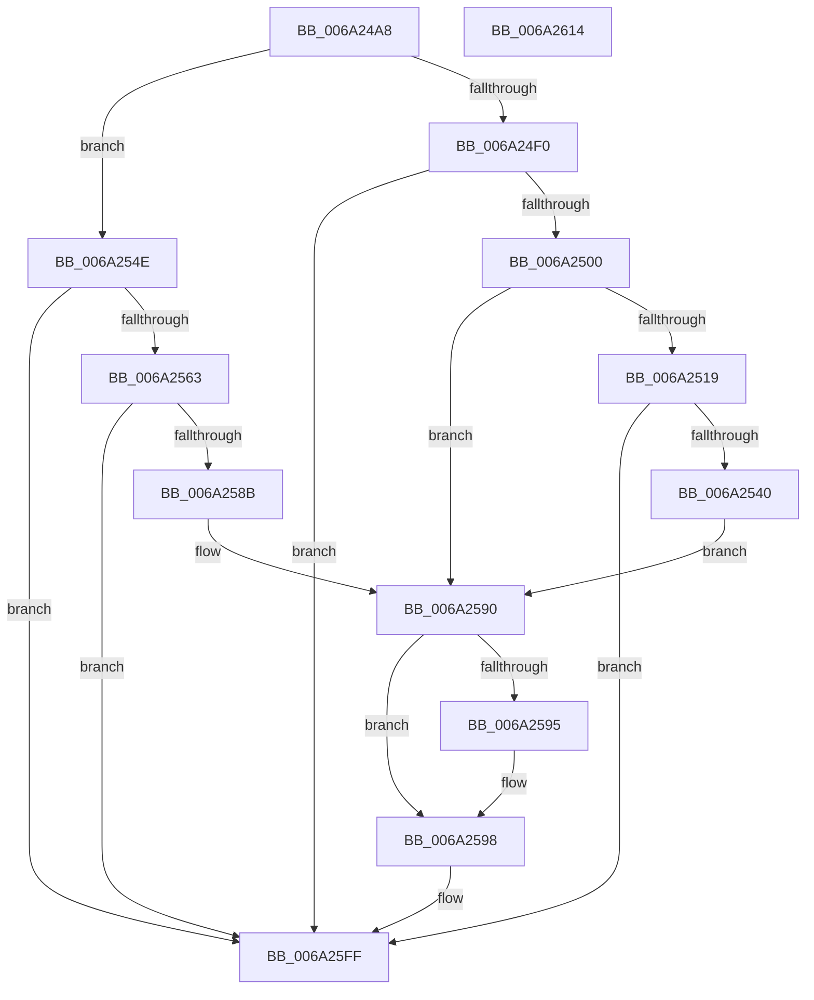

# RaspLoadBearings

- RVA: `0x006A24A8`–`0x006A2615` (길이 `365` bytes)
- VA: `0x00000001406A24A8`
- 실행 섹션: `.text`
- PDB 이름 있음: `예`; PDB Function 태그: `아니요`
- unwind 정보 RVA: `0x000D1E0C`
- 디코드: `109`개 명령, `365/365` bytes 표시
- 미해석 바이트: `0` (있으면 어셈블리에 `.byte`로 보존)

> 이 문서는 커널 이미지의 기계어와 PDB 기호를 분석해 생성했습니다. 4번과 5번은 함수 원형과 자료형을 바이너리 사용 방식에서 추정한 C 해석이며 원본 소스 복구 결과는 아닙니다.

## 1. Dependencies

- 직접 호출 지점: **4**; 고유 호출 대상: **2**
- 직접 호출자로 확인된 함수: **1**
- RIP 상대 이미지 참조: **0**

### Outgoing calls
- `0x006A24F3` → [FioFwReadBytesAtOffset](../3E/FioFwReadBytesAtOffset_function_003E5948.md) (function, `0x003E5948`)
- `0x006A2533` → [FioFwReadBytesAtOffset](../3E/FioFwReadBytesAtOffset_function_003E5948.md) (function, `0x003E5948`)
- `0x006A2556` → [FioFwReadBytesAtOffset](../3E/FioFwReadBytesAtOffset_function_003E5948.md) (function, `0x003E5948`)
- `0x006A2582` → [FioFwReadUshortAtOffset](../4F/FioFwReadUshortAtOffset_function_004F98A0.md) (function, `0x004F98A0`)

### Direct callers
- [RaspGetUnscaledGlyphData](RaspGetUnscaledGlyphData_function_006A1E84.md) at `0x006A1F39`

### Static image references
- 디코드된 RIP-relative 메모리 참조가 없습니다.

## 2. Other-region calls and transfers

- 다른 실행 섹션으로 향하는 call: **0**
- 별도 외부 분기/꼬리 이동을 확인하지 못했습니다.

## 3. Assembly (complete function range)

```asm
006A24A8  4C 8B DC                        mov r11, rsp
006A24AB  49 89 5B 18                     mov qword ptr [r11 + 0x18], rbx
006A24AF  55                              push rbp
006A24B0  56                              push rsi
006A24B1  57                              push rdi
006A24B2  41 54                           push r12
006A24B4  41 55                           push r13
006A24B6  41 56                           push r14
006A24B8  41 57                           push r15
006A24BA  48 83 EC 20                     sub rsp, 0x20
006A24BE  0F B7 69 58                     movzx ebp, word ptr [rcx + 0x58]
006A24C2  45 33 ED                        xor r13d, r13d
006A24C5  8B 41 44                        mov eax, dword ptr [rcx + 0x44]
006A24C8  48 8B F9                        mov rdi, rcx
006A24CB  48 8B 49 10                     mov rcx, qword ptr [rcx + 0x10]
006A24CF  4D 8B E1                        mov r12, r9
006A24D2  45 89 6B 08                     mov dword ptr [r11 + 8], r13d
006A24D6  4D 8B F8                        mov r15, r8
006A24D9  66 45 89 6B 10                  mov word ptr [r11 + 0x10], r13w
006A24DE  8B DA                           mov ebx, edx
006A24E0  4D 8D 4B 08                     lea r9, [r11 + 8]
006A24E4  48 8B 49 10                     mov rcx, qword ptr [rcx + 0x10]
006A24E8  45 8D 45 04                     lea r8d, [r13 + 4]
006A24EC  3B D5                           cmp edx, ebp
006A24EE  73 5E                           jae 0x1406a254e
006A24F0  8D 14 90                        lea edx, [rax + rdx*4]
006A24F3  E8 50 34 D4 FF                  call 0x1403e5948
006A24F8  85 C0                           test eax, eax
006A24FA  0F 88 FF 00 00 00               js 0x1406a25ff
006A2500  0F B7 44 24 60                  movzx eax, word ptr [rsp + 0x60]
006A2505  0F B7 5C 24 62                  movzx ebx, word ptr [rsp + 0x62]
006A250A  66 C1 C8 08                     ror ax, 8
006A250E  0F B7 F0                        movzx esi, ax
006A2511  66 C1 CB 08                     ror bx, 8
006A2515  85 F6                           test esi, esi
006A2517  75 77                           jne 0x1406a2590
006A2519  8B 57 44                        mov edx, dword ptr [rdi + 0x44]
006A251C  4C 8D 4C 24 60                  lea r9, [rsp + 0x60]
006A2521  48 8B 4F 10                     mov rcx, qword ptr [rdi + 0x10]
006A2525  45 8D 45 04                     lea r8d, [r13 + 4]
006A2529  83 C2 FC                        add edx, -4
006A252C  48 8B 49 10                     mov rcx, qword ptr [rcx + 0x10]
006A2530  8D 14 AA                        lea edx, [rdx + rbp*4]
006A2533  E8 10 34 D4 FF                  call 0x1403e5948
006A2538  85 C0                           test eax, eax
006A253A  0F 88 BF 00 00 00               js 0x1406a25ff
006A2540  0F B7 44 24 60                  movzx eax, word ptr [rsp + 0x60]
006A2545  66 C1 C8 08                     ror ax, 8
006A2549  0F B7 F0                        movzx esi, ax
006A254C  EB 42                           jmp 0x1406a2590
006A254E  44 8D 34 A8                     lea r14d, [rax + rbp*4]
006A2552  41 8D 56 FC                     lea edx, [r14 - 4]
006A2556  E8 ED 33 D4 FF                  call 0x1403e5948
006A255B  85 C0                           test eax, eax
006A255D  0F 88 9C 00 00 00               js 0x1406a25ff
006A2563  48 8B 4F 10                     mov rcx, qword ptr [rdi + 0x10]
006A2567  4C 8D 44 24 68                  lea r8, [rsp + 0x68]
006A256C  0F B7 44 24 60                  movzx eax, word ptr [rsp + 0x60]
006A2571  2B DD                           sub ebx, ebp
006A2573  66 C1 C8 08                     ror ax, 8
006A2577  0F B7 F0                        movzx esi, ax
006A257A  48 8B 49 10                     mov rcx, qword ptr [rcx + 0x10]
006A257E  41 8D 14 5E                     lea edx, [r14 + rbx*2]
006A2582  E8 19 73 E5 FF                  call 0x1404f98a0
006A2587  85 C0                           test eax, eax
006A2589  78 74                           js 0x1406a25ff
006A258B  0F B7 5C 24 68                  movzx ebx, word ptr [rsp + 0x68]
006A2590  66 85 DB                        test bx, bx
006A2593  79 03                           jns 0x1406a2598
006A2595  41 8B DD                        mov ebx, r13d
006A2598  45 8B 47 12                     mov r8d, dword ptr [r15 + 0x12]
006A259C  41 8B 4F 0A                     mov ecx, dword ptr [r15 + 0xa]
006A25A0  41 0F B7 57 18                  movzx edx, word ptr [r15 + 0x18]
006A25A5  41 2B C8                        sub ecx, r8d
006A25A8  44 0F BF CB                     movsx r9d, bx
006A25AC  41 03 C9                        add ecx, r9d
006A25AF  3B F1                           cmp esi, ecx
006A25B1  0F 4C F1                        cmovl esi, ecx
006A25B4  49 8B 4F 32                     mov rcx, qword ptr [r15 + 0x32]
006A25B8  45 2B C1                        sub r8d, r9d
006A25BB  41 89 34 24                     mov dword ptr [r12], esi
006A25BF  44 89 04 91                     mov dword ptr [rcx + rdx*4], r8d
006A25C3  41 8B 47 12                     mov eax, dword ptr [r15 + 0x12]
006A25C7  41 2B C1                        sub eax, r9d
006A25CA  03 C6                           add eax, esi
006A25CC  89 44 91 04                     mov dword ptr [rcx + rdx*4 + 4], eax
006A25D0  0F BF 47 52                     movsx eax, word ptr [rdi + 0x52]
006A25D4  0F BF 4F 54                     movsx ecx, word ptr [rdi + 0x54]
006A25D8  45 0F B7 47 18                  movzx r8d, word ptr [r15 + 0x18]
006A25DD  03 C8                           add ecx, eax
006A25DF  49 8B 57 3A                     mov rdx, qword ptr [r15 + 0x3a]
006A25E3  42 89 0C 82                     mov dword ptr [rdx + r8*4], ecx
006A25E7  0F BF 47 54                     movsx eax, word ptr [rdi + 0x54]
006A25EB  0F BF 4F 52                     movsx ecx, word ptr [rdi + 0x52]
006A25EF  03 C8                           add ecx, eax
006A25F1  41 8B C5                        mov eax, r13d
006A25F4  42 89 4C 82 04                  mov dword ptr [rdx + r8*4 + 4], ecx
006A25F9  66 41 83 47 18 02               add word ptr [r15 + 0x18], 2
006A25FF  48 8B 5C 24 70                  mov rbx, qword ptr [rsp + 0x70]
006A2604  48 83 C4 20                     add rsp, 0x20
006A2608  41 5F                           pop r15
006A260A  41 5E                           pop r14
006A260C  41 5D                           pop r13
006A260E  41 5C                           pop r12
006A2610  5F                              pop rdi
006A2611  5E                              pop rsi
006A2612  5D                              pop rbp
006A2613  C3                              ret
006A2614  CC                              int3
```

## 4. C-style interpretation (structured pseudocode)

```c
__int64 __fastcall RaspLoadBearings(__int64 a1, __int64 a2, __int64 a3, __int64 a4)
{
    __int64 result;
    __int64 v_r13;
    __int64 v_rbx;
    __int64 v_rsi;
    __int64 v_rsp;
    unsigned __int64 v_stack_p10;
    unsigned __int64 v_stack_p18;
    unsigned __int16 v_stack_p8;
    unsigned __int16 v_stack_pA;

    *(unsigned __int64 *)(v_rsp + 24) = v_rbx;
    v_rsp = (v_rsp) - (32);
    v_r13 = 0;
    *(unsigned int *)(v_rsp + 8) = 0;
    *(unsigned __int16 *)(v_rsp + 16) = 0;
    if (((unsigned int)(a2)) >= ((unsigned int)(*(unsigned __int16 *)(a1 + 88)))) goto loc_006A254E;
    result = FioFwReadBytesAtOffset(*(unsigned __int64 *)(*(unsigned __int64 *)(a1 + 16) + 16), (unsigned int)(*(unsigned int *)(a1 + 68)) + a2 * 4, v_r13 + 4, v_rsp + 8);
    if (sign_flag) goto loc_006A25FF;
    if ((unsigned int)((unsigned __int16)(v_stack_p8)) != 0) goto loc_006A2590;
    a2 = (unsigned int)(((unsigned int)(*(unsigned int *)(a1 + 68))) + (-4));
    result = FioFwReadBytesAtOffset(*(unsigned __int64 *)(*(unsigned __int64 *)(a1 + 16) + 16), a2 + *(unsigned __int16 *)(a1 + 88) * 4, v_r13 + 4, v_stack_p8);
    if (sign_flag) goto loc_006A25FF;
    goto loc_006A2590;
loc_006A254E:
    result = FioFwReadBytesAtOffset(*(unsigned __int64 *)(*(unsigned __int64 *)(a1 + 16) + 16), v_stack_p8 + *(unsigned __int16 *)(a1 + 88) * 4 - 4, v_r13 + 4, v_stack_p8);
    if (sign_flag) goto loc_006A25FF;
    v_rbx = (unsigned int)((v_stack_pA) - ((unsigned int)(*(unsigned __int16 *)(a1 + 88))));
    result = FioFwReadUshortAtOffset(*(unsigned __int64 *)(*(unsigned __int64 *)(a1 + 16) + 16), v_stack_p8 + *(unsigned __int16 *)(a1 + 88) * 4 + v_rbx * 2, v_stack_p10, v_stack_p8);
    if (sign_flag) goto loc_006A25FF;
loc_006A2590:
    v_rbx = v_stack_p10;
    if (sign_flag) {
        v_rbx = 0;
    }
    a1 = (unsigned int)(((unsigned int)(*(unsigned int *)(a3 + 10))) - ((unsigned int)((unsigned int)(*(unsigned int *)(a3 + 18)))));
    a1 = (unsigned int)((a1) + ((unsigned int)((__int16)((unsigned __int16)(v_rbx)))));
    v_rsi = (unsigned __int16)(v_stack_p8);
    if (((unsigned int)((unsigned __int16)(v_stack_p8))) < ((unsigned int)(a1))) { v_rsi = (unsigned int)(a1); }
    a3 = (unsigned int)(((unsigned int)(*(unsigned int *)(a3 + 18))) - ((unsigned int)((__int16)((unsigned __int16)(v_rbx)))));
    *(unsigned int *)(a4) = (unsigned int)(v_rsi);
    *(unsigned int *)(*(unsigned __int64 *)(a3 + 50) + *(unsigned __int16 *)(a3 + 24) * 4) = (unsigned int)(a3);
    result = (unsigned int)(((unsigned int)(*(unsigned int *)(a3 + 18))) - ((unsigned int)((__int16)((unsigned __int16)(v_rbx)))));
    result = (unsigned int)((result) + ((unsigned int)(v_rsi)));
    *(unsigned int *)(*(unsigned __int64 *)(a3 + 50) + *(unsigned __int16 *)(a3 + 24) * 4 + 4) = (unsigned int)(result);
    a1 = (unsigned int)(((__int16)(*(unsigned __int16 *)(a1 + 84))) + ((unsigned int)((__int16)(*(unsigned __int16 *)(a1 + 82)))));
    *(unsigned int *)(*(unsigned __int64 *)(a3 + 58) + *(unsigned __int16 *)(a3 + 24) * 4) = (unsigned int)(a1);
    a1 = (unsigned int)(((__int16)(*(unsigned __int16 *)(a1 + 82))) + ((unsigned int)((__int16)(*(unsigned __int16 *)(a1 + 84)))));
    *(unsigned int *)(*(unsigned __int64 *)(a3 + 58) + *(unsigned __int16 *)(a3 + 24) * 4 + 4) = (unsigned int)(a1);
loc_006A25FF:
    v_rsp = (v_rsp) + (32);
    return 0;
}
```

## 5. (Beta) C Style

```c
int64_t RaspLoadBearings(void *Arg1, int64_t Arg2, void *Arg3, void *Arg4)
{
    uint8_t *arg1 = (uint8_t *)Arg1;
    uint8_t *arg3 = (uint8_t *)Arg3;
    uint8_t *arg4 = (uint8_t *)Arg4;

    int64_t result;
    int64_t local_r13;
    int64_t local_rbx;
    int64_t local_rsi;
    int64_t local_rsp;
    uint64_t v_stack_p10;
    uint64_t v_stack_p18;
    uint16_t v_stack_p8;
    uint16_t v_stack_pA;

    *(uint64_t *)(local_rsp + 0x18) = local_rbx;
    local_rsp = (local_rsp) - (32);
    local_r13 = 0;
    *(uint32_t *)(local_rsp + 0x8) = 0;
    *(uint16_t *)(local_rsp + 0x10) = 0;
    if (((uint32_t)(Arg2)) >= ((uint32_t)(*(uint16_t *)(arg1 + 0x58)))) goto loc_006A254E;
    result = FioFwReadBytesAtOffset(*(uint64_t *)(*(uint64_t *)(arg1 + 0x10) + 0x10), (uint32_t)(*(uint32_t *)(arg1 + 0x44)) + Arg2 * 4, local_r13 + 4, local_rsp + 8);
    if (sign_flag) goto loc_006A25FF;
    if ((uint32_t)((uint16_t)(v_stack_p8)) != 0) goto loc_006A2590;
    Arg2 = (uint32_t)(((uint32_t)(*(uint32_t *)(arg1 + 0x44))) + (-4));
    result = FioFwReadBytesAtOffset(*(uint64_t *)(*(uint64_t *)(arg1 + 0x10) + 0x10), Arg2 + *(uint16_t *)(arg1 + 0x58) * 4, local_r13 + 4, v_stack_p8);
    if (sign_flag) goto loc_006A25FF;
    goto loc_006A2590;
loc_006A254E:
    result = FioFwReadBytesAtOffset(*(uint64_t *)(*(uint64_t *)(arg1 + 0x10) + 0x10), v_stack_p8 + *(uint16_t *)(arg1 + 0x58) * 4 - 4, local_r13 + 4, v_stack_p8);
    if (sign_flag) goto loc_006A25FF;
    local_rbx = (uint32_t)((v_stack_pA) - ((uint32_t)(*(uint16_t *)(arg1 + 0x58))));
    result = FioFwReadUshortAtOffset(*(uint64_t *)(*(uint64_t *)(arg1 + 0x10) + 0x10), v_stack_p8 + *(uint16_t *)(arg1 + 0x58) * 4 + local_rbx * 2, v_stack_p10, v_stack_p8);
    if (sign_flag) goto loc_006A25FF;
loc_006A2590:
    local_rbx = v_stack_p10;
    if (sign_flag) {
        local_rbx = 0;
    }
    Arg1 = (uint32_t)(((uint32_t)(*(uint32_t *)(arg3 + 0xA))) - ((uint32_t)((uint32_t)(*(uint32_t *)(arg3 + 0x12)))));
    Arg1 = (uint32_t)((Arg1) + ((uint32_t)((int16_t)((uint16_t)(local_rbx)))));
    local_rsi = (uint16_t)(v_stack_p8);
    if (((uint32_t)((uint16_t)(v_stack_p8))) < ((uint32_t)(Arg1))) { local_rsi = (uint32_t)(Arg1); }
    Arg3 = (uint32_t)(((uint32_t)(*(uint32_t *)(arg3 + 0x12))) - ((uint32_t)((int16_t)((uint16_t)(local_rbx)))));
    *(uint32_t *)(arg4) = (uint32_t)(local_rsi);
    *(uint32_t *)(*(uint64_t *)(arg3 + 0x32) + *(uint16_t *)(arg3 + 0x18) * 4) = (uint32_t)(Arg3);
    result = (uint32_t)(((uint32_t)(*(uint32_t *)(arg3 + 0x12))) - ((uint32_t)((int16_t)((uint16_t)(local_rbx)))));
    result = (uint32_t)((result) + ((uint32_t)(local_rsi)));
    *(uint32_t *)(*(uint64_t *)(arg3 + 0x32) + *(uint16_t *)(arg3 + 0x18) * 4 + 0x4) = (uint32_t)(result);
    Arg1 = (uint32_t)(((int16_t)(*(uint16_t *)(arg1 + 0x54))) + ((uint32_t)((int16_t)(*(uint16_t *)(arg1 + 0x52)))));
    *(uint32_t *)(*(uint64_t *)(arg3 + 0x3A) + *(uint16_t *)(arg3 + 0x18) * 4) = (uint32_t)(Arg1);
    Arg1 = (uint32_t)(((int16_t)(*(uint16_t *)(arg1 + 0x52))) + ((uint32_t)((int16_t)(*(uint16_t *)(arg1 + 0x54)))));
    *(uint32_t *)(*(uint64_t *)(arg3 + 0x3A) + *(uint16_t *)(arg3 + 0x18) * 4 + 0x4) = (uint32_t)(Arg1);
loc_006A25FF:
    local_rsp = (local_rsp) + (32);
    return 0;
}
```

### 관측된 메모리 오프셋

구조체 형식이 확인되지 않은 접근은 인자 기준의 오프셋으로만 기록했습니다.

| 기준 인자 | 오프셋 표현 | 폭 (bit) | 접근 |
|---|---:|---:|---|
| `Arg1` | `+ 0x10` | `64` | `R` |
| `Arg1` | `+ 0x44` | `32` | `R` |
| `Arg1` | `+ 0x52` | `16` | `R` |
| `Arg1` | `+ 0x54` | `16` | `R` |
| `Arg1` | `+ 0x58` | `16` | `R` |
| `Arg3` | `+ 0xA` | `32` | `R` |
| `Arg3` | `+ 0x12` | `32` | `R` |
| `Arg3` | `+ 0x18` | `16` | `R` |
| `Arg3` | `+ 0x18` | `16` | `R/W` |
| `Arg3` | `+ 0x32` | `64` | `R` |
| `Arg3` | `+ 0x3A` | `64` | `R` |
| `Arg4` | `+ 0x0` | `32` | `W` |

## 6. Execution-region graph

[열기: 2D/3D 그래프와 함수 탐색 컨트롤 패널](../../../control-panel.html?section=text&rva=0x006A24A8&view=graph)

- 2D 그래프는 위에서 아래로 흐르고, 3D 그래프는 빈 공간을 드래그해 회전합니다. Shift+드래그는 이동, 휠은 확대·축소, 함수 노드 선택은 대상 보고서 이동입니다.

### Static fallback


