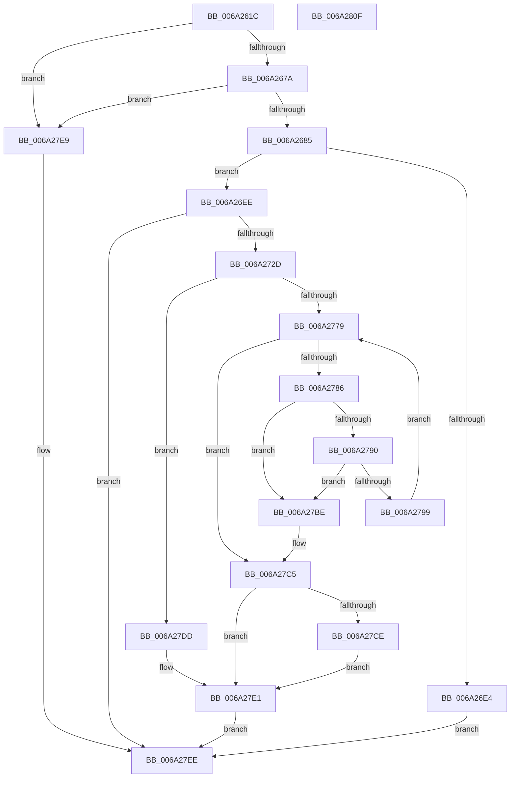

# RaspLoadCompositeGlyphData

- RVA: `0x006A261C`–`0x006A2810` (길이 `500` bytes)
- VA: `0x00000001406A261C`
- 실행 섹션: `.text`
- PDB 이름 있음: `예`; PDB Function 태그: `아니요`
- unwind 정보 RVA: `0x000BC0E8`
- 디코드: `142`개 명령, `500/500` bytes 표시
- 미해석 바이트: `0` (있으면 어셈블리에 `.byte`로 보존)

> 이 문서는 커널 이미지의 기계어와 PDB 기호를 분석해 생성했습니다. 4번과 5번은 함수 원형과 자료형을 바이너리 사용 방식에서 추정한 C 해석이며 원본 소스 복구 결과는 아닙니다.

## 1. Dependencies

- 직접 호출 지점: **10**; 고유 호출 대상: **4**
- 직접 호출자로 확인된 함수: **1**
- RIP 상대 이미지 참조: **0**

### Outgoing calls
- `0x006A2699` → [FioFwReadUshortAtOffset](../4F/FioFwReadUshortAtOffset_function_004F98A0.md) (function, `0x004F98A0`)
- `0x006A26A8` → [FioFwReadUshortAtOffset](../4F/FioFwReadUshortAtOffset_function_004F98A0.md) (function, `0x004F98A0`)
- `0x006A26B9` → [FioFwReadUshortAtOffset](../4F/FioFwReadUshortAtOffset_function_004F98A0.md) (function, `0x004F98A0`)
- `0x006A26C8` → [FioFwReadUshortAtOffset](../4F/FioFwReadUshortAtOffset_function_004F98A0.md) (function, `0x004F98A0`)
- `0x006A26D9` → [FioFwReadUshortAtOffset](../4F/FioFwReadUshortAtOffset_function_004F98A0.md) (function, `0x004F98A0`)
- `0x006A2720` → [RaspGetCompositeGlyphList](RaspGetCompositeGlyphList_function_006A1B54.md) (function, `0x006A1B54`)
- `0x006A276E` → [RaspInitializeCompositeGlyphData](RaspInitializeCompositeGlyphData_function_006A2138.md) (function, `0x006A2138`)
- `0x006A27AC` → [RaspFreeMemory](../3E/RaspFreeMemory_function_003E28E4.md) (function, `0x003E28E4`)
- `0x006A27B7` → [RaspFreeMemory](../3E/RaspFreeMemory_function_003E28E4.md) (function, `0x003E28E4`)
- `0x006A27D4` → [RaspFreeMemory](../3E/RaspFreeMemory_function_003E28E4.md) (function, `0x003E28E4`)

### Direct callers
- [RaspLoadGlyphData](RaspLoadGlyphData_function_006A2818.md) at `0x006A28C7`

### Static image references
- 디코드된 RIP-relative 메모리 참조가 없습니다.

## 2. Other-region calls and transfers

- 다른 실행 섹션으로 향하는 call: **0**
- 별도 외부 분기/꼬리 이동을 확인하지 못했습니다.

## 3. Assembly (complete function range)

```asm
006A261C  48 8B C4                        mov rax, rsp
006A261F  48 89 58 10                     mov qword ptr [rax + 0x10], rbx
006A2623  48 89 70 18                     mov qword ptr [rax + 0x18], rsi
006A2627  48 89 78 20                     mov qword ptr [rax + 0x20], rdi
006A262B  55                              push rbp
006A262C  41 54                           push r12
006A262E  41 55                           push r13
006A2630  41 56                           push r14
006A2632  41 57                           push r15
006A2634  48 8D 68 A9                     lea rbp, [rax - 0x57]
006A2638  48 81 EC 90 00 00 00            sub rsp, 0x90
006A263F  33 FF                           xor edi, edi
006A2641  33 C0                           xor eax, eax
006A2643  48 89 45 07                     mov qword ptr [rbp + 7], rax
006A2647  0F 57 C0                        xorps xmm0, xmm0
006A264A  66 89 45 0F                     mov word ptr [rbp + 0xf], ax
006A264E  4D 8B E1                        mov r12, r9
006A2651  89 7D F7                        mov dword ptr [rbp - 9], edi
006A2654  4D 8B E8                        mov r13, r8
006A2657  66 89 7D 5F                     mov word ptr [rbp + 0x5f], di
006A265B  44 8B FA                        mov r15d, edx
006A265E  66 89 7D EF                     mov word ptr [rbp - 0x11], di
006A2662  48 8B D9                        mov rbx, rcx
006A2665  66 89 7D F3                     mov word ptr [rbp - 0xd], di
006A2669  48 89 7D FF                     mov qword ptr [rbp - 1], rdi
006A266D  0F 11 45 17                     movups xmmword ptr [rbp + 0x17], xmm0
006A2671  48 85 C9                        test rcx, rcx
006A2674  0F 84 6F 01 00 00               je 0x1406a27e9
006A267A  8B 49 3C                        mov ecx, dword ptr [rcx + 0x3c]
006A267D  85 C9                           test ecx, ecx
006A267F  0F 84 64 01 00 00               je 0x1406a27e9
006A2685  48 8B 43 10                     mov rax, qword ptr [rbx + 0x10]
006A2689  8D 34 11                        lea esi, [rcx + rdx]
006A268C  4C 8D 45 07                     lea r8, [rbp + 7]
006A2690  8B D6                           mov edx, esi
006A2692  4C 8B 70 10                     mov r14, qword ptr [rax + 0x10]
006A2696  49 8B CE                        mov rcx, r14
006A2699  E8 02 72 E5 FF                  call 0x1404f98a0
006A269E  4C 8D 45 09                     lea r8, [rbp + 9]
006A26A2  49 8B CE                        mov rcx, r14
006A26A5  8D 56 02                        lea edx, [rsi + 2]
006A26A8  E8 F3 71 E5 FF                  call 0x1404f98a0
006A26AD  83 C6 04                        add esi, 4
006A26B0  4C 8D 45 0B                     lea r8, [rbp + 0xb]
006A26B4  8B D6                           mov edx, esi
006A26B6  49 8B CE                        mov rcx, r14
006A26B9  E8 E2 71 E5 FF                  call 0x1404f98a0
006A26BE  4C 8D 45 0D                     lea r8, [rbp + 0xd]
006A26C2  49 8B CE                        mov rcx, r14
006A26C5  8D 56 02                        lea edx, [rsi + 2]
006A26C8  E8 D3 71 E5 FF                  call 0x1404f98a0
006A26CD  83 C6 04                        add esi, 4
006A26D0  4C 8D 45 0F                     lea r8, [rbp + 0xf]
006A26D4  8B D6                           mov edx, esi
006A26D6  49 8B CE                        mov rcx, r14
006A26D9  E8 C2 71 E5 FF                  call 0x1404f98a0
006A26DE  66 39 7D 07                     cmp word ptr [rbp + 7], di
006A26E2  7C 0A                           jl 0x1406a26ee
006A26E4  B8 0D 00 00 C0                  mov eax, 0xc000000d
006A26E9  E9 00 01 00 00                  jmp 0x1406a27ee
006A26EE  48 8B 7D 7F                     mov rdi, qword ptr [rbp + 0x7f]
006A26F2  48 8D 45 17                     lea rax, [rbp + 0x17]
006A26F6  48 89 7C 24 38                  mov qword ptr [rsp + 0x38], rdi
006A26FB  4C 8D 4D EF                     lea r9, [rbp - 0x11]
006A26FF  48 89 44 24 30                  mov qword ptr [rsp + 0x30], rax
006A2704  4C 8D 45 F3                     lea r8, [rbp - 0xd]
006A2708  48 8D 45 F7                     lea rax, [rbp - 9]
006A270C  41 8B D7                        mov edx, r15d
006A270F  48 89 44 24 28                  mov qword ptr [rsp + 0x28], rax
006A2714  48 8B CB                        mov rcx, rbx
006A2717  48 8D 45 5F                     lea rax, [rbp + 0x5f]
006A271B  48 89 44 24 20                  mov qword ptr [rsp + 0x20], rax
006A2720  E8 2F F4 FF FF                  call 0x1406a1b54
006A2725  85 C0                           test eax, eax
006A2727  0F 88 C1 00 00 00               js 0x1406a27ee
006A272D  8B 55 F7                        mov edx, dword ptr [rbp - 9]
006A2730  48 8D 45 FF                     lea rax, [rbp - 1]
006A2734  44 0F B7 4D F3                  movzx r9d, word ptr [rbp - 0xd]
006A2739  4C 8D 45 07                     lea r8, [rbp + 7]
006A273D  48 89 7C 24 48                  mov qword ptr [rsp + 0x48], rdi
006A2742  83 C2 02                        add edx, 2
006A2745  48 89 44 24 40                  mov qword ptr [rsp + 0x40], rax
006A274A  03 D6                           add edx, esi
006A274C  0F B7 45 5F                     movzx eax, word ptr [rbp + 0x5f]
006A2750  49 8B CE                        mov rcx, r14
006A2753  4C 89 6C 24 38                  mov qword ptr [rsp + 0x38], r13
006A2758  89 54 24 30                     mov dword ptr [rsp + 0x30], edx
006A275C  48 8D 55 17                     lea rdx, [rbp + 0x17]
006A2760  66 89 44 24 28                  mov word ptr [rsp + 0x28], ax
006A2765  0F B7 45 EF                     movzx eax, word ptr [rbp - 0x11]
006A2769  66 89 44 24 20                  mov word ptr [rsp + 0x20], ax
006A276E  E8 C5 F9 FF FF                  call 0x1406a2138
006A2773  8B F0                           mov esi, eax
006A2775  85 C0                           test eax, eax
006A2777  79 64                           jns 0x1406a27dd
006A2779  48 8B 5D 17                     mov rbx, qword ptr [rbp + 0x17]
006A277D  48 8D 45 17                     lea rax, [rbp + 0x17]
006A2781  48 3B D8                        cmp rbx, rax
006A2784  74 3F                           je 0x1406a27c5
006A2786  48 8D 45 17                     lea rax, [rbp + 0x17]
006A278A  48 39 43 08                     cmp qword ptr [rbx + 8], rax
006A278E  75 2E                           jne 0x1406a27be
006A2790  48 8B 03                        mov rax, qword ptr [rbx]
006A2793  48 39 58 08                     cmp qword ptr [rax + 8], rbx
006A2797  75 25                           jne 0x1406a27be
006A2799  48 89 45 17                     mov qword ptr [rbp + 0x17], rax
006A279D  48 8D 4D 17                     lea rcx, [rbp + 0x17]
006A27A1  48 89 48 08                     mov qword ptr [rax + 8], rcx
006A27A5  48 8B D7                        mov rdx, rdi
006A27A8  48 8B 4B 10                     mov rcx, qword ptr [rbx + 0x10]
006A27AC  E8 33 01 D4 FF                  call 0x1403e28e4
006A27B1  48 8B D7                        mov rdx, rdi
006A27B4  48 8B CB                        mov rcx, rbx
006A27B7  E8 28 01 D4 FF                  call 0x1403e28e4
006A27BC  EB BB                           jmp 0x1406a2779
006A27BE  B9 03 00 00 00                  mov ecx, 3
006A27C3  CD 29                           int 0x29
006A27C5  48 8B 45 FF                     mov rax, qword ptr [rbp - 1]
006A27C9  48 85 C0                        test rax, rax
006A27CC  74 13                           je 0x1406a27e1
006A27CE  48 8B D7                        mov rdx, rdi
006A27D1  48 8B C8                        mov rcx, rax
006A27D4  E8 0B 01 D4 FF                  call 0x1403e28e4
006A27D9  33 C0                           xor eax, eax
006A27DB  EB 04                           jmp 0x1406a27e1
006A27DD  48 8B 45 FF                     mov rax, qword ptr [rbp - 1]
006A27E1  49 89 04 24                     mov qword ptr [r12], rax
006A27E5  8B C6                           mov eax, esi
006A27E7  EB 05                           jmp 0x1406a27ee
006A27E9  B8 01 00 00 C0                  mov eax, 0xc0000001
006A27EE  4C 8D 9C 24 90 00 00 00         lea r11, [rsp + 0x90]
006A27F6  49 8B 5B 38                     mov rbx, qword ptr [r11 + 0x38]
006A27FA  49 8B 73 40                     mov rsi, qword ptr [r11 + 0x40]
006A27FE  49 8B 7B 48                     mov rdi, qword ptr [r11 + 0x48]
006A2802  49 8B E3                        mov rsp, r11
006A2805  41 5F                           pop r15
006A2807  41 5E                           pop r14
006A2809  41 5D                           pop r13
006A280B  41 5C                           pop r12
006A280D  5D                              pop rbp
006A280E  C3                              ret
006A280F  CC                              int3
```

## 4. C-style interpretation (structured pseudocode)

```c
__int64 __fastcall RaspLoadCompositeGlyphData(__int64 a1, __int64 a2, __int64 a3, __int64 a4)
{
    __int64 result;
    __int64 v_rdi;
    __int64 v_rsi;
    __int64 v_rsp;
    unsigned __int64 v_stack_m28;
    unsigned __int64 v_stack_m70;
    unsigned __int64 v_stack_m78;
    unsigned __int64 v_stack_m80;
    unsigned __int64 v_stack_m88;
    unsigned __int64 v_stack_m90;
    unsigned __int64 v_stack_m98;

    *(unsigned __int64 *)(v_rsp + 16) = v_rbx;
    *(unsigned __int64 *)(v_rsp + 24) = v_rsi;
    *(unsigned __int64 *)(v_rsp + 32) = v_rdi;
    v_rsp = (v_rsp) - (144);
    v_rdi = 0;
    result = 0;
    *(unsigned __int64 *)(v_rsp - 87 + 7) = 0;
    *(unsigned __int16 *)(v_rsp - 87 + 15) = 0;
    *(unsigned int *)(v_rsp - 87 - 9) = 0;
    *(unsigned __int16 *)(v_rsp - 87 + 95) = 0;
    *(unsigned __int16 *)(v_rsp - 87 - 17) = 0;
    *(unsigned __int16 *)(v_rsp - 87 - 13) = 0;
    *(unsigned __int64 *)(v_rsp - 87 - 1) = 0;
    *(unsigned __int64 *)(v_rsp - 87 + 23) = v_xmm0;
    if (a1 == 0) goto loc_006A27E9;
    if ((unsigned int)((unsigned int)(*(unsigned int *)(a1 + 60))) == 0) goto loc_006A27E9;
    result = FioFwReadUshortAtOffset(*(unsigned __int64 *)(*(unsigned __int64 *)(a1 + 16) + 16), (unsigned int)((unsigned int)((unsigned int)(*(unsigned int *)(a1 + 60)) + a2 * 1)), v_rsp - 87 + 7, a4);
    result = FioFwReadUshortAtOffset(*(unsigned __int64 *)(*(unsigned __int64 *)(a1 + 16) + 16), (unsigned int)(*(unsigned int *)(a1 + 60)) + a2 * 1 + 2, v_rsp - 87 + 9, a4);
    v_rsi = (unsigned int)(((unsigned int)(*(unsigned int *)(a1 + 60)) + a2 * 1) + (4));
    result = FioFwReadUshortAtOffset(*(unsigned __int64 *)(*(unsigned __int64 *)(a1 + 16) + 16), (unsigned int)((unsigned int)(v_rsi)), v_rsp - 87 + 11, a4);
    result = FioFwReadUshortAtOffset(*(unsigned __int64 *)(*(unsigned __int64 *)(a1 + 16) + 16), v_rsi + 2, v_rsp - 87 + 13, a4);
    v_rsi = (unsigned int)((v_rsi) + (4));
    result = FioFwReadUshortAtOffset(*(unsigned __int64 *)(*(unsigned __int64 *)(a1 + 16) + 16), (unsigned int)((unsigned int)(v_rsi)), v_rsp - 87 + 15, a4);
    if ((*(unsigned __int16 *)(v_rsp - 87 + 7)) < 0) goto loc_006A26EE;
    goto loc_006A27EE;
loc_006A26EE:
    v_stack_m80 = *(unsigned __int64 *)(v_rsp - 87 + 127);
    v_stack_m88 = v_rsp - 87 + 23;
    v_stack_m90 = v_rsp - 87 - 9;
    v_stack_m98 = v_rsp - 87 + 95;
    result = RaspGetCompositeGlyphList(a1, (unsigned int)((unsigned int)((unsigned int)((unsigned int)(a2)))), v_rsp - 87 - 13, v_rsp - 87 - 17);
    if (sign_flag) goto loc_006A27EE;
    v_stack_m70 = *(unsigned __int64 *)(v_rsp - 87 + 127);
    a2 = (unsigned int)(((unsigned int)(*(unsigned int *)(v_rsp - 87 - 9))) + (2));
    v_stack_m78 = v_rsp - 87 - 1;
    a2 = (unsigned int)((a2) + ((unsigned int)(v_rsi)));
    v_stack_m80 = a3;
    v_stack_m88 = (unsigned int)(a2);
    v_stack_m90 = (unsigned __int16)(*(unsigned __int16 *)(v_rsp - 87 + 95));
    v_stack_m98 = (unsigned __int16)(*(unsigned __int16 *)(v_rsp - 87 - 17));
    result = RaspInitializeCompositeGlyphData(*(unsigned __int64 *)(*(unsigned __int64 *)(a1 + 16) + 16), v_rsp - 87 + 23, v_rsp - 87 + 7, *(unsigned __int16 *)(v_rsp - 87 - 13));
    if (!sign_flag) goto loc_006A27DD;
loc_006A2779:
    if ((*(unsigned __int64 *)(v_rsp - 87 + 23)) == (v_rsp - 87 + 23)) goto loc_006A27C5;
    if ((*(unsigned __int64 *)(*(unsigned __int64 *)(v_rsp - 87 + 23) + 8)) != (v_rsp - 87 + 23)) goto loc_006A27BE;
    if ((*(unsigned __int64 *)(*(unsigned __int64 *)(*(unsigned __int64 *)(v_rsp - 87 + 23)) + 8)) != (*(unsigned __int64 *)(v_rsp - 87 + 23))) goto loc_006A27BE;
    *(unsigned __int64 *)(v_rsp - 87 + 23) = *(unsigned __int64 *)(*(unsigned __int64 *)(v_rsp - 87 + 23));
    *(unsigned __int64 *)(*(unsigned __int64 *)(*(unsigned __int64 *)(v_rsp - 87 + 23)) + 8) = v_rsp - 87 + 23;
    result = RaspFreeMemory(*(unsigned __int64 *)(*(unsigned __int64 *)(v_rsp - 87 + 23) + 16), *(unsigned __int64 *)(v_rsp - 87 + 127), v_rsp - 87 + 7, *(unsigned __int16 *)(v_rsp - 87 - 13));
    result = RaspFreeMemory(*(unsigned __int64 *)(v_rsp - 87 + 23), *(unsigned __int64 *)(v_rsp - 87 + 127), v_rsp - 87 + 7, *(unsigned __int16 *)(v_rsp - 87 - 13));
    goto loc_006A2779;
loc_006A27BE:
loc_006A27C5:
    if (*(unsigned __int64 *)(v_rsp - 87 - 1) == 0) goto loc_006A27E1;
    result = RaspFreeMemory(*(unsigned __int64 *)(v_rsp - 87 - 1), *(unsigned __int64 *)(v_rsp - 87 + 127), v_rsp - 87 + 7, *(unsigned __int16 *)(v_rsp - 87 - 13));
    result = 0;
    goto loc_006A27E1;
loc_006A27DD:
loc_006A27E1:
    *(unsigned __int64 *)(a4) = *(unsigned __int64 *)(v_rsp - 87 - 1);
    goto loc_006A27EE;
loc_006A27E9:
loc_006A27EE:
    return (unsigned int)(0xC0000001ULL);
}
```

## 5. (Beta) C Style

```c
int64_t RaspLoadCompositeGlyphData(void *Arg1, int64_t Arg2, int64_t Arg3, void *Arg4)
{
    uint8_t *arg1 = (uint8_t *)Arg1;
    uint8_t *arg4 = (uint8_t *)Arg4;

    int64_t result;
    int64_t local_rdi;
    int64_t local_rsi;
    int64_t local_rsp;
    uint64_t v_stack_m28;
    uint64_t v_stack_m70;
    uint64_t v_stack_m78;
    uint64_t v_stack_m80;
    uint64_t v_stack_m88;
    uint64_t v_stack_m90;
    uint64_t v_stack_m98;

    *(uint64_t *)(local_rsp + 0x10) = local_rbx;
    *(uint64_t *)(local_rsp + 0x18) = local_rsi;
    *(uint64_t *)(local_rsp + 0x20) = local_rdi;
    local_rsp = (local_rsp) - (144);
    local_rdi = 0;
    result = 0;
    *(uint64_t *)(local_rsp - 0x57 + 0x7) = 0;
    *(uint16_t *)(local_rsp - 0x57 + 0xF) = 0;
    *(uint32_t *)(local_rsp - 0x57 - 0x9) = 0;
    *(uint16_t *)(local_rsp - 0x57 + 0x5F) = 0;
    *(uint16_t *)(local_rsp - 0x57 - 0x11) = 0;
    *(uint16_t *)(local_rsp - 0x57 - 0xD) = 0;
    *(uint64_t *)(local_rsp - 0x57 - 0x1) = 0;
    *(uint64_t *)(local_rsp - 0x57 + 0x17) = v_xmm0;
    if (Arg1 == NULL) goto loc_006A27E9;
    if ((uint32_t)((uint32_t)(*(uint32_t *)(arg1 + 0x3C))) == 0) goto loc_006A27E9;
    result = FioFwReadUshortAtOffset(*(uint64_t *)(*(uint64_t *)(arg1 + 0x10) + 0x10), (uint32_t)((uint32_t)((uint32_t)(*(uint32_t *)(arg1 + 0x3C)) + Arg2 * 1)), local_rsp - 87 + 7, Arg4);
    result = FioFwReadUshortAtOffset(*(uint64_t *)(*(uint64_t *)(arg1 + 0x10) + 0x10), (uint32_t)(*(uint32_t *)(arg1 + 0x3C)) + Arg2 * 1 + 2, local_rsp - 87 + 9, Arg4);
    local_rsi = (uint32_t)(((uint32_t)(*(uint32_t *)(arg1 + 0x3C)) + Arg2 * 1) + (4));
    result = FioFwReadUshortAtOffset(*(uint64_t *)(*(uint64_t *)(arg1 + 0x10) + 0x10), (uint32_t)((uint32_t)(local_rsi)), local_rsp - 87 + 11, Arg4);
    result = FioFwReadUshortAtOffset(*(uint64_t *)(*(uint64_t *)(arg1 + 0x10) + 0x10), local_rsi + 2, local_rsp - 87 + 13, Arg4);
    local_rsi = (uint32_t)((local_rsi) + (4));
    result = FioFwReadUshortAtOffset(*(uint64_t *)(*(uint64_t *)(arg1 + 0x10) + 0x10), (uint32_t)((uint32_t)(local_rsi)), local_rsp - 87 + 15, Arg4);
    if ((*(uint16_t *)(local_rsp - 0x57 + 0x7)) < 0) goto loc_006A26EE;
    goto loc_006A27EE;
loc_006A26EE:
    v_stack_m80 = *(uint64_t *)(local_rsp - 0x57 + 0x7F);
    v_stack_m88 = local_rsp - 87 + 23;
    v_stack_m90 = local_rsp - 87 - 9;
    v_stack_m98 = local_rsp - 87 + 95;
    result = RaspGetCompositeGlyphList(Arg1, (uint32_t)((uint32_t)((uint32_t)((uint32_t)(Arg2)))), local_rsp - 87 - 13, local_rsp - 87 - 17);
    if (sign_flag) goto loc_006A27EE;
    v_stack_m70 = *(uint64_t *)(local_rsp - 0x57 + 0x7F);
    Arg2 = (uint32_t)(((uint32_t)(*(uint32_t *)(local_rsp - 0x57 - 0x9))) + (2));
    v_stack_m78 = local_rsp - 87 - 1;
    Arg2 = (uint32_t)((Arg2) + ((uint32_t)(local_rsi)));
    v_stack_m80 = Arg3;
    v_stack_m88 = (uint32_t)(Arg2);
    v_stack_m90 = (uint16_t)(*(uint16_t *)(local_rsp - 0x57 + 0x5F));
    v_stack_m98 = (uint16_t)(*(uint16_t *)(local_rsp - 0x57 - 0x11));
    result = RaspInitializeCompositeGlyphData(*(uint64_t *)(*(uint64_t *)(arg1 + 0x10) + 0x10), local_rsp - 87 + 23, local_rsp - 87 + 7, *(uint16_t *)(local_rsp - 0x57 - 0xD));
    if (!sign_flag) goto loc_006A27DD;
loc_006A2779:
    if ((*(uint64_t *)(local_rsp - 0x57 + 0x17)) == (local_rsp - 87 + 23)) goto loc_006A27C5;
    if ((*(uint64_t *)(*(uint64_t *)(local_rsp - 0x57 + 0x17) + 0x8)) != (local_rsp - 87 + 23)) goto loc_006A27BE;
    if ((*(uint64_t *)(*(uint64_t *)(*(uint64_t *)(local_rsp - 0x57 + 0x17)) + 0x8)) != (*(uint64_t *)(local_rsp - 0x57 + 0x17))) goto loc_006A27BE;
    *(uint64_t *)(local_rsp - 0x57 + 0x17) = *(uint64_t *)(*(uint64_t *)(local_rsp - 0x57 + 0x17));
    *(uint64_t *)(*(uint64_t *)(*(uint64_t *)(local_rsp - 0x57 + 0x17)) + 0x8) = local_rsp - 87 + 23;
    result = RaspFreeMemory(*(uint64_t *)(*(uint64_t *)(local_rsp - 0x57 + 0x17) + 0x10), *(uint64_t *)(local_rsp - 0x57 + 0x7F), local_rsp - 87 + 7, *(uint16_t *)(local_rsp - 0x57 - 0xD));
    result = RaspFreeMemory(*(uint64_t *)(local_rsp - 0x57 + 0x17), *(uint64_t *)(local_rsp - 0x57 + 0x7F), local_rsp - 87 + 7, *(uint16_t *)(local_rsp - 0x57 - 0xD));
    goto loc_006A2779;
loc_006A27BE:
loc_006A27C5:
    if (*(uint64_t *)(local_rsp - 0x57 - 0x1) == 0) goto loc_006A27E1;
    result = RaspFreeMemory(*(uint64_t *)(local_rsp - 0x57 - 0x1), *(uint64_t *)(local_rsp - 0x57 + 0x7F), local_rsp - 87 + 7, *(uint16_t *)(local_rsp - 0x57 - 0xD));
    result = 0;
    goto loc_006A27E1;
loc_006A27DD:
loc_006A27E1:
    *(uint64_t *)(arg4) = *(uint64_t *)(local_rsp - 0x57 - 0x1);
    goto loc_006A27EE;
loc_006A27E9:
loc_006A27EE:
    return (uint32_t)(0xC0000001ULL);
}
```

### 관측된 메모리 오프셋

구조체 형식이 확인되지 않은 접근은 인자 기준의 오프셋으로만 기록했습니다.

| 기준 인자 | 오프셋 표현 | 폭 (bit) | 접근 |
|---|---:|---:|---|
| `Arg1` | `+ 0x10` | `64` | `R` |
| `Arg4` | `+ 0x0` | `64` | `W` |

## 6. Execution-region graph

[열기: 2D/3D 그래프와 함수 탐색 컨트롤 패널](../../../control-panel.html?section=text&rva=0x006A261C&view=graph)

- 2D 그래프는 위에서 아래로 흐르고, 3D 그래프는 빈 공간을 드래그해 회전합니다. Shift+드래그는 이동, 휠은 확대·축소, 함수 노드 선택은 대상 보고서 이동입니다.

### Static fallback


