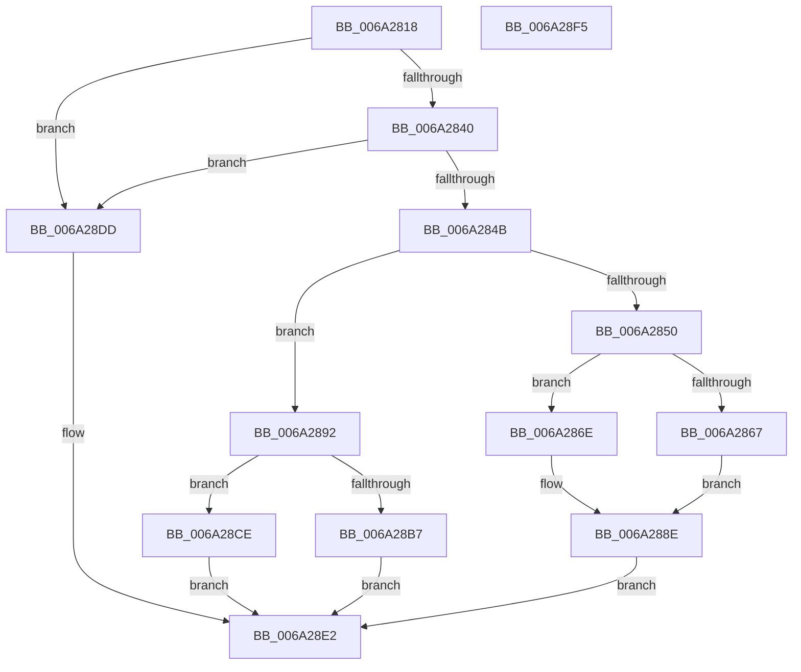

# RaspLoadGlyphData

- RVA: `0x006A2818`–`0x006A28F6` (길이 `222` bytes)
- VA: `0x00000001406A2818`
- 실행 섹션: `.text`
- PDB 이름 있음: `예`; PDB Function 태그: `아니요`
- unwind 정보 RVA: `0x000B8D7C`
- 디코드: `67`개 명령, `222/222` bytes 표시
- 미해석 바이트: `0` (있으면 어셈블리에 `.byte`로 보존)

> 이 문서는 커널 이미지의 기계어와 PDB 기호를 분석해 생성했습니다. 4번과 5번은 함수 원형과 자료형을 바이너리 사용 방식에서 추정한 C 해석이며 원본 소스 복구 결과는 아닙니다.

## 1. Dependencies

- 직접 호출 지점: **5**; 고유 호출 대상: **5**
- 직접 호출자로 확인된 함수: **2**
- RIP 상대 이미지 참조: **0**

### Outgoing calls
- `0x006A285A` → [RaspAllocateMemory](../3E/RaspAllocateMemory_function_003E42F8.md) (function, `0x003E42F8`)
- `0x006A2876` → [memset](../6C/memset_function_006C6C40.md) (function, `0x006C6C40`)
- `0x006A28A6` → [FioFwReadUshortAtOffset](../4F/FioFwReadUshortAtOffset_function_004F98A0.md) (function, `0x004F98A0`)
- `0x006A28C7` → [RaspLoadCompositeGlyphData](RaspLoadCompositeGlyphData_function_006A261C.md) (function, `0x006A261C`)
- `0x006A28D6` → [RaspInitializeGlyphData](../3E/RaspInitializeGlyphData_function_003E54B8.md) (function, `0x003E54B8`)

### Direct callers
- [RaspGetCompositeGlyphList](RaspGetCompositeGlyphList_function_006A1B54.md) at `0x006A1DB1`
- [RaspGetUnscaledGlyphData](RaspGetUnscaledGlyphData_function_006A1E84.md) at `0x006A1F0F`

### Static image references
- 디코드된 RIP-relative 메모리 참조가 없습니다.

## 2. Other-region calls and transfers

- 다른 실행 섹션으로 향하는 call: **0**
- 별도 외부 분기/꼬리 이동을 확인하지 못했습니다.

## 3. Assembly (complete function range)

```asm
006A2818  48 89 5C 24 10                  mov qword ptr [rsp + 0x10], rbx
006A281D  48 89 6C 24 18                  mov qword ptr [rsp + 0x18], rbp
006A2822  56                              push rsi
006A2823  57                              push rdi
006A2824  41 56                           push r14
006A2826  48 83 EC 30                     sub rsp, 0x30
006A282A  33 DB                           xor ebx, ebx
006A282C  4D 8B F1                        mov r14, r9
006A282F  49 8B E8                        mov rbp, r8
006A2832  8B F2                           mov esi, edx
006A2834  48 8B F9                        mov rdi, rcx
006A2837  48 85 C9                        test rcx, rcx
006A283A  0F 84 9D 00 00 00               je 0x1406a28dd
006A2840  8B 41 3C                        mov eax, dword ptr [rcx + 0x3c]
006A2843  85 C0                           test eax, eax
006A2845  0F 84 92 00 00 00               je 0x1406a28dd
006A284B  83 FA FF                        cmp edx, -1
006A284E  75 42                           jne 0x1406a2892
006A2850  48 8B 54 24 70                  mov rdx, qword ptr [rsp + 0x70]
006A2855  8D 73 52                        lea esi, [rbx + 0x52]
006A2858  8B CE                           mov ecx, esi
006A285A  E8 99 1A D4 FF                  call 0x1403e42f8
006A285F  48 8B F8                        mov rdi, rax
006A2862  48 85 C0                        test rax, rax
006A2865  75 07                           jne 0x1406a286e
006A2867  BB 9A 00 00 C0                  mov ebx, 0xc000009a
006A286C  EB 20                           jmp 0x1406a288e
006A286E  4C 8B C6                        mov r8, rsi
006A2871  33 D2                           xor edx, edx
006A2873  48 8B CF                        mov rcx, rdi
006A2876  E8 C5 43 02 00                  call 0x1406c6c40
006A287B  48 8D 4F 42                     lea rcx, [rdi + 0x42]
006A287F  49 89 3E                        mov qword ptr [r14], rdi
006A2882  48 89 4F 32                     mov qword ptr [rdi + 0x32], rcx
006A2886  48 83 C1 08                     add rcx, 8
006A288A  48 89 4F 3A                     mov qword ptr [rdi + 0x3a], rcx
006A288E  8B C3                           mov eax, ebx
006A2890  EB 50                           jmp 0x1406a28e2
006A2892  48 8B 49 10                     mov rcx, qword ptr [rcx + 0x10]
006A2896  4C 8D 44 24 50                  lea r8, [rsp + 0x50]
006A289B  03 D0                           add edx, eax
006A289D  66 89 5C 24 50                  mov word ptr [rsp + 0x50], bx
006A28A2  48 8B 49 10                     mov rcx, qword ptr [rcx + 0x10]
006A28A6  E8 F5 6F E5 FF                  call 0x1404f98a0
006A28AB  8B D6                           mov edx, esi
006A28AD  48 8B CF                        mov rcx, rdi
006A28B0  66 39 5C 24 50                  cmp word ptr [rsp + 0x50], bx
006A28B5  7D 17                           jge 0x1406a28ce
006A28B7  48 8B 44 24 70                  mov rax, qword ptr [rsp + 0x70]
006A28BC  4D 8B CE                        mov r9, r14
006A28BF  4C 8B C5                        mov r8, rbp
006A28C2  48 89 44 24 20                  mov qword ptr [rsp + 0x20], rax
006A28C7  E8 50 FD FF FF                  call 0x1406a261c
006A28CC  EB 14                           jmp 0x1406a28e2
006A28CE  4C 8B 4C 24 70                  mov r9, qword ptr [rsp + 0x70]
006A28D3  4D 8B C6                        mov r8, r14
006A28D6  E8 DD 2B D4 FF                  call 0x1403e54b8
006A28DB  EB 05                           jmp 0x1406a28e2
006A28DD  B8 01 00 00 C0                  mov eax, 0xc0000001
006A28E2  48 8B 5C 24 58                  mov rbx, qword ptr [rsp + 0x58]
006A28E7  48 8B 6C 24 60                  mov rbp, qword ptr [rsp + 0x60]
006A28EC  48 83 C4 30                     add rsp, 0x30
006A28F0  41 5E                           pop r14
006A28F2  5F                              pop rdi
006A28F3  5E                              pop rsi
006A28F4  C3                              ret
006A28F5  CC                              int3
```

## 4. C-style interpretation (structured pseudocode)

```c
__int64 __fastcall RaspLoadGlyphData(__int64 a1, int a2, __int64 a3, __int64 a4, __int64 a5)
{
    __int64 result;
    __int64 v_rbx;
    __int64 v_rsp;
    unsigned __int64 v_stack_m28;
    unsigned __int64 v_stack_p10;
    unsigned __int64 v_stack_p18;
    unsigned __int64 v_stack_p8;

    v_stack_p10 = v_rbx;
    v_stack_p18 = v_rbp;
    v_rsp = (v_rsp) - (48);
    v_rbx = 0;
    if (a1 == 0) goto loc_006A28DD;
    if ((unsigned int)((unsigned int)(*(unsigned int *)(a1 + 60))) == 0) goto loc_006A28DD;
    if (a2 != -1) goto loc_006A2892;
    result = RaspAllocateMemory((unsigned int)((unsigned int)(v_rbx + 82)), a5, a3, a4);
    if (result != 0) goto loc_006A286E;
    goto loc_006A288E;
loc_006A286E:
    a2 = 0;
    result = memset(result, a2, v_rbx + 82, a4);
    *(unsigned __int64 *)(a4) = result;
    *(unsigned __int64 *)(result + 50) = result + 66;
    a1 = (result + 66) + (8);
    *(unsigned __int64 *)(result + 58) = a1;
loc_006A288E:
    goto loc_006A28E2;
loc_006A2892:
    a2 = (unsigned int)((a2) + ((unsigned int)((unsigned int)((unsigned int)((unsigned int)(0xC000009AULL))))));
    v_stack_p8 = (unsigned __int16)((unsigned int)(0xC000009AULL));
    result = FioFwReadUshortAtOffset(*(unsigned __int64 *)(*(unsigned __int64 *)(a1 + 16) + 16), a2, v_stack_p8, a4);
    if (v_stack_p8 >= ((unsigned __int16)((unsigned int)(0xC000009AULL)))) goto loc_006A28CE;
    v_stack_m28 = a5;
    result = RaspLoadCompositeGlyphData(result, (unsigned int)((unsigned int)(v_rbx + 82)), a3, a4);
    goto loc_006A28E2;
loc_006A28CE:
    result = RaspInitializeGlyphData(result, (unsigned int)((unsigned int)(v_rbx + 82)), a4, a5);
    goto loc_006A28E2;
loc_006A28DD:
loc_006A28E2:
    v_rsp = (v_rsp) + (48);
    return (unsigned int)(0xC0000001ULL);
}
```

## 5. (Beta) C Style

```c
int64_t RaspLoadGlyphData(int64_t Arg1, int32_t Arg2, int64_t Arg3, void *Arg4, int64_t Arg5)
{
    uint8_t *arg4 = (uint8_t *)Arg4;

    int64_t result;
    int64_t local_rbx;
    int64_t local_rsp;
    uint64_t v_stack_m28;
    uint64_t v_stack_p10;
    uint64_t v_stack_p18;
    uint64_t v_stack_p8;

    v_stack_p10 = local_rbx;
    v_stack_p18 = local_rbp;
    local_rsp = (local_rsp) - (48);
    local_rbx = 0;
    if (Arg1 == 0) goto loc_006A28DD;
    if ((uint32_t)((uint32_t)(*(uint32_t *)(Arg1 + 0x3C))) == 0) goto loc_006A28DD;
    if (Arg2 != -1) goto loc_006A2892;
    result = RaspAllocateMemory((uint32_t)((uint32_t)(local_rbx + 82)), Arg5, Arg3, Arg4);
    if (result != 0) goto loc_006A286E;
    goto loc_006A288E;
loc_006A286E:
    Arg2 = 0;
    result = memset(result, Arg2, local_rbx + 82, Arg4);
    *(uint64_t *)(arg4) = result;
    *(uint64_t *)(result + 0x32) = result + 66;
    Arg1 = (result + 66) + (8);
    *(uint64_t *)(result + 0x3A) = Arg1;
loc_006A288E:
    goto loc_006A28E2;
loc_006A2892:
    Arg2 = (uint32_t)((Arg2) + ((uint32_t)((uint32_t)((uint32_t)((uint32_t)(0xC000009AULL))))));
    v_stack_p8 = (uint16_t)((uint32_t)(0xC000009AULL));
    result = FioFwReadUshortAtOffset(*(uint64_t *)(*(uint64_t *)(Arg1 + 0x10) + 0x10), Arg2, v_stack_p8, Arg4);
    if (v_stack_p8 >= ((uint16_t)((uint32_t)(0xC000009AULL)))) goto loc_006A28CE;
    v_stack_m28 = Arg5;
    result = RaspLoadCompositeGlyphData(result, (uint32_t)((uint32_t)(local_rbx + 82)), Arg3, Arg4);
    goto loc_006A28E2;
loc_006A28CE:
    result = RaspInitializeGlyphData(result, (uint32_t)((uint32_t)(local_rbx + 82)), Arg4, Arg5);
    goto loc_006A28E2;
loc_006A28DD:
loc_006A28E2:
    local_rsp = (local_rsp) + (48);
    return (uint32_t)(0xC0000001ULL);
}
```

### 관측된 메모리 오프셋

구조체 형식이 확인되지 않은 접근은 인자 기준의 오프셋으로만 기록했습니다.

| 기준 인자 | 오프셋 표현 | 폭 (bit) | 접근 |
|---|---:|---:|---|
| `Arg4` | `+ 0x0` | `64` | `W` |

## 6. Execution-region graph

[열기: 2D/3D 그래프와 함수 탐색 컨트롤 패널](../../../control-panel.html?section=text&rva=0x006A2818&view=graph)

- 2D 그래프는 위에서 아래로 흐르고, 3D 그래프는 빈 공간을 드래그해 회전합니다. Shift+드래그는 이동, 휠은 확대·축소, 함수 노드 선택은 대상 보고서 이동입니다.

### Static fallback


