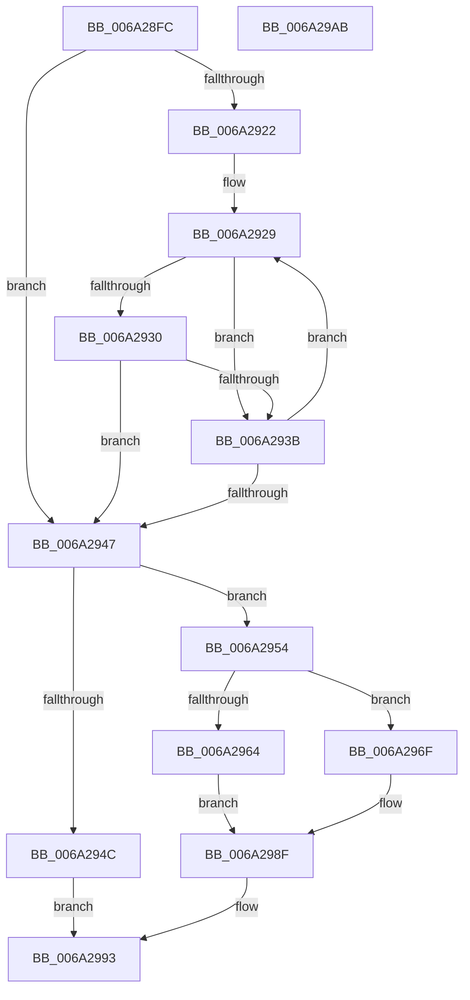

# RaspMapCharacterCodeToGlyphIndex

- RVA: `0x006A28FC`–`0x006A29AC` (길이 `176` bytes)
- VA: `0x00000001406A28FC`
- 실행 섹션: `.text`
- PDB 이름 있음: `예`; PDB Function 태그: `아니요`
- unwind 정보 RVA: `0x0007AE6C`
- 디코드: `52`개 명령, `176/176` bytes 표시
- 미해석 바이트: `0` (있으면 어셈블리에 `.byte`로 보존)

> 이 문서는 커널 이미지의 기계어와 PDB 기호를 분석해 생성했습니다. 4번과 5번은 함수 원형과 자료형을 바이너리 사용 방식에서 추정한 C 해석이며 원본 소스 복구 결과는 아닙니다.

## 1. Dependencies

- 직접 호출 지점: **0**; 고유 호출 대상: **0**
- 직접 호출자로 확인된 함수: **1**
- RIP 상대 이미지 참조: **0**

### Outgoing calls
- 직접 디코드된 call 명령이 없습니다.

### Direct callers
- [RaspGetUnscaledGlyphData](RaspGetUnscaledGlyphData_function_006A1E84.md) at `0x006A1EBB`

### Static image references
- 디코드된 RIP-relative 메모리 참조가 없습니다.

## 2. Other-region calls and transfers

- 다른 실행 섹션으로 향하는 call: **0**
- 별도 외부 분기/꼬리 이동을 확인하지 못했습니다.

## 3. Assembly (complete function range)

```asm
006A28FC  48 8B C4                        mov rax, rsp
006A28FF  48 89 58 08                     mov qword ptr [rax + 8], rbx
006A2903  48 89 70 10                     mov qword ptr [rax + 0x10], rsi
006A2907  48 89 78 18                     mov qword ptr [rax + 0x18], rdi
006A290B  4C 89 70 20                     mov qword ptr [rax + 0x20], r14
006A290F  45 33 D2                        xor r10d, r10d
006A2912  44 0F B7 CA                     movzx r9d, dx
006A2916  8B 11                           mov edx, dword ptr [rcx]
006A2918  48 8B D9                        mov rbx, rcx
006A291B  45 8B DA                        mov r11d, r10d
006A291E  85 D2                           test edx, edx
006A2920  74 25                           je 0x1406a2947
006A2922  48 8B 79 10                     mov rdi, qword ptr [rcx + 0x10]
006A2926  41 8B CA                        mov ecx, r10d
006A2929  66 44 39 0C 39                  cmp word ptr [rcx + rdi], r9w
006A292E  77 0B                           ja 0x1406a293b
006A2930  48 8B 43 18                     mov rax, qword ptr [rbx + 0x18]
006A2934  66 44 3B 0C 01                  cmp r9w, word ptr [rcx + rax]
006A2939  76 0C                           jbe 0x1406a2947
006A293B  41 FF C3                        inc r11d
006A293E  48 83 C1 02                     add rcx, 2
006A2942  44 3B DA                        cmp r11d, edx
006A2945  72 E2                           jb 0x1406a2929
006A2947  44 3B DA                        cmp r11d, edx
006A294A  75 08                           jne 0x1406a2954
006A294C  41 BA 01 00 00 C0               mov r10d, 0xc0000001
006A2952  EB 3F                           jmp 0x1406a2993
006A2954  48 8B 73 28                     mov rsi, qword ptr [rbx + 0x28]
006A2958  41 8B FB                        mov edi, r11d
006A295B  0F B7 14 7E                     movzx edx, word ptr [rsi + rdi*2]
006A295F  66 85 D2                        test dx, dx
006A2962  75 0B                           jne 0x1406a296f
006A2964  48 8B 43 20                     mov rax, qword ptr [rbx + 0x20]
006A2968  66 44 03 0C 78                  add r9w, word ptr [rax + rdi*2]
006A296D  EB 20                           jmp 0x1406a298f
006A296F  48 8B 43 10                     mov rax, qword ptr [rbx + 0x10]
006A2973  D1 EA                           shr edx, 1
006A2975  0F B7 0C 78                     movzx ecx, word ptr [rax + rdi*2]
006A2979  2B D1                           sub edx, ecx
006A297B  48 8B 4B 20                     mov rcx, qword ptr [rbx + 0x20]
006A297F  41 03 D3                        add edx, r11d
006A2982  41 03 D1                        add edx, r9d
006A2985  44 0F B7 0C 56                  movzx r9d, word ptr [rsi + rdx*2]
006A298A  66 44 03 0C 79                  add r9w, word ptr [rcx + rdi*2]
006A298F  66 45 89 08                     mov word ptr [r8], r9w
006A2993  48 8B 5C 24 08                  mov rbx, qword ptr [rsp + 8]
006A2998  41 8B C2                        mov eax, r10d
006A299B  48 8B 74 24 10                  mov rsi, qword ptr [rsp + 0x10]
006A29A0  48 8B 7C 24 18                  mov rdi, qword ptr [rsp + 0x18]
006A29A5  4C 8B 74 24 20                  mov r14, qword ptr [rsp + 0x20]
006A29AA  C3                              ret
006A29AB  CC                              int3
```

## 4. C-style interpretation (structured pseudocode)

```c
__int64 __fastcall RaspMapCharacterCodeToGlyphIndex(__int64 a1, unsigned __int16 a2, __int64 a3)
{
    __int64 v_r10;
    __int64 v_r11;
    unsigned __int64 v_stack_p10;
    unsigned __int64 v_stack_p18;
    unsigned __int64 v_stack_p20;
    unsigned __int64 v_stack_p8;

    *(unsigned __int64 *)(v_rsp + 8) = v_rbx;
    *(unsigned __int64 *)(v_rsp + 16) = v_rsi;
    *(unsigned __int64 *)(v_rsp + 24) = v_rdi;
    *(unsigned __int64 *)(v_rsp + 32) = v_r14;
    v_r10 = 0;
    if ((unsigned int)((unsigned int)(*(unsigned int *)(a1))) == 0) goto loc_006A2947;
loc_006A2929:
    if ((*(unsigned __int16 *)(0 + *(unsigned __int64 *)(a1 + 16) * 1)) > a2) goto loc_006A293B;
    if (a2 <= (*(unsigned __int16 *)(0 + *(unsigned __int64 *)(a1 + 24) * 1))) goto loc_006A2947;
loc_006A293B:
    v_r11 = (unsigned int)((0) + 1);
    a1 = (0) + (2);
    if (((unsigned int)(v_r11)) < ((unsigned int)((unsigned int)(*(unsigned int *)(a1))))) goto loc_006A2929;
loc_006A2947:
    if (((unsigned int)(v_r11)) != ((unsigned int)((unsigned int)(*(unsigned int *)(a1))))) goto loc_006A2954;
    goto loc_006A2993;
loc_006A2954:
    if ((unsigned __int16)(*(unsigned __int16 *)(*(unsigned __int64 *)(a1 + 40) + (unsigned int)((unsigned int)(v_r11)) * 2)) != 0) goto loc_006A296F;
    a4 = (unsigned __int16)((a2) + (*(unsigned __int16 *)(*(unsigned __int64 *)(a1 + 32) + (unsigned int)((unsigned int)(v_r11)) * 2)));
    goto loc_006A298F;
loc_006A296F:
    a2 = (unsigned int)((*(unsigned __int16 *)(*(unsigned __int64 *)(a1 + 40) + (unsigned int)((unsigned int)(v_r11)) * 2)) >> (1));
    a2 = (unsigned int)((a2) - ((unsigned int)(*(unsigned __int16 *)(*(unsigned __int64 *)(a1 + 16) + (unsigned int)((unsigned int)(v_r11)) * 2))));
    a2 = (unsigned int)((a2) + ((unsigned int)(v_r11)));
    a2 = (unsigned int)((a2) + ((unsigned int)(a4)));
    a4 = (unsigned __int16)((*(unsigned __int16 *)(*(unsigned __int64 *)(a1 + 40) + a2 * 2)) + (*(unsigned __int16 *)(*(unsigned __int64 *)(a1 + 32) + (unsigned int)((unsigned int)(v_r11)) * 2)));
loc_006A298F:
    *(unsigned __int16 *)(a3) = (unsigned __int16)(a4);
loc_006A2993:
    return (unsigned int)((unsigned int)((unsigned int)(0xC0000001ULL)));
}
```

## 5. (Beta) C Style

```c
int64_t RaspMapCharacterCodeToGlyphIndex(void *Arg1, uint16_t Arg2, void *Arg3)
{
    uint8_t *arg1 = (uint8_t *)Arg1;
    uint8_t *arg3 = (uint8_t *)Arg3;

    int64_t local_r10;
    int64_t local_r11;
    uint64_t v_stack_p10;
    uint64_t v_stack_p18;
    uint64_t v_stack_p20;
    uint64_t v_stack_p8;

    *(uint64_t *)(local_rsp + 0x8) = local_rbx;
    *(uint64_t *)(local_rsp + 0x10) = local_rsi;
    *(uint64_t *)(local_rsp + 0x18) = local_rdi;
    *(uint64_t *)(local_rsp + 0x20) = local_r14;
    local_r10 = 0;
    if ((uint32_t)((uint32_t)(*(uint32_t *)(arg1))) == 0) goto loc_006A2947;
loc_006A2929:
    if ((*(uint16_t *)(0 + *(uint64_t *)(arg1 + 0x10) * 1)) > Arg2) goto loc_006A293B;
    if (Arg2 <= (*(uint16_t *)(0 + *(uint64_t *)(arg1 + 0x18) * 1))) goto loc_006A2947;
loc_006A293B:
    local_r11 = (uint32_t)((0) + 1);
    Arg1 = (0) + (2);
    if (((uint32_t)(local_r11)) < ((uint32_t)((uint32_t)(*(uint32_t *)(arg1))))) goto loc_006A2929;
loc_006A2947:
    if (((uint32_t)(local_r11)) != ((uint32_t)((uint32_t)(*(uint32_t *)(arg1))))) goto loc_006A2954;
    goto loc_006A2993;
loc_006A2954:
    if ((uint16_t)(*(uint16_t *)(*(uint64_t *)(arg1 + 0x28) + (uint32_t)((uint32_t)(local_r11)) * 2)) != 0) goto loc_006A296F;
    a4 = (uint16_t)((Arg2) + (*(uint16_t *)(*(uint64_t *)(arg1 + 0x20) + (uint32_t)((uint32_t)(local_r11)) * 2)));
    goto loc_006A298F;
loc_006A296F:
    Arg2 = (uint32_t)((*(uint16_t *)(*(uint64_t *)(arg1 + 0x28) + (uint32_t)((uint32_t)(local_r11)) * 2)) >> (1));
    Arg2 = (uint32_t)((Arg2) - ((uint32_t)(*(uint16_t *)(*(uint64_t *)(arg1 + 0x10) + (uint32_t)((uint32_t)(local_r11)) * 2))));
    Arg2 = (uint32_t)((Arg2) + ((uint32_t)(local_r11)));
    Arg2 = (uint32_t)((Arg2) + ((uint32_t)(a4)));
    a4 = (uint16_t)((*(uint16_t *)(*(uint64_t *)(arg1 + 0x28) + Arg2 * 2)) + (*(uint16_t *)(*(uint64_t *)(arg1 + 0x20) + (uint32_t)((uint32_t)(local_r11)) * 2)));
loc_006A298F:
    *(uint16_t *)(arg3) = (uint16_t)(a4);
loc_006A2993:
    return (uint32_t)((uint32_t)((uint32_t)(0xC0000001ULL)));
}
```

### 관측된 메모리 오프셋

구조체 형식이 확인되지 않은 접근은 인자 기준의 오프셋으로만 기록했습니다.

| 기준 인자 | 오프셋 표현 | 폭 (bit) | 접근 |
|---|---:|---:|---|
| `Arg1` | `+ 0x0` | `32` | `R` |
| `Arg1` | `+ 0x10` | `64` | `R` |
| `Arg1` | `+ 0x18` | `64` | `R` |
| `Arg1` | `+ 0x20` | `64` | `R` |
| `Arg1` | `+ 0x28` | `64` | `R` |
| `Arg3` | `+ 0x0` | `16` | `W` |

## 6. Execution-region graph

[열기: 2D/3D 그래프와 함수 탐색 컨트롤 패널](../../../control-panel.html?section=text&rva=0x006A28FC&view=graph)

- 2D 그래프는 위에서 아래로 흐르고, 3D 그래프는 빈 공간을 드래그해 회전합니다. Shift+드래그는 이동, 휠은 확대·축소, 함수 노드 선택은 대상 보고서 이동입니다.

### Static fallback


