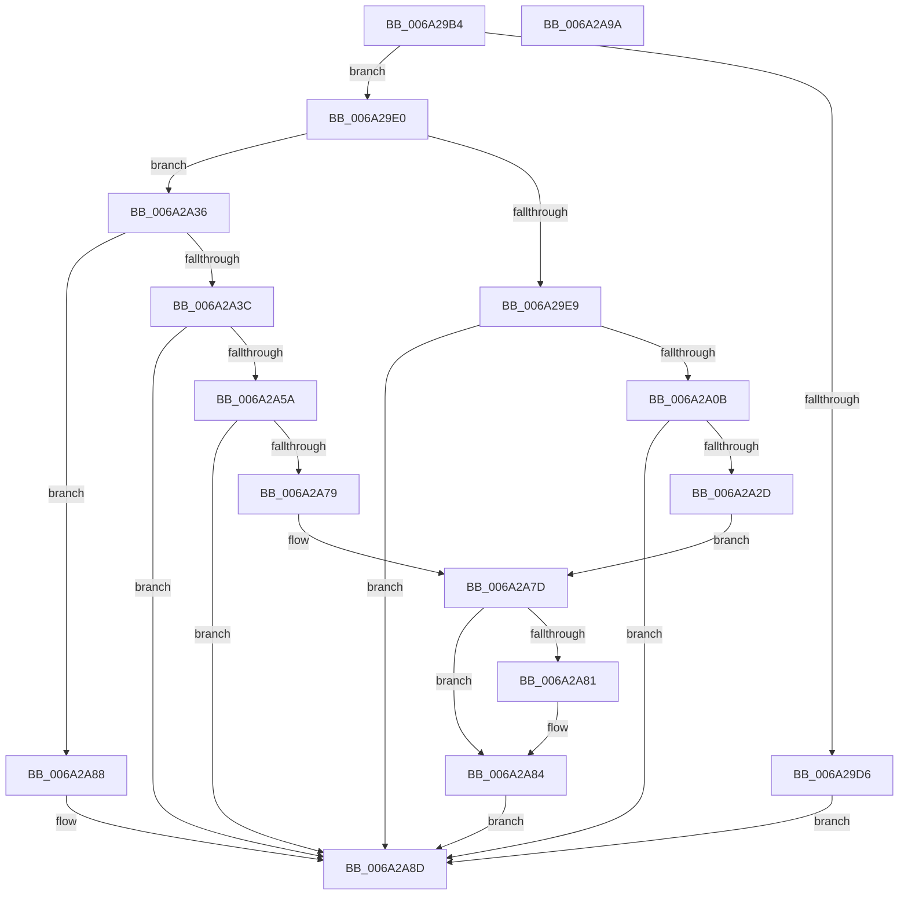

# RaspMapGlyphIndexToLocation

- RVA: `0x006A29B4`–`0x006A2A9B` (길이 `231` bytes)
- VA: `0x00000001406A29B4`
- 실행 섹션: `.text`
- PDB 이름 있음: `예`; PDB Function 태그: `아니요`
- unwind 정보 RVA: `0x000BEE74`
- 디코드: `73`개 명령, `231/231` bytes 표시
- 미해석 바이트: `0` (있으면 어셈블리에 `.byte`로 보존)

> 이 문서는 커널 이미지의 기계어와 PDB 기호를 분석해 생성했습니다. 4번과 5번은 함수 원형과 자료형을 바이너리 사용 방식에서 추정한 C 해석이며 원본 소스 복구 결과는 아닙니다.

## 1. Dependencies

- 직접 호출 지점: **4**; 고유 호출 대상: **2**
- 직접 호출자로 확인된 함수: **2**
- RIP 상대 이미지 참조: **0**

### Outgoing calls
- `0x006A29FE` → [FioFwReadUshortAtOffset](../4F/FioFwReadUshortAtOffset_function_004F98A0.md) (function, `0x004F98A0`)
- `0x006A2A24` → [FioFwReadUshortAtOffset](../4F/FioFwReadUshortAtOffset_function_004F98A0.md) (function, `0x004F98A0`)
- `0x006A2A51` → [FioFwReadUlongAtOffset](FioFwReadUlongAtOffset_function_006A2BB4.md) (function, `0x006A2BB4`)
- `0x006A2A70` → [FioFwReadUlongAtOffset](FioFwReadUlongAtOffset_function_006A2BB4.md) (function, `0x006A2BB4`)

### Direct callers
- [RaspGetCompositeGlyphList](RaspGetCompositeGlyphList_function_006A1B54.md) at `0x006A1D8E`
- [RaspGetUnscaledGlyphData](RaspGetUnscaledGlyphData_function_006A1E84.md) at `0x006A1ED5`
- [RaspGetUnscaledGlyphData](RaspGetUnscaledGlyphData_function_006A1E84.md) at `0x006A1EED`

### Static image references
- 디코드된 RIP-relative 메모리 참조가 없습니다.

## 2. Other-region calls and transfers

- 다른 실행 섹션으로 향하는 call: **0**
- 별도 외부 분기/꼬리 이동을 확인하지 못했습니다.

## 3. Assembly (complete function range)

```asm
006A29B4  48 89 5C 24 10                  mov qword ptr [rsp + 0x10], rbx
006A29B9  55                              push rbp
006A29BA  56                              push rsi
006A29BB  57                              push rdi
006A29BC  48 83 EC 20                     sub rsp, 0x20
006A29C0  33 ED                           xor ebp, ebp
006A29C2  49 8B D8                        mov rbx, r8
006A29C5  89 6C 24 58                     mov dword ptr [rsp + 0x58], ebp
006A29C9  48 8B F9                        mov rdi, rcx
006A29CC  66 89 6C 24 40                  mov word ptr [rsp + 0x40], bp
006A29D1  48 85 C9                        test rcx, rcx
006A29D4  75 0A                           jne 0x1406a29e0
006A29D6  B8 01 00 00 C0                  mov eax, 0xc0000001
006A29DB  E9 AD 00 00 00                  jmp 0x1406a2a8d
006A29E0  0F B7 41 4C                     movzx eax, word ptr [rcx + 0x4c]
006A29E4  66 85 C0                        test ax, ax
006A29E7  75 4D                           jne 0x1406a2a36
006A29E9  8B 41 48                        mov eax, dword ptr [rcx + 0x48]
006A29EC  4C 8D 44 24 40                  lea r8, [rsp + 0x40]
006A29F1  48 8B 49 10                     mov rcx, qword ptr [rcx + 0x10]
006A29F5  8D 34 50                        lea esi, [rax + rdx*2]
006A29F8  48 8B 49 10                     mov rcx, qword ptr [rcx + 0x10]
006A29FC  8B D6                           mov edx, esi
006A29FE  E8 9D 6E E5 FF                  call 0x1404f98a0
006A2A03  85 C0                           test eax, eax
006A2A05  0F 88 82 00 00 00               js 0x1406a2a8d
006A2A0B  48 8B 4F 10                     mov rcx, qword ptr [rdi + 0x10]
006A2A0F  8D 56 02                        lea edx, [rsi + 2]
006A2A12  0F B7 44 24 40                  movzx eax, word ptr [rsp + 0x40]
006A2A17  4C 8D 44 24 40                  lea r8, [rsp + 0x40]
006A2A1C  03 C0                           add eax, eax
006A2A1E  89 03                           mov dword ptr [rbx], eax
006A2A20  48 8B 49 10                     mov rcx, qword ptr [rcx + 0x10]
006A2A24  E8 77 6E E5 FF                  call 0x1404f98a0
006A2A29  85 C0                           test eax, eax
006A2A2B  78 60                           js 0x1406a2a8d
006A2A2D  0F B7 44 24 40                  movzx eax, word ptr [rsp + 0x40]
006A2A32  03 C0                           add eax, eax
006A2A34  EB 47                           jmp 0x1406a2a7d
006A2A36  66 83 F8 01                     cmp ax, 1
006A2A3A  75 4C                           jne 0x1406a2a88
006A2A3C  8B 41 48                        mov eax, dword ptr [rcx + 0x48]
006A2A3F  4C 8D 44 24 58                  lea r8, [rsp + 0x58]
006A2A44  48 8B 49 10                     mov rcx, qword ptr [rcx + 0x10]
006A2A48  8D 34 90                        lea esi, [rax + rdx*4]
006A2A4B  48 8B 49 10                     mov rcx, qword ptr [rcx + 0x10]
006A2A4F  8B D6                           mov edx, esi
006A2A51  E8 5E 01 00 00                  call 0x1406a2bb4
006A2A56  85 C0                           test eax, eax
006A2A58  78 33                           js 0x1406a2a8d
006A2A5A  48 8B 4F 10                     mov rcx, qword ptr [rdi + 0x10]
006A2A5E  8D 56 04                        lea edx, [rsi + 4]
006A2A61  8B 44 24 58                     mov eax, dword ptr [rsp + 0x58]
006A2A65  4C 8D 44 24 58                  lea r8, [rsp + 0x58]
006A2A6A  89 03                           mov dword ptr [rbx], eax
006A2A6C  48 8B 49 10                     mov rcx, qword ptr [rcx + 0x10]
006A2A70  E8 3F 01 00 00                  call 0x1406a2bb4
006A2A75  85 C0                           test eax, eax
006A2A77  78 14                           js 0x1406a2a8d
006A2A79  8B 44 24 58                     mov eax, dword ptr [rsp + 0x58]
006A2A7D  39 03                           cmp dword ptr [rbx], eax
006A2A7F  75 03                           jne 0x1406a2a84
006A2A81  83 0B FF                        or dword ptr [rbx], 0xffffffff
006A2A84  33 C0                           xor eax, eax
006A2A86  EB 05                           jmp 0x1406a2a8d
006A2A88  B8 7B 00 00 C0                  mov eax, 0xc000007b
006A2A8D  48 8B 5C 24 48                  mov rbx, qword ptr [rsp + 0x48]
006A2A92  48 83 C4 20                     add rsp, 0x20
006A2A96  5F                              pop rdi
006A2A97  5E                              pop rsi
006A2A98  5D                              pop rbp
006A2A99  C3                              ret
006A2A9A  CC                              int3
```

## 4. C-style interpretation (structured pseudocode)

```c
__int64 __fastcall RaspMapGlyphIndexToLocation(__int64 a1, __int64 a2, __int64 a3)
{
    __int64 result;
    __int64 v_rbp;
    __int64 v_rsp;
    unsigned __int64 v_stack_p10;
    unsigned int v_stack_p20;
    unsigned __int16 v_stack_p8;

    v_stack_p10 = v_rbx;
    v_rsp = (v_rsp) - (32);
    v_rbp = 0;
    v_stack_p20 = 0;
    v_stack_p8 = 0;
    if (a1 != 0) goto loc_006A29E0;
    goto loc_006A2A8D;
loc_006A29E0:
    if ((unsigned __int16)(*(unsigned __int16 *)(a1 + 76)) != 0) goto loc_006A2A36;
    result = FioFwReadUshortAtOffset(*(unsigned __int64 *)(*(unsigned __int64 *)(a1 + 16) + 16), (unsigned int)((unsigned int)((unsigned int)(*(unsigned int *)(a1 + 72)) + a2 * 2)), v_stack_p8, a4);
    if (sign_flag) goto loc_006A2A8D;
    result = (unsigned int)((v_stack_p8) + ((unsigned int)(v_stack_p8)));
    *(unsigned int *)(a3) = (unsigned int)(result);
    result = FioFwReadUshortAtOffset(*(unsigned __int64 *)(*(unsigned __int64 *)(a1 + 16) + 16), (unsigned int)(*(unsigned int *)(a1 + 72)) + a2 * 2 + 2, v_stack_p8, a4);
    if (sign_flag) goto loc_006A2A8D;
    result = (unsigned int)((v_stack_p8) + ((unsigned int)(v_stack_p8)));
    goto loc_006A2A7D;
loc_006A2A36:
    if (((unsigned __int16)(result)) != 1) goto loc_006A2A88;
    result = FioFwReadUlongAtOffset(*(unsigned __int64 *)(*(unsigned __int64 *)(*(unsigned __int64 *)(*(unsigned __int64 *)(a1 + 16) + 16) + 16) + 16), (unsigned int)((unsigned int)((unsigned int)(*(unsigned int *)(*(unsigned __int64 *)(*(unsigned __int64 *)(a1 + 16) + 16) + 72)) + (unsigned int)(*(unsigned int *)(a1 + 72)) + a2 * 2 + 2 * 4)), v_stack_p20, a4);
    if (sign_flag) goto loc_006A2A8D;
    *(unsigned int *)(a3) = (unsigned int)((unsigned int)(v_stack_p20));
    result = FioFwReadUlongAtOffset(*(unsigned __int64 *)(*(unsigned __int64 *)(a1 + 16) + 16), (unsigned int)(*(unsigned int *)(*(unsigned __int64 *)(*(unsigned __int64 *)(a1 + 16) + 16) + 72)) + (unsigned int)(*(unsigned int *)(a1 + 72)) + a2 * 2 + 2 * 4 + 4, v_stack_p20, a4);
    if (sign_flag) goto loc_006A2A8D;
loc_006A2A7D:
    if ((*(unsigned int *)(a3)) == ((unsigned int)((unsigned int)(v_stack_p20)))) {
    }
    result = 0;
    goto loc_006A2A8D;
loc_006A2A88:
loc_006A2A8D:
    v_rsp = (v_rsp) + (32);
    return (unsigned int)(0xC000007BULL);
}
```

## 5. (Beta) C Style

```c
int64_t RaspMapGlyphIndexToLocation(void *Arg1, int64_t Arg2, void *Arg3)
{
    uint8_t *arg1 = (uint8_t *)Arg1;
    uint8_t *arg3 = (uint8_t *)Arg3;

    int64_t result;
    int64_t local_rbp;
    int64_t local_rsp;
    uint64_t v_stack_p10;
    uint32_t v_stack_p20;
    uint16_t v_stack_p8;

    v_stack_p10 = local_rbx;
    local_rsp = (local_rsp) - (32);
    local_rbp = 0;
    v_stack_p20 = 0;
    v_stack_p8 = 0;
    if (Arg1 != NULL) goto loc_006A29E0;
    goto loc_006A2A8D;
loc_006A29E0:
    if ((uint16_t)(*(uint16_t *)(arg1 + 0x4C)) != 0) goto loc_006A2A36;
    result = FioFwReadUshortAtOffset(*(uint64_t *)(*(uint64_t *)(arg1 + 0x10) + 0x10), (uint32_t)((uint32_t)((uint32_t)(*(uint32_t *)(arg1 + 0x48)) + Arg2 * 2)), v_stack_p8, a4);
    if (sign_flag) goto loc_006A2A8D;
    result = (uint32_t)((v_stack_p8) + ((uint32_t)(v_stack_p8)));
    *(uint32_t *)(arg3) = (uint32_t)(result);
    result = FioFwReadUshortAtOffset(*(uint64_t *)(*(uint64_t *)(arg1 + 0x10) + 0x10), (uint32_t)(*(uint32_t *)(arg1 + 0x48)) + Arg2 * 2 + 2, v_stack_p8, a4);
    if (sign_flag) goto loc_006A2A8D;
    result = (uint32_t)((v_stack_p8) + ((uint32_t)(v_stack_p8)));
    goto loc_006A2A7D;
loc_006A2A36:
    if (((uint16_t)(result)) != 1) goto loc_006A2A88;
    result = FioFwReadUlongAtOffset(*(uint64_t *)(*(uint64_t *)(*(uint64_t *)(*(uint64_t *)(arg1 + 0x10) + 0x10) + 0x10) + 0x10), (uint32_t)((uint32_t)((uint32_t)(*(uint32_t *)(*(uint64_t *)(*(uint64_t *)(arg1 + 0x10) + 0x10) + 0x48)) + (uint32_t)(*(uint32_t *)(arg1 + 0x48)) + Arg2 * 2 + 2 * 4)), v_stack_p20, a4);
    if (sign_flag) goto loc_006A2A8D;
    *(uint32_t *)(arg3) = (uint32_t)((uint32_t)(v_stack_p20));
    result = FioFwReadUlongAtOffset(*(uint64_t *)(*(uint64_t *)(arg1 + 0x10) + 0x10), (uint32_t)(*(uint32_t *)(*(uint64_t *)(*(uint64_t *)(arg1 + 0x10) + 0x10) + 0x48)) + (uint32_t)(*(uint32_t *)(arg1 + 0x48)) + Arg2 * 2 + 2 * 4 + 4, v_stack_p20, a4);
    if (sign_flag) goto loc_006A2A8D;
loc_006A2A7D:
    if ((*(uint32_t *)(arg3)) == ((uint32_t)((uint32_t)(v_stack_p20)))) {
    }
    result = 0;
    goto loc_006A2A8D;
loc_006A2A88:
loc_006A2A8D:
    local_rsp = (local_rsp) + (32);
    return (uint32_t)(0xC000007BULL);
}
```

### 관측된 메모리 오프셋

구조체 형식이 확인되지 않은 접근은 인자 기준의 오프셋으로만 기록했습니다.

| 기준 인자 | 오프셋 표현 | 폭 (bit) | 접근 |
|---|---:|---:|---|
| `Arg1` | `+ 0x10` | `64` | `R` |
| `Arg3` | `+ 0x0` | `32` | `R` |
| `Arg3` | `+ 0x0` | `32` | `R/W` |
| `Arg3` | `+ 0x0` | `32` | `W` |

## 6. Execution-region graph

[열기: 2D/3D 그래프와 함수 탐색 컨트롤 패널](../../../control-panel.html?section=text&rva=0x006A29B4&view=graph)

- 2D 그래프는 위에서 아래로 흐르고, 3D 그래프는 빈 공간을 드래그해 회전합니다. Shift+드래그는 이동, 휠은 확대·축소, 함수 노드 선택은 대상 보고서 이동입니다.

### Static fallback


