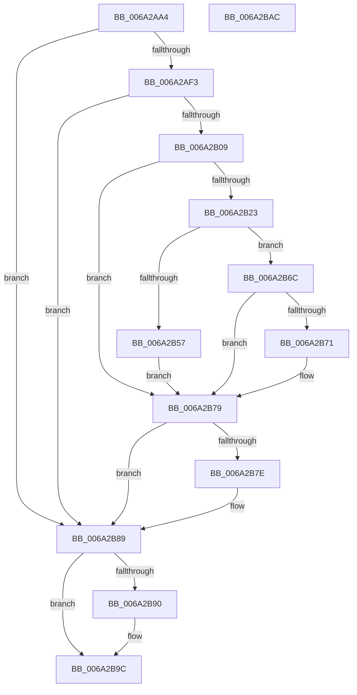

# RaspRasterize

- RVA: `0x006A2AA4`–`0x006A2BAD` (길이 `265` bytes)
- VA: `0x00000001406A2AA4`
- 실행 섹션: `.text`
- PDB 이름 있음: `예`; PDB Function 태그: `아니요`
- unwind 정보 RVA: `0x000DA694`
- 디코드: `78`개 명령, `265/265` bytes 표시
- 미해석 바이트: `0` (있으면 어셈블리에 `.byte`로 보존)

> 이 문서는 커널 이미지의 기계어와 PDB 기호를 분석해 생성했습니다. 4번과 5번은 함수 원형과 자료형을 바이너리 사용 방식에서 추정한 C 해석이며 원본 소스 복구 결과는 아닙니다.

## 1. Dependencies

- 직접 호출 지점: **7**; 고유 호출 대상: **5**
- 직접 호출자로 확인된 함수: **2**
- RIP 상대 이미지 참조: **0**

### Outgoing calls
- `0x006A2AE4` → [RaspGetUnscaledGlyphData](RaspGetUnscaledGlyphData_function_006A1E84.md) (function, `0x006A1E84`)
- `0x006A2AFA` → [RaspScaleCoordinates](../4C/RaspScaleCoordinates_function_004C9CC8.md) (function, `0x004C9CC8`)
- `0x006A2B14` → [RaspCreatePointList](RaspCreatePointList_function_006A1A24.md) (function, `0x006A1A24`)
- `0x006A2B48` → [RaspScanConvert](../3E/RaspScanConvert_function_003E3760.md) (function, `0x003E3760`)
- `0x006A2B74` → [RaspFreeMemory](../3E/RaspFreeMemory_function_003E28E4.md) (function, `0x003E28E4`)
- `0x006A2B84` → [RaspFreeMemory](../3E/RaspFreeMemory_function_003E28E4.md) (function, `0x003E28E4`)
- `0x006A2B97` → [RaspFreeMemory](../3E/RaspFreeMemory_function_003E28E4.md) (function, `0x003E28E4`)

### Direct callers
- [BgpRasPrintGlyph](../47/BgpRasPrintGlyph_function_0047F3B4.md) at `0x0047F527`
- [RaspGetXExtent](RaspGetXExtent_function_006A1F7C.md) at `0x006A2055`

### Static image references
- 디코드된 RIP-relative 메모리 참조가 없습니다.

## 2. Other-region calls and transfers

- 다른 실행 섹션으로 향하는 call: **0**
- 별도 외부 분기/꼬리 이동을 확인하지 못했습니다.

## 3. Assembly (complete function range)

```asm
006A2AA4  48 89 5C 24 10                  mov qword ptr [rsp + 0x10], rbx
006A2AA9  44 89 4C 24 20                  mov dword ptr [rsp + 0x20], r9d
006A2AAE  55                              push rbp
006A2AAF  57                              push rdi
006A2AB0  41 56                           push r14
006A2AB2  48 8B EC                        mov rbp, rsp
006A2AB5  48 83 EC 50                     sub rsp, 0x50
006A2AB9  48 8B 7D 60                     mov rdi, qword ptr [rbp + 0x60]
006A2ABD  4C 8D 4D 38                     lea r9, [rbp + 0x38]
006A2AC1  83 65 38 00                     and dword ptr [rbp + 0x38], 0
006A2AC5  4C 8D 45 20                     lea r8, [rbp + 0x20]
006A2AC9  48 83 65 F0 00                  and qword ptr [rbp - 0x10], 0
006A2ACE  4C 8B F1                        mov r14, rcx
006A2AD1  48 8B 49 08                     mov rcx, qword ptr [rcx + 8]
006A2AD5  48 83 65 F8 00                  and qword ptr [rbp - 8], 0
006A2ADA  48 83 65 20 00                  and qword ptr [rbp + 0x20], 0
006A2ADF  48 89 7C 24 20                  mov qword ptr [rsp + 0x20], rdi
006A2AE4  E8 9B F3 FF FF                  call 0x1406a1e84
006A2AE9  8B D8                           mov ebx, eax
006A2AEB  85 C0                           test eax, eax
006A2AED  0F 88 96 00 00 00               js 0x1406a2b89
006A2AF3  48 8B 55 20                     mov rdx, qword ptr [rbp + 0x20]
006A2AF7  49 8B CE                        mov rcx, r14
006A2AFA  E8 C9 71 E2 FF                  call 0x1404c9cc8
006A2AFF  8B D8                           mov ebx, eax
006A2B01  85 C0                           test eax, eax
006A2B03  0F 88 80 00 00 00               js 0x1406a2b89
006A2B09  48 8B 4D 20                     mov rcx, qword ptr [rbp + 0x20]
006A2B0D  48 8D 55 F8                     lea rdx, [rbp - 8]
006A2B11  4C 8B C7                        mov r8, rdi
006A2B14  E8 0B EF FF FF                  call 0x1406a1a24
006A2B19  4C 8B 75 F8                     mov r14, qword ptr [rbp - 8]
006A2B1D  8B D8                           mov ebx, eax
006A2B1F  85 C0                           test eax, eax
006A2B21  78 56                           js 0x1406a2b79
006A2B23  48 8B 45 58                     mov rax, qword ptr [rbp + 0x58]
006A2B27  49 8B D6                        mov rdx, r14
006A2B2A  48 8B 4D 20                     mov rcx, qword ptr [rbp + 0x20]
006A2B2E  48 89 7C 24 38                  mov qword ptr [rsp + 0x38], rdi
006A2B33  48 89 44 24 30                  mov qword ptr [rsp + 0x30], rax
006A2B38  48 8D 45 F0                     lea rax, [rbp - 0x10]
006A2B3C  48 89 44 24 28                  mov qword ptr [rsp + 0x28], rax
006A2B41  8B 45 40                        mov eax, dword ptr [rbp + 0x40]
006A2B44  89 44 24 20                     mov dword ptr [rsp + 0x20], eax
006A2B48  E8 13 0C D4 FF                  call 0x1403e3760
006A2B4D  48 8B 4D F0                     mov rcx, qword ptr [rbp - 0x10]
006A2B51  8B D8                           mov ebx, eax
006A2B53  85 C0                           test eax, eax
006A2B55  78 15                           js 0x1406a2b6c
006A2B57  48 8B 45 48                     mov rax, qword ptr [rbp + 0x48]
006A2B5B  8B 51 04                        mov edx, dword ptr [rcx + 4]
006A2B5E  C1 EA 02                        shr edx, 2
006A2B61  48 89 08                        mov qword ptr [rax], rcx
006A2B64  48 8B 45 50                     mov rax, qword ptr [rbp + 0x50]
006A2B68  89 10                           mov dword ptr [rax], edx
006A2B6A  EB 0D                           jmp 0x1406a2b79
006A2B6C  48 85 C9                        test rcx, rcx
006A2B6F  74 08                           je 0x1406a2b79
006A2B71  48 8B D7                        mov rdx, rdi
006A2B74  E8 6B FD D3 FF                  call 0x1403e28e4
006A2B79  4D 85 F6                        test r14, r14
006A2B7C  74 0B                           je 0x1406a2b89
006A2B7E  48 8B D7                        mov rdx, rdi
006A2B81  49 8B CE                        mov rcx, r14
006A2B84  E8 5B FD D3 FF                  call 0x1403e28e4
006A2B89  48 83 7D 20 00                  cmp qword ptr [rbp + 0x20], 0
006A2B8E  74 0C                           je 0x1406a2b9c
006A2B90  48 8B 4D 20                     mov rcx, qword ptr [rbp + 0x20]
006A2B94  48 8B D7                        mov rdx, rdi
006A2B97  E8 48 FD D3 FF                  call 0x1403e28e4
006A2B9C  8B C3                           mov eax, ebx
006A2B9E  48 8B 5C 24 78                  mov rbx, qword ptr [rsp + 0x78]
006A2BA3  48 83 C4 50                     add rsp, 0x50
006A2BA7  41 5E                           pop r14
006A2BA9  5F                              pop rdi
006A2BAA  5D                              pop rbp
006A2BAB  C3                              ret
006A2BAC  CC                              int3
```

## 4. C-style interpretation (structured pseudocode)

```c
__int64 __fastcall RaspRasterize(__int64 a1, __int64 a2, __int64 a3, int a4, unsigned int a5, __int64 a6, __int64 a7, __int64 a8, __int64 a9)
{
    __int64 result;
    __int64 v_rsp;
    unsigned __int64 v_stack_m20;
    unsigned __int64 v_stack_m28;
    unsigned __int64 v_stack_m30;
    unsigned __int64 v_stack_m38;
    unsigned __int64 v_stack_m40;
    unsigned __int64 v_stack_m48;
    unsigned __int64 v_stack_p10;
    unsigned int v_stack_p20;
    unsigned __int64 v_stack_p8;

    v_stack_p10 = v_rbx;
    v_stack_p20 = a4;
    v_rsp = (v_rsp) - (80);
    v_stack_m48 = a9;
    result = RaspGetUnscaledGlyphData(*(unsigned __int64 *)(a1 + 8), a2, v_stack_p8, v_stack_p20);
    if (sign_flag) goto loc_006A2B89;
    result = RaspScaleCoordinates(a1, v_stack_p8, v_stack_p8, v_stack_p20);
    if (sign_flag) goto loc_006A2B89;
    result = RaspCreatePointList(v_stack_p8, v_stack_m20, a9, v_stack_p20);
    if (sign_flag) goto loc_006A2B79;
    v_stack_m30 = a9;
    v_stack_m38 = a8;
    v_stack_m40 = v_stack_m28;
    v_stack_m48 = (unsigned int)((unsigned int)(a5));
    result = RaspScanConvert(v_stack_p8, v_stack_m20, a9, v_stack_p20);
    if (sign_flag) goto loc_006A2B6C;
    a2 = (unsigned int)(((unsigned int)(*(unsigned int *)(v_stack_m28 + 4))) >> (2));
    *(unsigned __int64 *)(a6) = v_stack_m28;
    *(unsigned int *)(a7) = (unsigned int)(a2);
    goto loc_006A2B79;
loc_006A2B6C:
    result = a7;
    if (v_stack_m28 != 0) {
        a2 = a9;
        result = RaspFreeMemory(v_stack_m28, a2, a9, v_stack_p20);
    }
    if (v_stack_m20 != 0) {
        a2 = a9;
        a1 = v_stack_m20;
        result = RaspFreeMemory(a1, a2, a9, v_stack_p20);
    }
    if (v_stack_p8 != 0) {
        a1 = v_stack_p8;
        a2 = a9;
        result = RaspFreeMemory(a1, a2, a9, v_stack_p20);
    }
    v_rsp = (v_rsp) + (80);
    return (unsigned int)((unsigned int)((unsigned int)((unsigned int)(result))));
}
```

## 5. (Beta) C Style

```c
int64_t RaspRasterize(void *Arg1, int64_t Arg2, int64_t Arg3, int32_t Arg4, uint32_t Arg5, void *Arg6, void *Arg7, int64_t Arg8, int64_t Arg9)
{
    uint8_t *arg1 = (uint8_t *)Arg1;
    uint8_t *arg6 = (uint8_t *)Arg6;
    uint8_t *arg7 = (uint8_t *)Arg7;

    int64_t result;
    int64_t local_rsp;
    uint64_t v_stack_m20;
    uint64_t v_stack_m28;
    uint64_t v_stack_m30;
    uint64_t v_stack_m38;
    uint64_t v_stack_m40;
    uint64_t v_stack_m48;
    uint64_t v_stack_p10;
    uint32_t v_stack_p20;
    uint64_t v_stack_p8;

    v_stack_p10 = local_rbx;
    v_stack_p20 = Arg4;
    local_rsp = (local_rsp) - (80);
    v_stack_m48 = Arg9;
    result = RaspGetUnscaledGlyphData(*(uint64_t *)(arg1 + 0x8), Arg2, v_stack_p8, v_stack_p20);
    if (sign_flag) goto loc_006A2B89;
    result = RaspScaleCoordinates(Arg1, v_stack_p8, v_stack_p8, v_stack_p20);
    if (sign_flag) goto loc_006A2B89;
    result = RaspCreatePointList(v_stack_p8, v_stack_m20, Arg9, v_stack_p20);
    if (sign_flag) goto loc_006A2B79;
    v_stack_m30 = Arg9;
    v_stack_m38 = Arg8;
    v_stack_m40 = v_stack_m28;
    v_stack_m48 = (uint32_t)((uint32_t)(Arg5));
    result = RaspScanConvert(v_stack_p8, v_stack_m20, Arg9, v_stack_p20);
    if (sign_flag) goto loc_006A2B6C;
    Arg2 = (uint32_t)(((uint32_t)(*(uint32_t *)(v_stack_m28 + 0x4))) >> (2));
    *(uint64_t *)(arg6) = v_stack_m28;
    *(uint32_t *)(arg7) = (uint32_t)(Arg2);
    goto loc_006A2B79;
loc_006A2B6C:
    result = Arg7;
    if (v_stack_m28 != 0) {
        Arg2 = Arg9;
        result = RaspFreeMemory(v_stack_m28, Arg2, Arg9, v_stack_p20);
    }
    if (v_stack_m20 != 0) {
        Arg2 = Arg9;
        Arg1 = v_stack_m20;
        result = RaspFreeMemory(Arg1, Arg2, Arg9, v_stack_p20);
    }
    if (v_stack_p8 != 0) {
        Arg1 = v_stack_p8;
        Arg2 = Arg9;
        result = RaspFreeMemory(Arg1, Arg2, Arg9, v_stack_p20);
    }
    local_rsp = (local_rsp) + (80);
    return (uint32_t)((uint32_t)((uint32_t)((uint32_t)(result))));
}
```

### 관측된 메모리 오프셋

구조체 형식이 확인되지 않은 접근은 인자 기준의 오프셋으로만 기록했습니다.

| 기준 인자 | 오프셋 표현 | 폭 (bit) | 접근 |
|---|---:|---:|---|
| `Arg1` | `+ 0x8` | `64` | `R` |
| `Arg6` | `+ 0x0` | `64` | `W` |
| `Arg7` | `+ 0x0` | `32` | `W` |

## 6. Execution-region graph

[열기: 2D/3D 그래프와 함수 탐색 컨트롤 패널](../../../control-panel.html?section=text&rva=0x006A2AA4&view=graph)

- 2D 그래프는 위에서 아래로 흐르고, 3D 그래프는 빈 공간을 드래그해 회전합니다. Shift+드래그는 이동, 휠은 확대·축소, 함수 노드 선택은 대상 보고서 이동입니다.

### Static fallback


