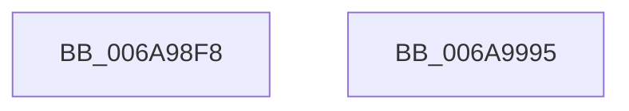

# RtlApplyImportRelocationToImage

- RVA: `0x006A98F8`–`0x006A9996` (길이 `158` bytes)
- VA: `0x00000001406A98F8`
- 실행 섹션: `.text`
- PDB 이름 있음: `예`; PDB Function 태그: `아니요`
- unwind 정보 RVA: `0x000A6434`
- 디코드: `44`개 명령, `158/158` bytes 표시
- 미해석 바이트: `0` (있으면 어셈블리에 `.byte`로 보존)

> 이 문서는 커널 이미지의 기계어와 PDB 기호를 분석해 생성했습니다. 4번과 5번은 함수 원형과 자료형을 바이너리 사용 방식에서 추정한 C 해석이며 원본 소스 복구 결과는 아닙니다.

## 1. Dependencies

- 직접 호출 지점: **3**; 고유 호출 대상: **3**
- 직접 호출자로 확인된 함수: **2**
- RIP 상대 이미지 참조: **1**

### Outgoing calls
- `0x006A9968` → [RtlpConstructImportRelocationFixup](../44/RtlpConstructImportRelocationFixup_function_0044A49C.md) (function, `0x0044A49C`)
- `0x006A997A` → [RtlpApplyGenericRetpolineFixup](../45/RtlpApplyGenericRetpolineFixup_function_0045D284.md) (function, `0x0045D284`)
- `0x006A9987` → [_security_check_cookie](_security_check_cookie_function_006AC640.md) (function, `0x006AC640`)

### Direct callers
- [RtlPerformRetpolineRelocationsOnImageEx](RtlPerformRetpolineRelocationsOnImageEx_function_006A9AD4.md) at `0x006A9C79`
- [RtlUpdateImportRelocationsInImage](RtlUpdateImportRelocationsInImage_function_006A9E1C.md) at `0x006A9FF5`

### Static image references
- `0x006A9901` → RVA `0x00E0A740` (`.data`; read)

## 2. Other-region calls and transfers

- 다른 실행 섹션으로 향하는 call: **0**
- 별도 외부 분기/꼬리 이동을 확인하지 못했습니다.

## 3. Assembly (complete function range)

```asm
006A98F8  40 53                           push rbx
006A98FA  55                              push rbp
006A98FB  56                              push rsi
006A98FC  57                              push rdi
006A98FD  48 83 EC 68                     sub rsp, 0x68
006A9901  48 8B 05 38 0E 76 00            mov rax, qword ptr [rip + 0x760e38]
006A9908  48 33 C4                        xor rax, rsp
006A990B  48 89 44 24 50                  mov qword ptr [rsp + 0x50], rax
006A9910  33 C0                           xor eax, eax
006A9912  49 8B F9                        mov rdi, r9
006A9915  4C 8B 8C 24 B8 00 00 00         mov r9, qword ptr [rsp + 0xb8]
006A991D  4D 8B D8                        mov r11, r8
006A9920  48 89 44 24 40                  mov qword ptr [rsp + 0x40], rax
006A9925  8B EA                           mov ebp, edx
006A9927  89 44 24 48                     mov dword ptr [rsp + 0x48], eax
006A992B  48 8B F1                        mov rsi, rcx
006A992E  66 89 44 24 4C                  mov word ptr [rsp + 0x4c], ax
006A9933  4C 8B C7                        mov r8, rdi
006A9936  41 8B 19                        mov ebx, dword ptr [r9]
006A9939  48 8D 44 24 40                  lea rax, [rsp + 0x40]
006A993E  48 89 44 24 30                  mov qword ptr [rsp + 0x30], rax
006A9943  81 E3 FF 0F 00 00               and ebx, 0xfff
006A9949  8B 84 24 C8 00 00 00            mov eax, dword ptr [rsp + 0xc8]
006A9950  49 8B D3                        mov rdx, r11
006A9953  03 9C 24 B0 00 00 00            add ebx, dword ptr [rsp + 0xb0]
006A995A  89 44 24 28                     mov dword ptr [rsp + 0x28], eax
006A995E  8B CB                           mov ecx, ebx
006A9960  C7 44 24 20 01 00 00 00         mov dword ptr [rsp + 0x20], 1
006A9968  E8 2F 0B DA FF                  call 0x14044a49c
006A996D  44 8B CB                        mov r9d, ebx
006A9970  4C 8D 44 24 40                  lea r8, [rsp + 0x40]
006A9975  8B D5                           mov edx, ebp
006A9977  48 8B CE                        mov rcx, rsi
006A997A  E8 05 39 DB FF                  call 0x14045d284
006A997F  48 8B 4C 24 50                  mov rcx, qword ptr [rsp + 0x50]
006A9984  48 33 CC                        xor rcx, rsp
006A9987  E8 B4 2C 00 00                  call 0x1406ac640
006A998C  48 83 C4 68                     add rsp, 0x68
006A9990  5F                              pop rdi
006A9991  5E                              pop rsi
006A9992  5D                              pop rbp
006A9993  5B                              pop rbx
006A9994  C3                              ret
006A9995  CC                              int3
```

## 4. C-style interpretation (structured pseudocode)

```c
__int64 __fastcall RtlApplyImportRelocationToImage(__int64 a1, int a2, __int64 a3, __int64 a4, unsigned int a5, __int64 a6, __int64 a7, unsigned int a8)
{
    __int64 result;
    __int64 v_rbx;
    __int64 v_rsp;
    unsigned __int64 v_stack_m38;
    unsigned __int16 v_stack_m3C;
    unsigned int v_stack_m40;
    unsigned __int64 v_stack_m48;
    unsigned __int64 v_stack_m58;
    unsigned int v_stack_m60;
    unsigned int v_stack_m68;

    v_rsp = (v_rsp) - (104);
    result = (*(unsigned __int64 *)(v_rip + 7736888)) ^ (v_rsp);
    v_stack_m38 = result;
    result = 0;
    v_stack_m48 = 0;
    v_stack_m40 = 0;
    v_stack_m3C = 0;
    v_stack_m58 = v_stack_m48;
    v_rbx = (unsigned int)(((unsigned int)(*(unsigned int *)(a6))) & (0xFFFULL));
    v_rbx = (unsigned int)((v_rbx) + (a5));
    v_stack_m60 = (unsigned int)((unsigned int)(a8));
    v_stack_m68 = 1;
    result = RtlpConstructImportRelocationFixup((unsigned int)((unsigned int)(v_rbx)), a3, a4, a6);
    result = RtlpApplyGenericRetpolineFixup(a1, (unsigned int)((unsigned int)((unsigned int)(a2))), v_stack_m48, (unsigned int)((unsigned int)(v_rbx)));
    a1 = (v_stack_m38) ^ (v_rsp);
    result = _security_check_cookie(a1, (unsigned int)((unsigned int)((unsigned int)(a2))), v_stack_m48, (unsigned int)((unsigned int)(v_rbx)));
    v_rsp = (v_rsp) + (104);
    return result;
}
```

## 5. (Beta) C Style

```c
int64_t RtlApplyImportRelocationToImage(int64_t Arg1, int32_t Arg2, int64_t Arg3, int64_t Arg4, uint32_t Arg5, void *Arg6, uint64_t Arg7, uint32_t Arg8)
{
    uint8_t *arg6 = (uint8_t *)Arg6;

    int64_t result;
    int64_t local_rbx;
    int64_t local_rsp;
    uint64_t v_stack_m38;
    uint16_t v_stack_m3C;
    uint32_t v_stack_m40;
    uint64_t v_stack_m48;
    uint64_t v_stack_m58;
    uint32_t v_stack_m60;
    uint32_t v_stack_m68;

    local_rsp = (local_rsp) - (104);
    result = (*(uint64_t *)(v_rip + 0x760E38)) ^ (local_rsp);
    v_stack_m38 = result;
    result = 0;
    v_stack_m48 = 0;
    v_stack_m40 = 0;
    v_stack_m3C = 0;
    v_stack_m58 = v_stack_m48;
    local_rbx = (uint32_t)(((uint32_t)(*(uint32_t *)(arg6))) & (0xFFFULL));
    local_rbx = (uint32_t)((local_rbx) + (Arg5));
    v_stack_m60 = (uint32_t)((uint32_t)(Arg8));
    v_stack_m68 = 1;
    result = RtlpConstructImportRelocationFixup((uint32_t)((uint32_t)(local_rbx)), Arg3, Arg4, Arg6);
    result = RtlpApplyGenericRetpolineFixup(Arg1, (uint32_t)((uint32_t)((uint32_t)(Arg2))), v_stack_m48, (uint32_t)((uint32_t)(local_rbx)));
    Arg1 = (v_stack_m38) ^ (local_rsp);
    result = _security_check_cookie(Arg1, (uint32_t)((uint32_t)((uint32_t)(Arg2))), v_stack_m48, (uint32_t)((uint32_t)(local_rbx)));
    local_rsp = (local_rsp) + (104);
    return result;
}
```

### 관측된 메모리 오프셋

구조체 형식이 확인되지 않은 접근은 인자 기준의 오프셋으로만 기록했습니다.

| 기준 인자 | 오프셋 표현 | 폭 (bit) | 접근 |
|---|---:|---:|---|
| `Arg6` | `+ 0x0` | `32` | `R` |

## 6. Execution-region graph

[열기: 2D/3D 그래프와 함수 탐색 컨트롤 패널](../../../control-panel.html?section=text&rva=0x006A98F8&view=graph)

- 2D 그래프는 위에서 아래로 흐르고, 3D 그래프는 빈 공간을 드래그해 회전합니다. Shift+드래그는 이동, 휠은 확대·축소, 함수 노드 선택은 대상 보고서 이동입니다.

### Static fallback


