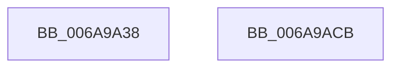

# RtlApplySwitchJumpRelocationToImage

- RVA: `0x006A9A38`–`0x006A9ACC` (길이 `148` bytes)
- VA: `0x00000001406A9A38`
- 실행 섹션: `.text`
- PDB 이름 있음: `예`; PDB Function 태그: `아니요`
- unwind 정보 RVA: `0x000A6470`
- 디코드: `42`개 명령, `148/148` bytes 표시
- 미해석 바이트: `0` (있으면 어셈블리에 `.byte`로 보존)

> 이 문서는 커널 이미지의 기계어와 PDB 기호를 분석해 생성했습니다. 4번과 5번은 함수 원형과 자료형을 바이너리 사용 방식에서 추정한 C 해석이며 원본 소스 복구 결과는 아닙니다.

## 1. Dependencies

- 직접 호출 지점: **3**; 고유 호출 대상: **3**
- 직접 호출자로 확인된 함수: **1**
- RIP 상대 이미지 참조: **1**

### Outgoing calls
- `0x006A9A9E` → [RtlpConstructSwitchJumpRelocationFixup](../4C/RtlpConstructSwitchJumpRelocationFixup_function_004CCA54.md) (function, `0x004CCA54`)
- `0x006A9AB0` → [RtlpApplyGenericRetpolineFixup](../45/RtlpApplyGenericRetpolineFixup_function_0045D284.md) (function, `0x0045D284`)
- `0x006A9ABD` → [_security_check_cookie](_security_check_cookie_function_006AC640.md) (function, `0x006AC640`)

### Direct callers
- [RtlPerformRetpolineRelocationsOnImageEx](RtlPerformRetpolineRelocationsOnImageEx_function_006A9AD4.md) at `0x006A9DE5`

### Static image references
- `0x006A9A41` → RVA `0x00E0A740` (`.data`; read)

## 2. Other-region calls and transfers

- 다른 실행 섹션으로 향하는 call: **0**
- 별도 외부 분기/꼬리 이동을 확인하지 못했습니다.

## 3. Assembly (complete function range)

```asm
006A9A38  40 53                           push rbx
006A9A3A  55                              push rbp
006A9A3B  56                              push rsi
006A9A3C  57                              push rdi
006A9A3D  48 83 EC 58                     sub rsp, 0x58
006A9A41  48 8B 05 F8 0C 76 00            mov rax, qword ptr [rip + 0x760cf8]
006A9A48  48 33 C4                        xor rax, rsp
006A9A4B  48 89 44 24 40                  mov qword ptr [rsp + 0x40], rax
006A9A50  33 C0                           xor eax, eax
006A9A52  4D 8B D8                        mov r11, r8
006A9A55  49 8B F9                        mov rdi, r9
006A9A58  48 89 44 24 30                  mov qword ptr [rsp + 0x30], rax
006A9A5D  4C 8B 8C 24 A8 00 00 00         mov r9, qword ptr [rsp + 0xa8]
006A9A65  8B EA                           mov ebp, edx
006A9A67  89 44 24 38                     mov dword ptr [rsp + 0x38], eax
006A9A6B  48 8B F1                        mov rsi, rcx
006A9A6E  66 89 44 24 3C                  mov word ptr [rsp + 0x3c], ax
006A9A73  4C 8B C7                        mov r8, rdi
006A9A76  48 8D 44 24 30                  lea rax, [rsp + 0x30]
006A9A7B  49 8B D3                        mov rdx, r11
006A9A7E  41 0F B7 19                     movzx ebx, word ptr [r9]
006A9A82  48 89 44 24 28                  mov qword ptr [rsp + 0x28], rax
006A9A87  81 E3 FF 0F 00 00               and ebx, 0xfff
006A9A8D  03 9C 24 A0 00 00 00            add ebx, dword ptr [rsp + 0xa0]
006A9A94  8B CB                           mov ecx, ebx
006A9A96  C7 44 24 20 01 00 00 00         mov dword ptr [rsp + 0x20], 1
006A9A9E  E8 B1 2F E2 FF                  call 0x1404cca54
006A9AA3  8B D5                           mov edx, ebp
006A9AA5  4C 8D 44 24 30                  lea r8, [rsp + 0x30]
006A9AAA  48 8B CE                        mov rcx, rsi
006A9AAD  44 8B CB                        mov r9d, ebx
006A9AB0  E8 CF 37 DB FF                  call 0x14045d284
006A9AB5  48 8B 4C 24 40                  mov rcx, qword ptr [rsp + 0x40]
006A9ABA  48 33 CC                        xor rcx, rsp
006A9ABD  E8 7E 2B 00 00                  call 0x1406ac640
006A9AC2  48 83 C4 58                     add rsp, 0x58
006A9AC6  5F                              pop rdi
006A9AC7  5E                              pop rsi
006A9AC8  5D                              pop rbp
006A9AC9  5B                              pop rbx
006A9ACA  C3                              ret
006A9ACB  CC                              int3
```

## 4. C-style interpretation (structured pseudocode)

```c
__int64 __fastcall RtlApplySwitchJumpRelocationToImage(__int64 a1, int a2, __int64 a3, __int64 a4, unsigned int a5, __int64 a6)
{
    __int64 result;
    __int64 v_rbx;
    __int64 v_rsp;
    unsigned __int64 v_stack_m38;
    unsigned __int16 v_stack_m3C;
    unsigned int v_stack_m40;
    unsigned __int64 v_stack_m48;
    unsigned __int64 v_stack_m50;
    unsigned int v_stack_m58;

    v_rsp = (v_rsp) - (88);
    result = (*(unsigned __int64 *)(v_rip + 7736568)) ^ (v_rsp);
    v_stack_m38 = result;
    result = 0;
    v_stack_m48 = 0;
    v_stack_m40 = 0;
    v_stack_m3C = 0;
    v_stack_m50 = v_stack_m48;
    v_rbx = (unsigned int)((*(unsigned __int16 *)(a6)) & (0xFFFULL));
    v_rbx = (unsigned int)((v_rbx) + (a5));
    v_stack_m58 = 1;
    result = RtlpConstructSwitchJumpRelocationFixup((unsigned int)((unsigned int)(v_rbx)), a3, a4, a6);
    result = RtlpApplyGenericRetpolineFixup(a1, (unsigned int)((unsigned int)((unsigned int)(a2))), v_stack_m48, (unsigned int)((unsigned int)(v_rbx)));
    a1 = (v_stack_m38) ^ (v_rsp);
    result = _security_check_cookie(a1, (unsigned int)((unsigned int)((unsigned int)(a2))), v_stack_m48, (unsigned int)((unsigned int)(v_rbx)));
    v_rsp = (v_rsp) + (88);
    return result;
}
```

## 5. (Beta) C Style

```c
int64_t RtlApplySwitchJumpRelocationToImage(int64_t Arg1, int32_t Arg2, int64_t Arg3, int64_t Arg4, uint32_t Arg5, void *Arg6)
{
    uint8_t *arg6 = (uint8_t *)Arg6;

    int64_t result;
    int64_t local_rbx;
    int64_t local_rsp;
    uint64_t v_stack_m38;
    uint16_t v_stack_m3C;
    uint32_t v_stack_m40;
    uint64_t v_stack_m48;
    uint64_t v_stack_m50;
    uint32_t v_stack_m58;

    local_rsp = (local_rsp) - (88);
    result = (*(uint64_t *)(v_rip + 0x760CF8)) ^ (local_rsp);
    v_stack_m38 = result;
    result = 0;
    v_stack_m48 = 0;
    v_stack_m40 = 0;
    v_stack_m3C = 0;
    v_stack_m50 = v_stack_m48;
    local_rbx = (uint32_t)((*(uint16_t *)(arg6)) & (0xFFFULL));
    local_rbx = (uint32_t)((local_rbx) + (Arg5));
    v_stack_m58 = 1;
    result = RtlpConstructSwitchJumpRelocationFixup((uint32_t)((uint32_t)(local_rbx)), Arg3, Arg4, Arg6);
    result = RtlpApplyGenericRetpolineFixup(Arg1, (uint32_t)((uint32_t)((uint32_t)(Arg2))), v_stack_m48, (uint32_t)((uint32_t)(local_rbx)));
    Arg1 = (v_stack_m38) ^ (local_rsp);
    result = _security_check_cookie(Arg1, (uint32_t)((uint32_t)((uint32_t)(Arg2))), v_stack_m48, (uint32_t)((uint32_t)(local_rbx)));
    local_rsp = (local_rsp) + (88);
    return result;
}
```

### 관측된 메모리 오프셋

구조체 형식이 확인되지 않은 접근은 인자 기준의 오프셋으로만 기록했습니다.

| 기준 인자 | 오프셋 표현 | 폭 (bit) | 접근 |
|---|---:|---:|---|
| `Arg6` | `+ 0x0` | `16` | `R` |

## 6. Execution-region graph

[열기: 2D/3D 그래프와 함수 탐색 컨트롤 패널](../../../control-panel.html?section=text&rva=0x006A9A38&view=graph)

- 2D 그래프는 위에서 아래로 흐르고, 3D 그래프는 빈 공간을 드래그해 회전합니다. Shift+드래그는 이동, 휠은 확대·축소, 함수 노드 선택은 대상 보고서 이동입니다.

### Static fallback


