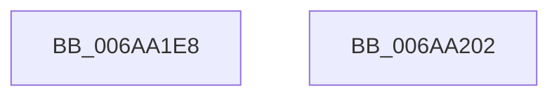

# RtlGetHpatEntryAddress

- RVA: `0x006AA1E8`–`0x006AA203` (길이 `27` bytes)
- VA: `0x00000001406AA1E8`
- 실행 섹션: `.text`
- PDB 이름 있음: `예`; PDB Function 태그: `아니요`
- unwind 정보 RVA: `0x000DB714`
- 디코드: `9`개 명령, `27/27` bytes 표시
- 미해석 바이트: `0` (있으면 어셈블리에 `.byte`로 보존)

> 이 문서는 커널 이미지의 기계어와 PDB 기호를 분석해 생성했습니다. 4번과 5번은 함수 원형과 자료형을 바이너리 사용 방식에서 추정한 C 해석이며 원본 소스 복구 결과는 아닙니다.

## 1. Dependencies

- 직접 호출 지점: **0**; 고유 호출 대상: **0**
- 직접 호출자로 확인된 함수: **1**
- RIP 상대 이미지 참조: **0**

### Outgoing calls
- 직접 디코드된 call 명령이 없습니다.

### Direct callers
- [RtlApplyHotPatch](../../pagelk/B7/RtlApplyHotPatch_function_00B7528C.md) at `0x00B7566F`
- [RtlApplyHotPatch](../../pagelk/B7/RtlApplyHotPatch_function_00B7528C.md) at `0x00B756F4`

### Static image references
- 디코드된 RIP-relative 메모리 참조가 없습니다.

## 2. Other-region calls and transfers

- 다른 실행 섹션으로 향하는 call: **0**
- 별도 외부 분기/꼬리 이동을 확인하지 못했습니다.

## 3. Assembly (complete function range)

```asm
006AA1E8  44 8B C2                        mov r8d, edx
006AA1EB  C1 EA 09                        shr edx, 9
006AA1EE  C1 E2 0D                        shl edx, 0xd
006AA1F1  41 81 E0 FF 01 00 00            and r8d, 0x1ff
006AA1F8  8B C2                           mov eax, edx
006AA1FA  48 03 C8                        add rcx, rax
006AA1FD  4A 8D 04 C1                     lea rax, [rcx + r8*8]
006AA201  C3                              ret
006AA202  CC                              int3
```

## 4. C-style interpretation (structured pseudocode)

```c
__int64 __fastcall RtlGetHpatEntryAddress(__int64 a1, int a2)
{
    a2 = (unsigned int)((a2) >> (9));
    a2 = (unsigned int)((a2) << (13));
    a3 = (unsigned int)(((unsigned int)(a2)) & (511));
    a1 = (a1) + ((unsigned int)(a2));
    return a1 + a3 * 8;
}
```

## 5. (Beta) C Style

```c
int64_t RtlGetHpatEntryAddress(void *Arg1, int32_t Arg2)
{
    uint8_t *arg1 = (uint8_t *)Arg1;

    Arg2 = (uint32_t)((Arg2) >> (9));
    Arg2 = (uint32_t)((Arg2) << (13));
    a3 = (uint32_t)(((uint32_t)(Arg2)) & (511));
    Arg1 = (Arg1) + ((uint32_t)(Arg2));
    return Arg1 + a3 * 8;
}
```

### 관측된 메모리 오프셋

구조체 형식이 확인되지 않은 접근은 인자 기준의 오프셋으로만 기록했습니다.

| 기준 인자 | 오프셋 표현 | 폭 (bit) | 접근 |
|---|---:|---:|---|
| `Arg1` | `+ 0x0 + r8*8` | `64` | `R` |

## 6. Execution-region graph

[열기: 2D/3D 그래프와 함수 탐색 컨트롤 패널](../../../control-panel.html?section=text&rva=0x006AA1E8&view=graph)

- 2D 그래프는 위에서 아래로 흐르고, 3D 그래프는 빈 공간을 드래그해 회전합니다. Shift+드래그는 이동, 휠은 확대·축소, 함수 노드 선택은 대상 보고서 이동입니다.

### Static fallback


