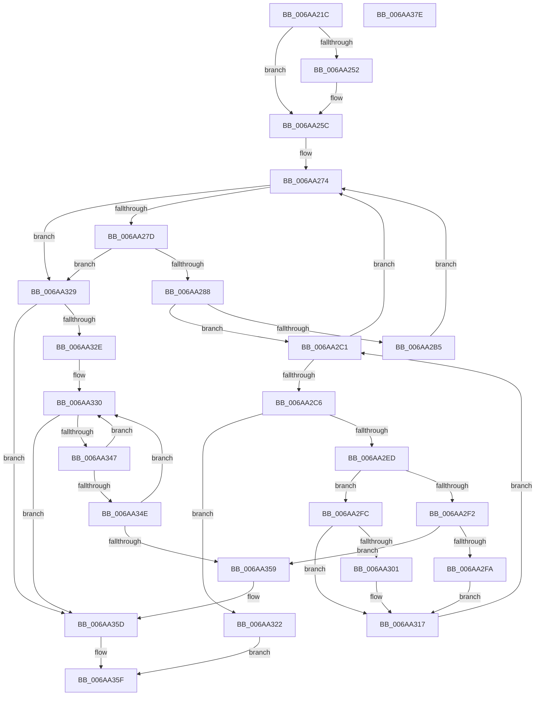

# RtlHotPatchSynchronizationRequired

- RVA: `0x006AA21C`–`0x006AA37F` (길이 `355` bytes)
- VA: `0x00000001406AA21C`
- 실행 섹션: `.text`
- PDB 이름 있음: `예`; PDB Function 태그: `아니요`
- unwind 정보 RVA: `0x0008A668`
- 디코드: `108`개 명령, `355/355` bytes 표시
- 미해석 바이트: `0` (있으면 어셈블리에 `.byte`로 보존)

> 이 문서는 커널 이미지의 기계어와 PDB 기호를 분석해 생성했습니다. 4번과 5번은 함수 원형과 자료형을 바이너리 사용 방식에서 추정한 C 해석이며 원본 소스 복구 결과는 아닙니다.

## 1. Dependencies

- 직접 호출 지점: **3**; 고유 호출 대상: **3**
- 직접 호출자로 확인된 함수: **1**
- RIP 상대 이미지 참조: **0**

### Outgoing calls
- `0x006AA255` → [RtlGetHotPatchSize](RtlGetHotPatchSize_function_006AA1D0.md) (function, `0x006AA1D0`)
- `0x006AA2E1` → [RtlpCheckFunctionPatchAppliedInOriginalImage](RtlpCheckFunctionPatchAppliedInOriginalImage_function_006AA408.md) (function, `0x006AA408`)
- `0x006AA33B` → [RtlFindClearBitsAndSet](../3E/RtlFindClearBitsAndSet_function_003E0CD0.md) (function, `0x003E0CD0`)

### Direct callers
- [MiPrepareToHotPatchImage](../../page/80/MiPrepareToHotPatchImage_function_00806820.md) at `0x00806CED`

### Static image references
- 디코드된 RIP-relative 메모리 참조가 없습니다.

## 2. Other-region calls and transfers

- 다른 실행 섹션으로 향하는 call: **0**
- 별도 외부 분기/꼬리 이동을 확인하지 못했습니다.

## 3. Assembly (complete function range)

```asm
006AA21C  48 8B C4                        mov rax, rsp
006AA21F  48 89 58 08                     mov qword ptr [rax + 8], rbx
006AA223  48 89 68 10                     mov qword ptr [rax + 0x10], rbp
006AA227  48 89 70 18                     mov qword ptr [rax + 0x18], rsi
006AA22B  48 89 78 20                     mov qword ptr [rax + 0x20], rdi
006AA22F  41 54                           push r12
006AA231  41 56                           push r14
006AA233  41 57                           push r15
006AA235  48 83 EC 40                     sub rsp, 0x40
006AA239  4C 8B B4 24 C8 00 00 00         mov r14, qword ptr [rsp + 0xc8]
006AA241  33 FF                           xor edi, edi
006AA243  4D 8B D0                        mov r10, r8
006AA246  4C 8B F9                        mov r15, rcx
006AA249  41 C6 06 00                     mov byte ptr [r14], 0
006AA24D  4D 85 C0                        test r8, r8
006AA250  74 0A                           je 0x1406aa25c
006AA252  48 8B CA                        mov rcx, rdx
006AA255  E8 76 FF FF FF                  call 0x1406aa1d0
006AA25A  8B F8                           mov edi, eax
006AA25C  48 8B AC 24 98 00 00 00         mov rbp, qword ptr [rsp + 0x98]
006AA264  48 8B B4 24 90 00 00 00         mov rsi, qword ptr [rsp + 0x90]
006AA26C  4C 8B A4 24 88 00 00 00         mov r12, qword ptr [rsp + 0x88]
006AA274  4D 85 D2                        test r10, r10
006AA277  0F 84 AC 00 00 00               je 0x1406aa329
006AA27D  41 8B 02                        mov eax, dword ptr [r10]
006AA280  85 C0                           test eax, eax
006AA282  0F 84 A1 00 00 00               je 0x1406aa329
006AA288  44 8B D8                        mov r11d, eax
006AA28B  8B D0                           mov edx, eax
006AA28D  C1 E8 1F                        shr eax, 0x1f
006AA290  33 C9                           xor ecx, ecx
006AA292  34 01                           xor al, 1
006AA294  41 81 E3 FF 0F 00 00            and r11d, 0xfff
006AA29B  49 83 C2 04                     add r10, 4
006AA29F  0F B6 C0                        movzx eax, al
006AA2A2  81 E2 00 C0 0F 00               and edx, 0xfc000
006AA2A8  81 FA 00 C0 01 00               cmp edx, 0x1c000
006AA2AE  0F 44 C8                        cmove ecx, eax
006AA2B1  84 C9                           test cl, cl
006AA2B3  75 0C                           jne 0x1406aa2c1
006AA2B5  8B C7                           mov eax, edi
006AA2B7  41 0F AF C3                     imul eax, r11d
006AA2BB  4D 8D 14 82                     lea r10, [r10 + rax*4]
006AA2BF  EB B3                           jmp 0x1406aa274
006AA2C1  45 85 DB                        test r11d, r11d
006AA2C4  74 AE                           je 0x1406aa274
006AA2C6  41 8B 1A                        mov ebx, dword ptr [r10]
006AA2C9  49 8D 42 08                     lea rax, [r10 + 8]
006AA2CD  33 D2                           xor edx, edx
006AA2CF  4C 89 64 24 20                  mov qword ptr [rsp + 0x20], r12
006AA2D4  49 03 DF                        add rbx, r15
006AA2D7  83 FF 02                        cmp edi, 2
006AA2DA  48 8B CB                        mov rcx, rbx
006AA2DD  48 0F 45 D0                     cmovne rdx, rax
006AA2E1  E8 22 01 00 00                  call 0x1406aa408
006AA2E6  8B D0                           mov edx, eax
006AA2E8  83 F8 FF                        cmp eax, -1
006AA2EB  74 35                           je 0x1406aa322
006AA2ED  83 FA FE                        cmp edx, -2
006AA2F0  75 0A                           jne 0x1406aa2fc
006AA2F2  80 E3 07                        and bl, 7
006AA2F5  80 FB 07                        cmp bl, 7
006AA2F8  74 5F                           je 0x1406aa359
006AA2FA  EB 1B                           jmp 0x1406aa317
006AA2FC  48 85 F6                        test rsi, rsi
006AA2FF  74 16                           je 0x1406aa317
006AA301  48 8B CA                        mov rcx, rdx
006AA304  83 E2 07                        and edx, 7
006AA307  48 C1 E9 03                     shr rcx, 3
006AA30B  48 03 4D 08                     add rcx, qword ptr [rbp + 8]
006AA30F  0F BE 01                        movsx eax, byte ptr [rcx]
006AA312  0F AB D0                        bts eax, edx
006AA315  88 01                           mov byte ptr [rcx], al
006AA317  8B C7                           mov eax, edi
006AA319  41 FF CB                        dec r11d
006AA31C  4D 8D 14 82                     lea r10, [r10 + rax*4]
006AA320  EB 9F                           jmp 0x1406aa2c1
006AA322  B8 7B 00 00 C0                  mov eax, 0xc000007b
006AA327  EB 36                           jmp 0x1406aa35f
006AA329  48 85 F6                        test rsi, rsi
006AA32C  74 2F                           je 0x1406aa35d
006AA32E  33 D2                           xor edx, edx
006AA330  44 8B C2                        mov r8d, edx
006AA333  48 8B CD                        mov rcx, rbp
006AA336  BA 01 00 00 00                  mov edx, 1
006AA33B  E8 90 69 D3 FF                  call 0x1403e0cd0
006AA340  8B D0                           mov edx, eax
006AA342  83 F8 FF                        cmp eax, -1
006AA345  74 16                           je 0x1406aa35d
006AA347  8B 0C D6                        mov ecx, dword ptr [rsi + rdx*8]
006AA34A  85 C9                           test ecx, ecx
006AA34C  74 E2                           je 0x1406aa330
006AA34E  41 02 CF                        add cl, r15b
006AA351  80 E1 07                        and cl, 7
006AA354  80 F9 07                        cmp cl, 7
006AA357  75 D7                           jne 0x1406aa330
006AA359  41 C6 06 01                     mov byte ptr [r14], 1
006AA35D  33 C0                           xor eax, eax
006AA35F  48 8B 5C 24 60                  mov rbx, qword ptr [rsp + 0x60]
006AA364  48 8B 6C 24 68                  mov rbp, qword ptr [rsp + 0x68]
006AA369  48 8B 74 24 70                  mov rsi, qword ptr [rsp + 0x70]
006AA36E  48 8B 7C 24 78                  mov rdi, qword ptr [rsp + 0x78]
006AA373  48 83 C4 40                     add rsp, 0x40
006AA377  41 5F                           pop r15
006AA379  41 5E                           pop r14
006AA37B  41 5C                           pop r12
006AA37D  C3                              ret
006AA37E  CC                              int3
```

## 4. C-style interpretation (structured pseudocode)

```c
__int64 __fastcall RtlHotPatchSynchronizationRequired(__int64 a1, __int64 a2, __int64 a3, __int64 a4, __int64 a5, __int64 a6, __int64 a7, __int64 a8, __int64 a9, __int64 a10, __int64 a11, __int64 a12, __int64 a13, __int64 a14)
{
    __int64 result;
    __int64 v_r10;
    __int64 v_r11;
    __int64 v_rbx;
    __int64 v_rdi;
    __int64 v_rsp;
    unsigned __int64 v_stack_m38;
    unsigned __int64 v_stack_p10;
    unsigned __int64 v_stack_p18;
    unsigned __int64 v_stack_p20;
    unsigned __int64 v_stack_p8;

    *(unsigned __int64 *)(v_rsp + 8) = v_rbx;
    *(unsigned __int64 *)(v_rsp + 16) = v_rbp;
    *(unsigned __int64 *)(v_rsp + 24) = v_rsi;
    *(unsigned __int64 *)(v_rsp + 32) = v_rdi;
    v_rsp = (v_rsp) - (64);
    v_rdi = 0;
    *(unsigned __int8 *)(a14) = 0;
    result = v_rsp;
    if (a3 != 0) {
        a1 = a2;
        result = RtlGetHotPatchSize(a1, a2, a3, a4);
        v_rdi = (unsigned int)(result);
    }
loc_006AA274:
    if (a3 == 0) goto loc_006AA329;
    if ((unsigned int)((unsigned int)(*(unsigned int *)(a3))) == 0) goto loc_006AA329;
    result = (unsigned int)(((unsigned int)(*(unsigned int *)(a3))) >> (31));
    a1 = 0;
    result = (unsigned __int8)((result) ^ (1));
    v_r11 = (unsigned int)(((unsigned int)((unsigned int)((unsigned int)(*(unsigned int *)(a3))))) & (0xFFFULL));
    v_r10 = (a3) + (4);
    a2 = (unsigned int)(((unsigned int)((unsigned int)((unsigned int)(*(unsigned int *)(a3))))) & (0xFC000ULL));
    if (((unsigned int)(a2)) == 0x1C000ULL) { a1 = (unsigned int)((unsigned __int8)(result)); }
    if ((unsigned __int8)(a1) != 0) goto loc_006AA2C1;
    result = (unsigned int)(((unsigned int)((unsigned int)(v_rdi))) * ((unsigned int)(v_r11)));
    goto loc_006AA274;
loc_006AA2C1:
    if ((unsigned int)(v_r11) == 0) goto loc_006AA274;
    a2 = 0;
    v_stack_m38 = a6;
    v_rbx = ((unsigned int)(*(unsigned int *)(v_r10 + result * 4))) + (a1);
    if (((unsigned int)(v_rdi)) != 2) { a2 = v_r10 + result * 4 + 8; }
    result = RtlpCheckFunctionPatchAppliedInOriginalImage(v_rbx, a2, a3, a4);
    if (((unsigned int)(result)) == -1) goto loc_006AA322;
    if (((unsigned int)((unsigned int)((unsigned int)(result)))) != -2) goto loc_006AA2FC;
    v_rbx = (unsigned __int8)((v_rbx) & (7));
    if (((unsigned __int8)(v_rbx)) == 7) goto loc_006AA359;
    goto loc_006AA317;
loc_006AA2FC:
    if (a7 != 0) {
        a1 = (unsigned int)((unsigned int)(result));
        a2 = (unsigned int)(((unsigned int)((unsigned int)(result))) & (7));
        a1 = (a1) >> (3);
        a1 = (a1) + (*(unsigned __int64 *)(a8 + 8));
        result = (__int8)(*(unsigned __int8 *)(a1));
        *(unsigned __int8 *)(a1) = (unsigned __int8)(result);
    }
    v_r11 = (unsigned int)((v_r11) - 1);
    goto loc_006AA2C1;
loc_006AA322:
    goto loc_006AA35F;
loc_006AA329:
    if (a7 == 0) goto loc_006AA35D;
    a2 = 0;
loc_006AA330:
    result = RtlFindClearBitsAndSet(a8, 1, 0, a4);
    if (((unsigned int)(result)) == -1) goto loc_006AA35D;
    if ((unsigned int)((unsigned int)(*(unsigned int *)(a7 + (unsigned int)((unsigned int)(result)) * 8))) == 0) goto loc_006AA330;
    a1 = (unsigned __int8)(((unsigned int)(*(unsigned int *)(a7 + (unsigned int)((unsigned int)(result)) * 8))) + ((unsigned __int8)(a1)));
    a1 = (unsigned __int8)((a1) & (7));
    if (((unsigned __int8)(a1)) != 7) goto loc_006AA330;
loc_006AA359:
    *(unsigned __int8 *)(a14) = 1;
loc_006AA35D:
    result = 0;
loc_006AA35F:
    v_rsp = (v_rsp) + (64);
    return result;
}
```

## 5. (Beta) C Style

```c
int64_t RtlHotPatchSynchronizationRequired(int64_t Arg1, int64_t Arg2, int64_t Arg3, int64_t Arg4, uint64_t Arg5, int64_t Arg6, int64_t Arg7, void *Arg8, uint64_t Arg9, uint64_t Arg10, uint64_t Arg11, uint64_t Arg12, uint64_t Arg13, void *Arg14)
{
    uint8_t *arg8 = (uint8_t *)Arg8;
    uint8_t *arg14 = (uint8_t *)Arg14;

    int64_t result;
    int64_t local_r10;
    int64_t local_r11;
    int64_t local_rbx;
    int64_t local_rdi;
    int64_t local_rsp;
    uint64_t v_stack_m38;
    uint64_t v_stack_p10;
    uint64_t v_stack_p18;
    uint64_t v_stack_p20;
    uint64_t v_stack_p8;

    *(uint64_t *)(local_rsp + 0x8) = local_rbx;
    *(uint64_t *)(local_rsp + 0x10) = local_rbp;
    *(uint64_t *)(local_rsp + 0x18) = local_rsi;
    *(uint64_t *)(local_rsp + 0x20) = local_rdi;
    local_rsp = (local_rsp) - (64);
    local_rdi = 0;
    *(uint8_t *)(arg14) = 0;
    result = local_rsp;
    if (Arg3 != 0) {
        Arg1 = Arg2;
        result = RtlGetHotPatchSize(Arg1, Arg2, Arg3, Arg4);
        local_rdi = (uint32_t)(result);
    }
loc_006AA274:
    if (Arg3 == 0) goto loc_006AA329;
    if ((uint32_t)((uint32_t)(*(uint32_t *)(Arg3))) == 0) goto loc_006AA329;
    result = (uint32_t)(((uint32_t)(*(uint32_t *)(Arg3))) >> (31));
    Arg1 = 0;
    result = (uint8_t)((result) ^ (1));
    local_r11 = (uint32_t)(((uint32_t)((uint32_t)((uint32_t)(*(uint32_t *)(Arg3))))) & (0xFFFULL));
    local_r10 = (Arg3) + (4);
    Arg2 = (uint32_t)(((uint32_t)((uint32_t)((uint32_t)(*(uint32_t *)(Arg3))))) & (0xFC000ULL));
    if (((uint32_t)(Arg2)) == 0x1C000ULL) { Arg1 = (uint32_t)((uint8_t)(result)); }
    if ((uint8_t)(Arg1) != 0) goto loc_006AA2C1;
    result = (uint32_t)(((uint32_t)((uint32_t)(local_rdi))) * ((uint32_t)(local_r11)));
    goto loc_006AA274;
loc_006AA2C1:
    if ((uint32_t)(local_r11) == 0) goto loc_006AA274;
    Arg2 = 0;
    v_stack_m38 = Arg6;
    local_rbx = ((uint32_t)(*(uint32_t *)(local_r10 + result * 4))) + (Arg1);
    if (((uint32_t)(local_rdi)) != 2) { Arg2 = local_r10 + result * 4 + 8; }
    result = RtlpCheckFunctionPatchAppliedInOriginalImage(local_rbx, Arg2, Arg3, Arg4);
    if (((uint32_t)(result)) == -1) goto loc_006AA322;
    if (((uint32_t)((uint32_t)((uint32_t)(result)))) != -2) goto loc_006AA2FC;
    local_rbx = (uint8_t)((local_rbx) & (7));
    if (((uint8_t)(local_rbx)) == 7) goto loc_006AA359;
    goto loc_006AA317;
loc_006AA2FC:
    if (Arg7 != 0) {
        Arg1 = (uint32_t)((uint32_t)(result));
        Arg2 = (uint32_t)(((uint32_t)((uint32_t)(result))) & (7));
        Arg1 = (Arg1) >> (3);
        Arg1 = (Arg1) + (*(uint64_t *)(arg8 + 0x8));
        result = (int8_t)(*(uint8_t *)(Arg1));
        *(uint8_t *)(Arg1) = (uint8_t)(result);
    }
    local_r11 = (uint32_t)((local_r11) - 1);
    goto loc_006AA2C1;
loc_006AA322:
    goto loc_006AA35F;
loc_006AA329:
    if (Arg7 == 0) goto loc_006AA35D;
    Arg2 = 0;
loc_006AA330:
    result = RtlFindClearBitsAndSet(Arg8, 1, 0, Arg4);
    if (((uint32_t)(result)) == -1) goto loc_006AA35D;
    if ((uint32_t)((uint32_t)(*(uint32_t *)(Arg7 + (uint32_t)((uint32_t)(result)) * 8))) == 0) goto loc_006AA330;
    Arg1 = (uint8_t)(((uint32_t)(*(uint32_t *)(Arg7 + (uint32_t)((uint32_t)(result)) * 8))) + ((uint8_t)(Arg1)));
    Arg1 = (uint8_t)((Arg1) & (7));
    if (((uint8_t)(Arg1)) != 7) goto loc_006AA330;
loc_006AA359:
    *(uint8_t *)(arg14) = 1;
loc_006AA35D:
    result = 0;
loc_006AA35F:
    local_rsp = (local_rsp) + (64);
    return result;
}
```

### 관측된 메모리 오프셋

구조체 형식이 확인되지 않은 접근은 인자 기준의 오프셋으로만 기록했습니다.

| 기준 인자 | 오프셋 표현 | 폭 (bit) | 접근 |
|---|---:|---:|---|
| `Arg8` | `+ 0x8` | `64` | `R` |
| `Arg14` | `+ 0x0` | `8` | `W` |

## 6. Execution-region graph

[열기: 2D/3D 그래프와 함수 탐색 컨트롤 패널](../../../control-panel.html?section=text&rva=0x006AA21C&view=graph)

- 2D 그래프는 위에서 아래로 흐르고, 3D 그래프는 빈 공간을 드래그해 회전합니다. Shift+드래그는 이동, 휠은 확대·축소, 함수 노드 선택은 대상 보고서 이동입니다.

### Static fallback


