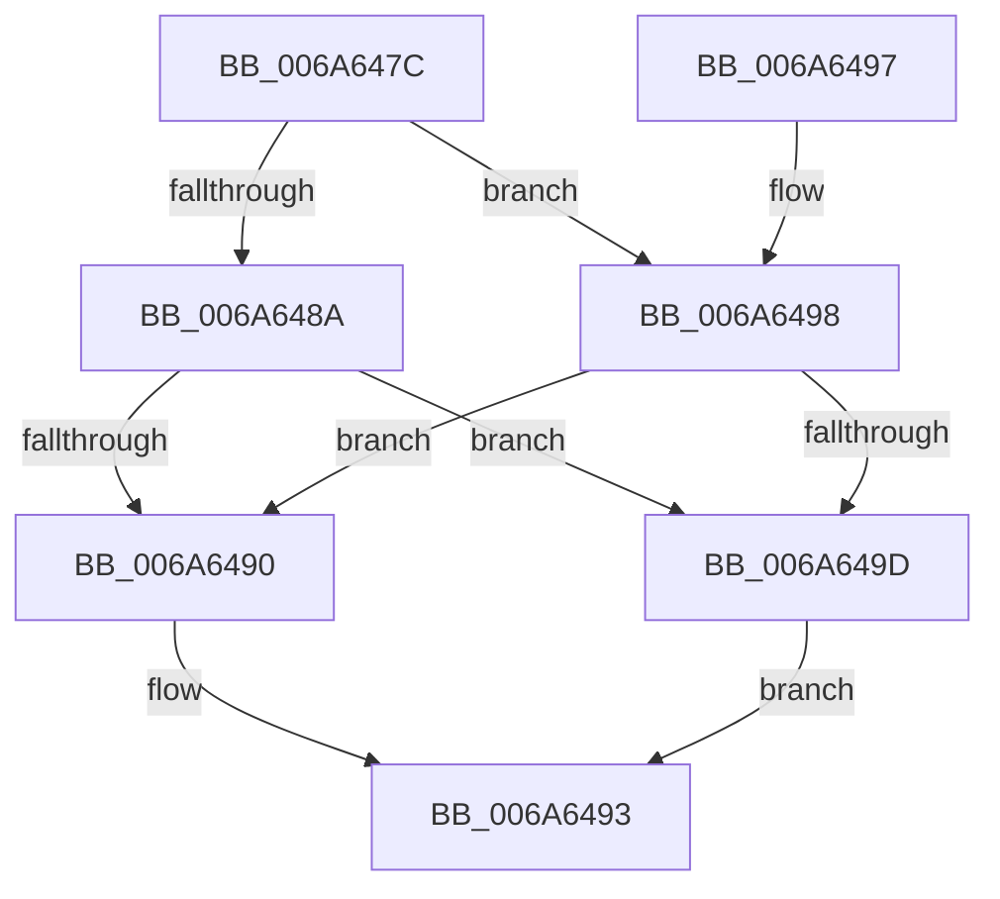

# RtlLongLongMult

- RVA: `0x006A647C`–`0x006A64A9` (길이 `45` bytes)
- VA: `0x00000001406A647C`
- 실행 섹션: `.text`
- PDB 이름 있음: `예`; PDB Function 태그: `아니요`
- unwind 정보 RVA: `0x000DB714`
- 디코드: `16`개 명령, `45/45` bytes 표시
- 미해석 바이트: `0` (있으면 어셈블리에 `.byte`로 보존)

> 이 문서는 커널 이미지의 기계어와 PDB 기호를 분석해 생성했습니다. 4번과 5번은 함수 원형과 자료형을 바이너리 사용 방식에서 추정한 C 해석이며 원본 소스 복구 결과는 아닙니다.

## 1. Dependencies

- 직접 호출 지점: **0**; 고유 호출 대상: **0**
- 직접 호출자로 확인된 함수: **1**
- RIP 상대 이미지 참조: **0**

### Outgoing calls
- 직접 디코드된 call 명령이 없습니다.

### Direct callers
- [I_MinAsn1MultiplyAndDivide](../../page/83/I_MinAsn1MultiplyAndDivide_function_00839AB4.md) at `0x00839AD1`
- [I_MinAsn1MultiplyAndDivide](../../page/83/I_MinAsn1MultiplyAndDivide_function_00839AB4.md) at `0x00839AF9`

### Static image references
- 디코드된 RIP-relative 메모리 참조가 없습니다.

## 2. Other-region calls and transfers

- 다른 실행 섹션으로 향하는 call: **0**
- 별도 외부 분기/꼬리 이동을 확인하지 못했습니다.

## 3. Assembly (complete function range)

```asm
006A647C  48 8B C2                        mov rax, rdx
006A647F  45 33 C9                        xor r9d, r9d
006A6482  48 F7 E9                        imul rcx
006A6485  48 85 C0                        test rax, rax
006A6488  79 0E                           jns 0x1406a6498
006A648A  48 83 FA FF                     cmp rdx, -1
006A648E  75 0D                           jne 0x1406a649d
006A6490  49 89 00                        mov qword ptr [r8], rax
006A6493  41 8B C1                        mov eax, r9d
006A6496  C3                              ret
006A6497  CC                              int3
006A6498  48 85 D2                        test rdx, rdx
006A649B  74 F3                           je 0x1406a6490
006A649D  49 83 08 FF                     or qword ptr [r8], 0xffffffffffffffff
006A64A1  41 B9 95 00 00 C0               mov r9d, 0xc0000095
006A64A7  EB EA                           jmp 0x1406a6493
```

## 4. C-style interpretation (structured pseudocode)

```c
__int64 __fastcall RtlLongLongMult(__int64 a1, __int64 a2, __int64 a3, int a4)
{
    a4 = 0;
    if (!sign_flag) goto loc_006A6498;
    if (a2 != -1) goto loc_006A649D;
loc_006A6490:
    *(unsigned __int64 *)(a3) = a2;
loc_006A6493:
    return 0;
loc_006A6498:
    if (a2 == 0) goto loc_006A6490;
loc_006A649D:
    goto loc_006A6493;
}
```

## 5. (Beta) C Style

```c
int64_t RtlLongLongMult(int64_t Arg1, int64_t Arg2, void *Arg3, int32_t Arg4)
{
    uint8_t *arg3 = (uint8_t *)Arg3;

    Arg4 = 0;
    if (!sign_flag) goto loc_006A6498;
    if (Arg2 != -1) goto loc_006A649D;
loc_006A6490:
    *(uint64_t *)(arg3) = Arg2;
loc_006A6493:
    return 0;
loc_006A6498:
    if (Arg2 == 0) goto loc_006A6490;
loc_006A649D:
    goto loc_006A6493;
}
```

### 관측된 메모리 오프셋

구조체 형식이 확인되지 않은 접근은 인자 기준의 오프셋으로만 기록했습니다.

| 기준 인자 | 오프셋 표현 | 폭 (bit) | 접근 |
|---|---:|---:|---|
| `Arg3` | `+ 0x0` | `64` | `R/W` |
| `Arg3` | `+ 0x0` | `64` | `W` |

## 6. Execution-region graph

[열기: 2D/3D 그래프와 함수 탐색 컨트롤 패널](../../../control-panel.html?section=text&rva=0x006A647C&view=graph)

- 2D 그래프는 위에서 아래로 흐르고, 3D 그래프는 빈 공간을 드래그해 회전합니다. Shift+드래그는 이동, 휠은 확대·축소, 함수 노드 선택은 대상 보고서 이동입니다.

### Static fallback


