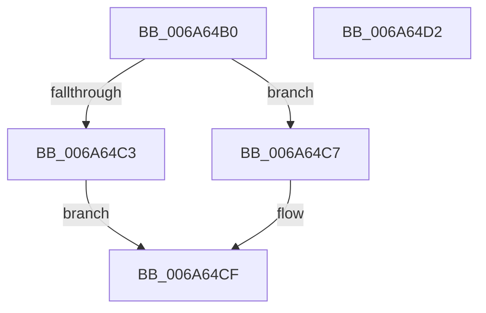

# RtlLongLongToInt

- RVA: `0x006A64B0`–`0x006A64D3` (길이 `35` bytes)
- VA: `0x00000001406A64B0`
- 실행 섹션: `.text`
- PDB 이름 있음: `예`; PDB Function 태그: `아니요`
- unwind 정보 RVA: `0x000DB714`
- 디코드: `12`개 명령, `35/35` bytes 표시
- 미해석 바이트: `0` (있으면 어셈블리에 `.byte`로 보존)

> 이 문서는 커널 이미지의 기계어와 PDB 기호를 분석해 생성했습니다. 4번과 5번은 함수 원형과 자료형을 바이너리 사용 방식에서 추정한 C 해석이며 원본 소스 복구 결과는 아닙니다.

## 1. Dependencies

- 직접 호출 지점: **0**; 고유 호출 대상: **0**
- 직접 호출자로 확인된 함수: **3**
- RIP 상대 이미지 참조: **0**

### Outgoing calls
- 직접 디코드된 call 명령이 없습니다.

### Direct callers
- [I_MinAsn1DecodeGeneralizedTimeFraction](../../page/83/I_MinAsn1DecodeGeneralizedTimeFraction_function_0083994C.md) at `0x00839A3F`
- [I_MinAsn1DecodeGeneralizedTimeFraction](../../page/83/I_MinAsn1DecodeGeneralizedTimeFraction_function_0083994C.md) at `0x00839A5A`
- [I_MinAsn1DecodeGeneralizedTimeFraction](../../page/83/I_MinAsn1DecodeGeneralizedTimeFraction_function_0083994C.md) at `0x00839A77`
- [I_MinAsn1DecodeGeneralizedTimeFraction](../../page/83/I_MinAsn1DecodeGeneralizedTimeFraction_function_0083994C.md) at `0x00839A91`
- [I_MinAsn1MultiplyAndDivide](../../page/83/I_MinAsn1MultiplyAndDivide_function_00839AB4.md) at `0x00839B12`
- [I_MinAsn1ScanFrac](../../page/83/I_MinAsn1ScanFrac_function_00839B60.md) at `0x00839BAB`
- [I_MinAsn1ScanFrac](../../page/83/I_MinAsn1ScanFrac_function_00839B60.md) at `0x00839BC1`
- [I_MinAsn1ScanFrac](../../page/83/I_MinAsn1ScanFrac_function_00839B60.md) at `0x00839BD7`

### Static image references
- 디코드된 RIP-relative 메모리 참조가 없습니다.

## 2. Other-region calls and transfers

- 다른 실행 섹션으로 향하는 call: **0**
- 별도 외부 분기/꼬리 이동을 확인하지 못했습니다.

## 3. Assembly (complete function range)

```asm
006A64B0  B8 00 00 00 80                  mov eax, 0x80000000
006A64B5  41 B8 FF FF FF FF               mov r8d, 0xffffffff
006A64BB  48 03 C1                        add rax, rcx
006A64BE  49 3B C0                        cmp rax, r8
006A64C1  77 04                           ja 0x1406a64c7
006A64C3  33 C0                           xor eax, eax
006A64C5  EB 08                           jmp 0x1406a64cf
006A64C7  B8 95 00 00 C0                  mov eax, 0xc0000095
006A64CC  83 C9 FF                        or ecx, 0xffffffff
006A64CF  89 0A                           mov dword ptr [rdx], ecx
006A64D1  C3                              ret
006A64D2  CC                              int3
```

## 4. C-style interpretation (structured pseudocode)

```c
__int64 __fastcall RtlLongLongToInt(__int64 a1, __int64 a2)
{
    __int64 result;

    result = ((unsigned int)(0x80000000ULL)) + (a1);
    if (result > ((unsigned int)(0xFFFFFFFFULL))) goto loc_006A64C7;
    result = 0;
    goto loc_006A64CF;
loc_006A64C7:
    a1 = (unsigned int)((a1) | (0xFFFFFFFFULL));
loc_006A64CF:
    *(unsigned int *)(a2) = (unsigned int)(a1);
    return (unsigned int)(0xC0000095ULL);
}
```

## 5. (Beta) C Style

```c
int64_t RtlLongLongToInt(int64_t Arg1, void *Arg2)
{
    uint8_t *arg2 = (uint8_t *)Arg2;

    int64_t result;

    result = ((uint32_t)(0x80000000ULL)) + (Arg1);
    if (result > ((uint32_t)(0xFFFFFFFFULL))) goto loc_006A64C7;
    result = 0;
    goto loc_006A64CF;
loc_006A64C7:
    Arg1 = (uint32_t)((Arg1) | (0xFFFFFFFFULL));
loc_006A64CF:
    *(uint32_t *)(arg2) = (uint32_t)(Arg1);
    return (uint32_t)(0xC0000095ULL);
}
```

### 관측된 메모리 오프셋

구조체 형식이 확인되지 않은 접근은 인자 기준의 오프셋으로만 기록했습니다.

| 기준 인자 | 오프셋 표현 | 폭 (bit) | 접근 |
|---|---:|---:|---|
| `Arg2` | `+ 0x0` | `32` | `W` |

## 6. Execution-region graph

[열기: 2D/3D 그래프와 함수 탐색 컨트롤 패널](../../../control-panel.html?section=text&rva=0x006A64B0&view=graph)

- 2D 그래프는 위에서 아래로 흐르고, 3D 그래프는 빈 공간을 드래그해 회전합니다. Shift+드래그는 이동, 휠은 확대·축소, 함수 노드 선택은 대상 보고서 이동입니다.

### Static fallback


