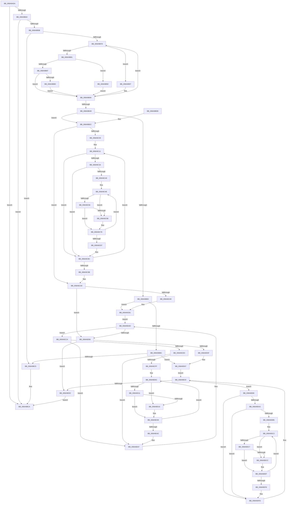

# RtlPerformRetpolineRelocationsOnImageEx

- RVA: `0x006A9AD4`–`0x006A9E13` (길이 `831` bytes)
- VA: `0x00000001406A9AD4`
- 실행 섹션: `.text`
- PDB 이름 있음: `예`; PDB Function 태그: `아니요`
- unwind 정보 RVA: `0x000DB5DC`
- 디코드: `217`개 명령, `831/831` bytes 표시
- 미해석 바이트: `0` (있으면 어셈블리에 `.byte`로 보존)

> 이 문서는 커널 이미지의 기계어와 PDB 기호를 분석해 생성했습니다. 4번과 5번은 함수 원형과 자료형을 바이너리 사용 방식에서 추정한 C 해석이며 원본 소스 복구 결과는 아닙니다.

## 1. Dependencies

- 직접 호출 지점: **8**; 고유 호출 대상: **6**
- 직접 호출자로 확인된 함수: **2**
- RIP 상대 이미지 참조: **0**

### Outgoing calls
- `0x006A9B37` → [RtlpCaptureRetpolineBinaryInfoForImage](RtlpCaptureRetpolineBinaryInfoForImage_function_006AA060.md) (function, `0x006AA060`)
- `0x006A9B52` → [RtlpCaptureDynamicRelocationTableRva](../5E/RtlpCaptureDynamicRelocationTableRva_function_005EC760.md) (function, `0x005EC760`)
- `0x006A9C2B` → [RtlpIsAddressInIgnoreRegion](RtlpIsAddressInIgnoreRegion_function_006AA190.md) (function, `0x006AA190`)
- `0x006A9C79` → [RtlApplyImportRelocationToImage](RtlApplyImportRelocationToImage_function_006A98F8.md) (function, `0x006A98F8`)
- `0x006A9CE4` → [RtlpIsAddressInIgnoreRegion](RtlpIsAddressInIgnoreRegion_function_006AA190.md) (function, `0x006AA190`)
- `0x006A9D2F` → [RtlApplyIndirectRelocationToImage](RtlApplyIndirectRelocationToImage_function_006A999C.md) (function, `0x006A999C`)
- `0x006A9D9A` → [RtlpIsAddressInIgnoreRegion](RtlpIsAddressInIgnoreRegion_function_006AA190.md) (function, `0x006AA190`)
- `0x006A9DE5` → [RtlApplySwitchJumpRelocationToImage](RtlApplySwitchJumpRelocationToImage_function_006A9A38.md) (function, `0x006A9A38`)

### Direct callers
- [MiApplyDynamicFixupsToKernelAndHal](../../init/C6/MiApplyDynamicFixupsToKernelAndHal_function_00C65EBC.md) at `0x00C6602D`
- [MiApplyRetpolineToBootDriver](../../init/C6/MiApplyRetpolineToBootDriver_function_00C66264.md) at `0x00C6635B`

### Static image references
- 디코드된 RIP-relative 메모리 참조가 없습니다.

## 2. Other-region calls and transfers

- 다른 실행 섹션으로 향하는 call: **0**
- 별도 외부 분기/꼬리 이동을 확인하지 못했습니다.

## 3. Assembly (complete function range)

```asm
006A9AD4  4C 8B DC                        mov r11, rsp
006A9AD7  49 89 5B 08                     mov qword ptr [r11 + 8], rbx
006A9ADB  49 89 6B 10                     mov qword ptr [r11 + 0x10], rbp
006A9ADF  49 89 73 20                     mov qword ptr [r11 + 0x20], rsi
006A9AE3  45 89 43 18                     mov dword ptr [r11 + 0x18], r8d
006A9AE7  57                              push rdi
006A9AE8  41 54                           push r12
006A9AEA  41 55                           push r13
006A9AEC  41 56                           push r14
006A9AEE  41 57                           push r15
006A9AF0  48 81 EC 90 00 00 00            sub rsp, 0x90
006A9AF7  41 83 63 30 00                  and dword ptr [r11 + 0x30], 0
006A9AFC  0F 57 C0                        xorps xmm0, xmm0
006A9AFF  33 C0                           xor eax, eax
006A9B01  45 8B E0                        mov r12d, r8d
006A9B04  0F 11 44 24 50                  movups xmmword ptr [rsp + 0x50], xmm0
006A9B09  4C 8B E9                        mov r13, rcx
006A9B0C  33 DB                           xor ebx, ebx
006A9B0E  0F 11 44 24 60                  movups xmmword ptr [rsp + 0x60], xmm0
006A9B13  33 F6                           xor esi, esi
006A9B15  45 33 F6                        xor r14d, r14d
006A9B18  0F 11 44 24 70                  movups xmmword ptr [rsp + 0x70], xmm0
006A9B1D  49 89 43 C8                     mov qword ptr [r11 - 0x38], rax
006A9B21  49 8D 43 98                     lea rax, [r11 - 0x68]
006A9B25  48 89 44 24 28                  mov qword ptr [rsp + 0x28], rax
006A9B2A  48 8B 84 24 E0 00 00 00         mov rax, qword ptr [rsp + 0xe0]
006A9B32  48 89 44 24 20                  mov qword ptr [rsp + 0x20], rax
006A9B37  E8 24 05 00 00                  call 0x1406aa060
006A9B3C  85 C0                           test eax, eax
006A9B3E  0F 88 86 00 00 00               js 0x1406a9bca
006A9B44  4C 8D 84 24 E8 00 00 00         lea r8, [rsp + 0xe8]
006A9B4C  41 8B D4                        mov edx, r12d
006A9B4F  49 8B CD                        mov rcx, r13
006A9B52  E8 09 2C F4 FF                  call 0x1405ec760
006A9B57  85 C0                           test eax, eax
006A9B59  78 6F                           js 0x1406a9bca
006A9B5B  8B 8C 24 E8 00 00 00            mov ecx, dword ptr [rsp + 0xe8]
006A9B62  49 03 CD                        add rcx, r13
006A9B65  8B 41 04                        mov eax, dword ptr [rcx + 4]
006A9B68  48 8D 51 08                     lea rdx, [rcx + 8]
006A9B6C  48 03 D0                        add rdx, rax
006A9B6F  48 83 C1 08                     add rcx, 8
006A9B73  48 3B CA                        cmp rcx, rdx
006A9B76  73 4D                           jae 0x1406a9bc5
006A9B78  48 8B 01                        mov rax, qword ptr [rcx]
006A9B7B  48 83 E8 03                     sub rax, 3
006A9B7F  74 16                           je 0x1406a9b97
006A9B81  48 83 E8 01                     sub rax, 1
006A9B85  74 0B                           je 0x1406a9b92
006A9B87  48 83 F8 01                     cmp rax, 1
006A9B8B  75 0D                           jne 0x1406a9b9a
006A9B8D  4C 8B F1                        mov r14, rcx
006A9B90  EB 08                           jmp 0x1406a9b9a
006A9B92  48 8B F1                        mov rsi, rcx
006A9B95  EB 03                           jmp 0x1406a9b9a
006A9B97  48 8B D9                        mov rbx, rcx
006A9B9A  8B 41 08                        mov eax, dword ptr [rcx + 8]
006A9B9D  48 83 C1 0C                     add rcx, 0xc
006A9BA1  48 03 C8                        add rcx, rax
006A9BA4  48 3B CA                        cmp rcx, rdx
006A9BA7  72 CF                           jb 0x1406a9b78
006A9BA9  4C 89 74 24 40                  mov qword ptr [rsp + 0x40], r14
006A9BAE  48 85 DB                        test rbx, rbx
006A9BB1  75 39                           jne 0x1406a9bec
006A9BB3  48 85 F6                        test rsi, rsi
006A9BB6  0F 85 F5 00 00 00               jne 0x1406a9cb1
006A9BBC  4D 85 F6                        test r14, r14
006A9BBF  0F 85 A2 01 00 00               jne 0x1406a9d67
006A9BC5  B8 BB 00 00 C0                  mov eax, 0xc00000bb
006A9BCA  4C 8D 9C 24 90 00 00 00         lea r11, [rsp + 0x90]
006A9BD2  49 8B 5B 30                     mov rbx, qword ptr [r11 + 0x30]
006A9BD6  49 8B 6B 38                     mov rbp, qword ptr [r11 + 0x38]
006A9BDA  49 8B 73 48                     mov rsi, qword ptr [r11 + 0x48]
006A9BDE  49 8B E3                        mov rsp, r11
006A9BE1  41 5F                           pop r15
006A9BE3  41 5E                           pop r14
006A9BE5  41 5D                           pop r13
006A9BE7  41 5C                           pop r12
006A9BE9  5F                              pop rdi
006A9BEA  C3                              ret
006A9BEB  CC                              int3
006A9BEC  44 8B 63 08                     mov r12d, dword ptr [rbx + 8]
006A9BF0  49 83 C4 0C                     add r12, 0xc
006A9BF4  4C 03 E3                        add r12, rbx
006A9BF7  48 83 C3 0C                     add rbx, 0xc
006A9BFB  4C 89 64 24 48                  mov qword ptr [rsp + 0x48], r12
006A9C00  49 3B DC                        cmp rbx, r12
006A9C03  0F 83 97 00 00 00               jae 0x1406a9ca0
006A9C09  4C 8B B4 24 E0 00 00 00         mov r14, qword ptr [rsp + 0xe0]
006A9C11  4C 8B 84 24 F8 00 00 00         mov r8, qword ptr [rsp + 0xf8]
006A9C19  48 8B 94 24 F0 00 00 00         mov rdx, qword ptr [rsp + 0xf0]
006A9C21  8B 0B                           mov ecx, dword ptr [rbx]
006A9C23  44 8B 8C 24 00 01 00 00         mov r9d, dword ptr [rsp + 0x100]
006A9C2B  E8 60 05 00 00                  call 0x1406aa190
006A9C30  84 C0                           test al, al
006A9C32  75 58                           jne 0x1406a9c8c
006A9C34  8B 6B 04                        mov ebp, dword ptr [rbx + 4]
006A9C37  4C 8D 7B 08                     lea r15, [rbx + 8]
006A9C3B  48 03 EB                        add rbp, rbx
006A9C3E  49 8B FF                        mov rdi, r15
006A9C41  4C 3B FD                        cmp r15, rbp
006A9C44  73 46                           jae 0x1406a9c8c
006A9C46  44 8B A4 24 D0 00 00 00         mov r12d, dword ptr [rsp + 0xd0]
006A9C4E  F7 07 FF 0F 00 00               test dword ptr [rdi], 0xfff
006A9C54  75 05                           jne 0x1406a9c5b
006A9C56  49 3B FF                        cmp rdi, r15
006A9C59  75 23                           jne 0x1406a9c7e
006A9C5B  83 64 24 38 00                  and dword ptr [rsp + 0x38], 0
006A9C60  4C 8D 44 24 50                  lea r8, [rsp + 0x50]
006A9C65  8B 03                           mov eax, dword ptr [rbx]
006A9C67  4D 8B CE                        mov r9, r14
006A9C6A  48 89 7C 24 28                  mov qword ptr [rsp + 0x28], rdi
006A9C6F  41 8B D4                        mov edx, r12d
006A9C72  49 8B CD                        mov rcx, r13
006A9C75  89 44 24 20                     mov dword ptr [rsp + 0x20], eax
006A9C79  E8 7A FC FF FF                  call 0x1406a98f8
006A9C7E  48 83 C7 04                     add rdi, 4
006A9C82  48 3B FD                        cmp rdi, rbp
006A9C85  72 C7                           jb 0x1406a9c4e
006A9C87  4C 8B 64 24 48                  mov r12, qword ptr [rsp + 0x48]
006A9C8C  8B 43 04                        mov eax, dword ptr [rbx + 4]
006A9C8F  48 03 D8                        add rbx, rax
006A9C92  49 3B DC                        cmp rbx, r12
006A9C95  0F 82 76 FF FF FF               jb 0x1406a9c11
006A9C9B  4C 8B 74 24 40                  mov r14, qword ptr [rsp + 0x40]
006A9CA0  48 85 F6                        test rsi, rsi
006A9CA3  0F 84 AD 00 00 00               je 0x1406a9d56
006A9CA9  44 8B A4 24 D0 00 00 00         mov r12d, dword ptr [rsp + 0xd0]
006A9CB1  44 8B 7E 08                     mov r15d, dword ptr [rsi + 8]
006A9CB5  48 8D 5E 0C                     lea rbx, [rsi + 0xc]
006A9CB9  49 83 C7 0C                     add r15, 0xc
006A9CBD  4C 03 FE                        add r15, rsi
006A9CC0  4C 89 7C 24 48                  mov qword ptr [rsp + 0x48], r15
006A9CC5  E9 83 00 00 00                  jmp 0x1406a9d4d
006A9CCA  4C 8B 84 24 F8 00 00 00         mov r8, qword ptr [rsp + 0xf8]
006A9CD2  48 8B 94 24 F0 00 00 00         mov rdx, qword ptr [rsp + 0xf0]
006A9CDA  8B 0B                           mov ecx, dword ptr [rbx]
006A9CDC  44 8B 8C 24 00 01 00 00         mov r9d, dword ptr [rsp + 0x100]
006A9CE4  E8 A7 04 00 00                  call 0x1406aa190
006A9CE9  84 C0                           test al, al
006A9CEB  75 5A                           jne 0x1406a9d47
006A9CED  8B 73 04                        mov esi, dword ptr [rbx + 4]
006A9CF0  48 8D 6B 08                     lea rbp, [rbx + 8]
006A9CF4  48 03 F3                        add rsi, rbx
006A9CF7  48 8B FD                        mov rdi, rbp
006A9CFA  48 3B EE                        cmp rbp, rsi
006A9CFD  73 48                           jae 0x1406a9d47
006A9CFF  4C 8B BC 24 E0 00 00 00         mov r15, qword ptr [rsp + 0xe0]
006A9D07  B9 FF 0F 00 00                  mov ecx, 0xfff
006A9D0C  66 85 0F                        test word ptr [rdi], cx
006A9D0F  75 05                           jne 0x1406a9d16
006A9D11  48 3B FD                        cmp rdi, rbp
006A9D14  75 23                           jne 0x1406a9d39
006A9D16  8B 03                           mov eax, dword ptr [rbx]
006A9D18  4C 8D 44 24 50                  lea r8, [rsp + 0x50]
006A9D1D  48 89 7C 24 28                  mov qword ptr [rsp + 0x28], rdi
006A9D22  4D 8B CF                        mov r9, r15
006A9D25  41 8B D4                        mov edx, r12d
006A9D28  89 44 24 20                     mov dword ptr [rsp + 0x20], eax
006A9D2C  49 8B CD                        mov rcx, r13
006A9D2F  E8 68 FC FF FF                  call 0x1406a999c
006A9D34  B9 FF 0F 00 00                  mov ecx, 0xfff
006A9D39  48 83 C7 02                     add rdi, 2
006A9D3D  48 3B FE                        cmp rdi, rsi
006A9D40  72 CA                           jb 0x1406a9d0c
006A9D42  4C 8B 7C 24 48                  mov r15, qword ptr [rsp + 0x48]
006A9D47  8B 43 04                        mov eax, dword ptr [rbx + 4]
006A9D4A  48 03 D8                        add rbx, rax
006A9D4D  49 3B DF                        cmp rbx, r15
006A9D50  0F 82 74 FF FF FF               jb 0x1406a9cca
006A9D56  4D 85 F6                        test r14, r14
006A9D59  0F 84 AD 00 00 00               je 0x1406a9e0c
006A9D5F  44 8B A4 24 D0 00 00 00         mov r12d, dword ptr [rsp + 0xd0]
006A9D67  41 8B 46 08                     mov eax, dword ptr [r14 + 8]
006A9D6B  4D 8D 7E 0C                     lea r15, [r14 + 0xc]
006A9D6F  4C 03 F8                        add r15, rax
006A9D72  49 8D 5E 0C                     lea rbx, [r14 + 0xc]
006A9D76  4C 89 7C 24 48                  mov qword ptr [rsp + 0x48], r15
006A9D7B  E9 83 00 00 00                  jmp 0x1406a9e03
006A9D80  4C 8B 84 24 F8 00 00 00         mov r8, qword ptr [rsp + 0xf8]
006A9D88  48 8B 94 24 F0 00 00 00         mov rdx, qword ptr [rsp + 0xf0]
006A9D90  8B 0B                           mov ecx, dword ptr [rbx]
006A9D92  44 8B 8C 24 00 01 00 00         mov r9d, dword ptr [rsp + 0x100]
006A9D9A  E8 F1 03 00 00                  call 0x1406aa190
006A9D9F  84 C0                           test al, al
006A9DA1  75 5A                           jne 0x1406a9dfd
006A9DA3  8B 73 04                        mov esi, dword ptr [rbx + 4]
006A9DA6  48 8D 6B 08                     lea rbp, [rbx + 8]
006A9DAA  48 03 F3                        add rsi, rbx
006A9DAD  48 8B FD                        mov rdi, rbp
006A9DB0  48 3B EE                        cmp rbp, rsi
006A9DB3  73 48                           jae 0x1406a9dfd
006A9DB5  4C 8B BC 24 E0 00 00 00         mov r15, qword ptr [rsp + 0xe0]
006A9DBD  B9 FF 0F 00 00                  mov ecx, 0xfff
006A9DC2  66 85 0F                        test word ptr [rdi], cx
006A9DC5  75 05                           jne 0x1406a9dcc
006A9DC7  48 3B FD                        cmp rdi, rbp
006A9DCA  75 23                           jne 0x1406a9def
006A9DCC  8B 03                           mov eax, dword ptr [rbx]
006A9DCE  4C 8D 44 24 50                  lea r8, [rsp + 0x50]
006A9DD3  48 89 7C 24 28                  mov qword ptr [rsp + 0x28], rdi
006A9DD8  4D 8B CF                        mov r9, r15
006A9DDB  41 8B D4                        mov edx, r12d
006A9DDE  89 44 24 20                     mov dword ptr [rsp + 0x20], eax
006A9DE2  49 8B CD                        mov rcx, r13
006A9DE5  E8 4E FC FF FF                  call 0x1406a9a38
006A9DEA  B9 FF 0F 00 00                  mov ecx, 0xfff
006A9DEF  48 83 C7 02                     add rdi, 2
006A9DF3  48 3B FE                        cmp rdi, rsi
006A9DF6  72 CA                           jb 0x1406a9dc2
006A9DF8  4C 8B 7C 24 48                  mov r15, qword ptr [rsp + 0x48]
006A9DFD  8B 43 04                        mov eax, dword ptr [rbx + 4]
006A9E00  48 03 D8                        add rbx, rax
006A9E03  49 3B DF                        cmp rbx, r15
006A9E06  0F 82 74 FF FF FF               jb 0x1406a9d80
006A9E0C  33 C0                           xor eax, eax
006A9E0E  E9 B7 FD FF FF                  jmp 0x1406a9bca
```

## 4. C-style interpretation (structured pseudocode)

```c
__int64 __fastcall RtlPerformRetpolineRelocationsOnImageEx(__int64 a1, __int64 a2, int a3, __int64 a4, __int64 a5, unsigned int a6, __int64 a7, __int64 a8, unsigned int a9)
{
    __int64 result;
    __int64 v_r12;
    __int64 v_r14;
    __int64 v_r15;
    __int64 v_rbp;
    __int64 v_rbx;
    __int64 v_rdi;
    __int64 v_rsi;
    __int64 v_rsp;
    unsigned __int64 v_stack_m28;
    unsigned __int64 v_stack_m40;
    unsigned __int64 v_stack_m48;
    unsigned __int64 v_stack_m50;
    unsigned __int64 v_stack_m58;
    unsigned __int64 v_stack_m68;
    unsigned int v_stack_m70;
    unsigned __int64 v_stack_m78;
    unsigned __int64 v_stack_m90;
    unsigned __int64 v_stack_m98;
    unsigned int v_stack_p40;

    *(unsigned __int64 *)(v_rsp + 8) = v_rbx;
    *(unsigned __int64 *)(v_rsp + 16) = v_rbp;
    *(unsigned __int64 *)(v_rsp + 32) = v_rsi;
    *(unsigned int *)(v_rsp + 24) = a3;
    v_rsp = (v_rsp) - (144);
    result = 0;
    v_stack_m68 = v_xmm0;
    v_rbx = 0;
    v_stack_m58 = v_xmm0;
    v_rsi = 0;
    v_r14 = 0;
    v_stack_m48 = v_xmm0;
    *(unsigned __int64 *)(v_rsp - 56) = 0;
    v_stack_m90 = v_rsp - 104;
    v_stack_m98 = a5;
    result = RtlpCaptureRetpolineBinaryInfoForImage(a1, a2, a3, a4);
    if (sign_flag) goto loc_006A9BCA;
    result = RtlpCaptureDynamicRelocationTableRva(a1, (unsigned int)((unsigned int)((unsigned int)(a3))), a6, a4);
    if (sign_flag) goto loc_006A9BCA;
    a1 = ((unsigned int)(a6)) + (a1);
    a2 = (a1 + 8) + ((unsigned int)(*(unsigned int *)(a1 + 4)));
    a1 = (a1) + (8);
    if (a1 >= a2) goto loc_006A9BC5;
loc_006A9B78:
    result = (*(unsigned __int64 *)(a1)) - (3);
    if (condition_is_equal) goto loc_006A9B97;
    result = (result) - (1);
    if (condition_is_equal) goto loc_006A9B92;
    if (result != 1) goto loc_006A9B9A;
    goto loc_006A9B9A;
loc_006A9B92:
    goto loc_006A9B9A;
loc_006A9B97:
loc_006A9B9A:
    a1 = (a1) + (12);
    a1 = (a1) + ((unsigned int)(*(unsigned int *)(a1 + 8)));
    if (a1 < a2) goto loc_006A9B78;
    v_stack_m78 = a1;
    if (a1 != 0) goto loc_006A9BEC;
    if (a1 != 0) goto loc_006A9CB1;
    if (a1 != 0) goto loc_006A9D67;
loc_006A9BC5:
loc_006A9BCA:
    return (unsigned int)(0xC00000BBULL);
loc_006A9BEC:
    v_r12 = ((unsigned int)(*(unsigned int *)(*(unsigned __int64 *)(v_stack_m28 + 48) + 8))) + (12);
    v_r12 = (v_r12) + (*(unsigned __int64 *)(v_stack_m28 + 48));
    v_rbx = (*(unsigned __int64 *)(v_stack_m28 + 48)) + (12);
    v_stack_m48 = v_r12;
    if (v_rbx >= v_r12) goto loc_006A9CA0;
loc_006A9C11:
    result = RtlpIsAddressInIgnoreRegion((unsigned int)(*(unsigned int *)(v_rbx)), a7, a8, (unsigned int)(a9));
    if ((unsigned __int8)(result) != 0) goto loc_006A9C8C;
    v_rbp = ((unsigned int)(*(unsigned int *)(v_rbx + 4))) + (v_rbx);
    if ((v_rbx + 8) >= v_rbp) goto loc_006A9C8C;
loc_006A9C4E:
    if (((*(unsigned int *)(v_rbx + 8)) & (0xFFFULL)) != 0) goto loc_006A9C5B;
    if ((v_rbx + 8) == (v_rbx + 8)) {
        a3 = v_stack_m40;
        result = *(unsigned int *)(v_rbx);
        a4 = a5;
        v_stack_m68 = v_rbx + 8;
        a2 = (unsigned int)((unsigned int)(v_stack_p40));
        a1 = a1;
        v_stack_m70 = (unsigned int)(result);
        result = RtlApplyImportRelocationToImage(a1, a2, a3, a4);
    }
    v_rdi = (v_rbx + 8) + (4);
    if (v_rdi < v_rbp) goto loc_006A9C4E;
loc_006A9C8C:
    v_rbx = (v_rbx) + ((unsigned int)(*(unsigned int *)(v_rbx + 4)));
    if (v_rbx < v_stack_m48) goto loc_006A9C11;
loc_006A9CA0:
    if (*(unsigned __int64 *)(v_stack_m28 + 72) == 0) goto loc_006A9D56;
loc_006A9CB1:
    v_r15 = ((unsigned int)(*(unsigned int *)(*(unsigned __int64 *)(v_stack_m28 + 72) + 8))) + (12);
    v_r15 = (v_r15) + (*(unsigned __int64 *)(v_stack_m28 + 72));
    v_stack_m48 = v_r15;
    goto loc_006A9D4D;
loc_006A9CCA:
    result = RtlpIsAddressInIgnoreRegion((unsigned int)(*(unsigned int *)(*(unsigned __int64 *)(v_stack_m28 + 72) + 12)), a7, a8, (unsigned int)(a9));
    if ((unsigned __int8)(result) != 0) goto loc_006A9D47;
    v_rsi = ((unsigned int)(*(unsigned int *)(*(unsigned __int64 *)(v_stack_m28 + 72) + 12 + 4))) + (*(unsigned __int64 *)(v_stack_m28 + 72) + 12);
    if ((*(unsigned __int64 *)(v_stack_m28 + 72) + 12 + 8) >= v_rsi) goto loc_006A9D47;
loc_006A9D0C:
    if (((*(unsigned __int16 *)(*(unsigned __int64 *)(v_stack_m28 + 72) + 12 + 8)) & ((unsigned __int16)((unsigned int)(0xFFFULL)))) != 0) goto loc_006A9D16;
    if ((*(unsigned __int64 *)(v_stack_m28 + 72) + 12 + 8) == (*(unsigned __int64 *)(v_stack_m28 + 72) + 12 + 8)) {
        result = *(unsigned int *)(*(unsigned __int64 *)(v_stack_m28 + 72) + 12);
        a3 = v_stack_m40;
        v_stack_m68 = *(unsigned __int64 *)(v_stack_m28 + 72) + 12 + 8;
        a4 = a5;
        a2 = (unsigned int)((unsigned int)(v_stack_p40));
        v_stack_m70 = (unsigned int)(result);
        a1 = a1;
        result = RtlApplyIndirectRelocationToImage(a1, a2, a3, a4);
        a1 = 0xFFFULL;
    }
    v_rdi = (*(unsigned __int64 *)(v_stack_m28 + 72) + 12 + 8) + (2);
    if (v_rdi < v_rsi) goto loc_006A9D0C;
loc_006A9D47:
    v_rbx = (*(unsigned __int64 *)(v_stack_m28 + 72) + 12) + ((unsigned int)(*(unsigned int *)(*(unsigned __int64 *)(v_stack_m28 + 72) + 12 + 4)));
loc_006A9D4D:
    if (v_rbx < v_stack_m48) goto loc_006A9CCA;
loc_006A9D56:
    if (v_stack_m50 == 0) goto loc_006A9E0C;
loc_006A9D67:
    v_r15 = (v_stack_m50 + 12) + ((unsigned int)(*(unsigned int *)(v_stack_m50 + 8)));
    v_stack_m48 = v_r15;
    goto loc_006A9E03;
loc_006A9D80:
    result = RtlpIsAddressInIgnoreRegion((unsigned int)(*(unsigned int *)(v_stack_m50 + 12)), a7, a8, (unsigned int)(a9));
    if ((unsigned __int8)(result) != 0) goto loc_006A9DFD;
    v_rsi = ((unsigned int)(*(unsigned int *)(v_stack_m50 + 12 + 4))) + (v_stack_m50 + 12);
    if ((v_stack_m50 + 12 + 8) >= v_rsi) goto loc_006A9DFD;
loc_006A9DC2:
    if (((*(unsigned __int16 *)(v_stack_m50 + 12 + 8)) & ((unsigned __int16)((unsigned int)(0xFFFULL)))) != 0) goto loc_006A9DCC;
    if ((v_stack_m50 + 12 + 8) == (v_stack_m50 + 12 + 8)) {
        result = *(unsigned int *)(v_stack_m50 + 12);
        a3 = v_stack_m40;
        v_stack_m68 = v_stack_m50 + 12 + 8;
        a4 = a5;
        a2 = (unsigned int)((unsigned int)(v_stack_p40));
        v_stack_m70 = (unsigned int)(result);
        a1 = a1;
        result = RtlApplySwitchJumpRelocationToImage(a1, a2, a3, a4);
        a1 = 0xFFFULL;
    }
    v_rdi = (v_stack_m50 + 12 + 8) + (2);
    if (v_rdi < v_rsi) goto loc_006A9DC2;
loc_006A9DFD:
    v_rbx = (v_stack_m50 + 12) + ((unsigned int)(*(unsigned int *)(v_stack_m50 + 12 + 4)));
loc_006A9E03:
    if (v_rbx < v_stack_m48) goto loc_006A9D80;
loc_006A9E0C:
    result = 0;
    goto loc_006A9BCA;
}
```

## 5. (Beta) C Style

```c
int64_t RtlPerformRetpolineRelocationsOnImageEx(int64_t Arg1, int64_t Arg2, int32_t Arg3, int64_t Arg4, int64_t Arg5, void *Arg6, int64_t Arg7, int64_t Arg8, uint32_t Arg9)
{
    uint8_t *arg6 = (uint8_t *)Arg6;

    int64_t result;
    int64_t local_r12;
    int64_t local_r14;
    int64_t local_r15;
    int64_t local_rbp;
    int64_t local_rbx;
    int64_t local_rdi;
    int64_t local_rsi;
    int64_t local_rsp;
    uint64_t v_stack_m28;
    uint64_t v_stack_m40;
    uint64_t v_stack_m48;
    uint64_t v_stack_m50;
    uint64_t v_stack_m58;
    uint64_t v_stack_m68;
    uint32_t v_stack_m70;
    uint64_t v_stack_m78;
    uint64_t v_stack_m90;
    uint64_t v_stack_m98;
    uint32_t v_stack_p40;

    *(uint64_t *)(local_rsp + 0x8) = local_rbx;
    *(uint64_t *)(local_rsp + 0x10) = local_rbp;
    *(uint64_t *)(local_rsp + 0x20) = local_rsi;
    *(uint32_t *)(local_rsp + 0x18) = Arg3;
    local_rsp = (local_rsp) - (144);
    result = 0;
    v_stack_m68 = v_xmm0;
    local_rbx = 0;
    v_stack_m58 = v_xmm0;
    local_rsi = 0;
    local_r14 = 0;
    v_stack_m48 = v_xmm0;
    *(uint64_t *)(local_rsp - 0x38) = 0;
    v_stack_m90 = local_rsp - 104;
    v_stack_m98 = Arg5;
    result = RtlpCaptureRetpolineBinaryInfoForImage(Arg1, Arg2, Arg3, Arg4);
    if (sign_flag) goto loc_006A9BCA;
    result = RtlpCaptureDynamicRelocationTableRva(Arg1, (uint32_t)((uint32_t)((uint32_t)(Arg3))), Arg6, Arg4);
    if (sign_flag) goto loc_006A9BCA;
    Arg1 = ((uint32_t)(Arg6)) + (Arg1);
    Arg2 = (Arg1 + 8) + ((uint32_t)(*(uint32_t *)(Arg1 + 0x4)));
    Arg1 = (Arg1) + (8);
    if (Arg1 >= Arg2) goto loc_006A9BC5;
loc_006A9B78:
    result = (*(uint64_t *)(Arg1)) - (3);
    if (condition_is_equal) goto loc_006A9B97;
    result = (result) - (1);
    if (condition_is_equal) goto loc_006A9B92;
    if (result != 1) goto loc_006A9B9A;
    goto loc_006A9B9A;
loc_006A9B92:
    goto loc_006A9B9A;
loc_006A9B97:
loc_006A9B9A:
    Arg1 = (Arg1) + (12);
    Arg1 = (Arg1) + ((uint32_t)(*(uint32_t *)(Arg1 + 0x8)));
    if (Arg1 < Arg2) goto loc_006A9B78;
    v_stack_m78 = Arg1;
    if (Arg1 != 0) goto loc_006A9BEC;
    if (Arg1 != 0) goto loc_006A9CB1;
    if (Arg1 != 0) goto loc_006A9D67;
loc_006A9BC5:
loc_006A9BCA:
    return (uint32_t)(0xC00000BBULL);
loc_006A9BEC:
    local_r12 = ((uint32_t)(*(uint32_t *)(*(uint64_t *)(v_stack_m28 + 0x30) + 0x8))) + (12);
    local_r12 = (local_r12) + (*(uint64_t *)(v_stack_m28 + 0x30));
    local_rbx = (*(uint64_t *)(v_stack_m28 + 0x30)) + (12);
    v_stack_m48 = local_r12;
    if (local_rbx >= local_r12) goto loc_006A9CA0;
loc_006A9C11:
    result = RtlpIsAddressInIgnoreRegion((uint32_t)(*(uint32_t *)(local_rbx)), Arg7, Arg8, (uint32_t)(Arg9));
    if ((uint8_t)(result) != 0) goto loc_006A9C8C;
    local_rbp = ((uint32_t)(*(uint32_t *)(local_rbx + 0x4))) + (local_rbx);
    if ((local_rbx + 8) >= local_rbp) goto loc_006A9C8C;
loc_006A9C4E:
    if (((*(uint32_t *)(local_rbx + 0x8)) & (0xFFFULL)) != 0) goto loc_006A9C5B;
    if ((local_rbx + 8) == (local_rbx + 8)) {
        Arg3 = v_stack_m40;
        result = *(uint32_t *)(local_rbx);
        Arg4 = Arg5;
        v_stack_m68 = local_rbx + 8;
        Arg2 = (uint32_t)((uint32_t)(v_stack_p40));
        Arg1 = Arg1;
        v_stack_m70 = (uint32_t)(result);
        result = RtlApplyImportRelocationToImage(Arg1, Arg2, Arg3, Arg4);
    }
    local_rdi = (local_rbx + 8) + (4);
    if (local_rdi < local_rbp) goto loc_006A9C4E;
loc_006A9C8C:
    local_rbx = (local_rbx) + ((uint32_t)(*(uint32_t *)(local_rbx + 0x4)));
    if (local_rbx < v_stack_m48) goto loc_006A9C11;
loc_006A9CA0:
    if (*(uint64_t *)(v_stack_m28 + 0x48) == 0) goto loc_006A9D56;
loc_006A9CB1:
    local_r15 = ((uint32_t)(*(uint32_t *)(*(uint64_t *)(v_stack_m28 + 0x48) + 0x8))) + (12);
    local_r15 = (local_r15) + (*(uint64_t *)(v_stack_m28 + 0x48));
    v_stack_m48 = local_r15;
    goto loc_006A9D4D;
loc_006A9CCA:
    result = RtlpIsAddressInIgnoreRegion((uint32_t)(*(uint32_t *)(*(uint64_t *)(v_stack_m28 + 0x48) + 0xC)), Arg7, Arg8, (uint32_t)(Arg9));
    if ((uint8_t)(result) != 0) goto loc_006A9D47;
    local_rsi = ((uint32_t)(*(uint32_t *)(*(uint64_t *)(v_stack_m28 + 0x48) + 0xC + 0x4))) + (*(uint64_t *)(v_stack_m28 + 0x48) + 12);
    if ((*(uint64_t *)(v_stack_m28 + 0x48) + 12 + 8) >= local_rsi) goto loc_006A9D47;
loc_006A9D0C:
    if (((*(uint16_t *)(*(uint64_t *)(v_stack_m28 + 0x48) + 0xC + 0x8)) & ((uint16_t)((uint32_t)(0xFFFULL)))) != 0) goto loc_006A9D16;
    if ((*(uint64_t *)(v_stack_m28 + 0x48) + 12 + 8) == (*(uint64_t *)(v_stack_m28 + 0x48) + 12 + 8)) {
        result = *(uint32_t *)(*(uint64_t *)(v_stack_m28 + 0x48) + 0xC);
        Arg3 = v_stack_m40;
        v_stack_m68 = *(uint64_t *)(v_stack_m28 + 0x48) + 12 + 8;
        Arg4 = Arg5;
        Arg2 = (uint32_t)((uint32_t)(v_stack_p40));
        v_stack_m70 = (uint32_t)(result);
        Arg1 = Arg1;
        result = RtlApplyIndirectRelocationToImage(Arg1, Arg2, Arg3, Arg4);
        Arg1 = 0xFFFULL;
    }
    local_rdi = (*(uint64_t *)(v_stack_m28 + 0x48) + 12 + 8) + (2);
    if (local_rdi < local_rsi) goto loc_006A9D0C;
loc_006A9D47:
    local_rbx = (*(uint64_t *)(v_stack_m28 + 0x48) + 12) + ((uint32_t)(*(uint32_t *)(*(uint64_t *)(v_stack_m28 + 0x48) + 0xC + 0x4)));
loc_006A9D4D:
    if (local_rbx < v_stack_m48) goto loc_006A9CCA;
loc_006A9D56:
    if (v_stack_m50 == 0) goto loc_006A9E0C;
loc_006A9D67:
    local_r15 = (v_stack_m50 + 12) + ((uint32_t)(*(uint32_t *)(v_stack_m50 + 0x8)));
    v_stack_m48 = local_r15;
    goto loc_006A9E03;
loc_006A9D80:
    result = RtlpIsAddressInIgnoreRegion((uint32_t)(*(uint32_t *)(v_stack_m50 + 0xC)), Arg7, Arg8, (uint32_t)(Arg9));
    if ((uint8_t)(result) != 0) goto loc_006A9DFD;
    local_rsi = ((uint32_t)(*(uint32_t *)(v_stack_m50 + 0xC + 0x4))) + (v_stack_m50 + 12);
    if ((v_stack_m50 + 12 + 8) >= local_rsi) goto loc_006A9DFD;
loc_006A9DC2:
    if (((*(uint16_t *)(v_stack_m50 + 0xC + 0x8)) & ((uint16_t)((uint32_t)(0xFFFULL)))) != 0) goto loc_006A9DCC;
    if ((v_stack_m50 + 12 + 8) == (v_stack_m50 + 12 + 8)) {
        result = *(uint32_t *)(v_stack_m50 + 0xC);
        Arg3 = v_stack_m40;
        v_stack_m68 = v_stack_m50 + 12 + 8;
        Arg4 = Arg5;
        Arg2 = (uint32_t)((uint32_t)(v_stack_p40));
        v_stack_m70 = (uint32_t)(result);
        Arg1 = Arg1;
        result = RtlApplySwitchJumpRelocationToImage(Arg1, Arg2, Arg3, Arg4);
        Arg1 = 0xFFFULL;
    }
    local_rdi = (v_stack_m50 + 12 + 8) + (2);
    if (local_rdi < local_rsi) goto loc_006A9DC2;
loc_006A9DFD:
    local_rbx = (v_stack_m50 + 12) + ((uint32_t)(*(uint32_t *)(v_stack_m50 + 0xC + 0x4)));
loc_006A9E03:
    if (local_rbx < v_stack_m48) goto loc_006A9D80;
loc_006A9E0C:
    result = 0;
    goto loc_006A9BCA;
}
```

### 관측된 메모리 오프셋

구조체 형식이 확인되지 않은 접근은 인자 기준의 오프셋으로만 기록했습니다.

| 기준 인자 | 오프셋 표현 | 폭 (bit) | 접근 |
|---|---:|---:|---|
| `Arg6` | `+ 0x4` | `32` | `R` |
| `Arg6` | `+ 0x8` | `64` | `R` |

## 6. Execution-region graph

[열기: 2D/3D 그래프와 함수 탐색 컨트롤 패널](../../../control-panel.html?section=text&rva=0x006A9AD4&view=graph)

- 2D 그래프는 위에서 아래로 흐르고, 3D 그래프는 빈 공간을 드래그해 회전합니다. Shift+드래그는 이동, 휠은 확대·축소, 함수 노드 선택은 대상 보고서 이동입니다.

### Static fallback


