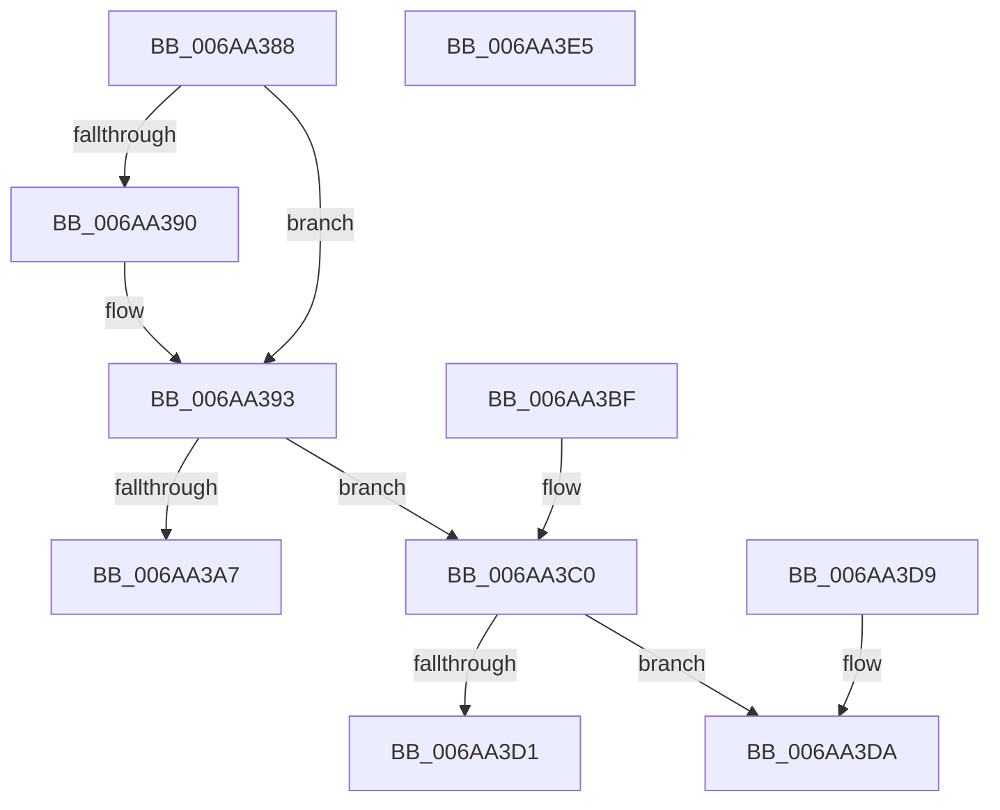

# RtlPopulateHpatEntry

- RVA: `0x006AA388`–`0x006AA3E6` (길이 `94` bytes)
- VA: `0x00000001406AA388`
- 실행 섹션: `.text`
- PDB 이름 있음: `예`; PDB Function 태그: `아니요`
- unwind 정보 RVA: `0x000DB714`
- 디코드: `28`개 명령, `94/94` bytes 표시
- 미해석 바이트: `0` (있으면 어셈블리에 `.byte`로 보존)

> 이 문서는 커널 이미지의 기계어와 PDB 기호를 분석해 생성했습니다. 4번과 5번은 함수 원형과 자료형을 바이너리 사용 방식에서 추정한 C 해석이며 원본 소스 복구 결과는 아닙니다.

## 1. Dependencies

- 직접 호출 지점: **0**; 고유 호출 대상: **0**
- 직접 호출자로 확인된 함수: **1**
- RIP 상대 이미지 참조: **0**

### Outgoing calls
- 직접 디코드된 call 명령이 없습니다.

### Direct callers
- [RtlApplyHotPatch](../../pagelk/B7/RtlApplyHotPatch_function_00B7528C.md) at `0x00B756A5`

### Static image references
- 디코드된 RIP-relative 메모리 참조가 없습니다.

## 2. Other-region calls and transfers

- 다른 실행 섹션으로 향하는 call: **0**
- 별도 외부 분기/꼬리 이동을 확인하지 못했습니다.

## 3. Assembly (complete function range)

```asm
006AA388  4C 8B D1                        mov r10, rcx
006AA38B  4D 85 C0                        test r8, r8
006AA38E  74 03                           je 0x1406aa393
006AA390  4C 89 02                        mov qword ptr [rdx], r8
006AA393  F6 44 24 48 08                  test byte ptr [rsp + 0x48], 8
006AA398  48 B8 CC CC CC CC CC CC CC CC   movabs rax, 0xcccccccccccccccc
006AA3A2  48 89 01                        mov qword ptr [rcx], rax
006AA3A5  74 19                           je 0x1406aa3c0
006AA3A7  8B 44 24 30                     mov eax, dword ptr [rsp + 0x30]
006AA3AB  C6 01 E8                        mov byte ptr [rcx], 0xe8
006AA3AE  83 C0 FB                        add eax, -5
006AA3B1  8B 4C 24 28                     mov ecx, dword ptr [rsp + 0x28]
006AA3B5  41 2B CA                        sub ecx, r10d
006AA3B8  03 C8                           add ecx, eax
006AA3BA  41 89 4A 01                     mov dword ptr [r10 + 1], ecx
006AA3BE  C3                              ret
006AA3BF  CC                              int3
006AA3C0  B8 64 86 00 00                  mov eax, 0x8664
006AA3C5  66 C7 01 FF 25                  mov word ptr [rcx], 0x25ff
006AA3CA  66 39 44 24 40                  cmp word ptr [rsp + 0x40], ax
006AA3CF  75 09                           jne 0x1406aa3da
006AA3D1  C7 41 02 FA 0F 00 00            mov dword ptr [rcx + 2], 0xffa
006AA3D8  C3                              ret
006AA3D9  CC                              int3
006AA3DA  41 8D 81 00 10 00 00            lea eax, [r9 + 0x1000]
006AA3E1  89 41 02                        mov dword ptr [rcx + 2], eax
006AA3E4  C3                              ret
006AA3E5  CC                              int3
```

## 4. C-style interpretation (structured pseudocode)

```c
__int64 __fastcall RtlPopulateHpatEntry(__int64 a1, __int64 a2, __int64 a3, __int64 a4, unsigned int a5, unsigned int a6, __int64 a7, unsigned __int16 a8, unsigned __int8 a9)
{
    __int64 result;

    if (a3 != 0) {
        *(unsigned __int64 *)(a2) = a3;
    }
    *(unsigned __int64 *)(a1) = result;
    if (((a9) & (8)) == 0) goto loc_006AA3C0;
    *(unsigned __int8 *)(a1) = 232;
    result = (unsigned int)(((unsigned int)(a6)) + (-5));
    a1 = (unsigned int)(((unsigned int)(a5)) - ((unsigned int)(a1)));
    a1 = (unsigned int)((a1) + ((unsigned int)(result)));
    *(unsigned int *)(a1 + 1) = (unsigned int)(a1);
    return result;
loc_006AA3C0:
    *(unsigned __int16 *)(a1) = 0x25FFULL;
    if (a8 != ((unsigned __int16)((unsigned int)(0x8664ULL)))) goto loc_006AA3DA;
    *(unsigned int *)(a1 + 2) = 0xFFAULL;
    return (unsigned int)(0x8664ULL);
loc_006AA3DA:
    *(unsigned int *)(a1 + 2) = (unsigned int)(a4 + 4096);
    return a4 + 4096;
}
```

## 5. (Beta) C Style

```c
int64_t RtlPopulateHpatEntry(void *Arg1, void *Arg2, int64_t Arg3, void *Arg4, uint32_t Arg5, uint32_t Arg6, uint64_t Arg7, uint16_t Arg8, uint8_t Arg9)
{
    uint8_t *arg1 = (uint8_t *)Arg1;
    uint8_t *arg2 = (uint8_t *)Arg2;
    uint8_t *arg4 = (uint8_t *)Arg4;

    int64_t result;

    if (Arg3 != 0) {
        *(uint64_t *)(arg2) = Arg3;
    }
    *(uint64_t *)(arg1) = result;
    if (((Arg9) & (8)) == 0) goto loc_006AA3C0;
    *(uint8_t *)(arg1) = 232;
    result = (uint32_t)(((uint32_t)(Arg6)) + (-5));
    Arg1 = (uint32_t)(((uint32_t)(Arg5)) - ((uint32_t)(Arg1)));
    Arg1 = (uint32_t)((Arg1) + ((uint32_t)(result)));
    *(uint32_t *)(arg1 + 0x1) = (uint32_t)(Arg1);
    return result;
loc_006AA3C0:
    *(uint16_t *)(arg1) = 0x25FFULL;
    if (Arg8 != ((uint16_t)((uint32_t)(0x8664ULL)))) goto loc_006AA3DA;
    *(uint32_t *)(arg1 + 0x2) = 0xFFAULL;
    return (uint32_t)(0x8664ULL);
loc_006AA3DA:
    *(uint32_t *)(arg1 + 0x2) = (uint32_t)(Arg4 + 4096);
    return Arg4 + 4096;
}
```

### 관측된 메모리 오프셋

구조체 형식이 확인되지 않은 접근은 인자 기준의 오프셋으로만 기록했습니다.

| 기준 인자 | 오프셋 표현 | 폭 (bit) | 접근 |
|---|---:|---:|---|
| `Arg1` | `+ 0x0` | `8` | `W` |
| `Arg1` | `+ 0x0` | `16` | `W` |
| `Arg1` | `+ 0x0` | `64` | `W` |
| `Arg1` | `+ 0x1` | `32` | `W` |
| `Arg1` | `+ 0x2` | `32` | `W` |
| `Arg2` | `+ 0x0` | `64` | `W` |
| `Arg4` | `+ 0x1000` | `32` | `R` |

## 6. Execution-region graph

[열기: 2D/3D 그래프와 함수 탐색 컨트롤 패널](../../../control-panel.html?section=text&rva=0x006AA388&view=graph)

- 2D 그래프는 위에서 아래로 흐르고, 3D 그래프는 빈 공간을 드래그해 회전합니다. Shift+드래그는 이동, 휠은 확대·축소, 함수 노드 선택은 대상 보고서 이동입니다.

### Static fallback


