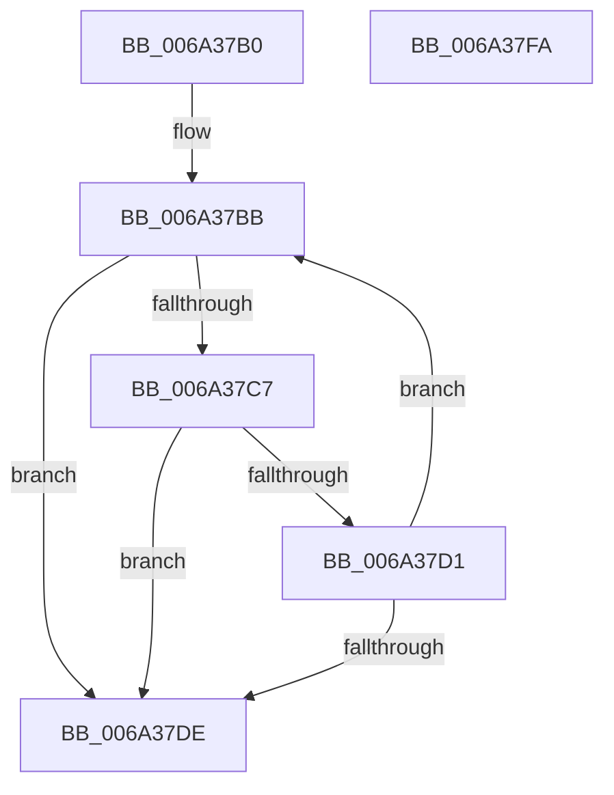

# RtlStringCbCopyW

- RVA: `0x006A37B0`–`0x006A37FB` (길이 `75` bytes)
- VA: `0x00000001406A37B0`
- 실행 섹션: `.text`
- PDB 이름 있음: `예`; PDB Function 태그: `아니요`
- unwind 정보 RVA: `0x000DB714`
- 디코드: `23`개 명령, `75/75` bytes 표시
- 미해석 바이트: `0` (있으면 어셈블리에 `.byte`로 보존)

> 이 문서는 커널 이미지의 기계어와 PDB 기호를 분석해 생성했습니다. 4번과 5번은 함수 원형과 자료형을 바이너리 사용 방식에서 추정한 C 해석이며 원본 소스 복구 결과는 아닙니다.

## 1. Dependencies

- 직접 호출 지점: **0**; 고유 호출 대상: **0**
- 직접 호출자로 확인된 함수: **3**
- RIP 상대 이미지 참조: **0**

### Outgoing calls
- 직접 디코드된 call 명령이 없습니다.

### Direct callers
- [SC_GPT::ReadPartitionTable](SC_GPT_ReadPartitionTable_function_006A34E4.md) at `0x006A3755`
- [SC_GPT::WritePartitionTable](SC_GPT_WritePartitionTable_function_006A3AD4.md) at `0x006A3D34`
- [SC_DISK::SetPartition](SC_DISK_SetPartition_function_006A4BDC.md) at `0x006A4CB2`

### Static image references
- 디코드된 RIP-relative 메모리 참조가 없습니다.

## 2. Other-region calls and transfers

- 다른 실행 섹션으로 향하는 call: **0**
- 별도 외부 분기/꼬리 이동을 확인하지 못했습니다.

## 3. Assembly (complete function range)

```asm
006A37B0  4C 2B C1                        sub r8, rcx
006A37B3  BA 24 00 00 00                  mov edx, 0x24
006A37B8  45 33 C9                        xor r9d, r9d
006A37BB  48 8D 82 DA FF FF 7F            lea rax, [rdx + 0x7fffffda]
006A37C2  48 85 C0                        test rax, rax
006A37C5  74 17                           je 0x1406a37de
006A37C7  41 0F B7 04 08                  movzx eax, word ptr [r8 + rcx]
006A37CC  66 85 C0                        test ax, ax
006A37CF  74 0D                           je 0x1406a37de
006A37D1  66 89 01                        mov word ptr [rcx], ax
006A37D4  48 83 C1 02                     add rcx, 2
006A37D8  48 83 EA 01                     sub rdx, 1
006A37DC  75 DD                           jne 0x1406a37bb
006A37DE  48 85 D2                        test rdx, rdx
006A37E1  48 8D 41 FE                     lea rax, [rcx - 2]
006A37E5  48 0F 45 C1                     cmovne rax, rcx
006A37E9  48 F7 DA                        neg rdx
006A37EC  66 44 89 08                     mov word ptr [rax], r9w
006A37F0  1B C0                           sbb eax, eax
006A37F2  F7 D0                           not eax
006A37F4  25 05 00 00 80                  and eax, 0x80000005
006A37F9  C3                              ret
006A37FA  CC                              int3
```

## 4. C-style interpretation (structured pseudocode)

```c
__int64 __fastcall RtlStringCbCopyW(__int64 a1, __int64 a2, __int64 a3, int a4)
{
    __int64 result;

    a3 = (a3) - (a1);
    a4 = 0;
loc_006A37BB:
    if (36 + 2147483610 == 0) goto loc_006A37DE;
    if ((unsigned __int16)(*(unsigned __int16 *)(a3 + a1 * 1)) == 0) goto loc_006A37DE;
    *(unsigned __int16 *)(a1) = (unsigned __int16)(*(unsigned __int16 *)(a3 + a1 * 1));
    a1 = (a1) + (2);
    a2 = (36) - (1);
    if (condition_is_not_equal) goto loc_006A37BB;
loc_006A37DE:
    result = a1 - 2;
    if (a2 != 0) { result = a1; }
    a2 = -(a2);
    *(unsigned __int16 *)(result) = 0;
    result = (unsigned int)(~(result));
    result = (unsigned int)((result) & (0x80000005ULL));
    return result;
}
```

## 5. (Beta) C Style

```c
int64_t RtlStringCbCopyW(void *Arg1, int64_t Arg2, void *Arg3, int32_t Arg4)
{
    uint8_t *arg1 = (uint8_t *)Arg1;
    uint8_t *arg3 = (uint8_t *)Arg3;

    int64_t result;

    Arg3 = (Arg3) - (Arg1);
    Arg4 = 0;
loc_006A37BB:
    if (36 + 2147483610 == 0) goto loc_006A37DE;
    if ((uint16_t)(*(uint16_t *)(arg3 + arg1 * 1)) == 0) goto loc_006A37DE;
    *(uint16_t *)(arg1) = (uint16_t)(*(uint16_t *)(arg3 + arg1 * 1));
    Arg1 = (Arg1) + (2);
    Arg2 = (36) - (1);
    if (condition_is_not_equal) goto loc_006A37BB;
loc_006A37DE:
    result = Arg1 - 2;
    if (Arg2 != 0) { result = Arg1; }
    Arg2 = -(Arg2);
    *(uint16_t *)(result) = 0;
    result = (uint32_t)(~(result));
    result = (uint32_t)((result) & (0x80000005ULL));
    return result;
}
```

### 관측된 메모리 오프셋

구조체 형식이 확인되지 않은 접근은 인자 기준의 오프셋으로만 기록했습니다.

| 기준 인자 | 오프셋 표현 | 폭 (bit) | 접근 |
|---|---:|---:|---|
| `Arg1` | `- 0x2` | `64` | `R` |
| `Arg1` | `+ 0x0` | `16` | `W` |
| `Arg3` | `+ 0x0 + rcx*1` | `16` | `R` |

## 6. Execution-region graph

[열기: 2D/3D 그래프와 함수 탐색 컨트롤 패널](../../../control-panel.html?section=text&rva=0x006A37B0&view=graph)

- 2D 그래프는 위에서 아래로 흐르고, 3D 그래프는 빈 공간을 드래그해 회전합니다. Shift+드래그는 이동, 휠은 확대·축소, 함수 노드 선택은 대상 보고서 이동입니다.

### Static fallback


