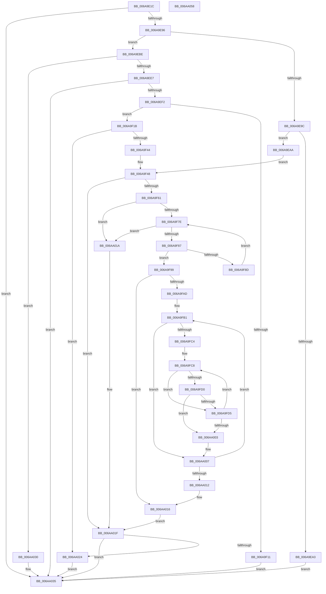

# RtlUpdateImportRelocationsInImage

- RVA: `0x006A9E1C`–`0x006AA059` (길이 `573` bytes)
- VA: `0x00000001406A9E1C`
- 실행 섹션: `.text`
- PDB 이름 있음: `예`; PDB Function 태그: `아니요`
- unwind 정보 RVA: `0x000DB600`
- 디코드: `164`개 명령, `573/573` bytes 표시
- 미해석 바이트: `0` (있으면 어셈블리에 `.byte`로 보존)

> 이 문서는 커널 이미지의 기계어와 PDB 기호를 분석해 생성했습니다. 4번과 5번은 함수 원형과 자료형을 바이너리 사용 방식에서 추정한 C 해석이며 원본 소스 복구 결과는 아닙니다.

## 1. Dependencies

- 직접 호출 지점: **7**; 고유 호출 대상: **6**
- 직접 호출자로 확인된 함수: **2**
- RIP 상대 이미지 참조: **0**

### Outgoing calls
- `0x006A9E87` → [RtlpCaptureRetpolineBinaryInfoForImage](RtlpCaptureRetpolineBinaryInfoForImage_function_006AA060.md) (function, `0x006AA060`)
- `0x006A9ED8` → [RtlCaptureRetpolineImportRvas](../43/RtlCaptureRetpolineImportRvas_function_004317B4.md) (function, `0x004317B4`)
- `0x006A9F00` → [ExAllocatePool2](../../poolcode/B8/ExAllocatePool2_function_00B820F0.md) (function, `0x00B820F0`)
- `0x006A9F35` → [RtlCaptureRetpolineImportRvas](../43/RtlCaptureRetpolineImportRvas_function_004317B4.md) (function, `0x004317B4`)
- `0x006A9F52` → [RtlpCaptureDynamicRelocationTableRva](../5E/RtlpCaptureDynamicRelocationTableRva_function_005EC760.md) (function, `0x005EC760`)
- `0x006A9FF5` → [RtlApplyImportRelocationToImage](RtlApplyImportRelocationToImage_function_006A98F8.md) (function, `0x006A98F8`)
- `0x006AA029` → [ExFreePoolWithTag](../../poolcode/B8/ExFreePoolWithTag_function_00B82870.md) (function, `0x00B82870`)

### Direct callers
- [MiApplyDynamicFixupsToKernelAndHal](../../init/C6/MiApplyDynamicFixupsToKernelAndHal_function_00C65EBC.md) at `0x00C660B0`
- [MiApplyImportOptimizationToBootDriver](../../init/C6/MiApplyImportOptimizationToBootDriver_function_00C66108.md) at `0x00C661F0`

### Static image references
- 디코드된 RIP-relative 메모리 참조가 없습니다.

## 2. Other-region calls and transfers

- 다른 실행 섹션으로 향하는 call: **2**
  - `0x006A9F00` → [ExAllocatePool2](../../poolcode/B8/ExAllocatePool2_function_00B820F0.md) (`.text` → `POOLCODE`)
  - `0x006AA029` → [ExFreePoolWithTag](../../poolcode/B8/ExFreePoolWithTag_function_00B82870.md) (`.text` → `POOLCODE`)
- 별도 외부 분기/꼬리 이동을 확인하지 못했습니다.

## 3. Assembly (complete function range)

```asm
006A9E1C  48 8B C4                        mov rax, rsp
006A9E1F  48 89 58 08                     mov qword ptr [rax + 8], rbx
006A9E23  48 89 70 10                     mov qword ptr [rax + 0x10], rsi
006A9E27  48 89 78 20                     mov qword ptr [rax + 0x20], rdi
006A9E2B  44 89 40 18                     mov dword ptr [rax + 0x18], r8d
006A9E2F  55                              push rbp
006A9E30  41 54                           push r12
006A9E32  41 55                           push r13
006A9E34  41 56                           push r14
006A9E36  41 57                           push r15
006A9E38  48 8D 68 C1                     lea rbp, [rax - 0x3f]
006A9E3C  48 81 EC 90 00 00 00            sub rsp, 0x90
006A9E43  83 65 CF 00                     and dword ptr [rbp - 0x31], 0
006A9E47  33 C0                           xor eax, eax
006A9E49  0F 57 C0                        xorps xmm0, xmm0
006A9E4C  48 89 45 0F                     mov qword ptr [rbp + 0xf], rax
006A9E50  48 8D 45 DF                     lea rax, [rbp - 0x21]
006A9E54  45 8B E8                        mov r13d, r8d
006A9E57  48 89 44 24 28                  mov qword ptr [rsp + 0x28], rax
006A9E5C  4D 8B F1                        mov r14, r9
006A9E5F  48 8B 45 6F                     mov rax, qword ptr [rbp + 0x6f]
006A9E63  33 FF                           xor edi, edi
006A9E65  4C 8B 4D 67                     mov r9, qword ptr [rbp + 0x67]
006A9E69  48 8B F2                        mov rsi, rdx
006A9E6C  21 7D C7                        and dword ptr [rbp - 0x39], edi
006A9E6F  4C 8B F9                        mov r15, rcx
006A9E72  48 89 44 24 20                  mov qword ptr [rsp + 0x20], rax
006A9E77  48 89 7D D7                     mov qword ptr [rbp - 0x29], rdi
006A9E7B  0F 11 45 DF                     movups xmmword ptr [rbp - 0x21], xmm0
006A9E7F  0F 11 45 EF                     movups xmmword ptr [rbp - 0x11], xmm0
006A9E83  0F 11 45 FF                     movups xmmword ptr [rbp - 1], xmm0
006A9E87  E8 D4 01 00 00                  call 0x1406aa060
006A9E8C  8B D8                           mov ebx, eax
006A9E8E  85 C0                           test eax, eax
006A9E90  0F 88 9F 01 00 00               js 0x1406aa035
006A9E96  40 38 7D 77                     cmp byte ptr [rbp + 0x77], dil
006A9E9A  74 22                           je 0x1406a9ebe
006A9E9C  8B 45 E3                        mov eax, dword ptr [rbp - 0x1d]
006A9E9F  85 C0                           test eax, eax
006A9EA1  75 07                           jne 0x1406a9eaa
006A9EA3  33 DB                           xor ebx, ebx
006A9EA5  E9 8B 01 00 00                  jmp 0x1406aa035
006A9EAA  49 03 C7                        add rax, r15
006A9EAD  48 89 75 FF                     mov qword ptr [rbp - 1], rsi
006A9EB1  48 89 45 F7                     mov qword ptr [rbp - 9], rax
006A9EB5  4C 89 75 07                     mov qword ptr [rbp + 7], r14
006A9EB9  E9 8A 00 00 00                  jmp 0x1406a9f48
006A9EBE  48 8D 45 C7                     lea rax, [rbp - 0x39]
006A9EC2  4D 8B CE                        mov r9, r14
006A9EC5  48 89 44 24 28                  mov qword ptr [rsp + 0x28], rax
006A9ECA  4D 8B C5                        mov r8, r13
006A9ECD  48 21 7C 24 20                  and qword ptr [rsp + 0x20], rdi
006A9ED2  48 8B D6                        mov rdx, rsi
006A9ED5  49 8B CF                        mov rcx, r15
006A9ED8  E8 D7 78 D8 FF                  call 0x1404317b4
006A9EDD  8B D8                           mov ebx, eax
006A9EDF  85 C0                           test eax, eax
006A9EE1  0F 89 49 01 00 00               jns 0x1406aa030
006A9EE7  3D 23 00 00 C0                  cmp eax, 0xc0000023
006A9EEC  0F 85 43 01 00 00               jne 0x1406aa035
006A9EF2  8B 55 C7                        mov edx, dword ptr [rbp - 0x39]
006A9EF5  B9 00 01 00 00                  mov ecx, 0x100
006A9EFA  41 B8 52 70 6C 49               mov r8d, 0x496c7052
006A9F00  E8 EB 81 4D 00                  call 0x140b820f0
006A9F05  48 89 45 D7                     mov qword ptr [rbp - 0x29], rax
006A9F09  48 8B F8                        mov rdi, rax
006A9F0C  48 85 C0                        test rax, rax
006A9F0F  75 0A                           jne 0x1406a9f1b
006A9F11  BB 17 00 00 C0                  mov ebx, 0xc0000017
006A9F16  E9 1A 01 00 00                  jmp 0x1406aa035
006A9F1B  48 8D 45 C7                     lea rax, [rbp - 0x39]
006A9F1F  4D 8B CE                        mov r9, r14
006A9F22  48 89 44 24 28                  mov qword ptr [rsp + 0x28], rax
006A9F27  4D 8B C5                        mov r8, r13
006A9F2A  48 8B D6                        mov rdx, rsi
006A9F2D  48 89 7C 24 20                  mov qword ptr [rsp + 0x20], rdi
006A9F32  49 8B CF                        mov rcx, r15
006A9F35  E8 7A 78 D8 FF                  call 0x1404317b4
006A9F3A  8B D8                           mov ebx, eax
006A9F3C  85 C0                           test eax, eax
006A9F3E  0F 88 E0 00 00 00               js 0x1406aa024
006A9F44  48 89 7D EF                     mov qword ptr [rbp - 0x11], rdi
006A9F48  4C 8D 45 CF                     lea r8, [rbp - 0x31]
006A9F4C  41 8B D5                        mov edx, r13d
006A9F4F  49 8B CF                        mov rcx, r15
006A9F52  E8 09 28 F4 FF                  call 0x1405ec760
006A9F57  8B D8                           mov ebx, eax
006A9F59  85 C0                           test eax, eax
006A9F5B  0F 88 BE 00 00 00               js 0x1406aa01f
006A9F61  8B 45 CF                        mov eax, dword ptr [rbp - 0x31]
006A9F64  42 8B 54 38 04                  mov edx, dword ptr [rax + r15 + 4]
006A9F69  48 8D 48 08                     lea rcx, [rax + 8]
006A9F6D  49 03 CF                        add rcx, r15
006A9F70  48 03 D1                        add rdx, rcx
006A9F73  42 83 3C 38 01                  cmp dword ptr [rax + r15], 1
006A9F78  0F 85 9C 00 00 00               jne 0x1406aa01a
006A9F7E  48 3B CA                        cmp rcx, rdx
006A9F81  0F 83 93 00 00 00               jae 0x1406aa01a
006A9F87  48 83 39 03                     cmp qword ptr [rcx], 3
006A9F8B  74 0C                           je 0x1406a9f99
006A9F8D  8B 41 08                        mov eax, dword ptr [rcx + 8]
006A9F90  48 83 C1 0C                     add rcx, 0xc
006A9F94  48 03 C8                        add rcx, rax
006A9F97  EB E5                           jmp 0x1406a9f7e
006A9F99  44 8B 71 08                     mov r14d, dword ptr [rcx + 8]
006A9F9D  48 8D 59 0C                     lea rbx, [rcx + 0xc]
006A9FA1  4C 03 F3                        add r14, rbx
006A9FA4  4C 89 75 CF                     mov qword ptr [rbp - 0x31], r14
006A9FA8  49 3B DE                        cmp rbx, r14
006A9FAB  73 69                           jae 0x1406aa016
006A9FAD  48 8B 7D 6F                     mov rdi, qword ptr [rbp + 0x6f]
006A9FB1  44 8B 63 04                     mov r12d, dword ptr [rbx + 4]
006A9FB5  4C 8D 6B 08                     lea r13, [rbx + 8]
006A9FB9  4C 03 E3                        add r12, rbx
006A9FBC  49 8B F5                        mov rsi, r13
006A9FBF  4D 3B EC                        cmp r13, r12
006A9FC2  73 43                           jae 0x1406aa007
006A9FC4  44 8B 75 57                     mov r14d, dword ptr [rbp + 0x57]
006A9FC8  F7 06 FF 0F 00 00               test dword ptr [rsi], 0xfff
006A9FCE  75 05                           jne 0x1406a9fd5
006A9FD0  49 3B F5                        cmp rsi, r13
006A9FD3  75 2E                           jne 0x1406aa003
006A9FD5  0F B6 45 7F                     movzx eax, byte ptr [rbp + 0x7f]
006A9FD9  4C 8D 45 DF                     lea r8, [rbp - 0x21]
006A9FDD  89 44 24 38                     mov dword ptr [rsp + 0x38], eax
006A9FE1  4C 8B CF                        mov r9, rdi
006A9FE4  8B 03                           mov eax, dword ptr [rbx]
006A9FE6  41 8B D6                        mov edx, r14d
006A9FE9  48 89 74 24 28                  mov qword ptr [rsp + 0x28], rsi
006A9FEE  49 8B CF                        mov rcx, r15
006A9FF1  89 44 24 20                     mov dword ptr [rsp + 0x20], eax
006A9FF5  E8 FE F8 FF FF                  call 0x1406a98f8
006A9FFA  48 83 C6 04                     add rsi, 4
006A9FFE  49 3B F4                        cmp rsi, r12
006AA001  72 C5                           jb 0x1406a9fc8
006AA003  4C 8B 75 CF                     mov r14, qword ptr [rbp - 0x31]
006AA007  8B 43 04                        mov eax, dword ptr [rbx + 4]
006AA00A  48 03 D8                        add rbx, rax
006AA00D  49 3B DE                        cmp rbx, r14
006AA010  72 9F                           jb 0x1406a9fb1
006AA012  48 8B 7D D7                     mov rdi, qword ptr [rbp - 0x29]
006AA016  33 DB                           xor ebx, ebx
006AA018  EB 05                           jmp 0x1406aa01f
006AA01A  BB BB 00 00 C0                  mov ebx, 0xc00000bb
006AA01F  48 85 FF                        test rdi, rdi
006AA022  74 11                           je 0x1406aa035
006AA024  33 D2                           xor edx, edx
006AA026  48 8B CF                        mov rcx, rdi
006AA029  E8 42 88 4D 00                  call 0x140b82870
006AA02E  EB 05                           jmp 0x1406aa035
006AA030  BB BB 00 00 C0                  mov ebx, 0xc00000bb
006AA035  4C 8D 9C 24 90 00 00 00         lea r11, [rsp + 0x90]
006AA03D  8B C3                           mov eax, ebx
006AA03F  49 8B 5B 30                     mov rbx, qword ptr [r11 + 0x30]
006AA043  49 8B 73 38                     mov rsi, qword ptr [r11 + 0x38]
006AA047  49 8B 7B 48                     mov rdi, qword ptr [r11 + 0x48]
006AA04B  49 8B E3                        mov rsp, r11
006AA04E  41 5F                           pop r15
006AA050  41 5E                           pop r14
006AA052  41 5D                           pop r13
006AA054  41 5C                           pop r12
006AA056  5D                              pop rbp
006AA057  C3                              ret
006AA058  CC                              int3
```

## 4. C-style interpretation (structured pseudocode)

```c
__int64 __fastcall RtlUpdateImportRelocationsInImage(__int64 a1, __int64 a2, int a3, __int64 a4)
{
    __int64 result;
    __int64 v_r12;
    __int64 v_r14;
    __int64 v_rbx;
    __int64 v_rdi;
    __int64 v_rsi;
    __int64 v_rsp;
    unsigned __int64 v_stack_m28;
    unsigned int v_stack_m80;
    unsigned __int64 v_stack_m90;
    unsigned __int64 v_stack_m98;

    *(unsigned __int64 *)(v_rsp + 8) = v_rbx;
    *(unsigned __int64 *)(v_rsp + 16) = v_rsi;
    *(unsigned __int64 *)(v_rsp + 32) = v_rdi;
    *(unsigned int *)(v_rsp + 24) = a3;
    v_rsp = (v_rsp) - (144);
    result = 0;
    *(unsigned __int64 *)(v_rsp - 63 + 15) = 0;
    v_stack_m90 = v_rsp - 63 - 33;
    v_rdi = 0;
    v_stack_m98 = *(unsigned __int64 *)(v_rsp - 63 + 111);
    *(unsigned __int64 *)(v_rsp - 63 - 41) = 0;
    *(unsigned __int64 *)(v_rsp - 63 - 33) = v_xmm0;
    *(unsigned __int64 *)(v_rsp - 63 - 17) = v_xmm0;
    *(unsigned __int64 *)(v_rsp - 63 - 1) = v_xmm0;
    result = RtlpCaptureRetpolineBinaryInfoForImage(a1, a2, a3, *(unsigned __int64 *)(v_rsp - 63 + 103));
    if (sign_flag) goto loc_006AA035;
    if ((*(unsigned __int8 *)(v_rsp - 63 + 119)) == 0) goto loc_006A9EBE;
    if ((unsigned int)((unsigned int)(*(unsigned int *)(v_rsp - 63 - 29))) != 0) goto loc_006A9EAA;
    v_rbx = 0;
    goto loc_006AA035;
loc_006A9EAA:
    result = ((unsigned int)(*(unsigned int *)(v_rsp - 63 - 29))) + (a1);
    *(unsigned __int64 *)(v_rsp - 63 - 1) = a2;
    *(unsigned __int64 *)(v_rsp - 63 - 9) = result;
    *(unsigned __int64 *)(v_rsp - 63 + 7) = a4;
    goto loc_006A9F48;
loc_006A9EBE:
    v_stack_m90 = v_rsp - 63 - 57;
    result = RtlCaptureRetpolineImportRvas(a1, a2, (unsigned int)(a3), a4);
    if (!sign_flag) goto loc_006AA030;
    if (((unsigned int)(result)) != 0xC0000023ULL) goto loc_006AA035;
    result = ExAllocatePool2(256, (unsigned int)(*(unsigned int *)(v_rsp - 63 - 57)), (unsigned int)(0x496C7052ULL), a4);
    *(unsigned __int64 *)(v_rsp - 63 - 41) = result;
    if (result != 0) goto loc_006A9F1B;
    goto loc_006AA035;
loc_006A9F1B:
    v_stack_m90 = v_rsp - 63 - 57;
    v_stack_m98 = result;
    result = RtlCaptureRetpolineImportRvas(a1, a2, (unsigned int)(a3), a4);
    if (sign_flag) goto loc_006AA024;
    *(unsigned __int64 *)(v_rsp - 63 - 17) = result;
loc_006A9F48:
    result = RtlpCaptureDynamicRelocationTableRva(a1, (unsigned int)((unsigned int)((unsigned int)(a3))), v_rsp - 63 - 49, a4);
    if (sign_flag) goto loc_006AA01F;
    a1 = ((unsigned int)(*(unsigned int *)(v_rsp - 63 - 49)) + 8) + (a1);
    a2 = ((unsigned int)(*(unsigned int *)((unsigned int)(*(unsigned int *)(v_rsp - 63 - 49)) + a1 * 1 + 4))) + (a1);
    if ((*(unsigned int *)((unsigned int)(*(unsigned int *)(v_rsp - 63 - 49)) + a1 * 1)) != 1) goto loc_006AA01A;
loc_006A9F7E:
    if (a1 >= a2) goto loc_006AA01A;
    if ((*(unsigned __int64 *)(a1)) == 3) goto loc_006A9F99;
    a1 = (a1) + (12);
    a1 = (a1) + ((unsigned int)(*(unsigned int *)(a1 + 8)));
    goto loc_006A9F7E;
loc_006A9F99:
    v_r14 = ((unsigned int)(*(unsigned int *)(a1 + 8))) + (a1 + 12);
    *(unsigned __int64 *)(v_rsp - 63 - 49) = v_r14;
    if ((a1 + 12) >= v_r14) goto loc_006AA016;
loc_006A9FB1:
    v_r12 = ((unsigned int)(*(unsigned int *)(a1 + 12 + 4))) + (a1 + 12);
    if ((a1 + 12 + 8) >= v_r12) goto loc_006AA007;
loc_006A9FC8:
    if (((*(unsigned int *)(a1 + 12 + 8)) & (0xFFFULL)) != 0) goto loc_006A9FD5;
    if ((a1 + 12 + 8) != (a1 + 12 + 8)) goto loc_006AA003;
loc_006A9FD5:
    v_stack_m80 = (unsigned int)(*(unsigned __int8 *)(v_rsp - 63 + 127));
    v_stack_m90 = a1 + 12 + 8;
    v_stack_m98 = (unsigned int)((unsigned int)(*(unsigned int *)(a1 + 12)));
    result = RtlApplyImportRelocationToImage(a1, (unsigned int)((unsigned int)((unsigned int)(*(unsigned int *)(v_rsp - 63 + 87)))), v_rsp - 63 - 33, *(unsigned __int64 *)(v_rsp - 63 + 111));
    v_rsi = (a1 + 12 + 8) + (4);
    if (v_rsi < v_r12) goto loc_006A9FC8;
loc_006AA003:
loc_006AA007:
    v_rbx = (a1 + 12) + ((unsigned int)(*(unsigned int *)(a1 + 12 + 4)));
    if (v_rbx < (*(unsigned __int64 *)(v_rsp - 63 - 49))) goto loc_006A9FB1;
loc_006AA016:
    v_rbx = 0;
    goto loc_006AA01F;
loc_006AA01A:
loc_006AA01F:
    if (*(unsigned __int64 *)(v_rsp - 63 - 41) == 0) goto loc_006AA035;
loc_006AA024:
    a2 = 0;
    result = ExFreePoolWithTag(*(unsigned __int64 *)(v_rsp - 63 - 41), a2, v_rsp - 63 - 33, *(unsigned __int64 *)(v_rsp - 63 + 111));
    goto loc_006AA035;
loc_006AA030:
loc_006AA035:
    return (unsigned int)((unsigned int)((unsigned int)(0xC00000BBULL)));
}
```

## 5. (Beta) C Style

```c
int64_t RtlUpdateImportRelocationsInImage(int64_t Arg1, int64_t Arg2, int32_t Arg3, int64_t Arg4)
{
    int64_t result;
    int64_t local_r12;
    int64_t local_r14;
    int64_t local_rbx;
    int64_t local_rdi;
    int64_t local_rsi;
    int64_t local_rsp;
    uint64_t v_stack_m28;
    uint32_t v_stack_m80;
    uint64_t v_stack_m90;
    uint64_t v_stack_m98;

    *(uint64_t *)(local_rsp + 0x8) = local_rbx;
    *(uint64_t *)(local_rsp + 0x10) = local_rsi;
    *(uint64_t *)(local_rsp + 0x20) = local_rdi;
    *(uint32_t *)(local_rsp + 0x18) = Arg3;
    local_rsp = (local_rsp) - (144);
    result = 0;
    *(uint64_t *)(local_rsp - 0x3F + 0xF) = 0;
    v_stack_m90 = local_rsp - 63 - 33;
    local_rdi = 0;
    v_stack_m98 = *(uint64_t *)(local_rsp - 0x3F + 0x6F);
    *(uint64_t *)(local_rsp - 0x3F - 0x29) = 0;
    *(uint64_t *)(local_rsp - 0x3F - 0x21) = v_xmm0;
    *(uint64_t *)(local_rsp - 0x3F - 0x11) = v_xmm0;
    *(uint64_t *)(local_rsp - 0x3F - 0x1) = v_xmm0;
    result = RtlpCaptureRetpolineBinaryInfoForImage(Arg1, Arg2, Arg3, *(uint64_t *)(local_rsp - 0x3F + 0x67));
    if (sign_flag) goto loc_006AA035;
    if ((*(uint8_t *)(local_rsp - 0x3F + 0x77)) == 0) goto loc_006A9EBE;
    if ((uint32_t)((uint32_t)(*(uint32_t *)(local_rsp - 0x3F - 0x1D))) != 0) goto loc_006A9EAA;
    local_rbx = 0;
    goto loc_006AA035;
loc_006A9EAA:
    result = ((uint32_t)(*(uint32_t *)(local_rsp - 0x3F - 0x1D))) + (Arg1);
    *(uint64_t *)(local_rsp - 0x3F - 0x1) = Arg2;
    *(uint64_t *)(local_rsp - 0x3F - 0x9) = result;
    *(uint64_t *)(local_rsp - 0x3F + 0x7) = Arg4;
    goto loc_006A9F48;
loc_006A9EBE:
    v_stack_m90 = local_rsp - 63 - 57;
    result = RtlCaptureRetpolineImportRvas(Arg1, Arg2, (uint32_t)(Arg3), Arg4);
    if (!sign_flag) goto loc_006AA030;
    if (((uint32_t)(result)) != 0xC0000023ULL) goto loc_006AA035;
    result = ExAllocatePool2(256, (uint32_t)(*(uint32_t *)(local_rsp - 0x3F - 0x39)), (uint32_t)(0x496C7052ULL), Arg4);
    *(uint64_t *)(local_rsp - 0x3F - 0x29) = result;
    if (result != 0) goto loc_006A9F1B;
    goto loc_006AA035;
loc_006A9F1B:
    v_stack_m90 = local_rsp - 63 - 57;
    v_stack_m98 = result;
    result = RtlCaptureRetpolineImportRvas(Arg1, Arg2, (uint32_t)(Arg3), Arg4);
    if (sign_flag) goto loc_006AA024;
    *(uint64_t *)(local_rsp - 0x3F - 0x11) = result;
loc_006A9F48:
    result = RtlpCaptureDynamicRelocationTableRva(Arg1, (uint32_t)((uint32_t)((uint32_t)(Arg3))), local_rsp - 63 - 49, Arg4);
    if (sign_flag) goto loc_006AA01F;
    Arg1 = ((uint32_t)(*(uint32_t *)(local_rsp - 0x3F - 0x31)) + 8) + (Arg1);
    Arg2 = ((uint32_t)(*(uint32_t *)((uint32_t)(*(uint32_t *)(local_rsp - 0x3F - 0x31)) + Arg1 * 1 + 0x4))) + (Arg1);
    if ((*(uint32_t *)((uint32_t)(*(uint32_t *)(local_rsp - 0x3F - 0x31)) + Arg1 * 1)) != 1) goto loc_006AA01A;
loc_006A9F7E:
    if (Arg1 >= Arg2) goto loc_006AA01A;
    if ((*(uint64_t *)(Arg1)) == 3) goto loc_006A9F99;
    Arg1 = (Arg1) + (12);
    Arg1 = (Arg1) + ((uint32_t)(*(uint32_t *)(Arg1 + 0x8)));
    goto loc_006A9F7E;
loc_006A9F99:
    local_r14 = ((uint32_t)(*(uint32_t *)(Arg1 + 0x8))) + (Arg1 + 12);
    *(uint64_t *)(local_rsp - 0x3F - 0x31) = local_r14;
    if ((Arg1 + 12) >= local_r14) goto loc_006AA016;
loc_006A9FB1:
    local_r12 = ((uint32_t)(*(uint32_t *)(Arg1 + 0xC + 0x4))) + (Arg1 + 12);
    if ((Arg1 + 12 + 8) >= local_r12) goto loc_006AA007;
loc_006A9FC8:
    if (((*(uint32_t *)(Arg1 + 0xC + 0x8)) & (0xFFFULL)) != 0) goto loc_006A9FD5;
    if ((Arg1 + 12 + 8) != (Arg1 + 12 + 8)) goto loc_006AA003;
loc_006A9FD5:
    v_stack_m80 = (uint32_t)(*(uint8_t *)(local_rsp - 0x3F + 0x7F));
    v_stack_m90 = Arg1 + 12 + 8;
    v_stack_m98 = (uint32_t)((uint32_t)(*(uint32_t *)(Arg1 + 0xC)));
    result = RtlApplyImportRelocationToImage(Arg1, (uint32_t)((uint32_t)((uint32_t)(*(uint32_t *)(local_rsp - 0x3F + 0x57)))), local_rsp - 63 - 33, *(uint64_t *)(local_rsp - 0x3F + 0x6F));
    local_rsi = (Arg1 + 12 + 8) + (4);
    if (local_rsi < local_r12) goto loc_006A9FC8;
loc_006AA003:
loc_006AA007:
    local_rbx = (Arg1 + 12) + ((uint32_t)(*(uint32_t *)(Arg1 + 0xC + 0x4)));
    if (local_rbx < (*(uint64_t *)(local_rsp - 0x3F - 0x31))) goto loc_006A9FB1;
loc_006AA016:
    local_rbx = 0;
    goto loc_006AA01F;
loc_006AA01A:
loc_006AA01F:
    if (*(uint64_t *)(local_rsp - 0x3F - 0x29) == 0) goto loc_006AA035;
loc_006AA024:
    Arg2 = 0;
    result = ExFreePoolWithTag(*(uint64_t *)(local_rsp - 0x3F - 0x29), Arg2, local_rsp - 63 - 33, *(uint64_t *)(local_rsp - 0x3F + 0x6F));
    goto loc_006AA035;
loc_006AA030:
loc_006AA035:
    return (uint32_t)((uint32_t)((uint32_t)(0xC00000BBULL)));
}
```

## 6. Execution-region graph

[열기: 2D/3D 그래프와 함수 탐색 컨트롤 패널](../../../control-panel.html?section=text&rva=0x006A9E1C&view=graph)

- 2D 그래프는 위에서 아래로 흐르고, 3D 그래프는 빈 공간을 드래그해 회전합니다. Shift+드래그는 이동, 휠은 확대·축소, 함수 노드 선택은 대상 보고서 이동입니다.

### Static fallback


